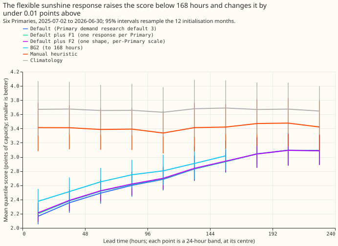
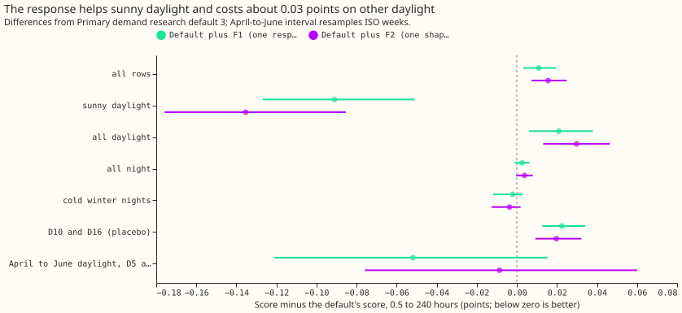
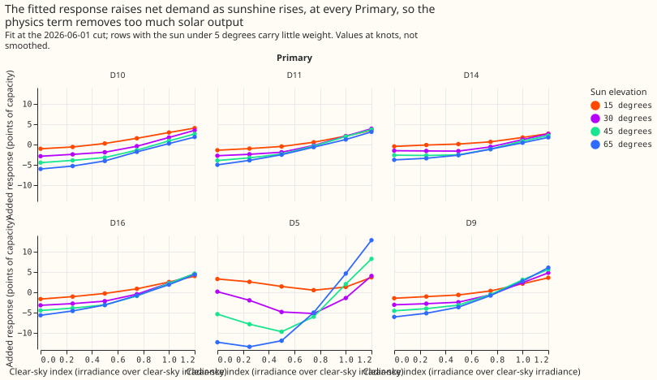

## Take-home message

**A smooth sunshine curve added to the demand model's solar term does not close the gap to the XGBoost model on April-to-June daylight half-hours, and it makes the pooled score slightly worse.** Primary demand research default 3 is our research demand forecast for six Primary substations (the substations that feed local areas from the transmission network, anonymised as D5, D9, D10, D11, D14, and D16), up to 10 days ahead. Experiment [322](../00322-primary-demand-default-2-daylight-only-heuristic-blend-and-sunshine-graft-replication/result.md) took the sunshine response of an XGBoost model with one-level trees, which scored better than the default on the worst April-to-June daylight half-hours at D5 and D9, added it to the default, and recovered half of that difference. We asked whether a smooth correction in clear-sky index (measured irradiance over clear-sky irradiance) and sun elevation does the same. The correction is fitted in the least-squares fit that gives each of the 51 weather-forecast ensemble members its solar term. F1 gives each Primary its own correction. F2 gives all six Primaries one shape and a scale per Primary. Neither reaches its pre-registered target. Lower scores are better. F1 improves the score at D5 and D9 in April to June by 0.044 points of effective capacity at 0.5 to 168 hours (99.5% interval -0.152 to +0.077, which includes zero), against a pre-registered improvement of 0.30. Over the whole year F1 worsens the pooled score by 0.011 points.

**Verdict: not supported.** The scored lead times are 0.5 to 240 hours, with BG2 (the best-guess forecast stack) as a reference to 168 hours. Before scoring, the rebuilt default had to match experiment 322's default, and it does: 2.7265 points at 0.5 to 240 hours against 2.727, with a largest difference of 1.5e-5 in any quantile.

## Figures

## Results

- **Sign convention.** Every contrast is the variant's score minus the default's score, so a negative number is an improvement.
- **Arms.** Default: Primary demand research default 3 (experiment 322's D1). F1: 30 spline columns
  per Primary (6 clear-sky-index knots by 5 sun-elevation knots), added to the T-all fit of
  experiment 184, free in sign, with a second-difference penalty (100) and a ridge (10) fixed before
  any score was read. The T-all fit is experiment 184's least-squares model of net demand with separate heating and lighting terms by day type, and the D5 export clip is not part of it. F2: one shape (the same 30 columns) with a non-negative scale per Primary,
  fitted by 6 alternating rounds. F3 (the monotone network) was not run, because F1 fell far under
  its pre-registered 0.15 floor at D5 and D9.
- **How the response enters.** Each member's response is the response-bearing fit's forecast with the
  member's weather minus its forecast at the ensemble-mean weather. The difference between the
  response-bearing and the stored T-all fit at the ensemble-mean weather is added to the chain's mean
  and quantiles. Experiment 202's rolling replay (0.5 to 168 hours, with experiment 220's median
  correction added afterwards) and experiments 319, 320, and 322 (168 to 240 hours, daylight blend)
  were then rerun with every factor refitted on completed history. The chain's own Kalman-filtered
  mean is not refitted, so the response is not fitted in exactly the same least-squares fit as the
  solar term.
- **Row set and schedule.** Six Primaries, scored year 2025-07-02 to 2026-06-30, 798,116 rows outside
  the hand-filtered events, origin 09:00 UTC, monthly refits of T-all as in experiment 184.
- **Absolute scores (points of capacity, 0.5 to 240 hours).** Default 2.727; F1 2.737; F2 2.742;
  manual heuristic 3.414; climatology 3.664. At 0.5 to 168 hours: default 2.579, F1 2.595, F2 2.602.
  At 168 to 240 hours: default 3.077, F1 3.075, F2 3.073.
- **Contrasts against the default (99.5% intervals, 12 initialisation months).** Pooled, 0.5 to 240
  hours: F1 +0.011 (+0.001 to +0.024), F2 +0.016 (+0.004 to +0.029). 168 to 240 hours: F1 -0.002
  (-0.010 to +0.006), F2 -0.003 (-0.013 to +0.006).
- **Stage 0 (passes).** The fitted response rises with clear-sky index at all six Primaries, and
  more steeply at higher sun elevation (D5 rises by 3.9 points between index 0 and 1.2 at 30 degrees,
  13.6 at 45 degrees, and 25.1 at 65 degrees; D9 by 7.9, 10.2, and 12.1), with the same sign at D5 and
  D9. The refit's own partial-dependence curve was not drawn, so the comparison is with the
  correction alone.
- **PF1 (fails on three clauses).** April-to-June daylight at D5 and D9 together, 0.5 to 168 hours:
  F1 -0.044 (99.5% interval from ISO-week blocks -0.152 to +0.077); D5 -0.039, D9 -0.049. The
  pre-registered improvement is 0.30 with an interval below zero. The pooled clause also fails (F1
  worsens the score by 0.011 against a required improvement of 0.02), and the sunny-daylight clause
  passes. The replicate year (April and June 2025, A+S without the median correction,
  daylight taken as 06:00 to 18:00 UTC): F1 -0.176 (95% interval -0.284 to -0.076), June -0.200,
  April -0.152 (-0.384 to +0.018). The sign agrees, and the size does not. D10 and D16 (placebos)
  move by +0.030 at 0.5 to 168 hours and +0.022 at 0.5 to 240 hours, over the 0.02 bound.
- **Where F1 helps.** Sunny daylight at 0.5 to 240 hours: F1 -0.091 (99.5% interval -0.139 to -0.034),
  F2 -0.135 (-0.188 to -0.063). All daylight at 0.5 to 168 hours: F1 +0.031, F2 +0.046. Night
  half-hours and cold winter nights are unchanged (+0.003 and -0.002).
- **PF2 (fails).** F2 is 0.035 points worse than F1 at D9 (April-to-June daylight, 0.5 to 168 hours:
  F2 -0.014, F1 -0.049), against the 0.05 points better that PF2 required.
- **PF3 (passes, but the gain is not adoptable).** At 168 to 240 hours sunny daylight improves by 1.9%
  for F1 (-0.085 points) and 3.4% for F2 (-0.155 points), against the 1% bar, while the pooled score
  at those leads does not change.
- **No-harm bounds.** Pooled, q01, q99, cold winter nights, and sunny daylight stay inside the
  tolerance table. The pooled score and the D10 and D16 placebos are worse, so the gain condition
  fails.
- **Leaving one Primary out** does not flip the sign of the pooled F1 contrast at 0.5 to 240 hours
  (+0.008 to +0.016). At 168 to 240 hours, leaving D5 out flips the sign (+0.003 against -0.002
  pooled), and D5 alone is -0.027.

## Checks

- **Median minus mean forecast per site (default / F1, points):** D5 0.04 / 0.04, D9 -0.24 / -0.25,
  D10 -0.43 / -0.44, D11 -0.02 / -0.02, D14 0.18 / 0.18, D16 0.19 / 0.19. The response does not change
  how far the median sits from the mean.
- **Error of the median forecast beside the quantile score (0.5 to 240 hours):** mean absolute error
  4.752 for the default, 4.774 for F1, 4.782 for F2, in the same direction as the quantile score. The
  mean signed error shrinks (-0.185, -0.099, -0.063), so the response reduces the median's bias while
  raising its scatter.
- **Tails (pooled, 0.5 to 240 hours):** pinball loss at q01 changes by -0.001 and at q99 by +0.002 for
  F1. The coverage of the 1% and 99% quantiles at 168 to 192 hours is 1.8% and 98.3% for the default and
  1.8% and 98.2% for F1. The threshold-weighted score changes by 0.6% (worse).
- **Audit triggers.** The trigger "a result contradicts its own prediction or an earlier finding,
  and no explanation has been tested" fired: the result contradicts its own prediction and
  experiment 322's graft. Untested candidates are that the graft
  carries the refit's interactions with other inputs, and that the chain's Kalman-filtered mean is
  not refitted here. The triggers for a failed control, a mean-error contrast in the other direction, a leave-one-out
  sign flip of a planned contrast, a nested arm beating its container, and an interval width
  mismatch did not fire. The trigger for a later experiment depending on this result's sign may
  apply.
- **Audit (fresh Sonnet agent, no Opus).** It re-derived the headline contrasts from the saved arms
  with its own code and found no method fault: pooled F1 +0.0109 and F2 +0.0156, D5 and D9 in April
  to June -0.0440, all daylight at 0.5 to 168 hours +0.0314, D10 and D16 +0.0224, no crossing
  quantiles, and the rebuilt default equal to the stored one to 1.5e-5. Its sunny-daylight figure
  was -0.0934 against the page's -0.091, from a slightly different sunny-flag join, and its row count
  was 798,236 against 798,116 because it did not join the reference forecasts. A partial test of the
  double-counting explanation removed each row's median shift from F1 (a proxy, because the stored
  files hold only the combined shift): the result scores -0.001 against the default at 0.5 to 240
  hours and -0.013 at D5 and D9 in April to June daylight. Nearly all of F1's pooled harm therefore
  sits in the level shift. This fits the double-counting explanation and does not prove it, so the
  explanation stays untested.
- **Limit of the test (code review).** The chain's mean is experiment 184's T-all forecast plus the
  Kalman filter's level and anomaly, and experiment 220's median correction is added afterwards. Both
  were estimated from the recent residuals of the stored fit without a response, so they may already
  contain part of the sunshine bias that the response now explains. The variants add the response on
  top of them unchanged, which could count that bias twice, most at short leads on sunny days. This
  was not tested: a rerun with the filter and the median correction refitted on each variant's own
  residuals would settle it. The verdict is therefore "not supported" for a response added in this
  way, and the hypothesis for a response inside a fully refitted convex fit is still open.
- **Curtailment cost** was not scored: the six Primaries have no generator forecasts here.

## Next steps

- A boosted-tree sunshine term could use more inputs at once, since a curve in two inputs did not
  reproduce the graft.
- Run the post hoc arm that changes only the members' responses (no level shift), to find which of
  the two parts of F1 raises the score on other daylight half-hours.
