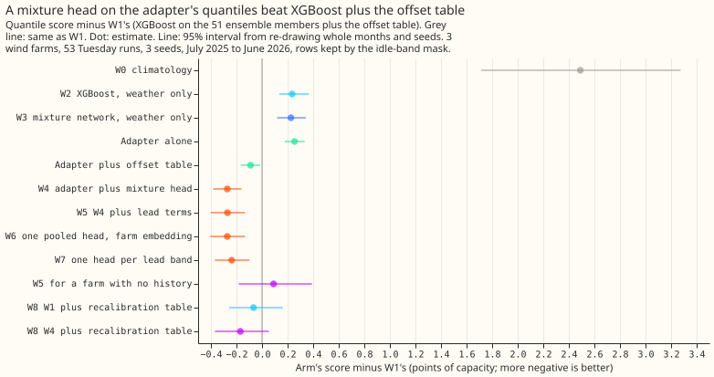
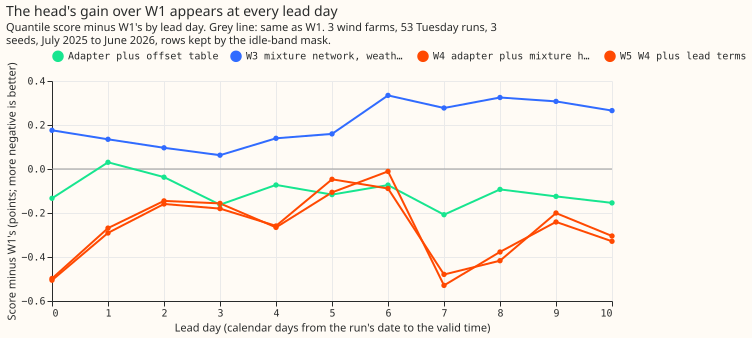
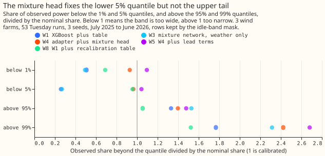

**Take-home: one of four solar-farm findings carried over to the three wind farms, with limits.**
We built a small neural network (a mixture-density network, which outputs a probability
distribution) that corrects the 11 quantiles of the physics-based wind forecast. On the half-hours
when a farm is not idle, its quantile score was 0.27 points of capacity (1 point is 1% of a farm's
capacity) better than XGBoost plus a lookup table of offsets, with a 95% interval from re-drawing
whole months of -0.38 to -0.16. The gain appears at days 1 to 2 (weaker) and at days 3 to 10, sits
in the median and the lower half of the distribution, and vanishes when the idle half-hours are
included. The upper tail is no better, and the network needs the farm's own forecast history to
learn from. We chose to report the non-idle half-hours after seeing that the all-half-hour gain was
near zero, so that choice is post hoc. Verdict: partly supported (of the five predictions, P4 held,
P1 held in direction but not size, P3 was inconclusive, and P2 and P5 failed).

We asked whether four findings from the six metered solar farms hold for the three metered wind
farms (farms W1, W2, and W3), at lead times of 1 to 10 days. The findings are: a mixture-density
network (as in [experiment 310](../00310-metered-farm-long-lead-scoring/result.md)) fed by a
physical power model beats that model alone; lead features help it; one pooled network across leads
matches separate networks per lead band; and the [experiment
321](../00321-metered-farm-lower-tail-recalibration-and-tail-head/result.md) recalibration table
lowers the lower-tail loss. The physical power model is the physics core with the wind-speed
adapter of [experiment 285](../00285-wind-effective-wind-adapters/result.md), run on the 51
ensemble members as in [experiment 303](../00303-wind-adapter-in-production-setting/result.md).
Scores are quantile scores in points of capacity (lower is better), on experiment 33's 53 Tuesday
runs from July 2025 to June 2026, with three seeds. Intervals re-draw whole months and seeds, and
farms are not resampled. "Kept rows" are the 96,479 of 107,121 rows outside experiment 210's
idle-band mask, which removes half-hours of near-zero wind where the metered series holds a
reactive-power floor. A "hindcast" is the 442 daily ensemble forecasts issued from April 2024 to
June 2025. A "lead day" is the number of calendar days from the run's date to the valid time. The
"offset table" is experiment 259's table of power offsets per farm, lead day, and quantile level.
Arms are named W0 to W8; the text says "farm W1" when it means a farm.

## Arms, rows, and weather

- **Arms.** W0 is `climatology` (per farm, month, and hour of the hindcast year's observed power).
  W1 is experiment 303's P1, XGBoost on the members plus the experiment 259 offset table. W2 and W3
  are experiment 313's pure XGBoost and pure MDN (weather only, ERA5-trained, own history, applied
  to the members). W4 to W7 and W5 for a farm with no history train a three-component Gaussian
  mixture head on the hindcast, with the adapter alone (experiment 303's P2) as base. W4 is one
  head per farm with no lead input. W5 adds the lead as sine and cosine of the hour of the lead day
  plus the raw lead. W6 is one head across the farms and leads with a learned farm embedding. W7 is
  one such head per lead band (days 0 to 2, days 3 to 6, and days 7 or later). W8 applies experiment
  321's rolling-origin offset table to W1 and W4. The adapter alone and the adapter plus the offset
  table are experiment 303's P2 and P3.
- **Departures from the plan** (written before any score was read): the adapter's
  effective wind speed is not stored per case, so the heads read the adapter's quantiles and the
  members' summaries of speed, direction, and temperature; W2 and W3 are experiment 313's stored
  predictions, not refits per lead band; W9 (pre-training on public farms) is skipped because
  experiment 288 has not merged; no manual heuristic exists for wind; the curtailment-cost metric
  is not run because it scores a node plus its generators.
- **Weather and training.** The adapter and XGBoost are trained on ERA5 before 2024-04-01. The
  heads train on the 442 ensemble hindcast runs (2024-04-01 to 2025-06-16), init and valid time
  before 2025-04-16, with early stopping on later runs. ERA5 is not read at forecast time.
  The research default does not apply to wind farms yet, so no row is added to the log.
- **Compute.** About 3 GPU minutes in total. Code reused from the folders of experiments 303, 310,
  313, and 321.

## Predictions

The planned contrasts are C1 (W4 minus W1), C2 (W5 minus W4), C3 (W6 minus W7), and C4 (W3 minus
W2). A label such as x8 names an extra contrast in the score file.

- **P1, W4 beats W1 by 0.05 to 0.2: the direction held and the size did not.** W4 minus W1 is
  -0.272 (95% -0.383 to -0.161; 99% -0.416 to -0.128), beyond the predicted 0.2.
- **P2, W5 beats W4 by at least 0.03: failed.** W5 minus W4 is +0.001 (99% -0.104 to 0.089).
- **P3, W6 within 0.03 of W7: inconclusive.** W6 minus W7 is -0.035 (99% -0.149 to 0.064); W6 is
  nominally better and the interval is wide.
- **P4, W3 no better than W2: held.** W3 minus W2 is -0.009 (99% -0.112 to 0.068).
- **P5, the recalibration table lowers W1's strict 0.01 pinball loss by at least 5%: failed.** The
  loss is 0.284 before and after. The table lowered W1's score by 0.066 (95% -0.258 to 0.162, not
  distinguishable from zero) and raised the 0.99 pinball loss from 0.640 to 0.707.

## Scores (points of capacity; pinball losses on the kept rows)

Single-family rows come first: XGBoost (W1, W2), physics core plus adapter (the adapter alone, and
with the table), and mixture network (W3). W4 to W7 are the blends. Best single family: the adapter
plus the offset table, 11.26. W4 minus that row is -0.182 (95% -0.285 to -0.082), the improvement
of the head.

| Arm | Kept | All | Kept, days 1 to 2 | Kept, days 3 to 10 | q01 pinball | q99 pinball | 5-95% coverage | Below median | Median minus mean forecast |
|---|---|---|---|---|---|---|---|---|---|
| W0 climatology | 13.84 | 13.58 | 13.31 | 13.93 | 0.307 | 1.177 | 85.2% | 44.8% | -6.22 |
| W1 XGBoost plus table | 11.35 | 10.83 | 6.91 | 11.79 | 0.284 | 0.640 | 92.1% | 40.4% | -4.81 |
| W2 XGBoost, weather only | 11.59 | 11.00 | 7.13 | 12.03 | 0.284 | 0.715 | 92.1% | 35.4% | -5.26 |
| W3 mixture network, weather only | 11.58 | 10.99 | 7.03 | 12.02 | 0.285 | 0.686 | 91.0% | 36.1% | -4.81 |
| Adapter alone | 11.61 | 10.99 | 7.09 | 12.06 | 0.287 | 0.683 | 91.3% | 35.1% | -4.82 |
| Adapter plus table | 11.26 | 10.76 | 6.91 | 11.66 | 0.287 | 0.644 | 92.6% | 40.4% | -4.71 |
| W4 adapter plus head | 11.08 | 10.79 | 6.68 | 11.54 | 0.283 | 0.691 | 88.2% | 47.2% | -3.87 |
| W5 W4 plus lead terms | 11.08 | 10.80 | 6.70 | 11.54 | 0.286 | 0.715 | 87.4% | 46.9% | -3.87 |
| W6 pooled head | 11.08 | 10.79 | 6.67 | 11.53 | 0.281 | 0.685 | 88.1% | 46.6% | -4.05 |
| W7 head per lead band | 11.11 | 10.83 | 6.75 | 11.61 | 0.284 | 0.694 | 87.5% | 47.0% | -3.92 |
| W5 for a farm with no history | 11.44 | 11.14 | 7.47 | 11.84 | 0.288 | 0.707 | 87.3% | 50.0% | -4.02 |
| W8 W1 plus recalibration | 11.29 | 10.77 | 6.86 | 11.72 | 0.284 | 0.707 | 89.9% | 48.6% | -4.96 |
| W8 W4 plus recalibration | 11.18 | 10.88 | 6.70 | 11.63 | 0.283 | 0.734 | 88.6% | 50.2% | -4.36 |

- **Absolute skill.** All arms beat `climatology` by 2.2 to 2.8 points on the kept rows (W1 minus W0
  -2.49, 95% -3.27 to -1.71). The table is scored at 1 to 10 days, with days 1 to 2 and days 3 to
  10 separately.
- **W4 against W1 at both lead splits (kept rows).** Days 1 to 2: -0.226 (95% -0.393 to -0.047).
  Days 3 to 10: -0.248 (-0.414 to -0.095).
- **Per farm, W4 minus W1:** farm W1 -0.174, farm W2 -0.392, farm W3 -0.250. Without farm W1, W2,
  or W3 the gain is -0.323, -0.211, and -0.282.
- **Leave one farm out.** W5 trained on the other two farms scored 0.361 worse than W5 (95% 0.111 to
  0.619) and 0.090 worse than W1 (-0.183 to 0.390), so the gain depends on the farm's own hindcast.
- **The recalibration table on W4 made it worse,** by 0.102 (95% -0.045 to 0.290, not
  distinguishable from zero), and raised the share of observed power below the median to 50.2%.
- **The curtailment-cost metric** was not run (see the departures above).

## Tail calibration (kept rows)

| Arm | Below q01 (nominal 1%) | Below q05 (5%) | Above q95 (5%) | Above q99 (1%) | q05 pinball | q95 pinball |
|---|---|---|---|---|---|---|
| W1 XGBoost plus table | 0.5% | 1.3% | 6.7% | 1.8% | 1.356 | 2.610 |
| W3 mixture network | 0.5% | 1.3% | 7.6% | 2.3% | 1.357 | 2.691 |
| W4 adapter plus head | 0.9% | 4.8% | 7.0% | 2.4% | 1.312 | 2.581 |
| W5 W4 plus lead terms | 1.1% | 5.2% | 7.4% | 2.7% | 1.319 | 2.611 |
| W8 W1 plus recalibration | 0.7% | 4.8% | 5.3% | 1.5% | 1.334 | 2.698 |

- **The head fixes the lower half and not the upper tail.** The share below q05 moves from 1.3%
  to 4.8%, and the share above q99 stays at 2.4% against 1% nominal (W1: 1.8%).
- **The 5% to 95% band is narrower than W1's** (88.2% coverage against 92.1%), because the head
  brings the quantiles down towards the observations.

## Checks

- **Median minus mean forecast** is in the last column of the score table. It is -3.87 points for
  W4 and -4.81 for W1, so every arm's median sits below its mean forecast. W4's gap is the smaller.
- **Mean-forecast error beside the quantile score.** Trigger 3 fired for W4 against W1: the score
  fell by 0.27 and the mean-forecast absolute error moved by +0.04 (95% -0.09 to 0.18). The
  median's absolute error fell by 0.41. W4 reshapes the quantiles around a similar mean forecast.
  W8 on W1 lowered the score by 0.07 and raised the mean-forecast absolute error by 0.55 (95% 0.27
  to 0.88).
- **All rows against kept rows.** W4 minus W1 is -0.037 on all 107,121 rows (95% -0.121 to 0.047):
  -0.245 from the kept rows and +0.208 from the 10,642 idle half-hours, where W4 scored 2.1 points
  worse because it trains on kept rows only. This is cancellation, not a spurious gain.
- **Audit.** A fresh Sonnet agent re-derived the W4 minus W1 contrast from the stored predictions,
  with its own code. The agent reproduced -0.272 on the kept rows, found no
  leakage and no row misalignment (hindcast rows, experiment 313's arrays, and the W8 scatter all
  line up), and found the gain on each of the three seeds (-0.274, -0.285, -0.256). The agent also
  found the gain between -0.24 and -0.30 when dropping any one month, but uneven by month: the
  scored month of May 2026 shows none, and April 2026 and July 2025 show the most. Remaining caveat:
  the adapter's base quantiles on the hindcast rows may be in-sample for the adapter, as for
  experiment 303's own head; the scored result is out of sample either way.
- **Triggers** (from the `ml-experiment` skill's audit list; trigger 3 is a quantile-score contrast
  that disagrees with the same contrast on the mean forecast, trigger 4 a sign flip when one farm is
  left out)**.** Trigger 3 fired (above). Trigger 4 did not fire for W4 minus W1, whose sign holds
  without any one farm; W6 minus W7 changes from -0.035 to +0.001 without W3, inside its interval.

## Caveats and what to try next

- **Three farms.** The intervals hold for these three farms only, because farms are not resampled.
- **Post hoc choices.** The heads' hyperparameters (40 epochs, batch of 2,048) were fixed before the
  scores were read. The prediction text names the kept rows, but we looked at both the kept-row and
  all-row scores before choosing the kept rows as the headline. The plan and the results were
  committed together, because the run took 3 minutes.
- **Next.** Fit the head with the idle half-hours in its training rows; give the head the upper
  tail's own loss (experiment 321's tail head); test W5 for a farm with no history after fitting on
  more than one hindcast year.
