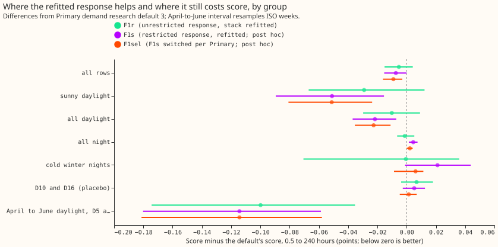
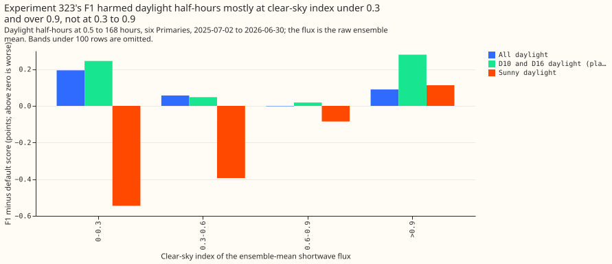
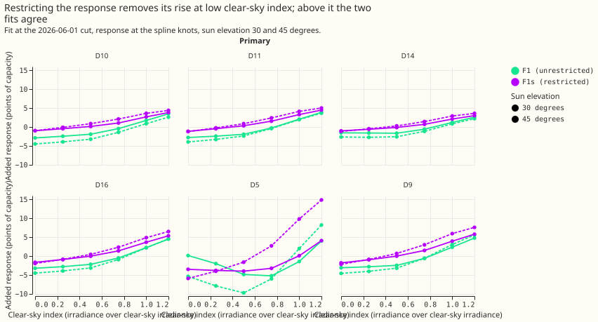

**The refitted sunshine response removes the all-daylight harm of experiment 323's F1, but the
pooled gain is under 0.01 points, below the 0.02-point minimum for a fitted step, so nothing is
adopted.** All numbers are at 0.5 to 240 hours, six Primaries, scored year 2025-07-02 to
2026-06-30, 798,116 rows, in points of effective capacity (smaller is better). F1s and F1sel were
added after stage 0 failed its prediction, so they are post hoc.

- **Arms.** Default is Primary demand research default 3, rebuilt and averaged over 6 network seed
  sets. F1 is experiment 323's unrestricted sunshine response with the rest of the chain left
  unrefitted. F1r is the unrestricted response with the Kalman level, night offset, recipe R, spread
  table, and median correction refitted on its own errors. F1s multiplies the response basis by
  `clip((index - 0.6) / 0.1, 0, 1) * clip((elevation - 15) / 5, 0, 1)`; the 5-degree ramp was
  chosen before any score. F1sel uses F1s at a Primary only where it beat the default by at least
  0.02 points on sunny daylight over the previous 12 months.
- **Absolute scores.** Default 2.732 (stored default from experiment 322: 2.727), F1 as run 2.737,
  F1r 2.727, F1s 2.725, F1sel 2.723, manual heuristic 3.414, climatology 3.664.
- **Pooled contrasts against the default (99.5% interval).** F1r -0.005 (-0.019 to +0.008), F1s
  -0.007 (-0.019 to +0.002), F1sel -0.009 (-0.020 to -0.001). The gain is similar at 0.5 to 168
  hours (-0.010 for F1sel) and 168 to 240 hours (-0.007).
- **By group.** Sunny daylight: F1r -0.029 (-0.082 to +0.027), F1s -0.051 (-0.105 to -0.006),
  F1sel -0.051 (-0.094 to -0.016). All daylight: -0.010, -0.022, -0.023. Night: -0.001, +0.004,
  +0.002. Cold winter nights: -0.001, +0.021, +0.006. D10 and D16 (placebo): +0.007, +0.005,
  +0.001. April to June daylight at D5 and D9: -0.100, -0.114, -0.114.

- **Prediction outcomes.**
    - **PR1 (F1r): partly failed.** The all-daylight change at 0.5 to 168 hours is -0.011, not harm,
      and the pooled score is at most 0. F1r keeps 0.033 of F1's sunny-daylight gain (0.117 against
      this experiment's default, 0.091 in experiment 323), under the 0.064 required, so refitting
      alone removed most of the gain as well as the harm.
    - **PR2 (F1s): failed.** Pooled -0.007, not -0.020. Sunny daylight -0.051, not -0.080. Sunny
      168 to 240 hours improves 0.9%, not 1.5%. All daylight is no worse than +0.005 (-0.024), and
      the April to June gain at D5 and D9 at 0.5 to 168 hours is 0.112, above 0.10. In the
      replicate year (April and June 2025) F1s is -0.248 (-0.330 to -0.183), the same sign.
    - **PR3 (F1sel): mostly passed.** D10 and D16 move by +0.002 and +0.001. D5 and D9 keep all of F1s's
      gain (-0.049 and -0.013). D11 had no F1s gain (+0.006), and D14's F1s gain was 0.003. No
      Primary's switch flipped more than twice (D10 twice, D11 and D16 once, D14, D5, and D9 never). The switch drops D14's F1s gain of 0.003, so the 80% retention test fails there.
    - **Stage 0: failed.** 52% of F1's all-daylight harm sits at index 0.3 to 0.9, under the 60%
      predicted. Another 23% sits under 0.3 and 25% above 0.9. Above 0.9, F1 also harms the
      placebo Primaries most.

- **The fitted responses.** The response rises with clear-sky index at every Primary and more
  steeply at higher sun elevation, as in experiment 323.

- **Tails and curtailment.** Over all rows the q01 and q99 pinball losses change by 0.003 or less
  for every arm. On cold winter nights the q01 pinball loss changes by up to 0.007 (F1s), and on
  sunny daylight by up to 0.016 (F1s), inside the 0.05 tolerance. The relative twCRPS
  (threshold-weighted continuous ranked probability score) changes by 0.3% or less over all rows, by
  1.6% to 3.2% on sunny daylight, and by up to 1.1% on cold winter nights, inside the 2% tolerance
  except for F1r on sunny daylight, at 3.2%. Leaving one Primary out never changes the sign of the
  pooled contrast for F1sel.
- **Seed noise.** Six seed sets of the median-correction network give a control score between 2.5787
  and 2.6038 at 0.5 to 168 hours, so one seed set moves the pooled score by 0.01 to 0.02 points.
  Experiment 322's stored default sits 0.006 below the six-set mean (99.5% interval -0.011 to
  +0.000), so it was a lucky draw. Every contrast above averages the six sets. The month-resampled
  intervals do not include seed noise, so the all-rows gains of 0.005 to 0.010 points are within it,
  while the sunny-daylight and all-daylight gains stand clear of it (audit, 2 to 4.5 standard
  deviations).
- **Reuse.** The scripts import experiments 136, 155, 184, 201, 202, 220, 251, 317, 319, 320, 322,
  and 323 from their folders.

## Checks

- **Reproduction gates.** The refitted F1 equals experiment 323's stored F1 to 8e-11. The rebuilt
  no-response chain equals the stored chain to 1.5e-5, its network deltas equal experiment 201's
  exactly, and its score is 2.7265 against 2.727.
- **Median minus mean, by Primary.** Under F1sel the gaps are D10 -0.44, D11 -0.02, D14 +0.18,
  D16 +0.19, D5 -0.09, D9 -0.29, close to the default's except at D5 (+0.04 under the default).
- **Mean absolute error.** Default 4.763, F1r 4.757, F1s 4.758, F1sel 4.755 (manual heuristic
  6.060, climatology 6.557), so the ranking of arms matches the quantile score.
- **Audit triggers.** Trigger 4 fired: leaving D5 out of the pooled score removes F1sel's gain
  (-0.002, 99.5% interval -0.011 to +0.004, with D5 left out). The result is therefore a D5 result.
