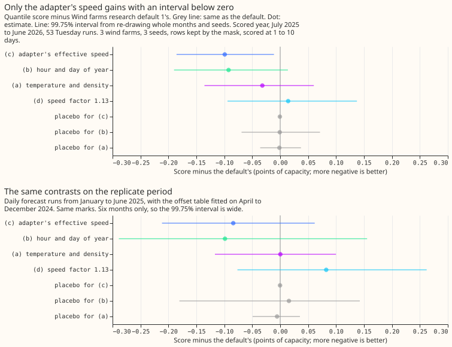
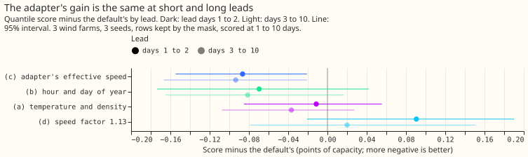
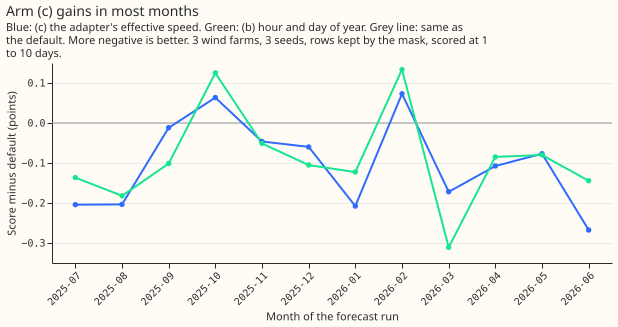

**Take-home: giving XGBoost the neural adapter's corrected wind speed lowers the wind forecast's
quantile score by 0.099 points of capacity (about 0.9%), scored at 1 to 10 day leads.** Of four
changes, only this one has a 99.75% interval wholly below zero. We asked whether any of four
changes, each added alone to Wind farms research default 1, lowers the quantile score of the three
metered wind farms (W1 to W3). The default is an XGBoost model (gradient-boosted trees) fitted to
ERA5 (our estimate of past weather). It runs on the 51 members of the ensemble forecast from ECMWF
(the European weather centre), then adds one correction per lead day, quantile level, and farm,
fitted on 442 daily ensemble forecasts. The four changes were: (a) 2 m temperature and air density
as extra inputs, (b) hour of day and day of year, (c) the effective wind speed of a small neural
adapter (a neural network fitted to ERA5 that rescales the wind speed that a physics-based
wind-power model reads), and (d) one wind-speed factor of 1.13 applied to every member. The score is
a quantile score over 11 quantile levels, in points of capacity (1 point is 1% of a farm's capacity;
lower is better), on the kept rows: the rows left after the mask of [experiment
210](../00210-wind-idle-noise-mva-artefact/result.md) removes half-hours when a farm is idle. The
default scores 11.352 points on the kept rows. The adapter (c) passes all five adoption conditions
of the [research-default rule](../research-default.md). Porting (c) puts a neural network in the
production service, and the rule leaves that adoption to the maintainer, so this page names (c) a
candidate and logs no version. The verdict is `supported`.

## Design

- **Family and default.** Wind farms research default 1: [experiment
  33](../00033-best-guess-architecture-vs-production/result.md)'s ERA5-trained XGBoost on the
  members, with the spread factor and [experiment
  259](../00259-wind-plant-plus-quantile-offset-head/result.md)'s offset table, as [experiment
  303](../00303-wind-adapter-in-production-setting/result.md)'s P1 and [experiment
  285](../00285-wind-effective-wind-adapters/result.md)'s `xgb_B4`. Rows `fold_a_tuesdays_v1` (53
  Tuesday runs, July 2025 to June 2026), 3 farms, 3 seeds. Scored at 1 to 10 days. The XGBoost
  models and the adapter are fitted once on ERA5 before 2024-04-01 and the table once on the
  hindcast, not refitted quarterly and monthly as the family settings say.
- **Arms and tier.** Tier 2 (inside the fitted stage), code imported from experiments 259, 285,
  303, and 307. (a) and (b) added columns, (d) a changed setting (minimum gain 0); (c) a new fitted
  step (minimum gain 0.02 points). Adoption order c, b, a, d; interval read at 99.75% (four arms).
  Arm (c) is experiment 303's P8, read from storage.
- **Controls.** Column subsampling off. Month-shuffled placebos for (a) and (b) (the added columns
  taken from a randomly paired other calendar month, in the ERA5 rows and the member rows) and a
  permuted-column placebo for (c). Known-answer test for (d): the refit factor after scaling the
  members by 0.85 times 0.85 equals the unscaled factor (difference 3e-8). Reproduction gate: the
  refit default is bit-identical to P1 (11.352 points, difference 0).
- **Replicate.** The offset table and (d)'s factor refitted on hindcast cases with valid times
  before 2025-01-01; the daily runs of 2025-01-01 to 2025-06-16 scored. Six months.
- **Intervals** resample whole months and the 3 seeds (50,000 resamples); the farms are not
  resampled, so every interval is conditional on these three farms.

## Results

| Arm | Kept rows | All rows | Days 1 to 2 | Days 3 to 10 | 0.01 pinball | 0.99 pinball | 5%-95% coverage |
|---|---|---|---|---|---|---|---|
| Default | 11.352 | 10.825 | 6.612 | 11.191 | 0.284 | 0.640 | 92.1% |
| Default plus (c) | 11.253 | 10.746 | 6.525 | 11.097 | 0.283 | 0.639 | 92.0% |
| Default plus (b) | 11.260 | 10.763 | 6.542 | 11.110 | 0.282 | 0.643 | 91.1% |
| Default plus (a) | 11.320 | 10.804 | 6.600 | 11.154 | 0.283 | 0.637 | 92.0% |
| Default plus (d) | 11.366 | 10.843 | 6.702 | 11.211 | 0.283 | 0.630 | 91.5% |

- **Benchmarks, kept rows.** The default scores 11.352. The frozen XGBoost reference (the default
  without the table) scores 11.697, so the table gains 0.345 (95% interval 0.274 to 0.418).
  Climatology scores 13.547, so the default is 2.195 better (1.577 to 2.808). Persistence is scored
  on hours 0 to 6 only (1,696 kept rows): 15.566 against the default's 6.568 on the same rows.
- **(c) minus default: -0.099 (99.75% interval -0.185 to -0.011; 95% -0.157 to -0.041).**
  Predicted -0.05 to -0.15, held. The prediction of a larger gain at days 1 to 2 than days 3 to 10
  failed; the gains are -0.086 (-0.155 to -0.021) and -0.093 (-0.167 to -0.021). The gain of (c) is
  negative at W1, W2, and W3 (-0.091, -0.129, -0.078) and without any one farm (-0.104, -0.084,
  -0.109), and negative in 10 of 12 months. Placebo for (c): -0.001 (99.75% interval -0.002 to
  +0.001), so the share recovered is 0.6%.
- **(b) minus default: -0.092 (99.75% interval -0.190 to +0.014).** The prediction (-0.05 to
  -0.15) held. The prediction that its placebo recovers over half the gain failed. The placebo is
  -0.001 (-0.069 to +0.071), a share of 0.8%, so the gain is not a date fingerprint. The ERA5 fits
  cover 2019 to 2024 and never see 2025 and 2026 dates, so a fingerprint was unlikely; the placebo
  tested it.
- **(a) minus default: -0.032 (-0.136 to +0.060).** The prediction (a gain under 0.1) held.
  Placebo -0.001.
- **(d) minus default: +0.014 (-0.094 to +0.137).** The prediction (a gain under 0.05) failed in
  sign: the factor lowers the 0.99 pinball loss by 0.010 and the below-median share rises to 42.4%
  from 40.4%, but days 1 to 2 are worse by 0.091 and W3 by 0.262.
- **Tails.** No arm raises the 0.01 pinball loss (upper 95% bound at most +0.0001) or the 0.99
  pinball loss (at most +0.031, arm (b)) by more than 0.05, as predicted. Coverage of the 5%-95%
  band falls from 92.1% to 91.1% for (b) and stays at 92.0% for (c).

## Adoption conditions for (c)

- **1, gain: met.** The 99.75% interval is wholly below zero and the gain 0.099 exceeds 0.02.
- **2, no harm: met.** The one-sided 95% upper bounds of the harm are -0.0006 at 0.01 and +0.013
  at 0.99, against 0.05. Reported without pass or fail: each farm is better; days 1 to 2 are better
  by 0.086; rows with wind above rated are better by 0.45, on a small subset whose interval the
  month resampling cannot give.
- **3, replication: met.** The replicate gain is -0.084 (99.75% interval -0.211 to +0.062), the
  same sign and above half of 0.02. The t test on the six monthly differences gives p = 0.13, so the
  sign is not contradicted but not established either.
- **4, controls: met.** The reproduction gate, the permuted-column placebo, and the known-answer
  test passed. No audit trigger fired for (c) (see Checks).
- **5, serving: met on inputs, with a port that touches the serving path.** The inputs are
  ensemble weather only. Porting needs the adapter, a neural network, in the production service, so
  the rule requires the maintainer's approval before adoption.

**Only (c) passes condition 1: (b), (a), and (d) do not.** (b) is next in the adoption order. Each
of the four arms has a wide 99.75% interval because there are three farms and 12 months, as the
research-default page predicted for a family of three farms.

## Checks

- **Median minus mean forecast.** Kept rows: default -4.805 points, (c) -4.720, (b) -4.548. The
  median sits below the mean in every arm, as in [experiment
  259](../00259-wind-plant-plus-quantile-offset-head/result.md).
- **Mean absolute error of the mean forecast beside the quantile score.** (c): quantile score
  -0.099, mean absolute error of the mean forecast -0.122, median absolute error -0.130, all three
  measures fall. (b): -0.092, -0.100, -0.109. (d): +0.014, +0.116, -0.019, so (d)'s mean forecast is
  worse.
- **Triggers.** Trigger 2 (a result contradicts its own prediction) fired for the lead pattern of
  (c) and the placebo of (b), and is explained above by tested placebos and a flat gain across lead.
  Trigger 2 bears on (b) and on the prediction about lead, not on (c)'s gain. Triggers 1, 3, 4
  (leaving any one farm out keeps the sign of (c)), 5, 6 (the 95% interval of (c) matches experiment
  303's P8 against P1, which is the same rows), and 7 did not fire.
- **Reproduction.** The refit default equals experiment 303's P1 to the last digit. Refit default
  versus stored default gives no difference, so every contrast reads the same against either.

## Caveats

- **Scored at 1 to 10 days, three farms, 12 months.** Intervals do not cover other farms.
- **The fits are single ERA5 fits,** not the quarterly refits the family settings name, so the
  contrasts could differ under refitting.
- **The replicate is 6 months** and its interval is wide; its sign agrees with the scored year for
  (c) and (b), (a) is null in both periods, and (d) is worse in both.
- **The curtailment-cost metric of experiment 277 is not scored.** It needs a substation node with
  its generators, and W1 to W3 have no node forecast in this experiment. Tail calibration is above.

## What the next experiment should answer

- **Does the adapter's gain survive quarterly refits of the XGBoost model and the adapter?** Run
  (c) with the family's refit cadence.
- **Is hour of day and day of year real?** Test (b) alone on a longer replicate, with the adapter
  already in the default.
