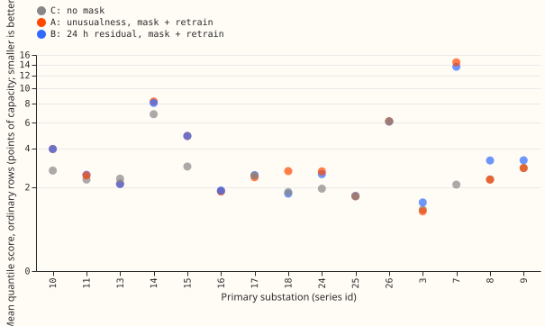
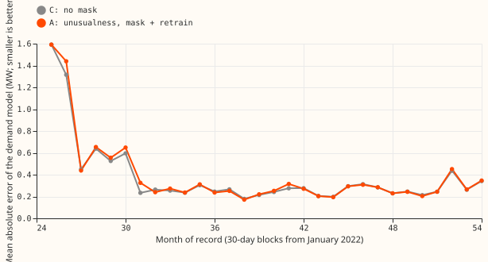
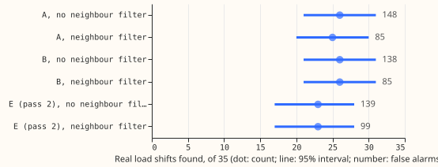

**Masking the readings that a label-free detector flags as load shifts makes a forecast of the
normal running arrangement (NRA) recover faster after a shift, and loses no accuracy on ordinary
days.** The masked forecasts were trained and corrected with no label from the network operator
(NGED). On the injected worlds, the rows during and after a shift score 1.04 points of capacity on
the 95% pinball loss with the label-free pipeline (arm A), against 1.79 with no mask and 0.81 with
the true spans masked. On the real record's ordinary rows, arm A scores 0.016 points better than no
mask, and its 98.75% interval runs to -0.060 on the better side. The verdict is *partly supported*,
because the pre-registered bar for the ordinary rows asked for that interval to lie inside plus or
minus 0.05.

## What the experiment did

**The detector reads only how unusual the observed power is.** A lagless demand model (the convex
model of [experiment 130](../00130-ro-nc-detector-on-the-gam-k-residual/result.md), ridge 0.1,
24-month window, refitted monthly, ERA5 reanalysis and CAMS past weather) gives quantiles for each
half-hour. The observed power is converted to a normal score in those quantiles, per Primary and
hour band (the band position of experiment 309). The 12 hour mean of the score is read at each
6-hourly origin. An alarm opens when the absolute mean passes a per-Primary threshold, set so that
odd months alarm 5 times per Primary-year with no label look. An alarm closes when the signed mean
falls below half the threshold at two consecutive origins, or after 14 days. The neighbour filter of
experiment 315 then drops alarms that two or more neighbours echo.

**The alarmed half-hours are removed from both the demand model's training rows and the Kalman
filter's inputs.** The demand model is refitted without the alarmed half-hours at each monthly cut,
and the two-state Kalman filter of `studies.dp_assimilation` treats the alarmed half-hours as
missing and re-runs from the onset. Arms:

- **A:** the pipeline above.
- **B:** the 24 hour mean residual with the same neighbour filter, through the same mask and train
  stages.
- **C:** no mask.
- **D:** the logged and labelled spans masked (a reference that uses labels).
- **E:** arm A with a second detection pass on the demand model refitted without the pass-1 alarms.
- **AF:** arm C's demand model with arm A's mask in the filter only (post hoc, to see which stage
  carries the gain).

On the injected worlds (experiment 297's 44 worlds at six Primaries) every arm uses the frozen
demand model, so the arms differ in the filter's mask only. The real record is experiment 258's
harness: 15 Primaries, 6-hourly origins, 336 half-hour leads, scored on even months.

## Results

**The headline contrasts (C1 and C2) decide the verdict.** Points of capacity; negative is better
than no mask.

| Contrast | Arm A minus no mask | 95% interval | 98.75% interval | Bar |
|---|---|---|---|---|
| C1: injected worlds, during and after a shift, 95% pinball loss | -0.752 | -1.340 to -0.322 | -1.533 to -0.257 | at least 0.05 better, interval below zero: **met** |
| C2: real record, ordinary rows, 95% pinball loss | -0.016 | -0.048 to +0.006 | -0.060 to +0.010 | point within 0.02, interval inside 0.05: **not met** (lower end) |
| Real record, ordinary rows, mean quantile score | -0.036 | -0.073 to -0.007 | not a bar | descriptive |
| Real record, 48 hours after a shift, 95% pinball loss | -0.953 | -2.393 to -0.179 | -2.953 to -0.118 | descriptive |

**Arm A beats arm B on the injected worlds.** During and after a shift, arm A minus arm B is -0.276
points (95% interval -0.486 to -0.104). On the real record's 48 hours after a shift the two arms are
close (A -0.953, B -1.095, no-mask score 1.670).

**With no mask, the 95% pinball loss is 1.79 during and after injected shifts and 0.71 on real
ordinary rows.**

| Rows | No mask (K0 or C) | Arm A | Arm B | Logged or true spans masked |
|---|---|---|---|---|
| Injected, during and after: 95% pinball loss | 1.789 | 1.037 | 1.313 | 0.811 |
| Injected, during and after: mean quantile score | 4.462 | 3.179 | 3.644 | 2.557 |
| Real, ordinary rows: 95% pinball loss | 0.712 | 0.696 | 0.697 | 0.707 |
| Real, ordinary rows: mean quantile score | 2.761 | 2.725 | 2.738 | 2.744 |
| Real, 48 hours after: 95% pinball loss | 1.670 | 0.717 | 0.575 | 0.556 |

**The tails stay calibrated on ordinary days, and the upper tail improves after a shift.** On the
real record's ordinary rows the share of readings below the 0.01 quantile is 0.0081 for arm A and
0.0084 for no mask. The share above the 0.99 quantile is 0.0068 for arm A and 0.0077 for no mask. On
the injected worlds, during and after a shift, the share above the 0.99 quantile is 0.211 with no
mask, 0.101 with arm A, 0.154 with arm B, and 0.026 with the true spans masked. Arm A still
under-covers the upper tail there, by a factor of ten.

**The gain comes from the filter mask.** Arm AF (the filter mask alone) scores -0.046 on ordinary
rows and -0.954 at the 48 hours after a shift, against -0.036 and -0.953 for arm A. Retraining the
demand model on masked power adds nothing measurable. At the short-history Primary 7, whose first 24
months are the fitting window, the monthly error of arm A and the no-mask arm is about the same
after month 30.

## The detector alone

**Arm A finds about as many of the 35 real shifts as arm B, and a second pass finds none more.** Of
the 35 labelled shifts, arm A matches 25 (95% interval 20 to 30) with 221 alarms and 85 false
alarms, which is 8.8 alarms per matched shift. Arm B matches 26 (21 to 31) with 231 alarms and 85
false alarms. Arm E (pass 2) matches 24 (18 to 29). The median lag from onset to alarm is 17 hours
for arm A and 24 hours for arm B. Of the 19 long-and-deep shifts, A and B each match 15 and E
matches 14. The neighbour filter cuts arm A's alarms from 313 to 221 and its false alarms from 148
to 85, at the loss of one matched shift.

**P1 holds as written, P2 is met, and P3 is refuted.**

- **P1 (the headline gain) holds as written.** Arm A beats no mask by 0.75 on the injected rows, and
  the ordinary rows change by -0.016, under the 0.02 limit. The verdict's stricter interval bar on
  the ordinary rows (inside plus or minus 0.05) is not met.
- **P2 (arm A matches at least as many long-and-deep shifts as arm B) is met.** Arms A and B each
  match 15 of the 19. Over all 35 shifts arm A matches 25 against arm B's 26 (A minus B -1, interval
  -5 to +3).
- **P3 (pass 2 finds 20% more shifts than pass 1) is refuted.** Pass 2 finds 24 against 25 (E minus
  A -1, interval -3 to 0).

## Checks

- **Median minus mean forecast.** During and after an injected shift the mean absolute error of the
  median is 5.43 for arm A and 5.42 for the mean forecast, and 7.29 against 7.25 with no mask. The
  mean forecast gives the same contrast as the median (A minus no mask -1.84 against -1.85).
- **Per site.** The mean-forecast error falls under arm A at 5 of the 6 sites (D10 -6.2, D14 -4.4,
  D9 -2.1, D11 -2.1, D16 -0.7 points) and rises at D5 (+0.9).
- **Leave one site out.** Without D11, arm A's gain on the injected rows falls from 0.75 to 0.30
  points, and the true-spans reference shows no gain (+0.05). The gain on the real record's ordinary
  rows survives dropping any one of the 15 Primaries (-0.030 to -0.041 in the quantile score).
- **Audit triggers.** Two audit triggers fired: a nested arm (AF) beat the full pipeline on ordinary
  rows (-0.046 against -0.036), and leaving out D11 shrank the injected gain. Both are reported
  above and neither changes the verdict. A Sonnet audit ran in place of the Opus audit, because the
  brief allows no Opus.
- **Fits.** No masked fit was refused for lack of training rows (0 for arms A, B, and E).

## Inputs and what uses labels

**Labels enter only the scoring groups, the match rule, and arm D.** Four constants carry label
knowledge from earlier work into every arm, including arm C:

- the filter's `step_penalty` and the prior for its four hyperparameters (experiment 106's
  `tuned.json`);
- the frozen demand model of experiment 297 in the injected worlds;
- the neighbour list, a literal dictionary copied from experiment 227's module, whose source is not
  documented;
- the neighbour filter's theta of 0.25 (set by experiment 315 against labels).

The quantile function, the alarm thresholds, the offset tables, and the filter hyperparameters are
fitted on all odd-month half-hours, which include the shifts and lie partly after some even-month
cuts. Fitting on all odd-month half-hours is non-causal, and every arm shares it. The detector's
demand model also sees the shifts as targets, so a shift it has learned as normal will not alarm.

## Deviations and what was not run

- The 95% pinball loss replaces the threshold-weighted continuous ranked probability score, and the
  11-quantile score replaces the continuous ranked probability score.
- The mixture-density arm (a neural network that outputs a density in place of quantiles), the
  scoring with ECMWF ensemble (ENS) weather at six Primaries, and the curtailment cost were not run.
  The ENS stage could not change a verdict, and the harness carries no node and generators for the
  curtailment metric.
- The end rule is adapted from experiment 147's rule R2: an alarm closes when the signed mean falls
  below half the threshold at two consecutive origins, or after 14 days.
- The training stage is not rerun on the injected worlds.

## What the next experiment should answer

**A test of the filter mask alone at more sites, on real shifts rather than injected ones, would
settle the case.** The injected gain rests mostly on D11. A test on the 35 real shifts at the six
Primaries with ENS frames would show whether the 48-hour gain (-0.95) holds with the weather that
production serves.
