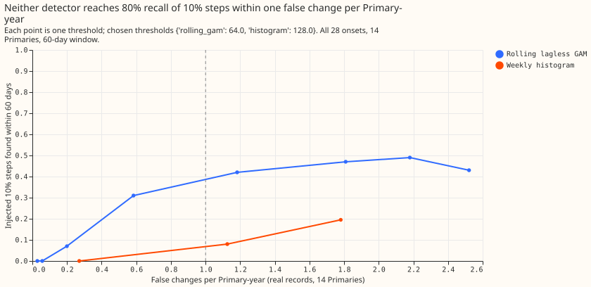
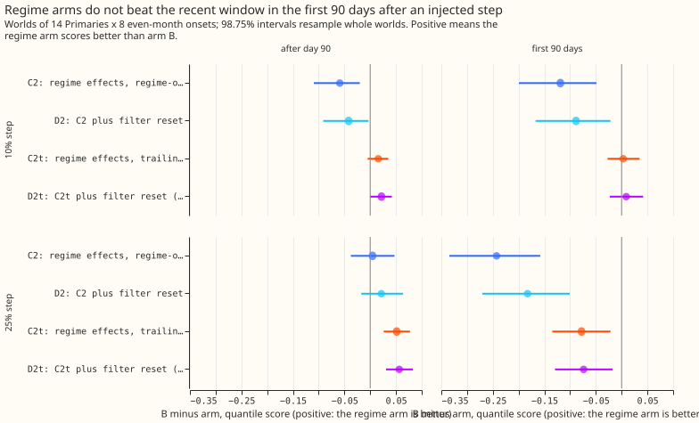
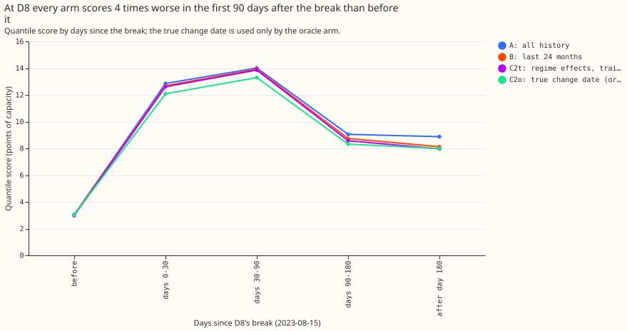

**Take-home: adding effects for a detected permanent change does not forecast better than refitting
the model on the last 24 months.**
We injected a permanent step of 10% or 25% of load into the recorded demand of 14 Primary
substations (the substations that feed local distribution feeders), and compared forecasts that add
new effects
after a detected change with forecasts refitted on the last 24 months (arm B). Arm B scored as well
as or better than every pre-registered regime arm in the first 90 days after a step, because the two
detectors raise their alarms late and miss small steps. At D8, the Primary with a real gas-engine
connection, the difference in the first 90 days was smaller than its interval (B minus C2 -0.040,
interval -0.262 to +0.154). The verdict is `not supported`, which means the hypothesis that regime
effects beat a recent-window refit did not hold.

The forecast model is a lagless generalised additive model (GAM) fitted to past weather (ERA5 and
CAMS), with a one-day-ahead level filter, so the result applies to a lab setting and not to Primary
demand research default 3. A "lagless" model reads no recent power. D8's gas engine is the only real
change we identified in the 15 Primaries' records, so the real-record evidence is D8 alone.

**Arm key.** A is one fit on all history, B one fit on the last 24 months, C1 a fit frozen at the
detected change plus new effects, and C2 a joint fit of old and new effects. D1 and D2 are C1 and C2
with the level filter reset at the change. Suffixes mark post hoc variants: `t` uses trailing
365-day bands, `o` uses the true change date (an oracle), `r` is arm A with bands from only the
residuals since the detected change, and `n` removes the level filter.

## Controls and audit

- Median forecast against mean forecast: not applicable. Every arm forecasts quantiles and the
  median directly;
  no mean forecast exists. The mean absolute error of the median is printed beside every score in
  `printed_report.txt` and points the same way as the quantile score.
- Audit triggers that fired: (1) the pre-registered placebo (C arms against A at 14 Primaries with
  no change) failed at +0.055 (C2) and +1.364 (C1); the tested explanation is the regime-band
  rule (arm Ar minus A is +0.098) and stale frozen fits after false alarms. (5) nested arm A, which
  C1 and C2 contain, beats both on the real records.
- A Sonnet audit (Opus was excluded for this session) re-derived the 25% step contrasts from the
  stored forecasts and matched. Triage: the one-day look-ahead in `known_regime` (an alarm raised on
  the origin day) was fixed and every score re-run; the filter subtracting a step twice once a
  regime is known was tested with the no-filter arms below; the bootstrap clusters of one Primary
  and one onset were too fine, so the headline intervals now cluster by onset (eight clusters),
  which
  widens them. The oracle placebo C2o equals A by construction when no true change exists, so it
  checks the plumbing only.
- Leaving D8 out is not applicable to the injected contrasts, which exclude D8.

## Detection

- Thresholds were fixed on 7 tune Primaries (at most 1 false change per Primary-year) and read on 7
  held-out Primaries with even-month onsets. The first threshold grid never reached 1 false change
  per Primary-year, so the grid was widened before any recall was read.
- Rolling GAM (CUSUM 64): recall within 60 days of 10% steps 0.26 (0.12 to 0.42), of 25% steps 0.56
  (0.36 to 0.70), of 30-day ramps to 10% 0.21; median delay 40 days (10%) and 19 days (25%).
- Weekly histogram (penalty 128): recall 0.00 for 10% steps and ramps, 0.10 for 25% steps.
- D8 (break 2023-08-15): rolling GAM dates the change 2023-08-20 but alarms on 2023-12-06 (113 days
  late); histogram dates it 2023-08-17 and alarms 2023-10-19 (65 days late).
- The Embedded Capacity Register holds 3 generators of at least 1 MW connected since 2020-06-01 at
  these
  Primaries, none at D8 near 2023-08, so the Register gave no independent check of the D8 date.
- False changes count real load shifts, so the rates are upper bounds.

## Forecast

- Quantile score: twice the mean pinball loss over 11 levels (0.01 to 0.99), in points of capacity.
  Intervals are 98.75% (four pre-registered contrasts) and resample the eight onset months of the
  injected worlds, or the calendar months of the real records.
- Injected 10% steps, first 90 days: A 3.273, B 3.270, C2 3.389, D2 3.358. B minus C2 is -0.118
  (-0.200 to -0.059); B minus D2 is -0.088 (-0.146 to -0.038); C1 and D1 are about 1.4 points worse.
- Injected 25% steps, first 90 days: A 3.945, B 3.978, C2 4.231, D2 4.171; B minus C2 -0.252
  (-0.320 to -0.181).
- Post hoc, trailing bands (C2t, D2t): B minus C2t +0.004 (-0.034 to +0.046) at 10% and -0.081
  (-0.183 to +0.029) at 25% in the first 90 days, and +0.051 (+0.011 to +0.092) at 25% after day 90.
- Post hoc, no level filter on any arm: the level filter matters more than the regime effects.
  Without it, C2 against the no-filter recent window (Bn) is +0.015 (-0.353 to +0.379) at 10% and
  +0.782 (-0.033 to +1.508) at 25% in the first 90 days, and +0.198 (+0.066 to +0.334) and +0.859
  (+0.419 to +1.277) after day 90. The true-date oracle gains +1.331 (+0.757 to +1.868) at 25%.
  Every
  filtered arm still scores far better than every unfiltered arm (arm B 3.978, arm Bn 8.047 at 25%
  steps, first 90 days).
- D8, first 90 days after the break: B minus C2 -0.040 (-0.262 to +0.154); post hoc B minus C2t
  +0.065 (+0.037 to +0.129); all rows after the break B minus C2t +0.150 (-0.057 to +0.372). The
  D8 intervals rest on 3 to 4 monthly forecast origins. The q99 exceedance after the break is 0.031
  for arm B
  and 0.031 for C2t against a nominal 0.010, so no arm is calibrated at D8.
- Primaries with no injection (14, real records): B minus A -0.021 (-0.037 to -0.004), C2t minus A
  -0.030 (-0.046 to -0.013), D2t minus A -0.033 (-0.050 to -0.016), against the 0.01 margin. C2
  minus A is +0.055 (+0.019 to +0.102) and fails it.
- Tail calibration: q01 and q99 exceedance and pinball loss are in `printed_report.txt`. The
  tail-weighted continuous ranked probability score and the curtailment cost were not computed.

## Caveats and next steps

- Lab shortcuts: past weather in place of ensemble members, a filter that sees yesterday's
  reading, a lagless GAM base with a simple fixed-gain level filter instead of the effects filter.
  The experiment 264 as-of band widening at D8 was not reproduced, so the success criterion for D8
  against that comparator is untested.
- The level filter absorbs a step within days, which leaves regime effects little to add. In this
  implementation the filter also subtracts a known step a second time once regime effects exist,
  which biases the regime arms against themselves; the no-filter rows above remove that bias but
  are far worse in absolute terms.
- Untested: confirming each candidate regime date by whether arm C2 improves out of sample on
  blocked time folds, then scanning 60 days either side of each candidate, needs a new design.
  A regime arm that replaces the level filter, instead of stacking on it, is also untested, and
  would need testing on the full Primary demand research default 3.
