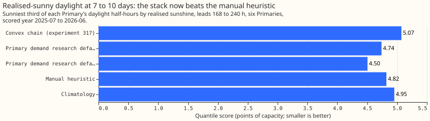
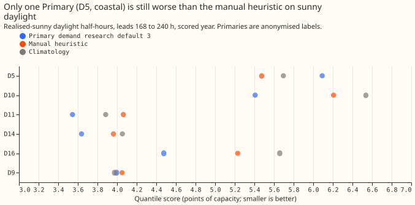
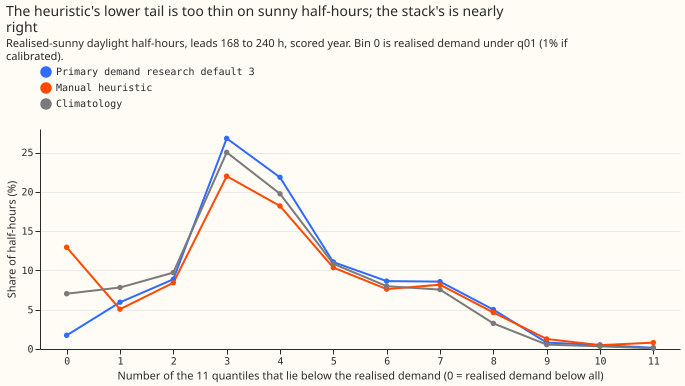

## Plan

The research default (Primary demand research default 3, still current in the research-default log
after experiment 325 adopted nothing) is our research demand forecast for six Primary
substations, up to 10 days ahead. Its 7-to-10-day bands come from experiment
[319](../00319-primary-demand-default-1-solar-summary-and-heuristic-blend-at-7-to-10-days/result.md)'s
two-number summary of the 51 ensemble members' solar responses (a mean and a standard deviation,
after [experiment 193](../00193-dp-ens-two-number-solar-summary/result.md)).

### The five plan items

1. **Question.** At 168 to 240 hours, does a solar-response distribution built from the 51 members
   and the training years (not only their mean and standard deviation) close the sunny-daylight
   weakness of the research default, and where does the weakness come from?
2. **Prediction that can fail.** The weakness is a fault of the predictive distribution (the lower
   tail on realised-sunny half-hours), not of the median. The thresholds are in the front matter.
3. **Rows and period.** `fold_a_daily_gap_v1`, six Primaries, scored year 2025-07-02 to 2026-06-30,
   replicate year 2024-25, origin 09:00 UTC, rows outside hand-filtered events. The headline range
   is 168 to 240 hours, and 0.5 to 240 hours is the no-harm check.
4. **Metric.** The quantile score over 11 levels in points of effective capacity, with the
   research-default page's protected groups and tolerances and 12-month block bootstrap intervals.
5. **Stop rule.** The reproduction gate fails, or stage 0 finds no weakness left in the default on
   sunny daylight at 168 to 240 hours.

### Stage 0 (zero-fit diagnostic)

Score the default against the manual heuristic and climatology on sunny daylight at 168 to 240
hours, by 24-hour lead band and by Primary. Report the probability-integral-transform histogram and
the below-q05, below-q01, above-q95, and above-q99 rates for the default and the heuristic, the
q50's mean error, and the same scores on forecast-sunny half-hours (ensemble-mean clear-sky index of
0.9 or more, from the stored ensemble's shortwave radiation over the Haurwitz clear-sky value, as in
[experiment 178](../00178-dp-sunny-daylight-gap-diagnosis/result.md)).

### Arms (run only if stage 0 passes)

All arms change the bands after the median, and are re-centred on the default's stored q50.

- **Default:** Primary demand research default 3.
- **X1, member solar distribution:** at 168 to 240 hours, the 51 members' solar responses replace
  the Gaussian points of experiment 319's arm x1 (centres `chain mean + response`, each with the
  chain's offsets times a factor `f` fitted per lead band). Daylight half-hours only.
- **X2, X1 mixed with climatology:** the member responses are mixed with the empirical distribution
  of the response at that Primary in completed earlier origins within plus or minus 15 days of the
  day of year at the same hour; the mixture weight per 24-hour lead band is fitted as-of by pinball
  loss before each scored month.
- **X3, lagged-ensemble pooling:** X1 with the responses of the two previous daily runs for the same
  valid time added, each earlier run down-weighted by a fitted per-lag weight. It uses only earlier
  runs whose response is stored (lead up to 240 hours), so lag 2 covers the 168-to-192-hour band
  only and lag 1 the first two bands.
- **References:** manual heuristic and climatology (static), BG2 below 168 hours.

Experiment 319's code and stored member responses are reused (the folders of experiments 317, 319,
320, and 322 are named in the scripts), and each month's fits use only completed runs before that
month's first origin, as they do. Schedule: the arms refit nothing but the band widths and mixture
weights each month, so a weekly-retrained median would give the same contrast.

## Take-home message

**The weakness this experiment set out to fix is already closed in Primary demand research default
3, so the experiment stopped after its first diagnostic (stage 0) and ran none of its three planned
arms.** Primary demand research default 3 is our research demand forecast for six Primary
substations (anonymised as D5, D9, D10, D11, D14, and D16), up to 10 days ahead. The weakness was a
worse score than the manual heuristic (NGED's rule of thumb, built from the same half-hour in
earlier weeks and years) on sunny daylight half-hours, at leads of 168 to 240 hours. A half-hour
counts as sunny when it is among the sunniest third of a Primary's daylight half-hours by the
sunshine that was realised, as in experiment
[178](../00178-dp-sunny-daylight-gap-diagnosis/result.md). We planned to build the uncertainty bands
from the 51 weather-forecast members' own solar responses and tested first whether any weakness was
left. The quantile score (twice the mean pinball loss over 11 quantiles, in percentage points of
effective capacity; smaller is better) of Primary demand research default 3 on those half-hours is
4.50, against the manual heuristic's 4.82. That is 6.6% better, with a 95% interval of 1.3% to 11.3%
better and a 99.5% interval of 1.7% worse to 13.4% better. Experiment
[317](../00317-primary-demand-default-1-at-7-to-10-days/result.md) had found the convex chain (the
stack before any weather summary or blend) 5.2% worse, at 5.07. The two-number solar summary of
experiment
[319](../00319-primary-demand-default-1-solar-summary-and-heuristic-blend-at-7-to-10-days/result.md)
and the daylight-only blend of experiment
[322](../00322-primary-demand-default-2-daylight-only-heuristic-blend-and-sunshine-graft-replication/result.md)
closed the gap. One Primary, D5, is still behind the heuristic, at 6.09 against 5.47 percentage
points of effective capacity.

## Findings

- **Reproduction gate passed:** Primary demand research default 3 scores 2.727 at 0.5 to 240 hours
  and 3.077 at 168 to
  240 hours, the values of experiment 322 (2.727 and 3.077).
- **Sunny daylight, 37,612 half-hours at 168 to 240 hours:** Primary demand research default 3
  scores 4.50, the manual heuristic 4.82, and climatology 4.95. It beats the heuristic in each
  24-hour band
  (4.48, 4.52, and 4.51 against 4.83, 4.83, and 4.81).
- **Per Primary (Primary demand research default 3, then the heuristic):** D5 6.09 and 5.47, D9 3.99
  and 4.05, D10 5.41 and 6.21,
  D11 3.55 and 4.06, D14 3.64 and 3.96, D16 4.48 and 5.23. Without D5, Primary demand research
  default 3 is 10.4% better
  than the heuristic (95% interval 5.4% to 14.8%).
- **Tails on realised-sunny half-hours:** Primary demand research default 3 has 1.7% below q01, 7.7%
  below q05, 0.7% above
  q95, and 0.2% above q99. The heuristic has 12.9%, 18.0%, 1.3%, and 0.8%.
- **Two of the stage 0 predictions failed, and one stop condition is met only through selection:**
  the below-q05 rate was 7.7% (predicted above 8%), and the q50 bias, defined as q50 minus realised
  demand, was +5.6 points (predicted under 0.1). Realised sunshine selects half-hours with low
  demand, so the bias is a selection effect: over all daylight half-hours it is +0.01.
- **Forecast-sunny half-hours** (ensemble-mean clear-sky index of 0.9 or more) number only 601.
  There Primary demand research default 3 scores 5.02 against the heuristic's 4.27, with a q50 bias
  of -6.4 and 17.0% of realised demand above q95. This is the mirror image of selecting by realised
  sunshine: the ensemble forecasts sun on days that turn out cloudier. The rows are too few to rank
  forecasts, and the group is not the one the brief defines.
- **Stop rule:** the default already beats the heuristic on sunny daylight, so the experiment stops.
  The three arms (X1, X2, X3) were not run, no model was refitted, and the run used about 10
  core-minutes.

## Checks

- **Median minus chain mean, per Primary, at 168 to 240 hours (points):** D5 -0.53, D9 -0.26,
  D10 +0.01, D11 -0.17, D14 -0.22, D16 -0.07.
- **Error of the median beside the score:** mean absolute error of the median on realised-sunny
  half-hours is 8.20 for Primary demand research default 3 and 8.71 for the heuristic, which points
  the same way as the score.
- **Triggers:** none fired. The stage 0 results differ from the brief's expectation, and the cause
  is tested above (the convex chain, Primary demand research default 2, and Primary demand research
  default 3 scored on the same rows). Leaving D5 out
  strengthens the contrast and does not flip it, so no audit ran.

## Caveats and what to try next

- **Lead range:** 168 to 240 hours, the 7-to-10-day range, six Primaries, one scored year. The
  replicate year was not scored, because the experiment stopped at stage 0.
- **Interval:** the 99.5% interval of the default against the heuristic on sunny daylight includes
  zero (-1.7% to 13.4%), so "6.6% better" is established at 95% only.
- **Next:** look at the solar term at D5 and D9 (coastal Primaries) at 168 to 240 hours, where
  experiment
  [325](../00325-primary-demand-default-3-sunshine-response-refit-and-restriction/result.md)
  also found a sunshine response helps. The member-distribution arms stay available if a later
  weakness at long leads shows a skewed tail.
- **Code:**
  `ml-experiments/00329-primary-demand-default-3-member-solar-distribution-at-7-to-10-days/`
  imports the folders of experiments 184, 202, 317, 319, 320, and 322 and reads their stored files.
