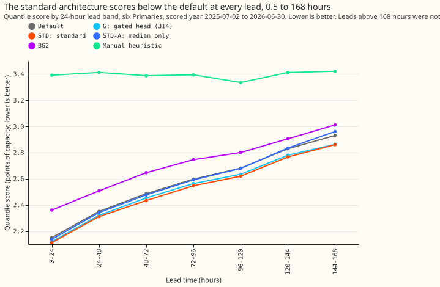
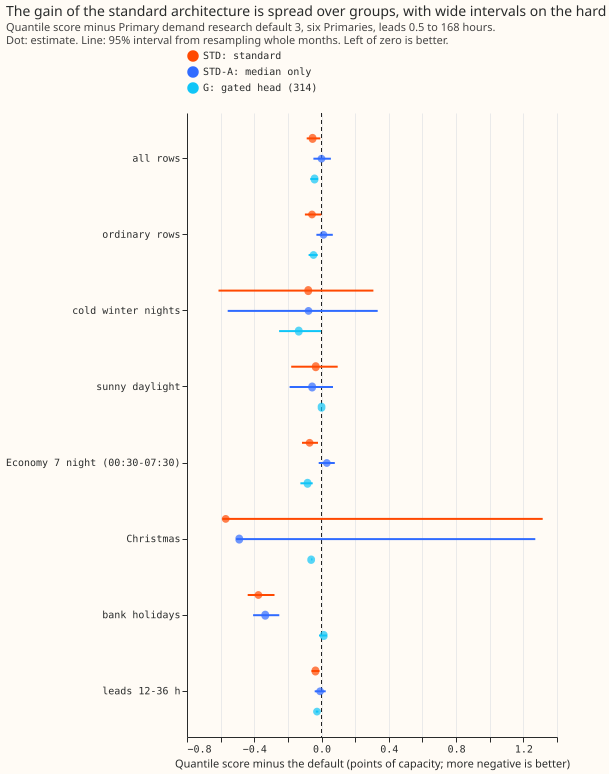
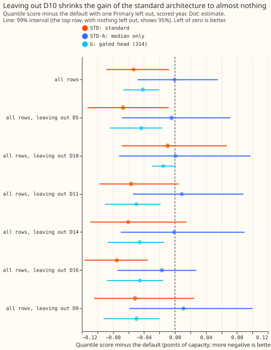

**Take-home:** The standard architecture is a small neural network with a learned input adapter
(two layers that map weather inputs into the network) and a mixture-density output (a spread of
forecast quantiles from three overlapping bell curves), fitted on top of the frozen convex stack of
the default. At forecast lead times of 0.5 to 168 hours (7 days) it forecasts demand at six Primary
substations (33/11 kV substations) slightly better than Primary
demand research default 3. At the all-rows score, demand therefore does not
need a different architecture from wind and solar at those leads, and the mixture output is the
part that gains. The 95% interval excludes zero but the 99.5% interval does not, and one Primary
(D10) supplies most of the gain.
The range 168 to 240 hours was not run, so the headline lead range is **0.5 to 168 hours**, not
the 0.5 to 240 hours that National Grid Electricity Distribution (NGED) needs. Scores are quantile
scores in points of effective capacity, and lower is better.

We asked whether replacing the default's median-correction network, spread table, and band steps
with one network (the standard architecture, STD) costs accuracy. The mixture-density output
follows [Bishop (1994)](https://publications.aston.ac.uk/id/eprint/373/), and the setup reuses the
rows, refit dates, and inputs of experiments
[311](../00311-primary-demand-mixture-density-band-head/result.md) and
[314](../00314-primary-demand-gated-or-pinball-band-head/result.md). STD scored 2.525 points of
capacity against the default's 2.579 (difference -0.053). The adapter with a median-only output
(STD-A) scored 2.578, so the mixture output makes the difference.

## Results

- **Arms (scored year, 0.5 to 168 hours, six Primaries, 561,207 rows, six seeds averaged, monthly
  refits on a 24-month pool, the P-roll schedule):** default 2.579, G 2.537, STD 2.525, STD-A 2.578,
  BG2 2.715, manual heuristic 3.397, climatology 3.665 points of capacity. The reproduction gate
  passed (default 2.579 against 2.579 stored).
- **STD against the default:** -0.053 (95% interval -0.089 to -0.008; 99.5% interval -0.100 to
  +0.016; 11 of 12 months better). **P1 holds** (the gap is below +0.03). STD is 0.19 points
  better than BG2 and 0.87 better than the manual heuristic.
- **STD-A against the default:** -0.000 (95% interval -0.048 to +0.056). **P3 is not met in the
  form predicted**: STD and STD-A differ by 0.053 (95% interval -0.079 to -0.025), and STD is the
  better of the two on the all-rows score, so the mixture output does not hurt that score. Whether
  it helps the tails is not shown (see the no-harm bounds).
- **STD against G:** -0.012 (95% interval -0.055 to +0.040).
- **Replicate year (2024-25 even months, against experiment 169's arm A bands):** STD -0.093 and
  STD-A -0.043 points (95% intervals -0.121 to -0.064 and -0.066 to -0.020), absolute scores
  STD 2.497, STD-A
  2.547, and default 2.589 (the arm A bands play the default's part in that year).
- **No-harm bounds (one-sided 95% upper bounds, pooled six Primaries; tolerances 0.02 pooled, 0.05
  for each of q01, q99, cold winter nights, sunny daylight, 2% for the tail-weighted score):**
  pooled -0.017, q01 pinball -0.000, q99 pinball -0.001. **P2 is not shown**: sunny daylight +0.075
  (estimate -0.034), cold winter nights +0.245 (estimate -0.079), and the tail-weighted CRPS at the
  95th percentile is 2.9% worse with an upper bound of +6.5%.
- **Tail calibration (all rows):** coverage at q01, q05, q95, q99 is 0.012, 0.056, 0.939, 0.983 for
  STD against 0.013, 0.049, 0.951, 0.984 for the default.
- **Absolute scores by lead band (STD against default, points):** 0-24 h 2.112 and 2.150; 48-72 h
  2.434 and 2.487; 96-120 h 2.620 and 2.681; 144-168 h 2.861 and 2.931. STD has the lowest score of
  default, G, STD, and STD-A in every 24-hour band. Its margin over G is 0.008 points at 0 to 24
  hours and 0.002 at 144 to 168 hours.

## Checks

- **Median minus mean forecast, per Primary (points):** STD -1.07 (D10), -0.51 (D11), -0.23 (D14),
  -0.53 (D16), -1.02 (D5), -0.48 (D9); the default's are +0.72, -0.50, -0.20, -0.84, +0.01, -0.75.
  STD's median sits below its mean at every Primary, and the gap is markedly larger than the default's
  at D10 and D5.
- **Error of the median and of the mean forecast (mean absolute error, points):** median 4.463 for
  STD against 4.510 for the default; mean 4.483 against 4.601. Both point the same way as the
  quantile score.
- **Audit triggers:** none fired. The sign survives leaving out D10 (-0.009), but the verdict was
  already "interval includes zero at 99.5%", so trigger 4 (leaving one Primary out flips the sign
  or the verdict of a contrast) does not fire.

## Caveats and what to try next

- **Lead range:** 0.5 to 168 hours only. The stored feature rows end at 168 hours, and the 168-to-240
  stage needs rows that experiment 322 stored only for the replicate and scored years.
- **Not done:** the as-of calibration of experiment 164 was not applied to STD, and the adapter
  reads the stored columns (temperature hinges, solar term, band width) rather than the 51
  members' two-number summaries, which the stored rows do not hold.
- **Seeds:** STD and STD-A average 6 seeds, and the stored default averages 3, so part of the gain
  could be a larger ensemble of seeds; STD-A, with the same 6 seeds, scores -0.000.
- **No calibration or night steps:** the default carries its as-of calibration and night offsets and
  STD carries none, so the contrast is conservative on that count.
- **Replicate year:** the comparator is experiment 169's arm A bands, an older forecast than the
  default, so -0.093 is not like-for-like with -0.053.
- **Schedule:** monthly refits on a 24-month pool (P-roll), six seeds; absolute scores could move
  slightly under weekly refits.
- **Next:** run STD at 168 to 240 hours with experiment 322's rows, with more seeds on cold winter
  nights, and test the mixture output alone (without the adapter) on the wind and solar families.

## Plan

Primary demand research default 3 is our research demand forecast for six Primary substations. This
experiment asks whether a standard architecture shared across demand, wind, and solar forecasts
costs demand any accuracy. The architecture is a physics core (here the frozen convex stack), a
learned input adapter, and a mixture-density output head. The mixture head follows
[Bishop (1994)](https://publications.aston.ac.uk/id/eprint/373/).

### The five plan items

1. **Question.** Does the standard architecture (STD) score within 0.03 points of Primary demand
   research default 3 at 0.5 to 240 hours, and what is its gap at each lead band?
2. **Prediction that can fail.** P1 to P4 in the front matter.
3. **Rows and period.** `fold_a_daily_gap_v1`, six Primaries, scored year 2025-07-02 to 2026-06-30,
   replicate year 2024-25, origin 09:00 UTC, rows outside hand-filtered events.
4. **Metric.** The quantile score over 11 levels in points of effective capacity, with the
   research-default page's protected groups and tolerances and 12-month block bootstrap intervals,
   and tail calibration at q01, q05, q95, and q99.
5. **Stop rule.** The reproduction gate fails (the default equals experiment 322's default 3 to
   within 0.01 points), or STD is more than 0.10 points worse than the default at the first full
   run.

### Arms

- **STD:** one network trained jointly on a median correction and a three-component mixture on the
  residual of the frozen core's mean, replacing the median-correction head, the spread table, the
  night offset's width part, and the solar standard-deviation band step. A two-layer adapter maps
  the ensemble summaries (temperature and solar response, mean and standard deviation) into the
  trunk; the other inputs are those of experiments 311 and 220. The as-of calibration of experiment
  164 was planned and not applied (see the caveats).
- **STD-A:** STD's median correction and adapter, with the default's band construction.
- **References:** the default, arm G of experiment 314, BG2 to 168 hours, the manual heuristic, and
  climatology.

### Stages

- **Stage 1 (0.5 to 168 hours).** Experiment 311's rows, 24-month pool, and monthly refits (the
  schedule is P-roll, a contrast of 0.03 points is read on at least six seeds averaged). The core is
  arm D, which is the default's core below 168 hours.
- **Stage 2 (168 to 240 hours).** The stored feature rows end at 168 hours, so the core above 168
  hours is the default's stored median and width (experiment 322), and the pool is the stored
  168-to-240-hour rows that end before each refit (an expanding pool that starts with the six
  replicate months). The pooled 0.5-to-240-hour figure is reported only if stage 2 runs; otherwise
  every headline says "0.5 to 168 hours" and names the missing range as the result's main caveat.

### Checks to run

Median minus mean forecast per site, the mean-forecast error beside each quantile-score contrast,
leaving one Primary out (D10 carried experiment 311's gain), and the seven audit triggers.
