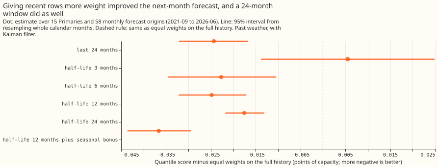
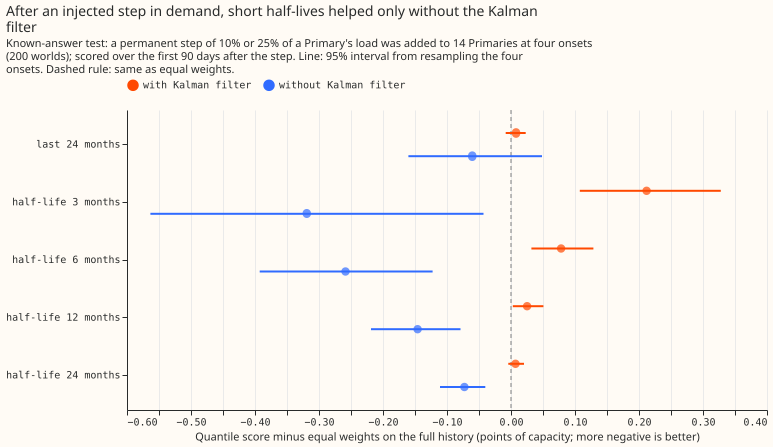
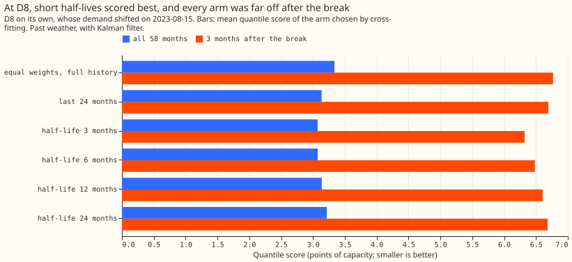

**Take-home: refitting the additive demand model every month with older rows weighted less improves
next month's forecast by about 0.025 points of quantile score (equal weights score 1.499), but
training on only the last 24 months gains the same.** Smooth recency weights therefore add nothing
to a plain 24-month window. Half of the pooled gain comes from one Primary substation, D8, whose
demand shifted in 2023. The verdict is `not supported`: we predicted the best weighting would beat
equal weights by at least 0.02 points and would fail if the 24-month window matched it, and the
window matched it.

We asked whether, when the additive model (a generalised additive model, GAM) with a Kalman filter
on its daily residual is refitted every month, giving older training rows less weight forecasts the
next month better. A quantile score of 1.499 means the average loss over 11 forecast quantiles, in
percent of a substation's effective capacity. The setup follows [experiment
328](../00328-lsc-regime-changes-detect-then-model-part-1/result.md), whose code and 15 Primary
substations we reuse, and the idea follows [experiment
17](../00017-training-window-and-retraining-rule-drift-demand/result.md), which found a gain for
XGBoost. We refitted each month from 2020-09 to 2026-06 and scored the following month from 2021-09
on past weather (ERA5 reanalysis and CAMS). Half-lives, ridge penalty and Kalman gain were chosen
on odd months and scored on even months, then swapped.

## Results

- **Arms:** R0 equal weights on the full history; W24 the last 24 months; H3, H6, H12, and H24
  exponential weights with half-lives of 3, 6, 12, and 24 months; SH3, SH6, SH12, and SH24 the
  same weights with a seasonal bonus (rows within 30 days of the forecast month's mid-date and at
  least 335 days old count double). "Best half-life" is the H arm chosen on the other half of the
  months, and "seasonal arm" is the SH arm with that half-life. Weights are normalised to mean 1.
- **Row set:** 15 Primaries and 58 monthly origins, with hand-filtered load-shift rows removed. Each
  month is scored with the settings chosen on the other parity of months.
- **Absolute scores (quantile score, points of capacity):** R0 1.499, W24 1.474, H3 1.504, H6 1.476,
  H12 1.474, H24 1.481, best half-life 1.474, seasonal arm 1.462. Excluding D8: R0 1.359, best
  half-life 1.347, seasonal arm 1.334. Winter (December to February): R0 1.475, best half-life
  1.473.
- **C1, best half-life minus R0:** -0.0248 (95% -0.0322 to -0.0171). Each half-life minus R0: H3
  +0.0055, H6 -0.0227, H12 -0.0248, H24 -0.0175. The point passes the 0.02 minimum. The 24-month
  window minus R0 is -0.0243 (95% -0.0321 to -0.0167).
- **C2, best half-life minus W24:** -0.0005 (95% -0.0051 to +0.0039). The window matches the best
  half-life, which is the pre-registered failure condition.
- **C3, seasonal arm minus best half-life:** -0.0118 (95% -0.0141 to -0.0095). The
  seasonal arm scores 1.462, 0.012 points better than W24 (1.474). The seasonal bonus is a
  candidate and not adopted, because no second period has replicated it.
- **Without D8:** C1 is -0.0119 (95% -0.0183 to -0.0054), below the 0.02 minimum. D8's own change is
  -0.199 points, which contributes 0.0133 of the pooled -0.0248.
- **Winter (December to February):** the best half-life minus R0 is -0.0020 (95% -0.0110 to +0.0074),
  so the weights give no measured winter gain.
- **By year of the forecast origin (post hoc):** C1 is +0.027 in 2021 (4 origins), then -0.009, -0.030,
  -0.031, -0.041 and -0.039 in 2022 to 2026. Weights hurt while history is short and help once
  several years exist.
- **Tail calibration (best half-life, R0):** q01 coverage 0.0117 and 0.0117 (nominal 0.01); q99
  coverage 0.0118 and 0.0120 (nominal 0.01); q95 pinball 0.7927 and 0.8052; q99 pinball 0.2487 and
  0.2510. Differences: q95 -0.0125, q99 -0.0023, both intervals wholly below zero.
- **Non-inferiority (margin 0.01, one-sided 95%):** the pooled upper bound without D8 is -0.0065, a
  pass. Per Primary, 13 of 14 pass; D5 is worse by +0.0088 (upper +0.0205), a look and not a failure.
- **D8 after its 2023-08-15 break (3 origins):** the q99 exceedance rate is 0.1707 for R0 and 0.1752
  for the best half-life against a nominal 0.01, so the secondary prediction fails; only H3 is lower
  (0.1637). Quantile score after the break: R0 6.768, H3 6.323. All arms are far off, so a better
  forecast of the level did not produce calibrated tails.
- **Effective winters at the last origin (median over Primaries):** R0 5.65, H24 4.29, H12 2.82, W24
  2.00, H6 1.63, H3 1.09. H3's winter score is 1.534 against 1.475 for R0, which is the noise
  that about one winter of data produces.
- **Post hoc without the Kalman filter (Kalman gain set to 0):** C1 is -0.0327 (95% -0.0561 to
  -0.0088), and the best half-life minus W24 is -0.0157 (95% -0.0377 to +0.0074). Without the
  filter the weights may beat the window, but the interval includes zero.
- **Not run:** the ENS-scored variant, the curtailment cost, and the `manual_heuristic` and
  `climatology` reference rows, because the lab base is not Primary demand research default 3. This
  experiment compares weights and not model families, so the standard-architecture arm does not
  apply.

## Controls

- **Reproduction gate: passed.** R0 and W24 at ridge 0.1 and gain 0.10 reproduce experiment 328's
  arms A and B per Primary to 0.0000 points.
- **Placebo: marginal miss.** A half-life of 1000 years differs from R0 by up to 0.0012 points
  (gate 0.001), and by 0.0013 in the no-filter run. We believe the solver tolerance causes the
  difference and did not test that. The difference is about 17 times smaller than the minimum gain.
- **Known answer: failed.** On injected steps of 10% and 25% of load (200 worlds, 8 onsets), H3 is
  worse than R0 over the first 90 days by +0.212 (95% +0.108 to +0.328) and H12 by +0.025. We tested
  the explanation that the Kalman filter absorbs a constant step: without the filter H3 is better
  than R0 by -0.319 (95% -0.563 to -0.043) and H12 by -0.146. The explanation holds, and a
  constant step cannot test recency weights in a model with a level filter.
- **Leakage: none found.** Weights use only the row end time and the cut, `fit_gam` rejects rows after
  the cut, the filter level uses earlier days only, and the offsets use the previous 365 days.

## Checks

- **Median minus mean forecast per site:** not computed. The offsets are residual quantiles of each
  arm's own forecast, and the error of the median forecast points the same way as the quantile score
  (best half-life minus R0 on the mean absolute error of the median: -0.1034, 95% -0.1316 to -0.0737).
- **Audit triggers fired:** a failed control (the known-answer test), a result that contradicted its
  prediction (the injected steps, with the explanation tested), and a gain that halves when one
  Primary is left out (D8). The other four triggers did not fire. A fresh Sonnet agent audited the
  experiment.
- **Audit findings, triaged:** an independent re-derivation from the raw forecasts agreed with
  C1, C2, and C3 (accepted). Autocorrelation of the monthly differences is 0.74 at lag 1, and a
  6-month-block bootstrap
  widens C1 to -0.0371 to -0.0133 and C2 to -0.0092 to +0.0043 (accepted, added post hoc; the
  conclusion is unchanged). Every arm chose the largest ridge (0.3) and gain (0.20), so the
  selection tested nothing at the edge (accepted as a caveat; a wider grid is advice). The filter
  uses actuals of earlier days in the forecast month (accepted as a caveat). The gain grows with
  history (accepted, shown by year).

## Caveats and next steps

- **Lab conditions:** past weather, a one-day-ahead Kalman level inside the scored month, and the
  month after each origin and not a 1 to 10 day lead. Absolute scores are optimistic, and the
  contrasts are conditional on the filter.
- **Selection:** the cross-fit is a two-way check, not leakage-free, and the bootstrap does not
  resample the selection of the best half-life from four.
- **Grid edges:** ridge 0.3 and gain 0.20 were the largest values offered, in every arm and both
  halves.
- **Options for later:** a `change` experiment on Primary demand research default 3 could test the
  24-month window and the seasonal bonus, with a wider ridge and gain grid.
