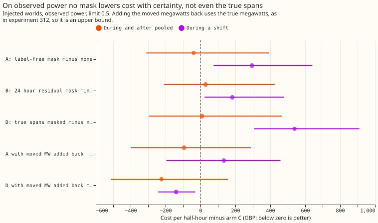
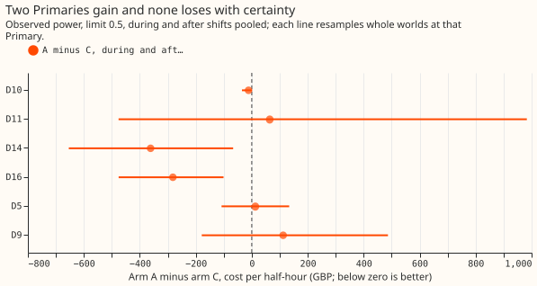
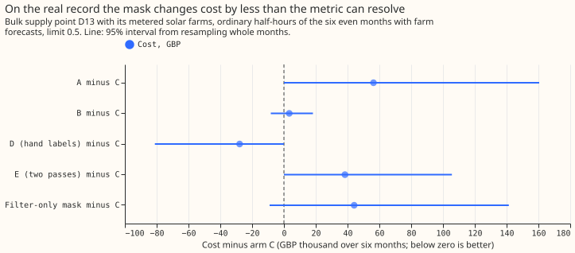

**Masking the load shifts that a label-free detector finds lowers curtailment cost by about a third
when the forecast is judged against the normal running arrangement, but not when it is judged against
the power the network carried.** Against observed power, the mask changes cost during and after
shifts by -3.0% (95% interval -24% to +30%) and raises it by 1.3% on ordinary half-hours. The
detector therefore stays an offline tool for labelling load shifts. A live service would also need
the moved megawatts before masking could lower cost. Verdict: not supported.

We asked whether the quantile-score gain that experiment
[327](../00327-lsc-label-free-detect-mask-train-pipeline/result.md) found for its label-free
detect-and-mask pipeline also shows up as lower curtailment cost. Curtailment cost is the cost of
cutting generation because a forecast let a substation's flow pass a limit, as defined by experiment
[268](../00268-lsc-curtailment-metric-v2-member-wise-ens/result.md). We scored experiment 327's
forecasts on 44 worlds in which transfers of load between six Primary substations had been injected,
and on the real record at one bulk supply point (D13) with its metered solar farms. A Primary has no
published limit, so the injected-world costs rank forecasts and state no money saved.

## Arms, rows, and data

- **Arms.** C is no mask. A masks the readings a label-free detector flags. B masks with a plain
  24 hour residual detector. D masks the true (logged and labelled) spans, as a reference. E is A
  with a second detection pass. All five are experiment 327's, with its filter hyperparameters and
  quantile offsets unchanged. The filter was re-run to rebuild the quantiles, which 327 does not
  store.
- **Injected worlds (Part 1).** Experiment 327's `inj` folder: 44 worlds at six Primaries, even
  calendar months, 12 to 36 hour leads, arms C, A, B, and D only. The limit is f times the Primary's
  largest real observed power before 2024-08-04 (before any scored row), the same for every arm
  and for both targets.
- **Real record (Part 2).** The bulk supply point D13 has 7 child Primaries, all with stored
  forecasts. Its node forecast is the sum of the 7 child forecasts plus quantile offsets fitted on
  odd months. Its generators are the metered farms A, C, and E and 2 other generators. Experiment
  243's quantile forecast for the farms and experiment 48's for the others are paired by valid
  time, which is a lab shortcut. D17 lacks one child forecast, so it is not scored.
- **Headline price** is GBP 2,000 per MWh-equivalent, breach ratio 20, Curtailment Limit 0 hours.
- **Not run.** The long-and-deep stratum of experiment 327 has too few rows at cost-bearing
  limits to score. Arm E has no injected-world rows, so it is scored on the real record only.

## Results

- **Deciding contrast (A minus C, during and after pooled, observed power, limit 0.5).** -GBP 39
  per half-hour (3.0% of C's GBP 1,291), 95% interval -310 to +392, from 10,149 half-hours. The
  smallest difference this design resolves is GBP 514. The interval includes zero, so the
  prediction fails.
- **Ordinary half-hours.** A minus C is +GBP 18.7 per half-hour (+1.3%, interval +16.6 to +21.2),
  above the 1% bound.
- **By group, observed power.** During: +295 (+36%, interval +75 to +641). After (48 hours): -213
  (-13.8%, interval -604 to +311). Before the alarm: +218 (+17.4%, interval +16 to +547).
- **Against the true series.** During and after pooled: -697 (-32.8%, interval -1,126 to -359).
  During: -1,118 (-35.5%). After: -477 (-29.9%). B minus C is -334 (-15.7%), D minus C is -986
  (-46.4%), and A minus B is -363 (interval -654 to -118).
- **Moved megawatts added back (observed power, as experiment 312's perfect-megawatts arm).** D with
  them: during -139 (-17.1%, interval -242 to -30). A with them: during +134 (interval -196 to
  +458), pooled -94 (interval -399 to +289). The true megawatts are used, so these are upper
  bounds.
- **Leave one Primary out (deciding contrast).** Without D11: -117 (interval -223 to +2). Without
  D16: +46 (interval -301 to +599). Per Primary, D14 (-362, interval -654 to -66) and D16 (-282,
  interval -476 to -101) gain, and none of the other four has an interval below zero.
- **Winter (November to March), observed power.** During: +339 (interval +75 to +613, 176
  half-hours). After: -134 (interval -389 to +113, 596 half-hours).
- **Limit sensitivity (observed power, A minus C, during and after).** At 0.75 the base cost is
  GBP 16 per half-hour and the difference is +17.5 (interval -4.9 to +64). At 0.9 no cost arises.
  Neither is evidence.
- **Real record at D13, ordinary half-hours, limit 0.5** (12,544 half-hours, 9,344 rows excluded
  because a child's span or label masks the target). Cost: C GBP 6.41 million, A 6.47 million, B
  6.41 million, D 6.38 million, perfect forecast 0.45 million. A minus C is +GBP 56,300 (+0.9%,
  interval 0 to +160,494) against a smallest resolvable difference of GBP 138,727. B minus C is
  +3,349 (interval -8,258 to +18,306). Cost arises in April and June only. The after-shift groups
  hold no rows in the farm window.
- **Tails.** Quantile q01 and q99 coverage were not recomputed here. Experiment 327 reports them.

## Checks

- **Median minus mean forecast per site, and the mean-forecast error beside each contrast.** Not
  applicable. No forecast was trained, and the stored mean-forecast errors are experiment 327's.
- **Triggers fired.** Trigger 1 (the true-span arm D loses to C during a shift on observed power)
  and trigger 2 (the result contradicts its own prediction): both are explained by the moved
  megawatts, and the add-back arm tests the explanation. Trigger 4 (leaving one Primary out flips
  the sign of the point estimate: without D16 it is +46): the interval includes zero both with and
  without D16, so the verdict does not change. The fresh Sonnet audit that these triggers call for
  ran in place of an Opus audit, on the maintainer's instruction that this run use no Opus. The
  audit re-derived the deciding contrast from the raw files with its own code: -GBP 38.9 per
  half-hour (interval -309 to +388), ordinary +18.68 (+1.27%), and both leave-one-out values. It found no error. It noted
  that a single world holds 22% to 41% of the pooled difference at D11 and D16, which is why the
  intervals resample whole worlds, and that the files hold both the earlier and the scored
  periods, both of which are used, as in experiment 327.
- **Weak node forecast.** At D13 the NGED baseline (generators assumed at capacity, the
  maintainer's unconfirmed understanding) costs GBP 5.89 million, below every demand arm. The node
  forecast, which ignores the farms, is the weak link, so the real-record levels are not money
  saved. Arm contrasts share that weakness.

## What to try next

- **Pair the mask with the moved megawatts.** The true spans with the true megawatts added back
  lowered during-shift cost, so a live service needs an estimate of the moved megawatts, which
  experiment 312 scored with oracle values.
- **Score the real record on a node that carries more shifts.** D13 has no after-shift rows in the
  farm window, so a longer farm forecast history is needed before the money question can be asked
  of real data.
