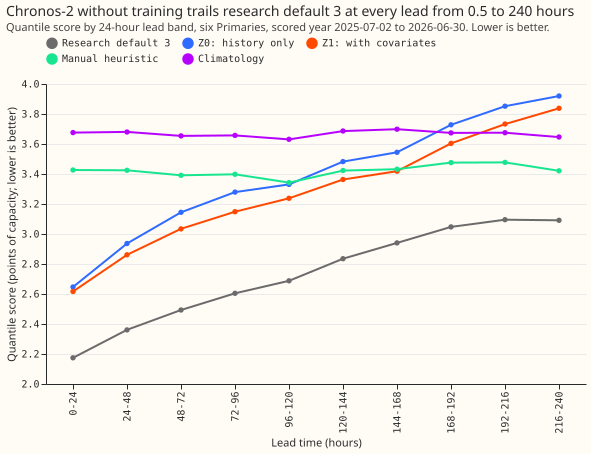
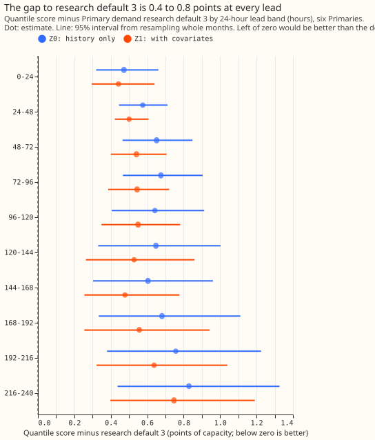
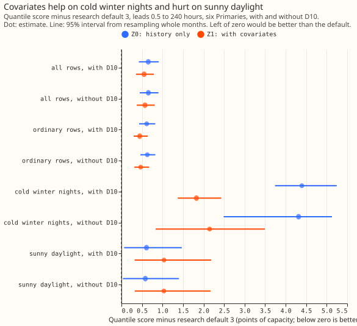

**Take-home:** A pre-trained time-series foundation model, Chronos-2, forecasts the demand of six
Primary substations (33/11 kV substations) clearly worse than Primary demand research default 3, at
every lead time from 0.5 to 240 hours (10 days). Used on the substation's own history alone (Z0), it
scores 0.65 points of capacity worse than the default. With the temperature forecast, the sun's
elevation, and the calendar as extra inputs (Z1), it scores 0.55 points worse, so the covariates
recover about one sixth of the gap. The covariates help on cold winter nights and make sunny
daylight worse. The headline lead range is **0.5 to 240 hours**, the full range National Grid
Electricity Distribution (NGED) needs. Scores are quantile scores in points of effective capacity,
and lower is better.

We asked how close a model trained on other series, and not trained on ours, gets to our research
default. The model is [Chronos-2](https://arxiv.org/abs/2510.15821) (Ansari et al., 2025), run as
published (Apache-2.0 licence, 120 million parameters), with no fine-tuning. We gave it the 8 weeks
of readings that ended 3.5 hours before each 09:00 UTC forecast time, and asked for the next 10 days
at the 11 quantile levels the default uses. The rows, the metric, and the default's stored forecasts
are those of experiments [251](../00251-dp-final-best-guess-assembly-clip-and-coast-against-bg2/result.md)
and [322](../00322-primary-demand-default-2-daylight-only-heuristic-blend-and-sunshine-graft-replication/result.md).
At 0.5 to 240 hours Z0 scored 3.387 and Z1 scored 3.286, against 2.733 for the default, 3.421 for the
manual heuristic, and 3.668 for climatology.

## Results

- **Arms (scored year, 0.5 to 240 hours, six Primaries, 788,004 rows, no training, one forecast per
  origin):** default 2.733, Z0 3.387, Z1 3.286, manual heuristic 3.421, climatology 3.668 points of
  capacity. The reproduction gate passed (default 2.733 at 0.5 to 240 hours and 3.078 at 168 to 240
  hours, against 2.727 and 3.077 stored in experiment 322).
- **Z0 against the default:** +0.653 (95% interval +0.423 to +0.909); without D10 +0.657 (+0.445 to
  +0.903). **P1's first half holds** (the gap exceeds 0.50). **P1's second half fails**: Z0 beats the
  manual heuristic clearly at 0.5 to 72 hours (differences -0.78 at 0 to 24 hours, -0.49, and -0.25,
  with intervals below zero) and by a point estimate of -0.12 at 72 to 96 hours (interval -0.29 to
  +0.03). It is level with it from 96 to 144 hours (-0.01 and +0.06), and trails it clearly from 144
  hours (+0.11 at 144 to 168 hours, +0.50 at 216 to 240 hours). The manual heuristic carries no
  recent demand level, and Z0 does, so the difference fades with lead.
- **Z1 against the default:** +0.552 (95% interval +0.354 to +0.791); without D10 +0.573 (+0.374 to
  +0.812). **P2 fails**: Z1 closes 16% of the Z0 gap at 24 to 120 hours (gap +0.636 for Z0, +0.534
  for Z1), against the predicted half. **P3 holds**: the smallest gap in any 24-hour band is +0.44
  (Z1, 0 to 24 hours), far above 0.03.
- **Z1 against Z0:** -0.101 (95% interval -0.294 to +0.040), so the covariates' overall gain is not
  established. By group the sign differs (figure 3): cold winter nights -2.57 (-3.30 to -1.31),
  ordinary rows -0.17 (-0.36 to -0.02), sunny daylight +0.43 (+0.21 to +0.76).
- **Protected groups, Z0 and Z1 against the default (leads 0.5 to 240 hours):** cold winter nights
  +4.39 and +1.83, sunny daylight +0.61 and +1.04, ordinary rows +0.62 and +0.45. Absolute scores
  on cold winter nights are 2.77 for the default, 7.16 for Z0, 4.59 for Z1, and 6.63 for the manual
  heuristic.
- **Tails (0.5 to 240 hours; default, Z0, Z1):** pinball loss at q01 0.188, 0.226, 0.226; at q99
  0.220, 0.270, 0.240. Coverage at q01 1.5%, 0.9%, 1.6% and at q99 98.4%, 98.6%, 98.8%. Tail-weighted
  CRPS at each Primary's 90th percentile 0.306, 0.420, 0.395.
- **Absolute scores by 24-hour lead band (default, Z0, Z1):** 0 to 24 hours 2.175, 2.647, 2.616;
  96 to 120 hours 2.688, 3.330, 3.238; 216 to 240 hours 3.091, 3.920, 3.838.
- **Z2 (light fine-tune) did not run.** Its rule needed Z1 within 0.30 points of the default in
  some 24-hour band, and the smallest gap is 0.44. The second stop rule did not fire either: both
  arms beat the manual heuristic by a wide margin at 0 to 24 hours.
- **How a reader could explain one forecast:** a Z0 forecast is a function of the previous 8
  weeks of readings through a transformer neural network with 120 million parameters, so no input or
  term can be named; Z1 adds six named covariates, but their effect is not separable. A GAM forecast
  has one named term per input (temperature hinge, solar term, calendar term), each readable as a curve.

## Checks

- **Median minus mean forecast, per Primary:** not informative. Chronos-2 returns its median as its
  mean, so both differences are exactly 0.00 at every Primary. The error of the median forecast is
  the only point-forecast check: mean absolute error 6.02 for Z0, 5.86 for Z1, and 4.77 for the
  default, the same order as the quantile score.
- **Per Primary (quantile score; default, Z0, Z1):** D5 3.52, 4.10, 4.06; D9 2.50, 3.10, 2.80; D10
  3.41, 4.04, 3.86; D11 2.41, 3.33, 3.38; D14 2.09, 2.69, 2.62; D16 2.57, 3.13, 3.08. Z0 trails the
  default at all six Primaries, and Z1 at all six.
- **Audit triggers:** none fired on a headline contrast. Trigger 2 was considered for P1's second
  half (Z0 beats the manual heuristic clearly out to 72 hours); the lead trend above is consistent with
  the explanation but does not isolate it,
  and the headline gap to the default is unaffected, so no audit ran. Trigger 4 did not fire (leaving
  out D10, or any one Primary, keeps the gap above +0.4). Trigger 5 did not fire at the all-rows
  level: Z1's overall gain over Z0 is not established, and Z1 is worse than Z0 on sunny daylight, a split
  reported as a result.

## Caveats and what to try next

- **Code review fix:** a first run filled Z1's temperature for the tail of a run cut short from a
  later run's forecast. The fix holds the run's own last temperature instead, and the rerun moved no
  score by more than 0.001 points.
- **Lab conditions:** the temperature covariate is the ensemble-mean 24-hour forecast, and for past
  half-hours it is the forecast of the run with the shortest lead; both exist at forecast time. The
  sun's elevation is a computed constant. Neither carries cloud, so the covariates are a weaker
  solar input than the default's.
- **One model, one context length:** Chronos-2 with 8 weeks of context and the default quantile
  heads. Other foundation models (TimesFM, Moirai, Toto) and other context lengths were not run.
- **Schedule:** inference only, so no refit schedule applies.
- **Next:** none for Primary demand as a replacement. A foundation-model forecast could be scored as
  a blend member alone first, with a solar input that carries cloud.

## Plan

The plan was committed with status `planned` before any score was read; its content is in the
front matter, the model choice, and the arms below.

### Model choice

- **Chronos-2** (`amazon/chronos-2`): Apache-2.0 licence, 478 MB of weights, accepts covariates.
- Not used: TimesFM, Moirai, and Toto.

### The five plan items

1. **Question.** How far behind research default 3 is a zero-shot foundation model, by lead band?
2. **Prediction that can fail.** P1 to P3 in the front matter.
3. **Rows and period.** `fold_a_daily_gap_v1`, six Primaries, scored year 2025-07-02 to 2026-06-30,
   origin 09:00 UTC, rows outside hand-filtered events.
4. **Metric.** The quantile score over 11 levels in points of effective capacity.
5. **Stop rule.** In the front matter.

### Arms

- **Z0:** history only; context 2688 half-hours ending 3.5 hours before the origin.
- **Z1:** Z0 plus the ensemble-mean 24-hour temperature, the sun's elevation, the local half-hour
  of day, the day of week, and a bank-holiday flag, known in advance.
- **Z2:** only if the rule in the front matter holds; it did not.
- **References:** the default, the manual heuristic, and climatology.
