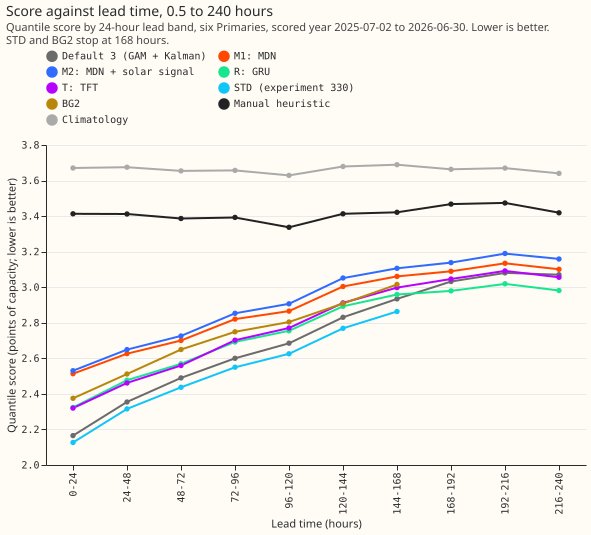
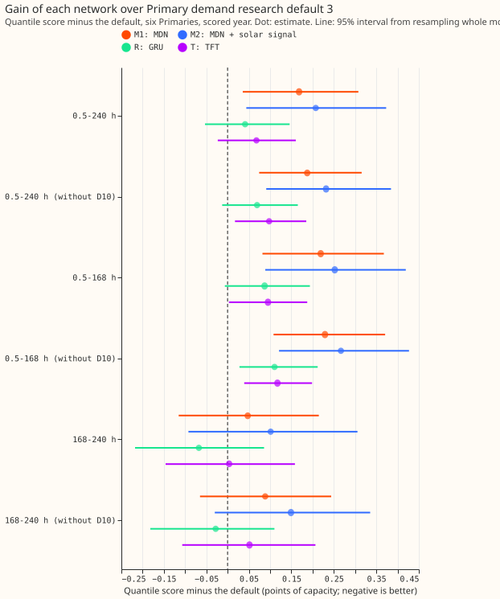
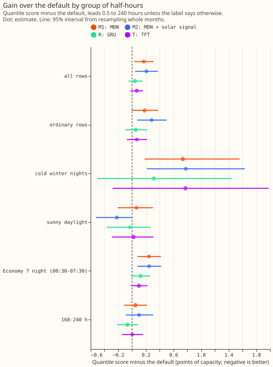
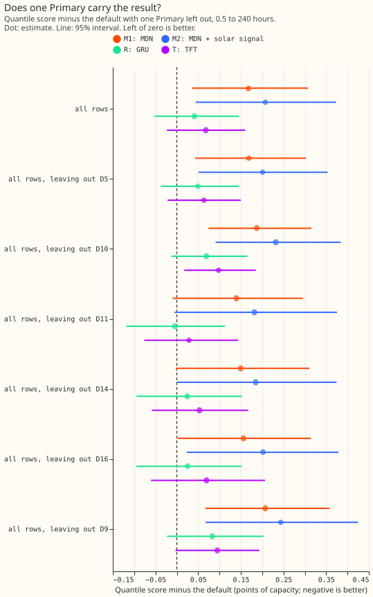

**Take-home:** None of four neural networks that replace the whole forecasting stack beats
Primary demand research default 3, so the stack stays. Research default 3 is the current best
research forecast of the demand at 33/11 kV substations ("Primaries"): a generalised additive
model (GAM, a sum of smooth, named terms for heating, lighting, and solar) with a Kalman filter that
tracks its recent errors. The best neural network (R) trails the default by 0.041 points at 0.5 to
240 hours, and the other three trail it by more. Scores are quantile scores: twice the mean
pinball loss over 11 quantile levels, in points of effective capacity (percent of the substation's
rated capacity), and lower is better. Gaps are the neural network's score minus the default's, so
a positive gap means the neural network is worse.

We asked whether a neural network with no GAM and no Kalman filter could forecast demand at six
Primaries at least as well as the default over leads of 0.5 to 240 hours. The four neural networks
were M1 (a mixture-density network, [Bishop
(1994)](https://publications.aston.ac.uk/id/eprint/373/)),
M2 (M1 given an explicit unmetered-solar signal instead of the weather inputs), R (a gated
recurrent unit that encodes the past 7 days of power and decodes the 480 half-hours of the
forecast), and T (a compact temporal fusion transformer,
[Lim et al. (2021)](https://doi.org/10.1016/j.ijforecast.2021.03.012)). All four were refitted
monthly on the rows and refit dates of experiments
[311](../00311-primary-demand-mixture-density-band-head/result.md) and
[330](../00330-primary-demand-standard-architecture-arm/result.md), and calibrated with the as-of
temperature-class widening of experiment
[164](../00164-calibration-cold-night-tail-under-coverage/result.md). No neural network came out
ahead of the default. The maintainer decides what counts as a decisive improvement, and no arm is
called a candidate for production.

## Results

- **Terms:** STD is experiment 330's standard architecture (a small neural network added on top of
  the default's stack, scored to 168 hours only); BG2 is the earlier best-guess stack, scored to
  168 hours; a *cold winter night* is a November-to-March half-hour between 18:00 and 07:00 local
  time, after dark, on a day flagged cold (day-mean temperature below 2 °C); *sunny daylight* is a
  daylight half-hour that experiment 178's rows flag as sunny; D5, D9, D10, D11, D14, and D16 are
  the anonymised labels of the six Primaries.
- **Lead range:** 0.5 to 240 hours on every headline. Scored year 2025-07-02 to 2026-06-30, six
  Primaries (D5, D9, D10, D11, D14, D16), 797,756 half-hours with a reading outside the
  hand-filtered events, origin 09:00 UTC. Intervals resample the 12 forecast-origin months.
  Monthly refits on a 24-month pool (the P-roll cadence), so these are not weekly-refit scores.
- **Reproduction gate:** the default rebuilt from experiments 251 and 322 scores 2.722 on the
  common rows against 2.727 stored (limit 0.01), so the gate passes. 360 reference rows at D5 and
  D16 (origins 2026-01-06 and 2026-01-08, leads 171.5 to 240 hours) have no network forecast and
  are left out of every arm.
- **Absolute scores, 0.5 to 240 hours:** default 2.722, M1 2.890, M2 2.929, R 2.763, T 2.790,
  manual heuristic 3.413, climatology 3.663. At 0.5 to 168 hours only: default 2.579, STD
  (experiment 330) 2.525, BG2 2.715, M1 2.798, M2 2.831, R 2.666, T 2.674.
- **Gap to the default (positive is worse), 0.5 to 240 hours, 95% interval, with D10 left out in
  brackets:** M1 +0.168 (+0.036 to +0.308) [+0.187]; M2 +0.207 (+0.044 to +0.373) [+0.232]; R
  +0.041 (-0.053 to +0.146) [+0.069]; T +0.068 (-0.023 to +0.161) [+0.098].
- **By lead range:** R +0.087 at 0.5 to 168 hours (-0.007 to +0.194) and -0.068 at 168 to 240 hours
  (-0.218 to +0.086). T +0.095 (+0.003 to +0.187) and +0.004 (-0.146 to +0.158). M1 +0.219 and
  +0.047. M2 +0.252 and +0.101.
- **Gap of the best network to experiment 330's STD (the standard architecture), 0.5 to 168
  hours:** R trails STD by 0.140 points (95% interval +0.044 to +0.253), 5.6% relative. STD is
  0.053 better than the default at those leads, so the standard architecture on top of the stack
  is the one neural arm scored on these rows that beat the default (at 0.5 to 168 hours).
- **Pairwise:** R minus M1 -0.127 (-0.175 to -0.077); T minus M1 -0.100 (-0.167 to -0.047); M2
  minus M1 +0.039 (-0.012 to +0.099); T minus R +0.027 (-0.025 to +0.076).
- **Protected groups, gap to the default (95% interval):** cold winter nights M1 +0.734 (+0.180
  to +1.558), M2 +0.777 (+0.213 to +1.635), R +0.315 (-0.502 to +1.447), T +0.774 (-0.283 to
  +1.981); sunny daylight M1 +0.063 (-0.208 to +0.303), M2 -0.222 (-0.521 to +0.007), R -0.032
  (-0.368 to +0.265), T +0.021 (-0.292 to +0.310). Threshold-weighted score at the 95th percentile
  relative to the default: M1 +4.3%, M2 +5.5%, R -0.6%, T -0.3%. The research-default page's
  no-harm tolerances are not shown to be met by any arm on cold winter nights (tolerances: 0.02
  pooled, 0.05 for q01 pinball, q99 pinball, cold winter nights, and sunny daylight, and 2% relative
  for the threshold-weighted score). T also has a q01 pinball loss 0.027 above the default's (95%
  interval +0.010 to +0.047). R beats the default in 7 of the 12 forecast-origin months.
- **Tail calibration (all rows; q01, q05, q95, q99 coverage; pinball at q01 and q99):** default
  0.014, 0.051, 0.952, 0.984; 0.186, 0.218. M1 0.009, 0.039, 0.915, 0.982; 0.185, 0.219. M2 0.007,
  0.032, 0.910, 0.981; 0.185, 0.224. R 0.010, 0.040, 0.918, 0.983; 0.176, 0.215. T 0.011, 0.042,
  0.932, 0.986; 0.214, 0.220. All four networks under-cover the upper tail at q95.
- **Replicate year (even months of 2024-25, 0.5 to 168 hours, against experiment 169's arm A bands
  as the reference, 3 seeds):** M1 +0.206 (+0.157 to +0.256), M2 +0.175 (+0.119 to +0.230), R
  +0.033 (-0.022 to +0.085), T +0.048 (+0.004 to +0.091); absolute reference 2.589, R 2.622, T
  2.637. The gaps have the same sign as in the scored year, and R beats T in both years. M1 and M2
  swap order: M2 beats M1 by 0.031 points in the replicate year, which carries M2's disclosed D9
  capacity leak.
- **Predictions:** P1 holds (M1 trails by 0.168, above the predicted 0.10). P2 fails: M2 trails M1
  by 0.039 instead of beating it by 0.03. P3 fails: R and T beat M1 by 0.127 and 0.100, not by
  under 0.03. P4: a single seed varies by 0.021 to 0.043 points (standard deviation of the pooled
  score across six seeds), above the 0.01 to 0.02 that experiment 325 found for the stack, so every
  contrast is read on the six-seed average.
  The stop rule did not fire: the gate passed, and no arm trails the default by more than 0.30 at
  every lead band.
- **Explaining one forecast:** M1, M2, R, and T are opaque. For M1 and M2 a reader can ablate
  inputs or read permutation importance (about 34 inputs in 2 hidden layers of 64 units); for R
  and T the past 7 days of power also feed in, and T's variable-selection weights and attention
  weights give a partial account. None gives the named heating, lighting, and solar terms of the
  GAM.

## Checks

- **Median minus mean of the 11 quantiles, per site (points):** the networks sit 0.07 to 1.5 below
  their quantile means (D10 -1.3 to -1.5 for M1, M2, and R, against -0.43 for the default), The
  offsets show that the forecast distributions of the neural networks are skewed upward at D10. The
  default's offsets are -0.43 to
  +0.19.
- **Error of the forecast beside the quantile score:** mean absolute error of the median
  forecast: default 4.75, M1 5.15, M2 5.21, R 4.92, T 4.87; the order agrees with the quantile
  score except that T's median is as good as the default's within 0.13.
- **Triggers fired:** the trigger for a result that contradicts its own prediction (M2 against P2)
  and the trigger for a leave-one-out sign flip (leaving out D11 turns R's gap to
  -0.004, though both intervals span zero). An independent audit re-derived every headline number
  from the stored fits and reproduced them to four decimals; it
  found no defect that changes a sign or verdict.
- **M2 against M1, tested:** the post hoc arm M2D (M2 plus darkness and sun elevation, 6 seeds)
  scores
  2.919 pooled, recovering only 0.010 of the 0.039 gap to M1, so the missing sun-geometry inputs
  are not the main cause. The audit locates the loss on daylight without strong sun (M2 +0.271
  against M1) and
  in spring and early summer; M2 is 0.285 better on sunny daylight. A possible explanation, not
  tested here, is that M2 lacks the shortwave and solar-term inputs that carry cloud information.
- **Calibration:** the as-of calibration of experiment 164 helps M1, M2, and R by 0.013 to 0.021
  points and hurts T by 0.010, almost all in 2026-01. It leaves calibrated q95 coverage on cold
  winter nights at 0.87 to 0.90.

## Caveats and what to try next

- **Inputs differ from the default's:** the stack's recent-error features (experiment 220) do not
  exist without the stack, so recent power stands in for them. The store holds ensemble means of
  temperature and shortwave only, so member spread and wind are not inputs. M2's explicit solar
  signal omits the D5 export clip, and its pinned capacity uses a later vintage for D9 before
  2025-04 (a disclosed leak in the replicate year only).
- **Seed averaging favours the networks slightly:** each network averages 6 seeds in quantile
  space, the default's forecasts below 168 hours average 3 fits, and above 168 hours they are one
  fit. A single R seed scores 2.82 to 2.87, so the six-seed average is 0.06 to 0.11 better than a
  single fit; the default still wins.
- **Code:** all arms share the input table `e00334_prep.py`, the refit logic `e00334_fit.py`, and
  `e00334_score.py` (scripts of experiments 164, 278, 311, 317, 320, and 322 are imported). The
  temporal fusion transformer is compact: one shared gated residual network after variable
  selection, hidden size 16, one head, chosen from three configurations on validation loss
  (pre-registered).
- **Not scored:** the curtailment-cost saving against the manual heuristic, because this experiment
  forecasts demand only and has no generator forecasts.
- **Next:** if a neural part is wanted, build it on top of the stack (experiment 330's STD), and
  test R's past-week encoder as the input adapter there. The result does not support a replacement;
  building a neural part on top of the stack is the option the evidence favours.
