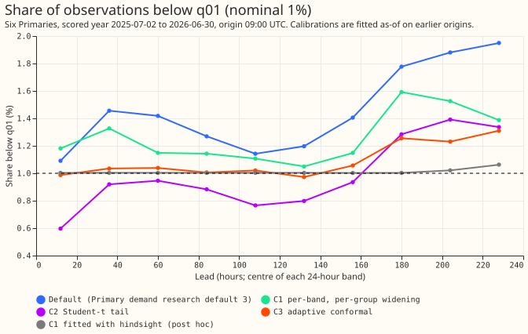
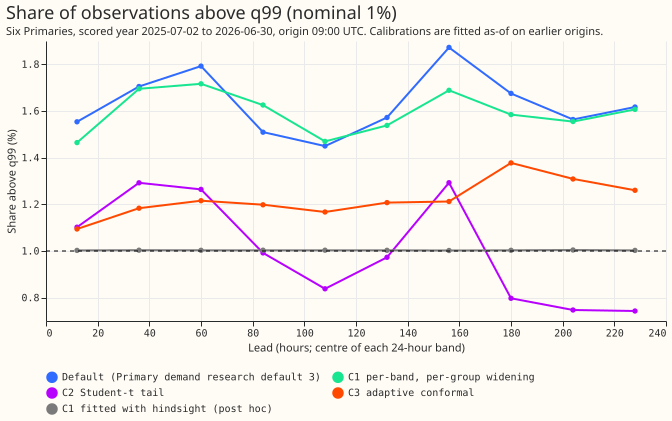
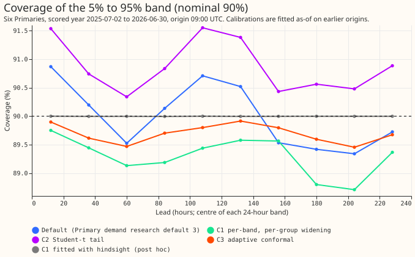
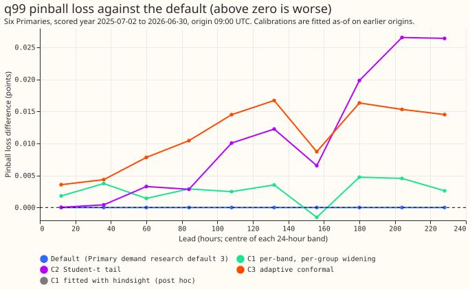

## Take-home message

**Primary demand research default 3 is already close to calibrated at 1 to 10 days, and tail
calibrations fitted on earlier months do not improve it.** Primary demand research default 3 is our
demand forecast that our experiments currently treat as the one to beat, for six Primary substations
(anonymised as D5, D9, D10, D11, D14, and D16),
up to 10 days ahead, for National Grid Electricity Distribution (NGED). We asked whether correcting
its 0.01, 0.05, 0.95, and 0.99 quantiles, with a
different correction for each 24-hour lead band and each kind of half-hour (season, day or night,
forecast cold night), brings the share of observations beyond each quantile to nominal. Three
corrections were tested, each fitted only on origins completed before each month: C1 widens or
narrows each tail by a table of factors (the recipe of experiments
[160](../00160-calibration-band-width-fix-on-stage-2-winner/result.md) and
[164](../00164-calibration-cold-night-tail-under-coverage/result.md) in every band), C2 replaces
the tails with a Student-t fitted to the errors, and C3 is adaptive conformal prediction ([Gibbs
and Candès (2021)](https://arxiv.org/abs/2106.00170)) with a 60-day window. No correction reaches
nominal:
the share below q01 stays at 0.6% to 1.6% (the default: 1.1% to 1.95%). The quantile score, twice
the
mean pinball loss in points of effective capacity, does not improve (C1 +0.0014, 95% interval
-0.0019 to +0.0054 points), and the q01 and q99 pinball loss rises by 0.003 to 0.011 points. Fitting
the C1 table in-sample on the scored year gives 1.00% in every band and lowers the score by 0.0038
points. That shows the table can describe the year, and does not show that the miss repeats across
years, which this experiment did not test.

Horizon: leads 0.5 to 240 hours (NGED's 1 to 10 days). Retraining schedule: the stored forecasts of
experiment [322](../00322-primary-demand-default-2-daylight-only-heuristic-blend-and-sunshine-graft-
replication/result.md)
are used unchanged, so no model was refitted here. The check that this experiment reproduces
experiment 322's scores passed: the default scores
2.7265 at 0.5 to 240 hours and 3.0767 at 168 to 240 hours (expected 2.727 and 3.077).

## Figures

## Results

- **Arms:** default (Primary demand research default 3); C1 (factor on the distance of q01, q05,
  q95,
  and q99 from the median, per band and group, bounded 0.8 to 1.6, shrunk to 1 under 500 half-hours
  per cell, interior quantiles unchanged apart from a sort); C2 (Student-t tail beyond q10 and q90);
  C3 (adaptive conformal, step 0.005, 60 days, per band, no groups). Groups: Apr-Oct day, Apr-Oct
  night, Nov-Mar day, Nov-Mar night, Nov-Mar forecast cold night (at least half of the 51 members
  below 3 °C; the member share is missing below 168 hours, so those half-hours fall in "Nov-Mar
  night").
- **Rows:** `fold_a_daily_gap_v1`, six Primaries, scored year 2025-07-02 to 2026-06-30, origin
  09:00 UTC, 798,116 half-hours outside hand-filtered events. History for the fits is the replicate
  year (even months of 2024-25, 168 to 240 hours only) plus earlier scored months, so the first
  cuts have no history below 168 hours and use a factor of 1 there.
- **Quantile score at 0.5 to 240 hours:** default 2.7265; C1 2.7280; C2 2.7321; C3 2.7319; manual
  heuristic 3.4143; climatology 3.6644. BG2 is not scored past 168 hours. At 168 to 240 hours the
  default scores 3.0767 and C1, C2, and C3 score 3.0786, 3.0839, and 3.0858.
- **Contrasts against the default (0.5 to 240 hours, 95% interval, 12 origin-month blocks):** C1
  +0.0014 (-0.0019 to +0.0054); C2 +0.0056 (+0.0012 to +0.0098); C3 +0.0054 (+0.0002 to +0.0116).
  Threshold-weighted continuous ranked probability score (twCRPS): C1 +0.0004, C2 +0.0012, C3
  +0.0016 (each interval includes zero except
  C3 against C1).
- **Tail calibration (pinball difference against the default, 0.5 to 240 hours; positive is
  worse):**

| Arm | q01 | q05 | q95 | q99 |
|---|---|---|---|---|
| C1 | +0.0032 | +0.0059 | -0.0004 | +0.0026 |
| C2 | +0.0082 | +0.0044 | +0.0072 | +0.0107 |
| C3 | +0.0028 | +0.0093 | +0.0073 | +0.0112 |

- **Share below q01 by lead band, per cent (nominal 1):** default 1.1 to 1.95; C1 1.0 to 1.6; C2
  0.6 to 1.4; C3 1.0 to 1.3.
- **Share above q99 by lead band, per cent (nominal 1):** default 1.4 to 1.9; C1 1.5 to 1.7; C2
  0.7 to 1.3; C3 1.1 to 1.4.
- **Coverage of the 5% to 95% band (nominal 90%):** default 89.3% to 90.9%; C3 89.4% to 89.9%.
- **Worst month:** the largest tail miss in one month is 3.4 points for the default, 2.9 for C1, 2.5
  for C2, and 1.6 for C3.
- **Cold winter nights:** C1 lowers the score by 0.014 points (95% interval -0.028 to 0.000) at 0.5
  to 240 hours. The share above q95 at 216 to 240 hours stays at 9.6% to 10% under every arm
  (nominal 5%), and at 168 to 216 hours C1 brings it from 7.2% to 5.2% and from 7.1% to 5.8%.
- **Sunny daylight:** no arm changes the score by more than 0.009 points (all intervals include
  zero).
- **In-sample fit (post hoc):** the C1 table fitted on the scored year itself gives 1.00% below
  q01 and above q99 in every band, apart from 1.02% to 1.06% below q01 past 192 hours, and lowers
  the score by 0.0038 points.

## Checks

- **Median minus mean forecast, per Primary:** D5 +0.04, D9 -0.24, D10 -0.43, D11 -0.02, D14 +0.18,
  D16 +0.19 points for the default. The values differ by arm because the mean of the 11 quantiles
  moves with the tails (D10: C1 -0.26, C2 -0.64, C3 -0.47; D9: C1 -0.17, C2 -0.33, C3 -0.29).
- **Error of the median forecast beside each contrast:** mean absolute error 4.7523 points for every
  arm, so the contrasts above come from the tails only.
- **Triggers:** trigger 2 fired for the prediction that C1 brings the tail shares within 0.3
  points of 1%. The in-sample fit above reaches 1.00% with the same method, which shows the method
  is not the
  limit, so no audit was run. Leaving one Primary out does not change the sign of any
  contrast. No other trigger fired.

## Caveats and what to try next

- Predictions: stage 0 predicted a miss of at least 0.8 points at every band past 96 hours, and the
  miss was 0.45 to 0.95 points, so that prediction failed in part. The prediction for C1 (PC1)
  failed, because the tail
  shares stay beyond 0.3 points of 1% and the q01 and q99 pinball loss does not improve by 0.03
  points. The prediction for C2 (PC2) failed, because at 168 to 240 hours C2 improves q01 pinball
  over C1 by only 0.0059 points and
  worsens q99 pinball by 0.0203.
  The prediction for C3 (PC3) failed, because
  the 5% to 95% band of C3 misses 90% by 5.5 percentage points in its worst month (the prediction
  was within
  3 points), although its worst-month tail miss is 1.3 points smaller than C1's.
- The curtailment-cost metric was not scored: the metric needs an electricity-network node with
  generators attached, and the Primary
  demand series have none.
- The replicate-year rows carry no day or night flag, so they enter the day cell of their season
  and the night cells and the forecast-cold-night cell get no replicate history. C2 factors are not
  bounded to 0.8 to 1.6 (3.6% of cells fall outside) and C2 does not shrink thin cells.
- The history below 168 hours is short for the first cuts of the scored year (see Rows), which
  makes C1 and C2 weaker there.
- Next: a forecast-model input feature for the cold-winter-night upper tail at 216 to 240 hours, and
  a calibration
  that adapts within the year (a faster conformal update) only if NGED need the tail shares at 1.0%.
