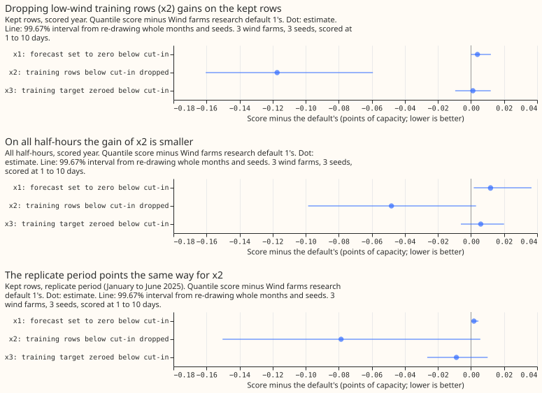
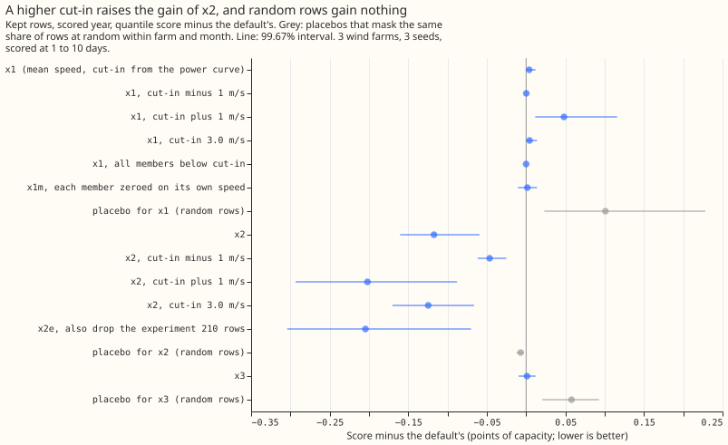
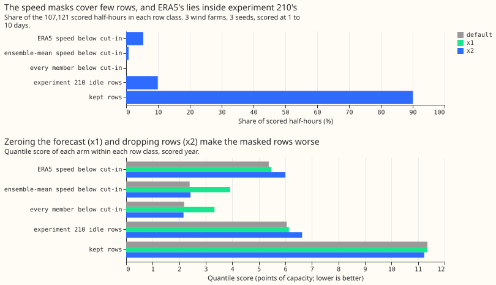

**Take-home: setting the wind forecast, or the training target, to zero below the turbines'
cut-in speed does not improve the forecast, and the one change that gains, dropping the low-wind
rows from training, mostly lifts the quantiles upward.** We tested the maintainer's proposal that
rows below the turbines' cut-in speed (the speed at which a turbine starts to turn) are noise and
should be zeroed. The default is Wind farms research default 1, the current best wind forecast: an
XGBoost quantile model
(gradient-boosted trees) fitted to ERA5 (our estimate of past weather), run on the 51 members of the
ensemble forecast from the
European Centre for Medium-Range Weather Forecasts (ECMWF), plus an offset table that shifts each
forecast quantile by an amount fitted on 442 daily hindcast runs. We scored three readings on
the three metered wind farms (W1 to W3), at 1 to 10 day leads. The score is a quantile score over 11
quantile levels in points of capacity (1 point is 1% of a farm's capacity; lower is better), on
the kept rows, which are the half-hours that the mask of [experiment
210](../00210-wind-idle-noise-mva-artefact/result.md) does not flag as idle-band readings. The
default scores 11.352. Zeroing the forecast where the ensemble-mean wind speed is below cut-in (x1)
scored 0.004 points
worse, and zeroing the training target there (x3) scored 0.001 points worse. Dropping the low-wind
rows from training (x2) scored 0.117 better
(99.67% interval -0.160 to -0.059; the interval re-draws whole months and seeds, at the level for
three arms), but an audit by the Sonnet language model traced most of that to an upward shift of
the quantiles, so the verdict is `partly supported` and x2 stays a candidate.

## Design

- **Plan.** Committed before any score, in the first commit of this branch. The prediction text
  for x2 on the ensemble was written with the wrong sign (it said "raises (worse)"); the brief and
  [experiment 276](../00276-wind-xgboost-vs-physics-gap-diagnostics/result.md) say dropping rows
  *lowered* the score by 0.03 to 0.1 with the ensemble as weather. Read against that, x2's gain of
  0.117 is a little above the predicted range.
- **Family and default.** [Experiment 326](../00326-wind-research-default-1-change-arms/result.md)'s
  default (XGBoost fitted once on ERA5 before 2024-04-01, offset table fitted once on the
  hindcast), rows `fold_a_tuesdays_v1`, 3 farms, 3 seeds, 107,121 scored half-hours. The XGBoost
  models are not refitted quarterly. Tier 2 for x2 and x3 (inside the fitted stage), tier 1 for x1;
  minimum gain 0 for all three.
- **Cut-in speeds** from [experiment 230](../00230-wind-physics-core-part-1/result.md)'s fitted
  power curve: W1 2.69, W2 2.85, W3 3.38 m/s (all inside 2 to 5 m/s). Sensitivity: plus and minus 1
  m/s, and 3.0 m/s.
- **Arms.** x1: all 11 quantiles set to zero when the ensemble-mean 100 m speed is below cut-in
  (variants: every member below cut-in; each member zeroed on its own speed before pooling, x1m).
  x2: ERA5 rows below cut-in dropped from XGBoost training and from the offset table's cases (x2e
  also drops the experiment 210 rows). x3: training target set to zero on those rows. Interval
  level 99.67% (three arms), months and seeds resampled, farms not resampled.
- **Controls.** Reproduction gate: the refit default equals experiment 303's P1 exactly (11.352,
  difference 0). Shuffled-mask placebos (same share of rows at random within farm and month).
  Leakage check: the forecast masks read only ensemble members, and their mean speed equals
  experiment 307's (largest difference 3e-6 m/s). The known-answer test confirms the mask flags
  every synthetic row below cut-in and none above it, but it calls the same one-line comparison
  that it tests, so it cannot fail and is weak evidence.

## Results

| Arm | Kept rows | All half-hours | Days 1 to 2 | Days 3 to 10 | 0.01 pinball | 0.99 pinball |
5%-95% coverage |
|---|---|---|---|---|---|---|---|
| Default | 11.352 | 10.825 | 6.612 | 11.759 | 0.284 | 0.640 | 92.1% |
| x1 zero forecast | 11.356 | 10.837 | 6.643 | 11.766 | 0.284 | 0.649 | 92.0% |
| x2 drop training rows | 11.235 | 10.777 | 6.597 | 11.705 | 0.284 | 0.638 | 91.4% |
| x3 zero training target | 11.353 | 10.831 | 6.635 | 11.761 | 0.284 | 0.641 | 92.2% |

- **x1 minus default: +0.004 on the kept rows (99.67% interval 0.000 to 0.012), +0.012 on all
  half-hours (0.002 to 0.037).** The forecast rule is slightly worse. On the 0.77% of half-hours it
  zeroes, the score rises from 2.39 to 3.92, so the farms produce small real output there. A cut-in
  1 m/s higher is worse (+0.048, 0.012 to 0.116); 1 m/s lower and "every member below cut-in" do
  nothing (+0.000). Zeroing each member on its own speed (x1m) gives +0.002 (-0.010 to +0.014).
  Predicted: kept rows lower by under 0.05. The kept-rows prediction had the wrong sign.
- **x2 minus default: -0.117 on the kept rows (-0.160 to -0.059), -0.048 on all half-hours (-0.099
  to +0.003).** The gain is -0.015 at days 1 to 2 and -0.055 at days 3 to 10. The gain is negative
  at each
  farm (-0.129, -0.115, -0.107) and without any one farm (-0.111, -0.119, -0.122), and in 11 of 12
  months. The score on the rows below the ERA5 cut-in rises from 5.37 to 6.00. A higher cut-in gains
  more (x2hi -0.202, x2e -0.205) and a lower one less (x2lo -0.046), and the random-row placebo
  gains 0.007, 6% of x2's gain.
- **x3 minus default: +0.001 (-0.010 to +0.012).** No better than x2, as predicted. The x3 placebo
  (random rows zeroed) is 0.058 worse.
- **Replicate period (January to June 2025, 6 months).** x2 gains 0.079 on the kept rows. The
  99.67% interval (-0.150 to +0.006) includes zero, while a t test on the 6 monthly differences
  gives p = 0.04, so the sign is supported and the size is uncertain. x1 is worse by 0.002,
  x3 better by 0.009 (-0.026 to +0.010).
- **How much each mask covers.** The ERA5 rule flags 5.4% of scored half-hours (4.7%, 4.8%, and
  6.8% at W1, W2, and W3). Of those, 99.9% lie inside experiment 210's mask, and they are 54% of the
  mask's rows, so the speed rule misses 46% of the idle half-hours (predicted: covers under half;
  it covers slightly more). The ensemble-mean rule flags 0.77% of half-hours and 7% of the mask's
  rows. The rule "every member below cut-in" flags 0.03%.
- **Evaluation-only variants (descriptive, never adopted).** c1: the default scores 11.136 on the
  rows outside the ERA5 mask and 10.891 outside the ensemble-mean mask, against 10.825 on all
  half-hours, so "scoring only the rows above cut-in" is just a different row set. c2: scoring the
  default against a target set to zero on the ERA5-masked rows gives 10.875 on all half-hours
  against 10.825 against observed power, and no change on the kept rows.
- **Tails.** No main arm raises the 0.01 pinball loss (upper 95% bound at most +0.0001) or the 0.99
  pinball loss (at most +0.017) by more than 0.05. The x1 variant with a 1 m/s higher cut-in raises
  the 0.99 pinball loss by 0.093, and the random-row placebo of x1 by 0.165.
- **Benchmarks, kept rows.** The default scores 11.352. The default without the offset table
  scores 11.697, so the table gains 0.345 (95% interval 0.274 to 0.418). Climatology scores 13.547,
  so the default is 2.195 better (1.577 to 2.808). Persistence is scored on hours 0 to 6 only (1,696
  kept rows): 15.566 against the default's 6.568 on the same rows.

## Adoption conditions for x2 (the only arm that gains)

- **1, gain: met** on the kept rows (interval wholly below zero, gain 0.117 above minimum 0).
- **2, no harm: met.** Upper 95% bounds of the harm are +0.00004 at 0.01 and +0.00007 at 0.99,
  against 0.05. Reported without pass or fail: the score on the rows it masks worsens by 0.63, and
  the 5%-95% coverage falls from 92.1% to 91.4% (90.1% against 91.5% on all half-hours).
- **3, replication: met** (same sign; the t test supports it).
- **4, controls and audit: the audit leaves x2 a candidate.** Trigger 3 fired (below). A Sonnet
  audit re-derived the gain from the stored predictions and confirmed it, then found its cause.
- **5, serving: met.** x2 changes training only, so no serving-path change is needed.

## Checks

An audit trigger is one of the seven conditions in the `ml-experiment` skill that sends a result to
a fresh reviewer before it merges. Trigger 2 is a result that contradicts its own prediction,
trigger 3 is a quantile-score contrast that disagrees with the mean-forecast error, trigger 4 is a
sign flip when one farm is left out, and trigger 5 is a control that moves the score. "Tier 1" and
"tier 2" are the research-default rule's names for changes that act on stored forecasts and inside
a fitted stage. "P1" is experiment 303's name for the default.

- **Median minus mean forecast, kept rows.** Default -4.805 points, x2 -4.737, x1 -4.804.
- **Error of the mean forecast beside the quantile score.** x2: quantile score -0.117, absolute
  error of the median -0.176, but absolute error of the mean forecast +0.032 (replicate +0.117).
  x1 and x3 move all three measures by under 0.01. **Trigger 3 fired for x2.**
- **Other triggers.** Trigger 2 fired (x2's gain was above the predicted range, and the plan
  carried a sign error; both explained in Design). Trigger 4: leaving out any one farm keeps the
  sign. Trigger 5: the controls behave (the x2 placebo moves the score by 0.007, within about a
  seventh
  of the x2 interval's half-width). Trigger 6 does not apply (no sister experiment on a matching
  contrast). Trigger 7: not yet; nothing is built on x2.
- **Audit findings (Sonnet; report in the private briefs folder).** The gain is real and identical
  in all three seeds. It sits at the middle quantile levels (q25 to q75), is spread over 11 of 12
  months and all 24 hours, and the top 5% of rows carry 55% of it. x2 raises the median by about
  0.9 points of capacity on 97% of rows: the default's median sits 9.0 points below the observed
  value on average. Adding a constant +0.9 to the default's quantiles reproduces about 85% of x2's
  gain and the same loss in the mean forecast. The gain scales with how far each variant lifts the
  quantiles. **Triage:** accepted. The finding changes what x2 means (a bias correction, not noise
  removal) and is why x2 is not adopted. We did not run the constant-shift arm as a new experiment.

## Caveats

- **Scored at 1 to 10 days, 3 farms, 12 months.** Intervals do not cover other farms.
- **The XGBoost models are single ERA5 fits,** not the quarterly refits the family settings name.
- **The ERA5 mask is an oracle at training time only.** The forecast-time masks use the ensemble
  members. The "wind above rated" group holds under 0.1% of rows at the 95%-of-peak definition
  used here, so it is not reported.
- **The physics core with the adapter is not scored as an alternative family,** and the
  curtailment-cost metric of experiment 277 is not scored (the farms have no node forecast here).
- **x2 holds the base margin flat below cut-in.** With the low-wind rows dropped from the binned
  curve, member speeds below cut-in take the lowest retained bin's value.
- **The replicate is 6 months** and its interval is wide.

## What the next experiment should answer

- **Does a constant upward shift of the quantiles, fitted on the hindcast, match x2's gain?** The
  audit says the shift should match it (85% of the gain); a pre-registered arm would settle whether
  x2 adds anything beyond a
  bias correction, and why the offset table leaves a median bias of -9 points of capacity.
- **Is the physics core with the adapter helped by dropping low-wind rows?** Not tested here.
