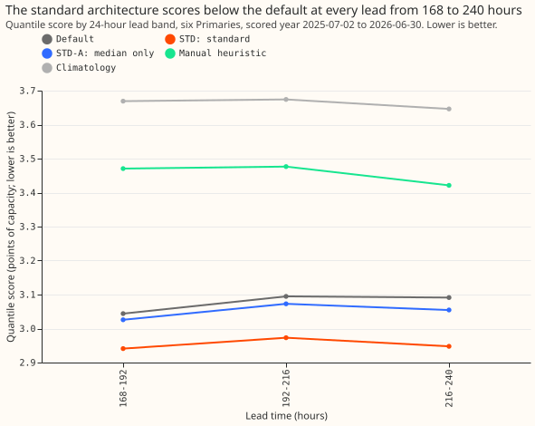
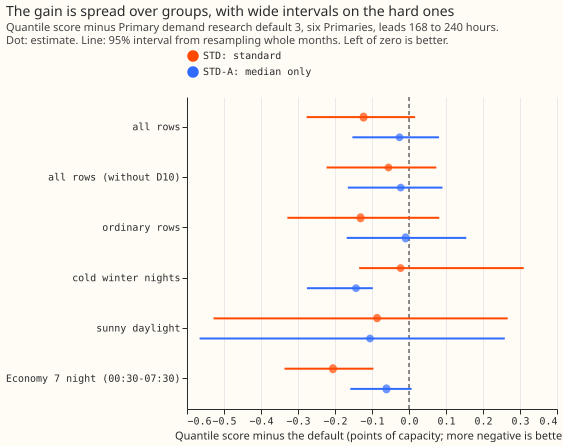
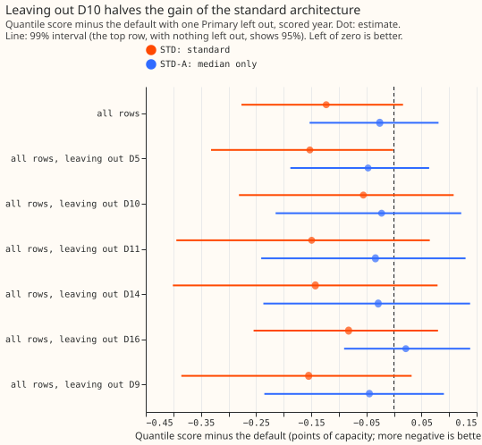

**Take-home:** The standard architecture is a small neural network with a learned input adapter and
a mixture-density output (a spread of forecast quantiles from three overlapping bell curves). It
sits
on top of the frozen convex stack of Primary demand research default 3. At forecast lead times of
168
to 240 hours (7 to 10 days) it forecasts demand at six Primary substations (33/11 kV substations)
slightly better than the default, as it did at 0.5 to 168 hours in
[experiment 330](../00330-primary-demand-standard-architecture-arm/result.md). With experiment 330,
the result now covers the 0.5-to-240-hour range that National Grid Electricity Distribution (NGED)
needs. The 95% interval includes zero, so a small harm cannot be excluded, and two Primaries (D10
and D16)
supply most of the gain.
Scores are quantile scores in points of effective capacity, and lower is better.

We asked whether replacing the default's median correction, spread table, and band steps with one
neural network makes the forecast less accurate at 7 to 10 days. The mixture-density output follows
[Bishop (1994)](https://publications.aston.ac.uk/id/eprint/373/). The arms, network, and settings are
those of experiment 330. STD scored 2.954 points against the default's 3.077 (difference -0.123).
The same neural network with a median-only output (STD-A) scored 3.051 (difference -0.026).

## Results

- **Arms (scored year, 168 to 240 hours, six Primaries, 236,909 half-hours, six seeds averaged,
  monthly refits on a pool of up to 24 months, the P-roll schedule):** default 3.077, STD 2.954,
  STD-A 3.051, manual heuristic 3.456, climatology 3.663 points of capacity. The reproduction gate
  passed (default 3.077 against 3.077 stored). BG2 has no forecasts past 168 hours.
- **STD against the default:** -0.123 (95% interval -0.276 to +0.017; 99.5% interval -0.346 to
  +0.072; 9 of 12 months better), a relative change of -4.0%. **P3 holds** (STD is better with D10
  included, as predicted). STD is 0.50 points better than the manual heuristic and 0.71 better than
  climatology.
- **Without D10:** -0.055 (95% interval -0.223 to +0.074; relative -1.9%). **P1 holds on the
  estimate** (the gap is below +0.03), but the interval cannot exclude +0.074. Experiment 330's
  figure without D10 was -0.009 at 0.5 to 168 hours.
- **STD-A against the default:** -0.026 (95% interval -0.153 to +0.081), -0.022 without D10.
  **P2 fails by a small margin** (predicted under 0.02, observed 0.026). STD against STD-A is
  -0.097 (95% interval -0.151 to -0.048), so the mixture output carries most of the gain.
- **By lead band (STD minus default, points):** 168 to 192 h -0.103, 192 to 216 h -0.122, 216 to 240
  h -0.144; the gain grows with lead.
- **By Primary (STD minus default, points):** D10 -0.447, D16 -0.331, D14 -0.026, D11 +0.004, D9
  +0.029, D5 +0.046. Leaving out D10 gives -0.055; leaving out D16 gives -0.082 (99% interval
  -0.254 to +0.080).
- **No-harm bounds (one-sided 95% upper bounds; tolerances 0.02 pooled, 0.05 for each of q01, q99,
  cold winter nights, sunny daylight, 2% for the tail-weighted score):** pooled -0.004, q01 pinball
  -0.006, q99 pinball +0.037, tail-weighted CRPS at the 95th percentile -0.7% (relative). **Not
  shown:** cold winter nights +0.263 (estimate -0.023, 2,384 half-hours), sunny daylight +0.217
  (estimate -0.086), and the pooled bound without D10, +0.056.
- **Tail calibration (all rows; coverage at q01, q05, q95, q99):** STD 0.010, 0.052, 0.950, 0.985;
  STD-A 0.015, 0.052, 0.946, 0.982; default 0.019, 0.057, 0.952, 0.984. Pinball loss at q01 is 0.177
  for STD against 0.224 for the default; at q99 it is 0.238 against 0.239.
- **Cold winter nights (STD-A):** -0.143 against the default (95% interval -0.276 to -0.098).
- **Economy 7 night (00:30 to 07:30):** STD -0.206 (95% interval -0.337 to -0.096), -0.123 without
  D10.

## Checks

- **Median minus mean forecast, per Primary (points):** STD -1.35 (D10), -0.65 (D11), -0.34 (D14),
  -0.96 (D16), -1.49 (D5), -0.41 (D9); the default's are +0.01, -0.17, -0.22, -0.07, -0.53, -0.26.
  STD's median sits further below its mean than the default's at every Primary, as at 0.5 to 168
  hours.
- **Error of the median and of the mean forecast (mean absolute error, points):** median 5.259 for
  STD against 5.326 for the default; mean 5.342 against 5.459 (without D10: 5.071 against 5.149).
  Both point the same way as the quantile score.
- **Audit triggers:** none of the strict triggers fired. The sign survives leaving out D10. The
  95% interval for STD is 3.6 times as wide as experiment 330's at the same contrast, the size that
  audit trigger 6 names; the rows differ (168 to 240 hours against 0.5 to 168), so the trigger does
  not strictly apply. The width has an explanation in the per-Primary gains (D10 and D16 gain
  0.45 and 0.33 points, D5 and D9 do not) and in the 12 months of resampling blocks. No independent
  audit has been run on this result.

## Caveats and what to try next

- **Lead range:** 168 to 240 hours only. With experiment 330 the full 0.5-to-240-hour range is
  covered, with different training rows for each part.
- **Training rows:** only the ensemble era (July 2024 onward) has 168-to-240-hour rows, so the pool
  grows from 233,628 rows at the first refit (12 months) to 408,691 at the last (about 23 months),
  against 24 months of rows for experiment 330. The networks were trained on 168-to-240-hour rows
  only.
- **Inputs:** the filter's level is the level of the same run and hour band at 168 hours or less,
  and the anomaly is zero (its mean absolute value is 0.009 points at 144 to 168 hours).
- **Comparator and not done:** the default is experiment 335's stored default 3 forecast (the
  daylight heuristic blend past 168 hours), and the as-of calibration of experiment 164 was not
  applied to STD. No replicate-year check was run, because the replicate months are in the training
  pool.
- **Seeds:** STD and STD-A average six seeds, and the stored default averages 3.
- **Schedule:** monthly refits on a rolling pool (P-roll); absolute scores could move under weekly
  refits.
- **Next:** score STD at 0.5 to 240 hours in one run once more months of 168-to-240-hour rows exist,
  and test the median-only adapter on cold winter nights at long leads.

## The question, prediction, rows, metric, and stop rule

1. **Question.** Does the standard architecture (STD) score within 0.03 points of Primary demand
   research default 3 at 168 to 240 hours, with and without D10?
2. **Prediction that can fail.** P1 to P4 in the front matter.
3. **Rows and period.** Six Primaries, scored year 2025-07-02 to 2026-06-30, origin 09:00 UTC, rows
   outside hand-filtered events, valid times 168 to 240 hours after the origin. Rows come from
   experiment 317's stored chain (the ensemble era only), so the training pool grows from 12 months
   at the first refit to about 23 months at the last.
4. **Metric.** As in experiment 330: the quantile score, the research-default page's protected
   groups and tolerances, tail calibration at q01, q05, q95, and q99, and month-block intervals.
5. **Stop rule.** The reproduction gate fails, or STD is more than 0.10 points worse than the
   default at the first full run.

## Design

- **Arms.** STD and STD-A as in experiment 330, with experiment 330's network code imported. Monthly
  refits on the P-roll schedule, six seeds averaged.
- **Core and inputs.** The core is arm D's mean from the chain (identical to the stored arm D below
  168 hours). The inputs are experiment 278's arm 2 columns. The level comes from the same run and
  hour band at 168 hours or less, the anomaly is zero past 168 hours (mean absolute value 0.009
  points at 144 to 168 hours), and the weather is the 51-member mean of experiment 111's store.
- **Training rows.** Only rows at 168 to 240 hours, from the chain's ensemble-era periods, ending
  before each refit.
- **Differences from experiment 330.** The replicate-year check is dropped, because the replicate
  months are in the training pool.
