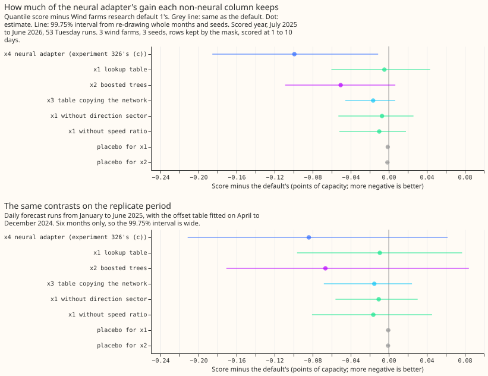
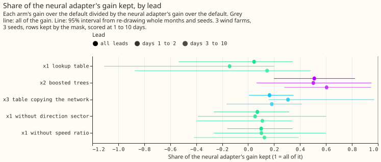
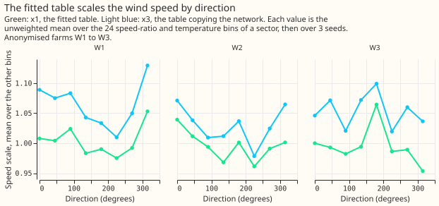

**Take-home: a lookup table keeps 5% of the neural network's gain in forecast score and boosted
trees keep 51%, so no non-neural column passes the adoption rule.** [Experiment
326](../00326-wind-research-default-1-change-arms/result.md) found that giving XGBoost one extra
input, the wind speed corrected by a small neural network (the neural adapter), lowers the wind
forecast's score by 0.099 points. We asked whether a simpler method can produce that input, so
that the production service needs no neural network. The input is the 100 m wind speed from the
ensemble forecast of the European Centre for Medium-Range Weather Forecasts (ECMWF), multiplied by
a speed scale that depends on wind direction, temperature, and the ratio of the 10 m to the 100 m
wind speed. We replaced the neural network by three simpler methods for choosing the speed scale:
a lookup table by direction, speed ratio, and temperature (x1), boosted decision trees on the
neural network's inputs (x2), and a table filled in from the neural network's own speed scales
(x3). Each method was fitted as the neural network was: it minimises the error of a physics-based
wind-power model against the power observed at three metered wind farms (W1 to W3, anonymised),
driven by ERA5 (our estimate of past weather) before April 2024. The score is the quantile score
over 11 quantile levels, in percentage points of each farm's capacity, scored at forecast leads of
1 to 10 days on the rows that experiment 210's mask keeps (lower is better). The default forecast,
[Wind farms research default 1](../research-default.md), scores 11.352. The neural adapter (x4,
experiment 326's arm (c)) lowers the default's score by 0.099. The lookup table lowers it by
0.005, the table copying the neural network by 0.016, and the boosted trees by 0.051. The boosted
trees and the copied table have a 95% interval for that difference below zero, but the 99.75%
interval that the adoption rule uses includes zero for all three non-neural columns. The
hypothesis, that a non-neural column keeps most of the gain, is `not supported`.

## Results

| Arm | Kept rows | All rows | Days 1 to 2 | Days 3 to 10 | 0.01 pinball | 0.99 pinball | 5%-95% coverage |
|---|---|---|---|---|---|---|---|
| Default | 11.352 | 10.825 | 6.612 | 11.191 | 0.284 | 0.640 | 92.1% |
| x4, neural adapter | 11.253 | 10.746 | 6.525 | 11.097 | 0.283 | 0.639 | 92.0% |
| x2, boosted trees | 11.301 | 10.785 | 6.568 | 11.134 | 0.283 | 0.641 | 91.9% |
| x3, table copying the network | 11.336 | 10.810 | 6.585 | 11.174 | 0.284 | 0.638 | 92.1% |
| x1, lookup table | 11.347 | 10.821 | 6.624 | 11.177 | 0.284 | 0.640 | 92.1% |

- **Scored at 1 to 10 days, on 3 farms and 12 months.** Intervals resample whole months and the 3
  seeds (50,000 resamples) and do not cover other farms.
- **Benchmarks, kept rows.** The default's 11.352 compares with 13.547 for climatology (the default
  is 2.195 better, 95% interval 1.577 to 2.808), 11.697 for the frozen XGBoost reference without the
  offset table (0.345 better, 0.274 to 0.418), and on hours 0 to 6 only 15.566 for persistence
  against the default's 6.568 on the same 1,696 rows.
- **Gain over the default, kept rows (95% interval; 99.75% interval).** x4: -0.099 (-0.157 to
  -0.041; -0.185 to -0.011). x2: -0.051 (-0.089 to -0.012; -0.109 to +0.007). x3: -0.016 (-0.034 to
  -0.001; -0.046 to +0.007). x1: -0.005 (-0.040 to +0.028; -0.060 to +0.043).
- **Share of the neural adapter's gain kept (95% interval).** x2: 51% (20% to 82%). x3: 16% (1% to
  35%). x1: 5% (-54% to 34%). The prediction that x1 keeps at least half failed, and the prediction
  that x2 keeps at least 80% failed (its point estimate is 51%, and 80% sits at the top of its
  interval).
- **By lead.** x2 keeps 50% at days 1 to 2 and 60% at days 3 to 10; x3 keeps 31% and 18%; x1 keeps
  -14% and 15%. The prediction that the kept share is smaller at days 1 to 2 held for x2 and x1 and
  failed for x3, and every pair of intervals overlaps, so the prediction is not established.
- **Drop-one tables.** Without the direction sector the table gains 0.007, and without the speed
  ratio 0.010, against x1's 0.005, so each version gains nothing within its interval. The prediction
  that the sector and the ratio carry the gain cannot be tested when the full table has no gain.
- **Per farm (x2 minus default).** W1 -0.061, W2 -0.070, W3 -0.018, and negative without any one
  farm (-0.045, -0.041, -0.066), in 9 of 12 months. x1 is -0.017, -0.015, and +0.020, and so has no
  consistent sign.
- **Replicate period (daily runs of January to June 2025, six months).** x2: -0.067 (99.75%
  interval -0.171 to +0.084; t test on six monthly differences, p = 0.32). x4: -0.084. x3: -0.015.
  x1: -0.009. Every arm agrees in sign with the scored year, and no interval excludes zero.
- **Tails.** No arm raises the 0.01 or 0.99 pinball loss by more than 0.05; the one-sided 95% upper
  bounds are at most +0.0124 (x2 at 0.99).
- **Serving each arm needs.** x1 and x3: a table file of 192 numbers per farm. x2: a boosted-tree
  model file per farm. x4: a neural network per farm. All four also need the fitted physics core
  (power curve, hub height, idle layer, and
  air-density terms) to turn the 10 m and 100 m speeds and the temperature into the effective
  speed, and x2 also needs the hour of day.

## Why the table fails

**An adapter's gain on the forecast follows how much it lowers the physics core's error on ERA5.**
On the ERA5 training rows the core's mean absolute error of expected power, as a fraction of
capacity, is lowest with the neural adapter, then boosted trees, then the lookup table, and no
better than no adapter with the table copying the network. The table below gives these errors for
seed 0.

| Farm | No adapter | x4, neural | x2, trees | x1, lookup table | x3, copied table |
|---|---|---|---|---|---|
| W1 | 0.0702 | 0.0633 | 0.0657 | 0.0672 | 0.0705 |
| W2 | 0.0822 | 0.0725 | 0.0760 | 0.0784 | 0.0870 |
| W3 | 0.0906 | 0.0802 | 0.0831 | 0.0860 | 0.0966 |

- **The lookup table closes 39% to 44% of the network's ERA5 error reduction** (W1 43%, W2 39%, W3
  44%), yet keeps 5% of its forecast gain. Whatever the table learns on ERA5 mostly does not carry
  to the ensemble members' wind speeds.
- **The copied table is worse than none.** The median of the network's factor in a cell loses the
  network's variation inside the cell, and the physics core was fitted jointly with the network, so
  the table does not reproduce the network's wind-power curve.
- **The columns differ by about 0.4 to 0.7 m/s from the network's** on the scored year's member
  rows, against 0.7 to 1.1 m/s for no adapter (mean absolute difference). All correlate at 0.97 or
  higher with the network's column.

## Design as run

- **Column.** Every arm hands XGBoost the physics core's effective hub-height speed (the 100 m
  speed after the core's shear, air-density, and adapter terms), the same definition as x4. The
  plan's phrase "100 m speed times the table value" is this column.
- **x1.** The table and the core are fitted together by the optimiser that fitted the neural
  adapter (1,200 steps of full-batch AdamW on the mean absolute error of expected power), with each
  cell's scale held between 0.8 and 1.25.
- **x2.** Boosted trees (depth 3, learning rate 0.1) give the log scale through a custom objective
  (pseudo-Huber loss on the core's power, delta 0.1). Pass 1 runs 60 rounds with the core fixed at
  the fit without an adapter, the core's curve is then refitted with the scale held fixed, and
  pass 2 adds 30 rounds. The monotone constraints took the sign of the Spearman correlation
  between x1's fitted scale and each input, before any forecast was scored: +1 on the speed ratio
  at all three farms, and +1 on temperature at W1 and -1 at W2 and W3 (the same for every seed).
- **x3.** The first fit gave medians outside the table's range of 0.8 to 1.25 at low speeds, which
  produced undefined values. The medians are now clipped to the range, and the arm was refitted
  before any forecast score was read.
- **Replicate.** Every arm's mixtures come from the same ERA5 fits, with only the offset table
  refitted on hindcast cases before 2025-01-01, as in experiment 326.

## Controls and adoption conditions

- **Reproduction gate: passed.** The default through the offset table scores 11.352 points on the
  kept rows, identical to experiment 303's P1 (difference 0).
- **Placebos: passed.** A column permuted across rows gives -0.001 (99.75% interval -0.003 to
  +0.001) for x1 and -0.001 (-0.004 to +0.001) for x2.
- **Known-answer test for x1: passed.** Power generated with known speed scales by sector (0.90 to
  1.12) was fitted by x1 on W1's ERA5 inputs, and the effective speed was recovered to within 0.7%
  in every sector (the limit is 3%).
- **Leakage check: passed.** Every table and tree input is ensemble weather at forecast time: the
  10 m and 100 m wind speeds, the 100 m direction, the 2 m temperature, and the hour of day (x2
  only). The fits use ERA5 before 2024-04-01.
- **Conditions for x1, x2, and x3, in that order.** Condition 1 (gain): failed for all three, since
  no 99.75% interval lies wholly below zero. Condition 2 (no harm to the 0.01 and 0.99 tails):
  met. Condition 3 (replication): met on sign, with no interval excluding zero. Condition
  4 (controls): met. Condition 5 (inputs available at forecast time): met. No arm is adopted, and
  no arm is kept as a candidate, because each fails condition 1.

## Checks

- **Median minus mean forecast, kept rows.** The default's is -4.805 points. x4 -4.720, x2 -4.686,
  x3 -4.800, x1 -4.781. The median sits below the mean in every arm, as in experiment 326.
- **Error of the mean forecast beside the quantile score.** Mean absolute error, kept rows: x4
  -0.122, x2 -0.066, x3 -0.009, x1 +0.009. Median absolute error: x4 -0.130, x2 -0.074, x3 -0.021,
  x1 -0.008.
- **Triggers.** Trigger 2 (a result contradicts its own prediction) fired, because x1 and x2 kept
  less of the gain than predicted. The ERA5 error table above tests the explanation. Trigger 3 fired
  for x1 alone, because its mean-forecast error contrast is +0.009 and its quantile score contrast
  is -0.005, and both are zero within their intervals. Trigger 4 fired for x1 alone (+0.020 at W3,
  -0.017 at W1), and x1's verdict does not depend on it. Trigger 5 fired for x1, because each
  drop-one table scores 0.002 to 0.005 better than the full table, which is well inside the 0.03
  half-width of the paired interval. Triggers 1, 6, and 7 did not fire. No audit ran, because each
  fired trigger concerns a null contrast that cannot change the verdict.

## Caveats

- **Scored at 1 to 10 days, 3 farms, 12 months.** Three farms rarely reach the research-default bar.
- **Single ERA5 fits,** not the quarterly refits the family settings name, as in experiment 326.
- **The boosted trees (x2) were fitted with one set of settings** (depth 3, 60 rounds then 30
  rounds after a refit of the core, learning rate 0.1), chosen before any score. Other settings
  might keep more of the gain.
- **Table bins are quantiles of the ERA5 rows** (8 sectors, 6 speed-ratio bins, 4 temperature
  bins). A finer table was not tried.
- **The curtailment-cost metric is not scored,** as in experiment 326, because W1 to W3 have no
  node forecast.
- **Replicate period is six months,** so its intervals cannot confirm or refute any arm.

## What the next experiment should answer

- **Can a non-neural adapter fit the core's ERA5 error as well as the network does?** The ERA5 error
  ranks the adapters in the forecast's order, so a cheap search on ERA5 alone (more trees, more
  inputs such as the lead-independent spread, or a larger table) could find an adapter worth a
  forecast run, without a forecast run per candidate.
- **Does the neural adapter's gain survive the family's quarterly refits?** This was already the
  open question after experiment 326.
