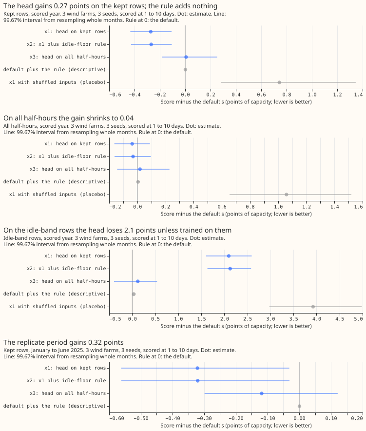
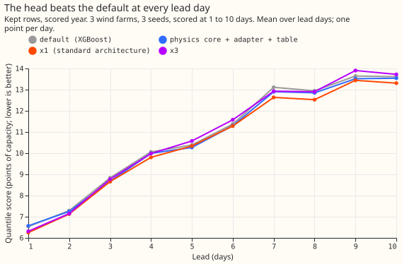
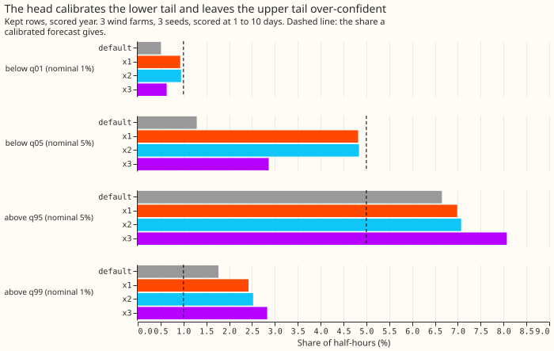
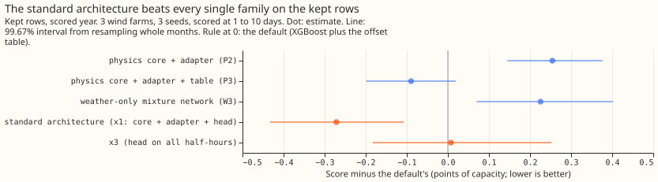

**Take-home: a small neural network that corrects the wind forecast's quantiles lowers the quantile
score by 0.27 points of capacity on the farms' normal half-hours, but the gain is a recalibration,
and no arm passes the adoption conditions.** The quantile score measures how well a forecast's 11
quantiles match the observed power, in points of capacity (1 point is 1% of a farm's capacity; lower
is better).

We asked whether the mixture-density head of [experiment
324](../00324-wind-farm-solar-cross-breeds-long-run/result.md) can improve Wind farms research
default 1, called "the default" below. The head is a small neural network that fits three bell
curves to each forecast. It takes the 11 quantiles of the physics core plus adapter (a physics-based
wind-power forecast with a learned correction to the wind speed) and summaries of the 51 ensemble
members (the 51 perturbed runs of the ECMWF weather forecast) for speed, direction, and temperature.
The default is an XGBoost model trained on ERA5 (our estimate of past weather) and run on the 51
members, plus a table of per-quantile offsets.

The head scored 11.080 against the default's 11.352 on the kept rows, the half-hours that
[experiment 210](../00210-wind-idle-noise-mva-artefact/result.md)'s mask does not flag as idle-band
readings (small noisy power readings while a farm is idle). On the idle-band rows the head scored
8.146 against 6.051. We tested two repairs: x2 adds a rule that forecasts the farm's idle floor (the
median power of its idle-band readings) wherever the ensemble-mean wind speed is below the speed at
which the turbines start generating (the cut-in speed), and x3 trains the head on every half-hour.
The rule recovered none of the 2.1-point loss. Training on every half-hour (x3) removed the
0.27-point gain.

The pinball loss at the 0.99 quantile, the score of the upper tail that matters for curtailment,
rose by 0.05 points. The adoption rule allows a rise of at most 0.05 with 95% confidence, and the
bound is 0.092. A control run afterwards, in which the head saw only the 11 quantiles and no weather
summaries, scored 11.050, so the weather summaries add nothing. The verdict is `partly supported`,
and the head stays a candidate: no arm is adopted.

## Results

"Default plus x" is an arm. Scores are quantile scores in points of capacity (lower is better),
scored at 1 to 10 days, on 107,121 half-hours of three farms (W1 to W3), three seeds. Intervals are
99.67% (three arms), resampling whole months and seeds.

| Arm | Kept rows | All half-hours | Idle-band rows | Days 1 to 2 | Days 3 to 10 | 0.01 pinball | 0.99 pinball | 5%-95% coverage |
|---|---|---|---|---|---|---|---|---|
| Default | 11.352 | 10.825 | 6.051 | 6.612 | 11.759 | 0.284 | 0.640 | 92.1% |
| x1 head, kept rows | 11.080 | 10.789 | 8.146 | 6.472 | 11.763 | 0.283 | 0.691 | 88.2% |
| x2 x1 plus rule | 11.084 | 10.795 | 8.176 | 6.486 | 11.767 | 0.283 | 0.697 | 88.1% |
| x3 head, all rows | 11.359 | 10.844 | 6.172 | 6.462 | 11.832 | 0.281 | 0.729 | 89.1% |
| Default plus the rule | 11.354 | 10.830 | 6.083 | 6.626 | 11.762 | 0.284 | 0.647 | 92.0% |
| Head, base quantiles only (post hoc) | 11.050 | 10.744 | 7.969 | | | | | |
| Default plus +3 point shift (post hoc, oracle) | 11.171 | 10.872 | 8.162 | | | | | |

- **x1 minus default: -0.272 on the kept rows (-0.433 to -0.108), -0.037 on all half-hours (-0.163
  to +0.089).** Seeds give -0.274, -0.285, and -0.256; five head seeds on one base seed score 11.076
  on average (sd 0.023). The gain holds at each farm (-0.17, -0.39, -0.25), without any one farm,
  and at every lead day. The replicate period (January to June 2025, heads trained on 2024-04 to
  2024-11) gains 0.321 (-0.562 to -0.031), t test on six monthly differences p = 0.01.
- **The 0.99 pinball loss rises by +0.050 (one-sided 95% bound 0.092) and the 0.01 loss falls by
  0.001.** Adoption condition 2 allows 0.05, so x1 and x2 fail it. Below q05 the share of half-hours
  moves from 1.3% to 4.8% (nominal 5%), above q99 from 1.8% to 2.4% (nominal 1%).
- **x2 minus x1: +0.003 on the kept rows.** The rule flags 0.77% of half-hours and 6.7% of the
  idle-band rows. On the idle-band rows x2 loses 2.13 points against x1's 2.10, so x2 makes the loss
  1% larger instead of recovering any of it. The plan text for x2 contradicts itself (it says "at
  least half" and then "under a third"); x2 fails both halves. On the rows the rule flags, the idle
  floor scores 3.05 against 2.39 for the default, because the farms still produce small real output
  there ([experiment 336](../00336-wind-research-default-1-below-cut-in-zeroing/result.md)). Default
  plus the rule is +0.002 on the kept rows.
- **x3 minus x1: +0.279 on the kept rows.** Training on all half-hours gives the head +0.007 against
  the default on the kept rows (-0.183 to +0.252) and +0.122 on the idle-band rows, so x3 recovers
  94% of x1's idle-band loss. It also gives up the whole kept-row gain, against a predicted loss of
  under 0.1 relative to x1. The 0.99 pinball loss is 0.089 worse than the default.
- **Placebo and controls.** Feeding the trained head member summaries from another month of the same
  farm scores 12.095 on the kept rows, 0.743 worse than the default, so the head reads its
  summaries. The head with no summaries scores 11.050 (-0.302 against the default), 0.030 better
  than x1 (x1 minus base-only +0.030, 95% interval -0.032 to +0.088, so no difference).
- **Leave one farm out.** A head trained on the other two farms scores +0.153 against the default on
  the kept rows (95% -0.129 to +0.452), worse at W2 and W3 and better at W1. Predicted: no better
  than the default; held.
- **Standard architecture against the best single family.** The best family is the physics core plus
  adapter plus the offset table (P3, 11.262), 0.090 better than the default (0.015 to 0.166). The
  standard architecture (x1: physics core + adapter + head) is 0.182 better than P3 on the kept rows
  (-0.285 to -0.082, 1.6%), and 0.032 worse on all half-hours (-0.061 to +0.131). The weather-only
  mixture network scores 11.578, the physics core plus adapter 11.606.
- **Benchmarks, kept rows.** Climatology 13.547. The default without the offset table 11.697.
  Persistence is scored on hours 0 to 6 only (1,696 kept rows): 15.566 against 6.568 for the default
  and 6.248 for x1.
- **Tolerance on all half-hours (0.05, reported without pass or fail).** x1 (-0.037), x2 (-0.031),
  and x3 (+0.019) all meet it.
- **Serving.** x1 needs a small neural network (about 2 minutes to train per farm on a graphics
  processing unit), its input quantiles from the physics core plus adapter, and the 11
  member-summary columns. x2 adds a rule and a floor value per farm (1.4%, 0.4%, and 2.6% of
  capacity at W1 to W3). x3 needs the network only.

## Adoption conditions

| Arm | 1, gain | 2, no harm | 3, replication | 4, controls |
|---|---|---|---|---|
| x2 | met (0.268) | **failed** (0.99 bound 0.097) | met | met, but see Checks |
| x3 | failed (+0.007) | failed (0.99 bound 0.156) | not met | seed spread too large for a zero gain |
| x1 | met (0.272) | **failed** (0.99 bound 0.092) | met | met, but see Checks |

No arm is adopted, so no forecasts are stored.

## Checks

- **Median minus mean forecast, kept rows, per farm (points).** Default -4.95, -5.39, -4.03; x1
  -4.04, -4.30, -3.25; x3 -4.23, -4.42, -3.85. The head moves the median up relative to the mean at
  every farm.
- **Error of the mean forecast beside the quantile score.** x1: quantile score -0.272, absolute
  error of the median -0.410 (-0.566 to -0.245), absolute error of the mean forecast +0.043 (-0.091
  to +0.184). **Trigger 3 fired nominally for x1**, with the mean forecast not significantly
  different.
- **Triggers fired:** audit trigger 2 (x2 and x3 contradicted their predictions; explanations tested
  above) and audit trigger 3 (quantile score and mean-forecast error disagree, x1). A Sonnet audit
  (private report `briefs/e339_audit_report.md`) re-derived the contrasts and found no leakage.
  **Triage:** accepted all findings. Its main finding: about half of x1's gain (a shift fitted on
  the hindcast gives -0.144, a per-quantile shift -0.150) is a level shift of the default's
  quantiles, and x1 still gains -0.122 (-0.21 to -0.03) beyond the hindcast-shifted default. We ran
  the control the audit asked for: the head with no member summaries does as well as x1, so the
  member summaries add nothing and the head's value is recalibration of the physics core's
  quantiles. The audit also notes that the spread factor of the base quantiles is fitted on earlier
  cases including the scored year, a feature the default shares.
- **Leaving one farm out keeps the sign** for x1 and x2 (-0.32, -0.21, -0.28 without each farm).

## Caveats

- **Scored at 1 to 10 days, 3 farms, 12 months.** Intervals do not cover other farms.
- **x1 is bit-identical to experiment 324's W4** (the stored arrays match), so x1 re-scores
  experiment 324's stored predictions against new contrasts, and no new fit was run for it.
- **x1 and x2 never see idle-band rows in training;** only x3 does.
- **The replicate heads use December 2024 only to stop training early,** and the replicate has six
  months.
- **The oracle shift is fitted on the scored rows** and is an optimistic bound on a bias correction.
- **No audit by Opus,** by the maintainer's instruction; the audit and reviews were by Sonnet.

## What the next experiment should answer

- **Does a hindcast-fitted correction of the default's quantiles (a shift or a small head on the
  default's own quantiles) match the head's 0.27 points?** The post hoc controls say a shift reaches
  about half and a base-only head reaches all of it.
- **Can the head's upper tail be repaired?** Above q99 the head covers 2.4% against 1% nominal; a
  tail-specific term in the mixture is the obvious test.
