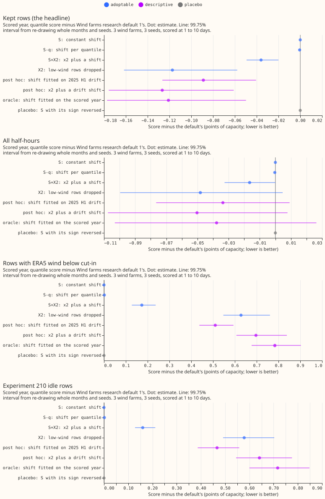
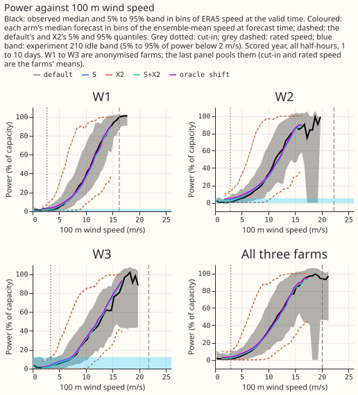
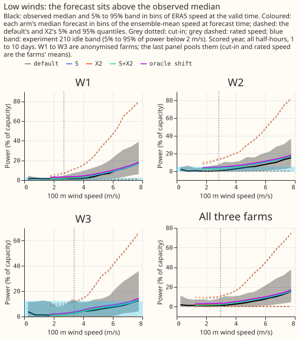
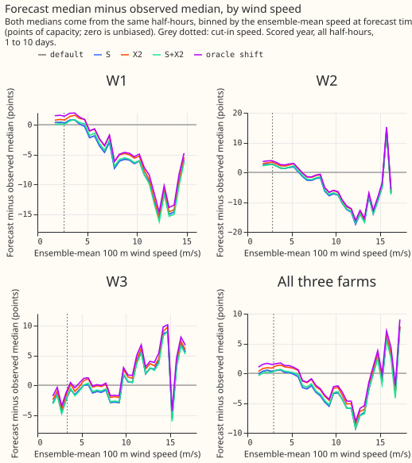

**Take-home: a single upward shift of the wind quantiles, fitted on past forecasts, does nothing,
and the shifts that do reproduce the gain of dropping low-wind training rows also harm the forecast
at low winds.** [Experiment 336](../00336-wind-research-default-1-below-cut-in-zeroing/result.md)
found that dropping the training rows with wind below the turbines' cut-in speed (the speed at
which a turbine starts to turn) improves the forecast (its arm x2, called X2 here), and its audit
suggested the gain is only a constant upward shift of the forecast quantiles. We tested that. The
forecast is Wind farms research default 1, the wind forecast with the best score in the experiments
run so far, on the three metered wind farms (W1 to W3, anonymised) at 1 to 10 day leads. The score
is the quantile score in points of capacity (a point of capacity is 1% of a farm's capacity; lower
is better) on the kept rows: the half-hours at a farm that the mask of [experiment
210](../00210-wind-idle-noise-mva-artefact/result.md) does not flag as idle. The default scores
11.352. Arm S adds one constant to every forecast quantile, fitted on the 442 hindcast runs (the
forecasts made retrospectively on 442 earlier days) that also fit the forecast's offset table, the
correction per farm and lead day built into the default. The fit returns 0.000 points, because the
offset table already minimises the score on those runs. Arm S therefore equals the default (gain
0.000). A shift reproduces the gain only when fitted on data from after the table's fitting
window, and the two such shifts we tried raise the score on the rows with ERA5 wind (our estimate
of past weather, used here as the observed wind speed) below cut-in by 0.5 to 0.8 points. The
verdict is `not supported`, and nothing is adopted.

Differences are the arm's score minus the default's, so a negative difference is an improvement.

## Design

- **Plan.** Committed before any score, in the first commit of this branch. Its caution (a
  hindcast-only probe showed an optimum near +0.2 points) was optimistic: the fitted constant is
  0.000. The plan did not say that the S+X2 constant is fitted on all usable hindcast rows, not on
  the kept rows; it is.
- **Family and default.** Wind farms research default 1, experiment 336's refit, 3 farms, 3 seeds,
  107,121 scored half-hours. Code reused from the folder of experiment
  [336](../00336-wind-research-default-1-below-cut-in-zeroing/result.md) (and through it 326, 303,
  285, 259, and 230); X2 is read from 336's stored mixtures. Tier 1 for S and S-q, tier 2 for X2.
  Minimum gain 0.02 points for S, S-q, and S+X2 (each adds a fitted step) and 0 for X2.
- **Arms.** S: one constant added to the final quantiles. S-q: one constant per quantile level.
  X2: dropped low-wind rows. S+X2: x2's quantiles plus a constant fitted on x2's hindcast. Post hoc
  and never adopted: `Sdrift` and `SX2drift` (constant fitted on the January to June 2025 hindcast
  runs scored with the table fitted before 2025, then applied to the scored year), `Soracle`
  (fitted on the scored year), and the sign-reversed placebos.
- **Reproduction gate.** The refit default and X2 equal experiment 336's stored forecasts exactly
  (largest difference 0), and the default scores 11.352, the same as experiment 303's stored
  forecast (named P1 there).
- **Controls.** Known-answer test: the fit recovers an injected 1.2-point shift to within 0.001.
  Leakage check: the hindcast ends on 2025-06-16 and the scored year starts on 2025-07-01. Placebo:
  with the sign of the shift reversed, S and S-q change nothing, and S+X2 gains 0.17 points, because
  reversing x2's negative constant raises the forecast, the useful direction for X2.

## Results

| Arm | Kept rows | All half-hours | Below cut-in | Idle rows | Days 1 to 2 | Days 3 to 10 | 0.01 pinball | 0.99 pinball |
|---|---|---|---|---|---|---|---|---|
| Default | 11.352 | 10.825 | 5.374 | 6.051 | 6.612 | 11.759 | 0.284 | 0.640 |
| S | 11.352 | 10.825 | 5.374 | 6.051 | 6.612 | 11.759 | 0.284 | 0.640 |
| S-q | 11.351 | 10.825 | 5.375 | 6.052 | 6.612 | 11.759 | 0.284 | 0.634 |
| S+X2 | 11.316 | 10.809 | 5.547 | 6.210 | 6.612 | 11.739 | 0.285 | 0.644 |
| X2 | 11.235 | 10.777 | 6.002 | 6.629 | 6.597 | 11.705 | 0.284 | 0.638 |
| Post hoc: drift shift | 11.263 | 10.792 | 5.884 | 6.517 | 6.621 | 11.718 | 0.289 | 0.637 |
| Post hoc: x2 plus drift shift | 11.225 | 10.775 | 6.071 | 6.692 | 6.598 | 11.702 | 0.284 | 0.637 |
| Oracle shift | 11.231 | 10.788 | 6.157 | 6.767 | 6.642 | 11.709 | 0.296 | 0.636 |

Reference rows on the kept rows: the frozen XGBoost reference (the default without the offset
table) 11.697, climatology 13.547, persistence 15.566 (hours 0 to 6 only, 1,696 rows). The default
beats climatology by 2.195 points. The pinball columns are on the kept rows.

- **Fitted shifts (points of capacity, seed 0; the three seeds agree to 0.01).** S: 0.00 (W1, W2,
  and W3 each 0.00). S-q: -0.16 at q01, 0.00 from q05 to q90, +0.15 at q95, and +1.83 at q99. S+X2:
  -0.73 (W1 -0.63, W2 -0.82, W3 -0.79). Post hoc drift shift: +0.78 for the default and
  +0.10 for x2. Oracle: +1.16.
- **S and S-q do nothing (P1 fails).** S gains 0.000 on the kept rows. S-q gains 0.001 (99.75%
  interval -0.001 to 0.000), and its 0.99 pinball loss improves by 0.006 (0.640 to 0.634) from the
  q99 constant.
- **S+X2 gains 0.036 on the kept rows over S (-0.049 to -0.020), above the 0.03 that P2 allowed.**
  The constant fitted on x2's hindcast is -0.73, which cancels most of x2's own upward lift. The
  gain therefore falls from 0.117 to 0.036. The replicate gain is 0.002. S+X2 worsens the rows below
  cut-in
  by 0.17 (0.13 to 0.24), the idle rows by 0.16, and all half-hours improve by 0.017.
- **X2 reproduced: -0.117 on the kept rows (-0.162 to -0.058), +0.628 on the rows below cut-in
  (0.547 to 0.761), +0.579 on the idle rows (0.492 to 0.703), -0.048 on all half-hours (-0.100 to
  +0.005).** The three farms gain -0.129, -0.115, and -0.107, and leaving out any one farm gives
  -0.111, -0.119, and -0.122.
- **A shift fitted out of sample reproduces most of the gain and the harm (post hoc).** The drift
  shift gains 0.089 on the kept rows (-0.126 to -0.041), 76% of X2's gain, and worsens the rows
  below cut-in by 0.510 (0.437 to 0.594). The oracle shift gains 0.121 and worsens the rows below
  cut-in by 0.783.
  So a constant shift reproduces the gain (P1's size) but not the behaviour at low winds (P3 fails
  for every shift that gains). The replicate gains are 0.083 and 0.112, so P4 holds for these
  shifts only.
- **P3 and P4 for S itself.** S worsens no row set, because S is the default (P3 holds vacuously).
  P4 has no sign to test, because S is zero in both periods.
- **Where the forecast is wrong.** In figure 4 the default's median is 5 to 15 points of capacity
  too low at 8 to 15 m/s at W1 and W2, and 1 to 3 points too high below 5 m/s at W1 and W2. The
  differences between the arms' medians are under 2 points everywhere. A constant shift moves the
  whole curve and so fixes the first fault while worsening the second.
- **Tails.** No arm raises the 0.01 pinball loss by more than 0.012 (the oracle shift) or the 0.99
  pinball loss by more than 0.004. The oracle shift lowers the 5%-to-95% coverage from 92.1% to
  89.4%, and X2 to 91.4%.

## Adoption conditions for each arm

| Arm | 1, gain | 2, no harm (tails and low winds) | 3, replication | 4, controls | Adopted |
|---|---|---|---|---|---|
| S | no (gain 0.000, minimum 0.02) | met | no (replicate gain 0.000) | met | no |
| S-q | no (gain 0.001, minimum 0.02) | met | no (replicate 0.000) | met | no |
| S+X2 | met (0.036, interval wholly below zero) | no (below cut-in +0.20 upper bound, idle +0.19, limit 0.1) | no (replicate 0.002, under 0.01) | no (the reversed shift gains) | no |
| X2 | met (0.117) | no (below cut-in +0.70, idle +0.65) | met | met | no |

Condition 5 holds for all arms (the shifts read only hindcast runs). X2 remains a candidate from
experiment 336, and the maintainer's low-wind condition is the one it fails. A shift alone would
need no serving-path change (a constant per quantile), but no shift passes.

## Checks

- **Median minus mean forecast, kept rows.** Default -4.805 points, S -4.805, X2 -4.737, S+X2
  -4.754, drift shift -4.801, oracle shift -4.798.
- **Error of the mean forecast beside the quantile score.** The absolute error of the mean forecast
  rises with every gaining arm: X2 +0.032 (quantile score -0.117), S+X2 +0.006 (-0.036), drift
  shift +0.030 (-0.089), oracle shift +0.056 (-0.121). The median's absolute error falls by 0.06 to
  0.18. **Trigger 3 fired for X2 and S+X2, as in experiment 336.**
- **Other triggers.** Trigger 2 fired (S gained 0.000 against a predicted 0.08 to 0.12). The
  explanation is tested above: the offset table is fitted on the same hindcast, and the post hoc
  drift and oracle shifts show a constant shift does gain once it is fitted after the table's
  window. Trigger 4: leaving out any one farm keeps the sign for X2, S+X2, and the post hoc shifts.
  Trigger 5: the controls pass for S, S-q, and X2 and fail for S+X2, whose reversed shift gains 0.17
  points. A Sonnet audit re-derived the shifts and contrasts from the stored quantiles (see Review).

## Caveats

- **Scored at 1 to 10 days, 3 farms, 12 months.** Intervals do not cover other farms.
- **The oracle shift is not an honest forecast of the scored year; the drift shift is one a live
  service could fit.** The drift shift reads January to June 2025, the six months before the scored
  year. The oracle shift reads the scored year and is an upper bound.
- **The shift is fitted per seed on a single set of 442 hindcast runs,** and the fit minimises the
  headline quantile score, not any single quantile.
- **The power curves bin all scored half-hours** (not only the kept rows) in bins of 0.5 m/s, and
  show bins with at least 30 half-hours. The forecast curve uses the ensemble-mean speed at
  forecast time and the observed curve uses ERA5 speed at the valid time, so the two x axes are
  different quantities.

## Review

- **Code review and audit (Sonnet, one agent).** No leakage: every shift fit reads hindcast rows
  only, which end on 2025-06-16, before the scored year starts on 2025-07-01. It re-derived the
  contrasts of X2, the drift shift, the oracle shift, and S+X2 from the stored quantiles and
  matched every number in this page, and refitted S independently to 0 on both the headline score
  and a plain 11-level pinball loss. Findings, all low severity: condition 5 is set to true in code
  and the audit-trigger part of condition 4 is not computed (accepted, both are read by hand on
  this page); the per-level fit ignores the later clip and sort (accepted, S-q is a null arm); the
  S+X2 constant is fitted on all hindcast rows (accepted, now stated in Design).
- **Prose review (Sonnet, one agent).** Accepted: define x2, hindcast, offset table, cut-in, and
  ERA5 in the opening, link experiment 336 at first mention, split the two-claim sentences,
  scope the law-like sentences and advice, fix the q95 range, the trigger-5 and caveat wording, and
  the 0.007 to 0.006 figure, and add the sign convention. Rejected: deleting the pre-registration
  sentence in Design (the skill requires the commit order to be shown); rewording 0.017 and 0.579
  (rounding of unrounded scores); bolded leads on table paragraphs (convention on these pages).

## Open questions

- **A correction that depends on wind speed is untested.** One offset per bin of ensemble-mean 100
  m wind speed (for example 0 to 5, 5 to 8, 8 to 12, and above 12 m/s), fitted on the hindcast,
  could lift the forecast at 8 to 15 m/s and leave it alone below 5 m/s, as the power-curve figures
  suggest. Its gain on the kept rows and its score below cut-in are the numbers to read.
- **The cause of the 0.8 to 1.2 point drift is untested.** The hindcast years and the scored year
  differ in median bias; refitting the offset table every few months might remove the difference.
