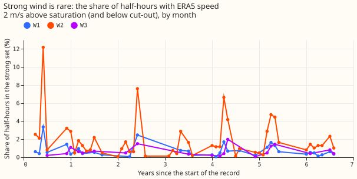

**A loss of about half a wind farm's capacity is found within 60 days at 91% to 93% of start dates
at all three farms, a loss of a quarter at 26% to 77%, and anything smaller is not found reliably.**
The proposal to look only at the strongest winds does not help, because strong wind fills 0.18% to
1.1% of half-hours and most 28-day blocks hold too few of them for a stable high quantile. The best
statistic is the ratio of observed to expected power over every half-hour at 20% of the farm's
maximum output or more. The verdict is **not supported**: two of eight pre-registered predictions
held, and one of the two held only because the strong-wind statistic is missing in almost every
block. W1, W2, and W3 are three metered wind farms, anonymised.

## Question and answer

**We asked how small a loss of a wind farm's usable capacity its output can show, and how fast.**
Capacity falls when turbines fail and returns when they are repaired. Experiment 233 divided
observed power by the power that a fitted wind-turbine model expects, over the half-hours when the
model expects at least 95% of the farm's maximum output, and was too slow (a 25% loss was found
within 120 days at about half the start dates at W1 and W2 and at none at W3). This experiment
changes the statistic and the detector. The statistic is a high quantile of observed power in
half-hours when the ERA5 100 m wind speed is at least 2 m/s above the speed at which the fitted
power curve saturates (the "strong set"). The detectors are a change-point search (optimal
partitioning, after [Killick et al. (2012)](https://doi.org/10.1080/01621459.2012.737745)) and a
two-sided CUSUM test (cumulative sum, after [Page
(1954)](https://doi.org/10.1093/biomet/41.1-2.100)).

**We tested the detectors by cutting the observed power in known ways and counting the start dates
at which each detector found the cut.** We cut power by whole turbines, by 10%, 25%, and 50%, and by
half a turbine, for 3 to 365 days from each of 30 random start dates (2024-07 to 2025-12). We also
clipped output at 90%, 75%, and 50% of the 99.9th percentile (a lost export cable), added seasonal
swings and a slow drift, and added a 5% error in wind speed. Five arms were compared: A (the 99.9th
percentile in the strong set), B (the average log ratio of observed to expected power over
half-hours at 25% to 100% of scale, weighted by the inverse of each half-hour's variance, which is
lower at saturation where wind-speed errors do not matter), C (B with a fitted speed-scale term per
block), D (experiment 233's ratio), and E (W2 against W3, which share one ERA5 cell). Arms F and G
(public neighbour farms) could not be run: none of the 65 public farms with a known position among
the 287 candidates of [experiment 288](../00288-pooled-head-on-public-wind-farms/result.md) lies
within 150 km of W1, W2, or W3, and the other 222 candidates have no position.

**The result narrows the search to larger losses and to statistics that use every busy half-hour.**
It rules out the strong-wind quantile. It also finds that the real records show repaired episodes
and no permanent steps. The penalty rule fired a stop (below), so the change-point penalty was
chosen separately for each arm after the injection test and before the real series was read.

## Results

- **Pre-registered predictions: two held, four failed, two untestable.** P1 failed (arm A at the
  planned 2 m/s margin found a 25% step at 0% of start dates at W1 and 10% at W2, although at W1 and
  W3 that arm has fewer than 8 observed blocks, so the 0% is structural). P2 held vacuously: arm A
  at the 2 m/s margin raised 0, 0, and 0 new change points under a 9% swing (W1, W2, W3) against 1,
  2, and 1 for D, only because it has almost no blocks (at the saturation speed, arm A raised 2, 4,
  and 0). P3 failed: D finds a 10% step at 31% of W3 start dates, and arm A at the saturation speed
  flags every size from half a turbine (3.8%) to 50% at the same 50% of start dates at W1 (its
  statistic is so flat that any dip in a block that exists is flagged). P4 failed (State-space fit).
  P5 held (episodes shorter than 7 days: D finds 3-day 25% episodes at 0%, 0%, and 14% of start
  dates and 7-day ones at 0%, 3%, and 27%). P6 is untestable: it names the gap to the registered
  capacity, which was not available, and the effective capacity comes from the same readings. P7
  failed (Weighted evidence). P8 is untestable (no public farm with a known position within 150 km).
- **Strong wind is rare.** At the 2 m/s margin the strong set holds 0.31% (W1), 1.12% (W2), and
  0.18% (W3) of half-hours, on 3.2%, 5.1%, and 1.3% of days. At the margin of 0 m/s (experiment
  233's above-rated set) the shares are 1.6%, 3.3%, and 0.65%, on 7.3%, 11.1%, and 3.1% of days. The
  saturation speeds of the fitted curve are 15.3, 15.8, and 18.6 m/s at 100 m. Of strong-set
  half-hours at the 2 m/s margin, 0%, 4.7%, and 12.8% have observed power under half of scale (an
  outage or an ERA5 error).
**The check for an export limit at strong wind is circular, so it shows nothing either way.** The
  99.9th percentile of observed power in the strong set is 4% (W1), 16% (W2), and 17% (W3) above the
  fitted scale. The fitted scale comes from the same readings, so this check is circular and the
  visibility margin is not identified without turbine ratings. Coverage is the clear limit on seeing
  a loss. For W1 and W3 the observed power is in MVA, so reactive power adds to the readings.
- **The stop rule fired and the penalty was chosen per arm.** At `c = 2`, the worst primary
  combination of farm, arm, and block length raised 4.9 change points per farm-year in 2021-09 to
  2024-06, against the limit of one. At the largest penalty the worst was 1.06, because several
  change points of the unmodified series are probably real. Only change points that vanish at the
  largest penalty were then counted as false alarms ([Figure
  6](figure_6_false_alarms_by_penalty.svg)). The chosen multipliers are 2 (A), 8 (B), 16 (C), and 4
  (D); the CUSUM limits are 5 (A), 10 (B), 8 (C), and 8 (D). The noise estimates (relative speed
  error and power noise per farm) are 0.125 and 0.056 (W1), 0.139 and 0.098 (W2), and 0.116 and
  0.148 (W3).
- **Steps lasting 90 days, 28-day blocks, change-point search, share found within 60 days
  (95% interval from resampling calendar months of start dates).**

| Farm and step | A, 2 m/s margin | A, 0 m/s margin | B | C | D |
|---|---|---|---|---|---|
| W1, 25% | 0% | 50% (19 to 81) | 54% (23 to 81) | 46% (13 to 77) | 63% (30 to 88) |
| W1, 50% | 0% | 50% | 75% | 82% | 93% |
| W2, 25% | 10% | 74% (44 to 100) | 8% (0 to 25) | 0% | 26% (3 to 57) |
| W2, 50% | 13% | 74% | 81% | 29% | 91% |
| W3, 25% | 0% | 0% | 29% (3 to 61) | 0% | 77% (50 to 95) |
| W3, one turbine (50%) | 0% | 0% | 90% (72 to 100) | 23% (0 to 52) | 93% (82 to 100) |
| W1, one turbine (7.7%) | 0% | 50% | 0% | 0% | 0% |
| W2, one turbine (12.5%) | 0% | 45% | 0% | 0% | 0% |

- **Smallest step found at 80% of start dates or more within 60 days:** 50% of capacity at every farm
  (arm D, 93%, 91%, and 93%), and no smaller size reaches 80%. Median delay of arm D at a 50% step
  is 28 days at W3; at a 25% step it is 42 days (W1) and 36.5 days (W3), and W2's median is 78 days,
  past the 60-day limit.
- **CUSUM on the saturated set flagged 25% steps at 83% of start dates at W1, 100% at W2 (median
  delay 34 days), and 14% at W3,** on 18, 17, and 7 valid start dates. At W1 it flags a one-turbine
  step at the same 83%, so this reflects the flat statistic and not a faster detection. It also
  raised more new alarms under a 9% swing (6, 2, and 0 for the 99.9th percentile at 0 m/s margin).
- **Weighted evidence (arms B and C) did not speed detection up.** Arm B found a 25% step at 54%,
  8%, and 29% and arm C at 46%, 0%, and 0%, against arm D's 63%, 26%, and 77%. Under a 9%
  seasonal swing at 28-day blocks arm B raised 1, 0, and 0 new change points and arm C raised 0, 3,
  and 0. Under a 5% speed bias that lowers observed power for 30 days, arm D raised a false step at
  45% of start dates at W3 and arm C at 0% (arm B 4%), so the weighting, not the speed-scale term,
  removed most false steps.
- **Episodes (7-day blocks, arm D):** a 25% episode that then ends is found within its length plus
  60 days at 0%, 0%, and 14% of start dates when it lasts 3 days, at 7%, 10%, and 40% when it lasts
  14 days, and at 77%, 52%, and 73% when it lasts 60 days (W1, W2, W3). A one-turbine episode at W3
  is found at 20%, 43%, 73%, and 90% of start dates at 3, 7, 14, and 60 days.
- **Two farms, one ERA5 cell (arm E, 14-day blocks, arm B):** a 50% step is found in the W2 minus
  W3 series at 52% (W2) and 73% (W3) of start dates, a 25% step at 4% and 40%, and a one-turbine
  step at W2 at 0%. The result does not show that the shared speed error cancels: a 25% step at W2
  is found at 4% of start dates, no better than arm B on W2 alone (8%), and no correlation between
  the two farms' ratios was measured.
- **State-space fit.** The fit could not be validated, so no clip result is claimed. With 7-day
  blocks the fit labelled the unmodified series at W2 as not nameplate near every start date, so no
  W2 start date is valid. With 14-day blocks W2 has 30 valid start dates, and 5 of the 14-day 25%
  episodes were labelled as turbines out, none of the clips as a clip. At W1, 14-day episodes that
  cut output by 25% were labelled as turbines out for 7 of 30 start dates (7-day blocks) and 2 of 21
  (14-day blocks), and 14-day clips at 75% of the 99.9th percentile as a clip for none. The 99.9th
  percentile of the strong set exists in under 3% of 7-day and 14-day blocks at W1 and W3, so the
  fit falls back on fixed reference values there. The lattice-constrained variant never returned a
  whole-turbine state at W1 or W3 for the same reason, so that result does not test the lattice. The
  interquartile range of the strong set is near zero on the flat top, so it carries no signal for a
  clip, and the fit used only the 99.9th percentile and the mid-wind ratio.
- **Real series (dates are change points of arm D in 14-day blocks, with arm A as a check).** W1:
  one 2-week episode from 2024-03-10 to 2024-03-23 at 0.34 times expected power against 1.00
  before and after, which overlaps three of experiment 210's idle runs (2024-03-16 to 2024-03-19),
  and no permanent step. W2: 2021-09-26 to 2021-12-18 at 0.82 against 0.99 (a loss of 17%), and
  2025-11-02 to 2025-12-13 at 0.70 against 1.02 (a loss of 31%, 34% on the 99.9th percentile),
  which overlaps an idle run of 2025-11-14 to 2025-11-16; both end in a return to the earlier
  level. W3: 2024-10-20 to 2025-01-25 at 0.61 against 1.02 (a loss of 40%, and 53% on the 99.9th
  percentile, about one of the two turbines), a return on 2025-01-26, and a second, smaller drop
  from 2025-12-28 to the end of the record (0.82 against 1.03) with no return in the data. W3 also
  shows many short drops in 2020 and has 151 of the 183 idle runs of experiment 210. W1's
  annual 99th percentile of output over its effective capacity is 0.99 to 1.01 in every year from
  2019 to 2025, so no gap to that capacity opens inside the record (the effective capacity is
  itself estimated from the same readings).
- **Whole-turbine lattice test.** Steps of arm A at the saturated set in W1 are single 28-day
  blocks 7% to 9% below their neighbours, close to one turbine (7.7%); 5 of 9 lie within a tenth of
  a turbine at 13 turbines (binomial p = 0.02), but 5 of 9 also at 12 turbines (p = 0.02) and 3 of 9
  at 14 (p = 0.26), so the test cannot tell the counts apart. A dip and its return count as two
  steps, so the 9 steps are about 4 to 5 independent events and p = 0.02 is overstated; no
  correction is made for the several counts and two arms. At W2, 0 of 6 steps of arm A (p = 1.0)
  and 1 of 4 of arm D (p = 0.59) lie near a multiple of one eighth. At W3, 3 of 5 steps of arm A lie
  near a multiple of one half (p = 0.06) and 0 of 7 of arm D. The 31% loss at W2 lies between 2 and
  3 turbines. No upward step is permanent: every rise is the return from a downward episode.
**A private capacity-state table** (full, reduced by an estimated share, or out) for every half-hour
  of the three farms is saved under `work/capacity_state.parquet`, built from the change points of
  arm D and experiment 210's idle runs. A later experiment could test it as a training mask and as
  an as-of feature.

## Checks

- **No forecast is produced,** so forecast-error and tail-calibration checks do not apply.
- **Audit triggers** (listed in the `ml-experiment` skill): trigger 1 fired (a 9% swing raises new
  change points for arm A at the saturated set and for arm D) and trigger 2 fired (arm A failed its
  prediction). The strong-set shares and Figure 1 explain the second. The worker brief allowed
  Sonnet only, so a fresh Sonnet reviewer stood in for the Opus audit: it re-derived the shares and
  median delays of the table, the strong-set shares, and the idle-run counts from the stored rows
  and matched all of them. It found no leakage in the injected effects or the prefix replay.
**Two steps use data from after the start date.** The noise scale and the `ln(n)` in the
  change-point penalty use the whole 2019 to 2026 series, and the fitted core was fitted before
  2025-06-17, so about 12 of the 18 months of start dates lie in the core's fitting data.
- **The seasonal swing is a one-off ramp.** It begins at 2024-07 and falls by its range over half a
  year, so it is a half cycle and not a stationary seasonal pattern.
- **Lab conditions:** the injected power cut multiplies the observed power from the start day, the
  fitted core is frozen, and 30 start dates share each cell, so the intervals resample 18 calendar
  months of start dates. Starts whose unmodified series already shows a consistent change point are
  excluded and counted in each cell's n (for example 18 to 30 of 30).

## Caveats and what to try next

- **Arm A at the saturated set, the CUSUM comparison, and the 0 m/s margin are post hoc.** The 2
  m/s margin and the change-point search are the pre-registered rows.
- **The state-space fit is an unfinished tool** and is not evidence about clips.
- **Turbine counts** (13, 8, and 2) come from the public planning register and are tied to the
  anonymous labels, as the worker brief required for step sizes.
- **Next:** test the capacity-state table as a training mask; replicate on more farms, because three
  farms with 2 to 13 turbines cannot separate whole-turbine steps from a continuous distribution.
  A learned correction of the ratio by wind speed is a candidate neural component; its prediction
  that could fail is that arm C then finds a 25% step at W2 within 60 days at more than 50% of
  start dates.
