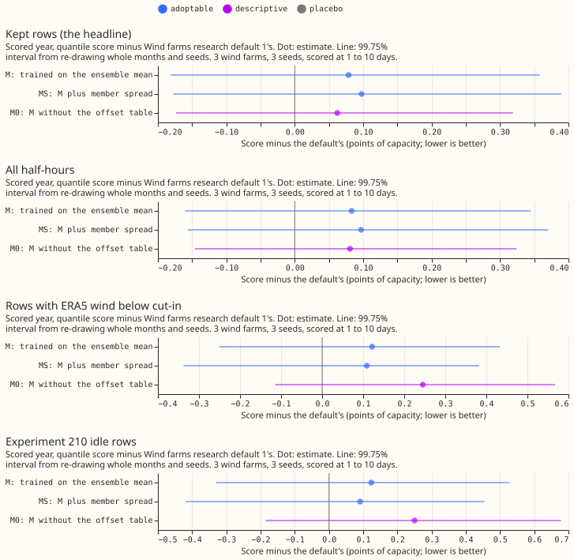
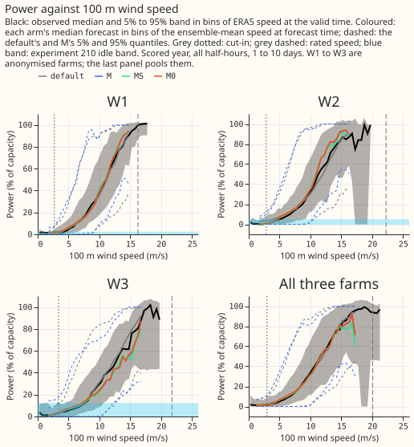
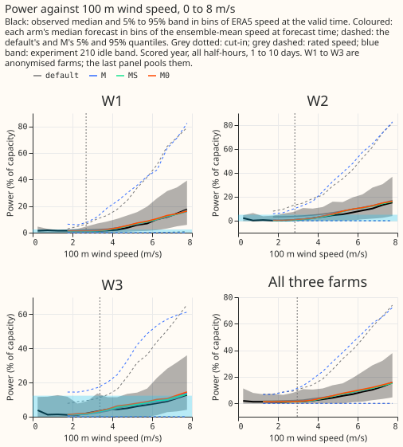
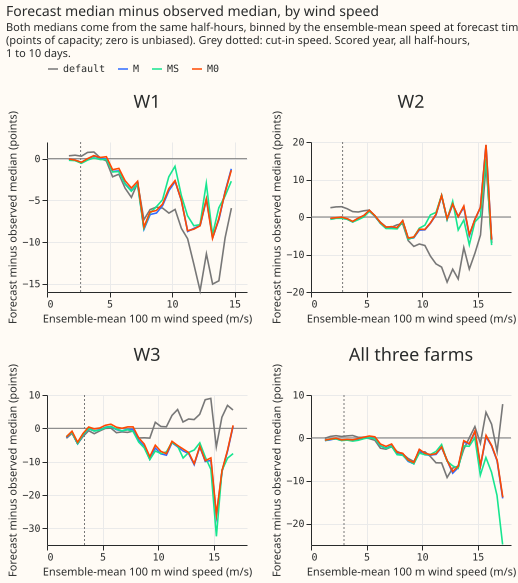

**Take-home: training the wind XGBoost model on the 51-member ensemble mean removes almost all of
the need for the offset table, but it does not make the forecast better.** The offset table lowers
the default's score by 0.345 points of capacity and M's by 0.017. M scores 11.431 against the
default's 11.352 on the kept rows (M minus default +0.079, 95% interval -0.110 to +0.278), which
the data cannot tell apart from no difference, and M is worse below the turbines' cut-in speed
(+0.122) and at the 0.99 quantile (+0.038). The verdict is not supported: nothing is adopted.

We asked whether an XGBoost quantile model trained on the ensemble's own history, with each weather
column replaced by its mean over the 51 members, would learn the ensemble's wind-speed bias that
the default corrects with an offset table. The default is Wind farms research default 1: XGBoost
trained on ERA5, run on each member, then corrected by the table of [experiment
259](../00259-wind-plant-plus-quantile-offset-head/result.md). The scored sites are the three
metered wind farms (W1 to W3, anonymised) at 1 to 10 day leads. Mean training learned most of the
bias, since it needs the table 20 times less, and its score stayed within noise of the default. It
did not improve on the default, so the search narrows to a mean-trained model that is better at low
winds.

## Results

- **Arms.** D: the default, experiment 340's stored refit (reproduction gate: 11.352 points on the
  kept rows, difference 0.00004 from experiment 326's figure). M: the same six weather columns on
  the member mean, trained on the ensemble hindcast (runs of 2024-04-01 to 2025-06-16), three
  seeds, same hyperparameters, no calendar columns. MS: M plus the member standard deviation of the
  100 m and 10 m speeds. M0: M without the table. Mpl: M with the target permuted within the month.
- **Row set.** `fold_a_tuesdays_v1`, the kept rows of experiment 210's mask are the headline.
  Lead range 1 to 10 days. Training: the hindcast was cross-fitted in three blocks; the scored year
  comes from a fit on all usable hindcast cases (about 305,000 per farm).
- **Retraining schedule.** One fit per seed, no refits. The contrast could depend on a refit
  schedule that this experiment did not vary.

| Arm | Kept rows | All half-hours | Below cut-in | Idle rows | Days 1-2 | Days 3-10 | 0.01 pinball | 0.99 pinball |
|---|---|---|---|---|---|---|---|---|
| Default | 11.352 | 10.825 | 5.374 | 6.051 | 6.612 | 11.759 | 0.284 | 0.640 |
| M | 11.431 | 10.908 | 5.496 | 6.174 | 6.670 | 11.861 | 0.289 | 0.678 |
| MS | 11.450 | 10.922 | 5.483 | 6.142 | 6.672 | 11.884 | 0.284 | 0.654 |
| M0 (no table) | 11.414 | 10.906 | 5.619 | 6.301 | 6.670 | 11.858 | 0.291 | 0.781 |

Per farm on the kept rows (default, M): W1 10.96, 11.02; W2 12.28, 12.20; W3 10.80, 11.07.
Climatology scores 13.547 on the same rows as the default's 11.352.

- **Contrasts on the kept rows (arm minus default; 95% and 99.5% intervals).** M +0.079 (-0.110 to
  +0.278; -0.181 to +0.358). MS +0.098 (-0.100 to +0.305; -0.178 to +0.390). MS minus M +0.019
  (-0.035 to +0.073).
- **Without one farm (M minus default).** Without W1 +0.090, without W2 +0.159, without W3 -0.010.
  Only W2: -0.080; only W3: +0.269.
- **Low-wind condition (M minus default).** Below cut-in +0.122, idle rows +0.124, all half-hours
  +0.083. The one-sided 95% upper bounds are 0.30, 0.34, and 0.24, above the 0.1 tolerance.
- **Predictions.** P1 (M trails by 0.2 to 1.0) failed: M trails by 0.08. P2 held: the table moves M
  by 0.017 (M0 minus M is -0.017, so M0 is slightly better on the kept rows overall, worse below
cut-in by 0.12) against 0.345 for the default. P3 failed: MS beats M by 0.024 at the 0.99 pinball
loss (under 0.05; the 0.95 level was not tabulated separately), and is worse on the median error
(+0.085).
- **Adoption.** M and MS fail condition 1 (intervals include zero, estimates positive), condition 2
  (low-wind bounds above 0.1), and condition 3 (replicate period M minus default +0.241).
- **Controls.** The reproduction gate, the known-answer test (planted power curve recovered with a
  mean absolute error of 0.006 against 0.33 for the permuted placebo), the leakage check (latest
  hindcast valid time 2025-06-16, earliest scored 2025-07-01), and the placebo Mpl (+2.509, much
  worse) all behaved as they should.

## Checks

- **Median minus mean forecast, kept rows, points of capacity:** default -4.81, M -5.07, MS -5.18.
- **Error of the mean forecast beside the contrast:** mean absolute error +0.068 for M and +0.076
  for MS against the default, the same direction as the quantile score.
- **Triggers that fired:** trigger 2 (M trails by 0.08, not the predicted 0.2 to 1.0) and trigger 4
  (leaving out W3 changes the sign of M minus default). A Sonnet audit ran (brief override), see
  the audit section.
- **Replicate caveat.** The replicate reuses the out-of-fold quantiles, whose fold models saw later
  runs, so it favours M; M is still worse there.

## Caveats

- M trains on 15 months of ensemble runs and the default on 4.4 years of ERA5; the history length is
  not separated from the training source.
- The spread factor and the table are fitted on quantiles from models trained on two thirds of the
  hindcast and applied to a model trained on all of it, which biases against M and MS.
- The placebo's permutation includes unusable hindcast cases whose target is set to zero, so it is
  a worse model than intended; it still fails to gain, as a placebo should.
- The condition 5 and "no unresolved audit trigger" parts of condition 4 are asserted by hand.

## What to try next

- Mean training with ERA5 pre-training, then fine-tuning on the ensemble hindcast, to separate the
  source from the history length.
- A low-wind correction for M, since the harm below cut-in is the failed condition (see
  [experiment 340](../00340-wind-research-default-1-constant-shift-then-low-wind-drop/result.md)).

## Plan (as committed before any score)

- **Arms.** D: the default (stored refit, reproduction gate). M: the same six weather columns as
  the default, on the 51-member mean of each column (sine and cosine of direction averaged, as the
  columns are), trained on the ensemble hindcast (2024-04-01 to 2025-06-16 runs, one row per run
  and valid time), same quantile loss, 500 rounds, eta 0.05, depth 6, binned-curve base margin.
  MS: M plus the member standard deviation of the 100 m speed and of the 10 m speed (the 10 m speed
  is the column other than the 100 m speed with the highest gain in the default, in all three
  farms). M0: M without the offset table, descriptive and never adopted. No calendar columns, no
  lead column, three seeds.
- **Cross-fitting.** The hindcast is both the training set and the set that fits the spread factor
  and the offset table, so M and MS are cross-fitted in three blocks of consecutive run dates as in
  experiment 303: the hindcast quantiles come from models fitted without the held-out block and
  the runs whose valid times overlap it. The scored year comes from a model fitted on all usable
  hindcast cases.
- **Reuse.** Scoring, the kept rows, the low-wind subsets, the replicate, and the spread factor and
  offset table follow experiments 340, 326, and 303 (imported, read only).
- **Predictions that can fail:** P1, P2, and P3 above.
- **Five triggers:** stored: private scored quantiles; serving path: no; degradation rule: no;
  designs: arms fixed by the brief; callers: this folder's scripts. Medium.
- **Ensemble-mean training is a lab condition** for serving: the mean of 51 members is available
  at forecast time, so condition 5 holds.
- **Triage of the plan review (all applied before any score).**
    - The spread factor and the offset table are fitted only on out-of-fold hindcast quantiles
      (held-out block, with training cases whose valid times fall inside the block's range
      removed, asserted in the fit). They are then applied to the model fitted on all usable
      hindcast cases, which has seen about 50% more rows than the fold models; this mismatch
      biases against M and MS.
    - The spread factor is experiment 33's rule applied to the model's own single set of quantiles
      (no member mixture exists for M), fitted month by month on earlier cases.
    - The replicate (2025-01 to 2025-06 runs) reuses the out-of-fold quantiles with the table
      fitted on valid times before 2025-01. Those fold models were trained on later runs, so the
replicate favours M and MS; condition 3 is read with that caveat and cannot alone adopt an arm. - P2
is |M0 - M| < |default without table - default| on the kept rows, with the default's table-free
score from experiment 340's `default_notable`. P3 reads "no better on the median" as a median
pinball difference above -0.02 points. - All arms use `colsample` 1.0 (the settings of experiment
230); MS has eight columns against six, which is part of the arm. The default trains on 4.4 years of
ERA5 and M on 15 months of ensemble runs; the history length is not separated, and the write-up says
so. - The default uses experiment 340's three seeds and their mean score; M and MS use seeds 0 to 2.
- The default's gains per column (seed 0, W1 to W3): the 10 m speed is the highest column other than
the 100 m speed (0.050, 0.051, 0.036 against 0.050, 0.054, 0.068 for the 100 m speed). - MS is
tested only if M fails a condition, and need not beat M. Level 99.5% for both. - Controls:
known-answer test (planted power curve recovered from synthetic members, mean absolute error under
0.03), placebo Mpl (target permuted across cases within the month, must not gain), leakage assertion
in the fit (no training valid time inside a held-out block's range; latest hindcast valid time
before the earliest scored valid time).
