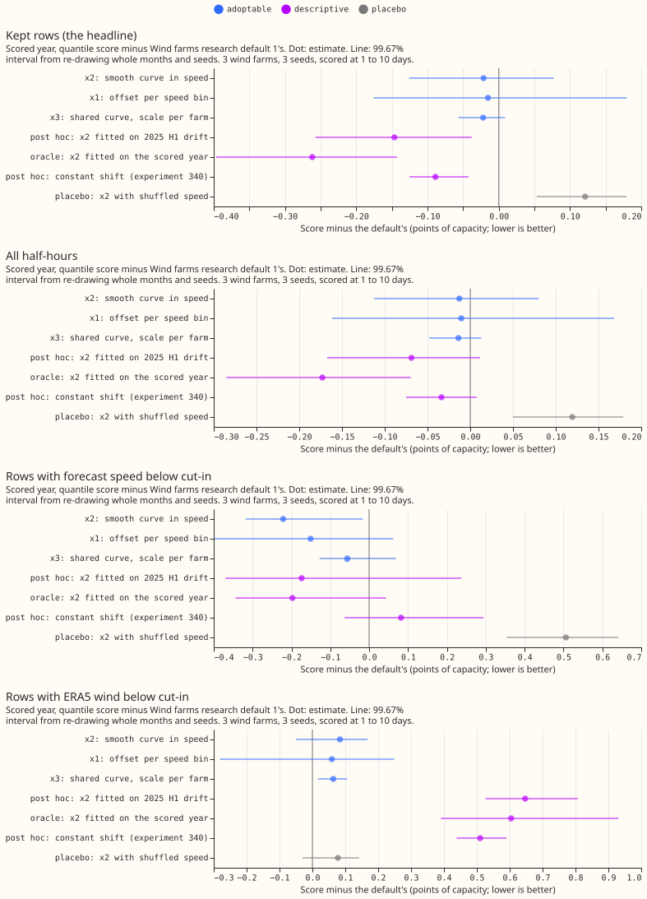
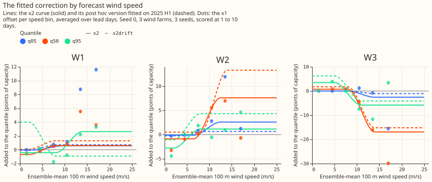
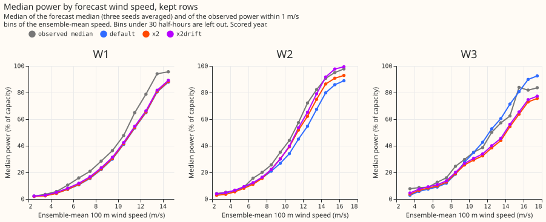
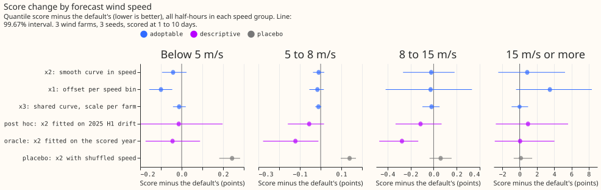

**Take-home: letting the wind quantiles depend on the forecast wind speed gains only about 0.02
points of capacity when the correction is fitted on the hindcast, and that gain cannot be told from
zero.** [Experiment
340](../00340-wind-research-default-1-constant-shift-then-low-wind-drop/result.md) found that a
constant upward shift of the forecast quantiles gains 0.09 to 0.12 points but worsens the half-hours
with low wind by 0.5 to 0.8 points, and that the forecast median is too low at 8 to 15 m/s and too
high below 5 m/s. We asked whether an offset that depends on the forecast wind speed keeps the gain
and avoids the harm. The forecast is Wind farms research default 1, the wind forecast that scored
best of those tested so far on the three metered wind farms (W1 to W3, anonymised), at 1 to 10 day
leads. It is an XGBoost-based forecast with a spread factor and an offset table that adds one offset
per farm, lead day, and quantile level. The score is the quantile score of [experiment
33](../00033-best-guess-architecture-vs-production/result.md) in points of capacity (a point is 1%
of a farm's capacity; a mean over nine quantile levels, lower is better), on the kept rows: the
half-hours that the mask of [experiment 210](../00210-wind-idle-noise-mva-artefact/result.md) does
not flag as idle (wind near zero, where the metered series holds a reactive-power floor). The
default scores 11.352.

**Three arms fit the correction on the same hindcast runs as the offset table.** The 442 hindcast
runs are retrospective forecasts for April 2024 to June 2025. The correction is keyed by the mean
over the 51 ensemble members of the 100 m wind speed at the valid time (the time the forecast is
for). Arm x1 adds an offset per speed bin, x2 adds a smooth curve in speed per farm and quantile,
and x3 adds one curve shared by the three farms, with a scale per farm. The arms gain 0.015, 0.021,
and 0.022 points, against the 0.05 to 0.12 predicted. No 99.67% interval excludes zero (the level
for three arms), so no arm is adopted, and the verdict is `not supported`.

**A correction fitted on the six months before the scored year gains 0.146 points on the kept rows,
so the bias is real and changes from year to year.** This post hoc x2 curve, fitted on January to
June 2025, does not worsen the half-hours where the forecast wind speed is below the turbines'
cut-in speed. The scored year runs from July 2025 to June 2026.

Differences are the arm's score minus the default's, so a negative difference is an improvement.

## Design

- **Plan.** Committed before any score. Tier 1: every arm acts on the default's stored quantiles,
  so nothing is retrained (the spread factor and the offset table are rebuilt from experiment
  [336](../00336-wind-research-default-1-below-cut-in-zeroing/result.md)'s stored mixtures, as in
  experiment 340). A family comparison is not needed for a tier 1 change on stored forecasts.
  Minimum gain 0.02 points (each arm adds a fitted step). Code reused from the folders of
  experiments 340 and 336 (and through them 326, 303, 285, 259, and 230); the speed-bin pattern
  follows experiment [342](../00342-wind-research-default-1-upper-tail-offsets-and-head/result.md),
  which keyed only q90 to q99.
- **Arms.** x1: an additive offset per farm, lead day, quantile (all 11), and speed bin (edges at
  3, 6, 9, 12, and 15 m/s), none for a cell under 200 rows. x2: an S-shaped curve (a smoothstep, 6
  m/s wide) of the offset against forecast speed per farm and quantile, with a low and a high
  offset level and a midpoint speed chosen from five candidates. x3: one such curve per quantile
  fitted on the three farms pooled, times one scale per farm. Post hoc and never adopted: x2 fitted
  on the January to June 2025 hindcast runs scored with the table fitted before 2025 (`x2drift`),
  and x2 fitted on the scored year (`x2oracle`). Reference: the default plus the constant shift of
  experiment 340 fitted out of sample (`Sdrift`, read from experiment 340's stored forecasts).
- **Row set and schedule.** `fold_a_tuesdays_v1`, 53 Tuesday runs, 107,121 scored half-hours, 3
  seeds. The offset table, the corrections, and the replicate use the same fitted-once hindcast
  schedule as experiment 340; there is no retraining here, so the contrast does not depend on the
  retraining cadence.
- **Reproduction gate.** The default equals experiment 340's stored default exactly (largest
  difference 0) and scores 11.352, the same as experiment 303's stored forecast (P1).
- **Controls.** Known-answer test: an injected speed-dependent bias is recovered by x2 within 12%
  and by x3 within 8% (limit 20%). Leakage check: the hindcast ends on 2025-06-16 and the scored
  year starts on 2025-07-01, and the key is the ensemble's speed at forecast time. Placebo: with
  the speed of another case of the same farm and lead day, x2 scores 0.121 worse, x1 0.243 worse,
  and x3 0.020 worse (points of capacity). The real speeds therefore beat the shuffled speeds by
  0.142 (x2), 0.258 (x1), and 0.042 (x3).

## Results

| Arm | Kept rows | All half-hours | Forecast speed below cut-in | ERA5 below cut-in | Days 1 to 2 | Days 3 to 10 | 0.01 pinball | 0.99 pinball |
|---|---|---|---|---|---|---|---|---|
| Default | 11.352 | 10.825 | 2.394 | 5.374 | 6.612 | 11.759 | 0.284 | 0.640 |
| x1 | 11.337 | 10.815 | 2.243 | 5.433 | 6.454 | 11.795 | 0.283 | 0.640 |
| x2 | 11.331 | 10.813 | 2.173 | 5.457 | 6.543 | 11.763 | 0.284 | 0.640 |
| x3 | 11.330 | 10.811 | 2.338 | 5.437 | 6.570 | 11.752 | 0.284 | 0.639 |
| Post hoc: x2 fitted on 2025 H1 | 11.205 | 10.757 | 2.220 | 6.021 | 6.563 | 11.694 | 0.284 | 0.634 |
| Oracle: x2 fitted on the scored year | 11.090 | 10.652 | 2.197 | 5.978 | 6.392 | 11.605 | 0.284 | 0.631 |
| Constant shift (experiment 340) | 11.263 | 10.792 | 2.476 | 5.884 | 6.621 | 11.718 | 0.289 | 0.637 |

Reference rows on the kept rows: the frozen XGBoost reference (the default without the offset
table) 11.697, climatology 13.547, persistence 15.566 (hours 0 to 6 only, 1,696 rows, where the
default scores 6.568). The default beats climatology by 2.195 points (99.67% interval 1.302 to
3.100). The pinball columns are on the kept rows.

- **Take-home numbers, kept rows (99.67% intervals).** x2 -0.021 (-0.126 to +0.077), x1 -0.015
  (-0.176 to +0.180), x3 -0.022 (-0.057 to +0.009). The three farms differ in sign: x2 gains 0.07
  at W2 and loses 0.02 at W3, and x1 gains 0.18 at W2 and loses 0.18 at W3.
- **Prediction P1 (x2 gains 0.05 to 0.12 points and worsens the rows below cut-in by under 0.1)
  fails on the gain and holds on low winds.** x2 gains 0.021, below the predicted 0.05 to 0.12.
  The rows with forecast speed below cut-in improve by 0.221 (99.67% interval -0.318 to -0.016),
  so the predicted worsening of under 0.1 holds.
- **Prediction P2 (x1 gains less than x2 on the replicate) fails.** x1 gains 0.068 on the replicate
  against 0.045 for x2 (the difference is -0.022, 95% interval -0.041 to -0.004, 99.67% interval
  -0.051 to +0.006).
- **Prediction P3 (x3 and x2 differ by under 0.03) holds.** x3 minus x2 is -0.001 on the kept rows
  (99.67% interval -0.072 to +0.079).
- **Prediction P4 (at least 60% of x2's gain comes from 8 to 15 m/s) fails.** The share of x2's kept-row gain from rows at 8 to 15 m/s is
  0.081 (95% interval -5.8 to +7.4, because a share of a gain this small is not defined). The group gains are: below 5 m/s -0.041, 5 to 8 m/s -0.009, 8 to 15 m/s
  -0.021, and 15 m/s or more +0.878.
- **Prediction P5 (no arm moves the 0.99 pinball loss by more than 0.05) holds.** The 0.99 pinball
  loss moves by -0.0004 (x2), -0.0001 (x1), and -0.0012 (x3).
- **Post hoc: the speed-dependent structure is real and has drifted.** x2 fitted on January to June
  2025 gains 0.146 on the kept rows (-0.257 to -0.038), against 0.089 for the constant shift of
  experiment 340 (-0.125 to -0.042), and it improves the rows with forecast speed below cut-in by
  0.174 where the constant shift worsens them by 0.082. The post hoc x2 worsens the rows with ERA5
  wind below cut-in by 0.647. Those rows are chosen using the observed wind, so they gather the
  cases where the forecast speed was too high. Every upward correction worsens such rows. x2 fitted
  on the scored year gains 0.262 (oracle, not an honest forecast).
- **Where the curves differ.** In figure 2, at the median and 10 to 15 m/s, the median needs a lift
  of about 1 point at W1 and about 8 points at W2, and a cut of up to 17 points at W3. In figure 3,
  the default's median is below the observed median at W1 and W2 across 5 to 15 m/s and above it at
  W3 above 10 m/s.
- **Above 15 m/s the fitted corrections hurt.** The group worsens by 0.878 (x2) and 3.503 (x1),
  because few hindcast rows exceed 15 m/s per farm, and the offsets there are large.
- **Tails.** No arm raises the 0.01 or 0.99 pinball loss by more than 0.001 (kept rows). The share
  of kept rows where the observed power exceeds the forecast 0.99 quantile (ideally 1%) is 1.8% for
  the default, 1.7% for x2 and x3, and 1.8% for x1. The share inside the forecast 5% to 95% interval
  (ideally 90%) is 92.1% for the default, 91.4% for x2, 91.2% for x1, and 91.8% for x3.

## Adoption conditions for each arm

| Arm | 1, gain | 2, no harm | 3, replication | 4, controls | Adopted |
|---|---|---|---|---|---|
| x2 | no (gain 0.021, interval -0.126 to +0.077) | no (all half-hours +0.042 upper bound against 0.02; ERA5 below cut-in +0.132 and idle rows +0.125 against 0.1) | met (replicate gain 0.045) | met | no |
| x1 | no (gain 0.015, interval -0.176 to +0.180) | no (all half-hours +0.088; ERA5 below cut-in +0.180; idle rows +0.150) | met (0.068) | met | no |
| x3 | no (gain 0.022, interval -0.057 to +0.009) | met (all half-hours +0.002; ERA5 below cut-in +0.087) | met (0.018) | met | no |

Condition 5 holds for all arms (the key is the ensemble's forecast-time speed and the fits read only
hindcast runs). x3 fails only condition 1: its 95% interval (-0.045 to -0.001) excludes zero, and
its 99.67% interval, the level for three arms, does not.

## Checks

- **Median minus mean forecast, kept rows.** Default -4.805 points (W1 -4.95, W2 -5.39, W3 -4.03),
  x2 -4.586 (-4.75, -4.73, -4.26), x1 -4.824, x3 -4.602 (-4.93, -5.39, -3.41), post hoc x2 -4.791.
  No arm shifts the spread.
- **Error of the mean forecast beside the quantile score.** The absolute error of the mean forecast
  moves by -0.016 (x2, quantile score -0.021), +0.003 (x1, -0.015), and -0.011 (x3, -0.022). It
  rises by 0.034 for the post hoc x2 (quantile score -0.146) and 0.037 for the oracle, as it did for
  the shifts of experiment 340.
- **Triggers.** The prediction-contradiction trigger (x2 gained 0.021, not 0.05 to 0.12) is
  explained and tested here by the post hoc arms: the hindcast fit gains little, and a fit after the
  table's window gains 0.146. The sign-disagreement trigger (the quantile score and the error of the
  mean forecast move in opposite directions) fired for x1, by 0.003 under an interval that spans
  zero, and for the post hoc arms. The leave-one-farm-out trigger fired for x2 and x1: leaving out
  W2 turns x2's gain into +0.003 and x1's into +0.067 (a loss), and W3 alone loses for both. The
  gain depends on one farm, which agrees with the interval spanning zero. No arm is adopted, so no
  adoption rests on the fired triggers. A Sonnet audit re-derived the contrasts from the stored
  quantiles (see Review).

## Caveats

- **Scored at 1 to 10 days, 3 farms, 12 months.** Intervals do not cover other farms or years.
- **The three farms disagree in sign,** so a pooled gain depends on W2.
- **x3 is effectively two farms.** Its scales ended at the ends of the 0 to 3 grid in all three
  seeds (W2 0.0, W3 3.0, W1 about 0.4), so the shared curve follows W3 and the W2 correction is
  switched off. In x2, 20 of the 33 fitted curves per seed chose an edge midpoint (5 or 11 m/s),
  Those edge midpoints fit the poorly determined region above 15 m/s. That fit explains the
  harm there.
- **The placebo cannot detect harm.** The shuffled-speed placebo (condition 4) passes whenever the
  shuffled-speed arm scores worse than the default, which is what happened. The known-answer test
  has no case where the true bias is zero.
- **The fits read one hindcast.** The curves are fitted per seed on the same 442 runs as the offset
  table, and the fit minimises the pinball loss at each level separately. The shape of x2 (two
  levels, a smoothstep of width 6 m/s, five candidate midpoints) is a pre-registered choice and
  not tuned on the scored year.
- **The post hoc arms are not honest forecasts.** `x2drift` uses January to June 2025, which a
  live service could fit; `x2oracle` reads the scored year.

## Review

- **Code review and audit (Sonnet, one agent, from the files only).** No leakage, and no arithmetic
  error: its own re-derivation matched every contrast, per-farm and leave-one-farm-out sign,
  median-minus-mean figure, and placebo score, and an independent minimisation matched the stored
  curves. Accepted: the placebo cannot detect harm, x3's scales sit at the grid ends, x2 often picks
  an edge midpoint, and the score is nine-level (all now stated above). No finding changes a
  verdict.
- **Prose review (Sonnet, one agent).** Accepted: the opening split into three bolded paragraphs
  with the score and mask defined, the headline and take-home message rewritten, the predictions
  and triggers named by content, the farms no longer "wanting" a correction, and the tail shares
  defined. Rejected: dropping the repeated conclusion from the headline (the front matter and the
  body serve different readers); expanding NWP and XGBoost (the page no longer uses NWP, and the
  page's readers know XGBoost).

## Open questions

- **A refit on recent months is untested.** Refitting the offset table and the speed curve every few
  months on the latest hindcast runs could capture the drift that the post hoc `x2drift` arm gains.
- **A per-farm speed curve for the upper quantiles at 15 m/s or more is poorly determined** by the
  hindcast; a cap on the offset there is an untried option.
