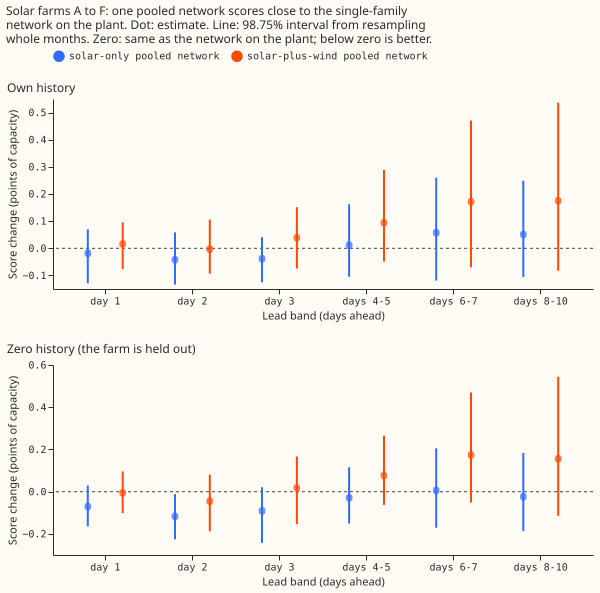
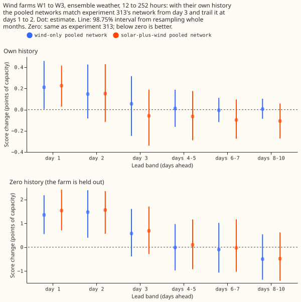
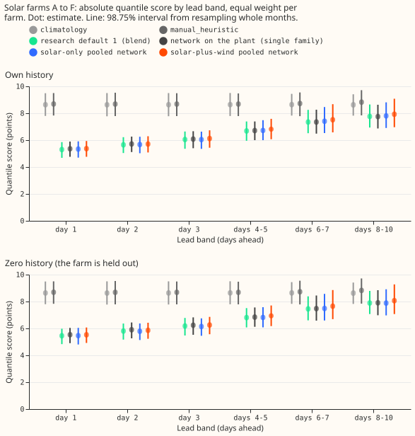
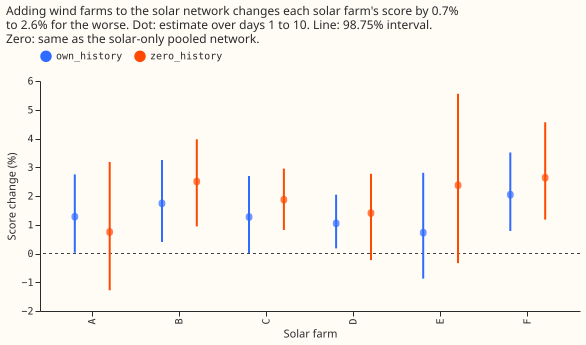
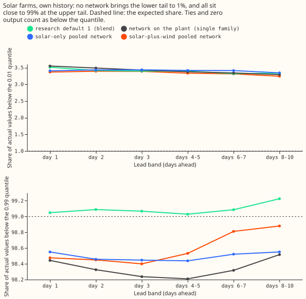

**One neural network trained across all six solar farms forecasts each farm as well as a separate
network on the physical plant model, to within 0.8%. Adding wind farms to the same network does not
help either fuel, and it costs solar between 0.7% and 2.3%.** National Grid Electricity Distribution
(NGED) meters six solar farms, labelled A to F, and three wind farms, labelled W1 to W3.
[Experiment 313](../00313-metered-farm-pure-xgboost-and-mdn-vs-plant/result.md) and
[experiment 318](../00318-metered-farm-mdn-head-more-features/result.md) found that a
mixture-density network (a neural network whose output is a mixture of three bell curves, from which
the 11 quantiles are read) that sees only weather and the calendar matches the plant-based network.
We asked whether one such network, trained once for all leads on all six solar farms (and then also
on wind farms, with a fuel indicator), keeps that skill. The quantile score is twice the mean
pinball loss over the 11 quantiles, in points of capacity (1 point is 1% of capacity), and lower is
better. "Own history" means the farm's earlier months are in training, and "zero history" means the
farm is held out.

**Scored at leads of 1 to 10 days for solar, and at 12 to 252 hours (days 1 to 10 by the same
arithmetic) for wind.** The stored wind cases reach 351 hours, and the page reports that range as a
secondary row. Solar refits quarterly (experiment 310's screening schedule), wind trains once on
rows before 2025-06-17. The pre-registered predictions: P1 holds at the point estimates but not by
its interval rule; P2 and P3 fail; P4 holds. The verdict is partly supported, and nothing is adopted:
the pooled network is a candidate single-family model, and it does not beat Metered solar farms
research default 1 by the 0.02 points that a tier 2 change needs.

## Results

- **Arms (all five seeds averaged in own history, three in zero history).** The reference is
  Metered solar farms research default 1 ("default"): its blend (experiment 310) and its
  mixture-density network on the plant (experiment 318, "network on the plant"). The default plus x
  arms are the solar-only pooled network (pure, lead in hours, trained across the six farms), the
  wind-only pooled network (W1 to W3 plus 40 public wind farms), and the solar-plus-wind pooled
  network (a fuel indicator, columns a fuel lacks set to zero), with the plant forecast as an extra
  column in `both_plant`. Tier 2, "a new data source" (0.02 points minimum gain). Controls: the fuel
  indicator shuffled, the wind targets shuffled, `climatology`, and `manual_heuristic`.
- **Weather at each lag.** Solar rows use the ECMWF ensemble mean at each lead, which exists at
  forecast time. Wind training rows use ERA5, which arrives about 5 days late, so ERA5 wind scores
  are a ceiling. The headline wind rows apply the network to each of the 51 ensemble members and mix
  the quantiles. The public wind farms' ERA5 rows carry no temperature (the column is masked and
  flagged).
- **Row set.** Solar: experiment 310's rows, farms A to F, 2025-09 to 2026-08. Wind:
  `fold_a_tuesdays_v1`, kept rows of experiment 285's 53 Tuesday runs, 12 to 252 hours.
- **Schedule.** Quarterly refits (screening schedule). The contrast between pooled and single-family
  networks could depend on cadence: trained once is 1.4% to 1.6% worse at days 1 to 3 in own history,
  and monthly refits change nothing measurable (-0.8% to +0.5%).

### Solar quantile score (points of capacity, 98.75% interval), own history

| Arm | Day 1 | Day 3 | Days 8 to 10 |
|---|---|---|---|
| `climatology` | 8.64 | 8.64 | 8.64 |
| `manual_heuristic` | 8.69 | 8.68 | 8.83 |
| Default blend (research default 1) | 5.30 | 6.05 | 7.77 |
| Network on the plant (single family) | 5.36 [4.76, 5.90] | 6.08 [5.40, 6.67] | 7.75 [6.87, 8.64] |
| Solar-only pooled network | 5.34 [4.70, 5.92] | 6.04 [5.36, 6.64] | 7.80 [6.91, 8.81] |
| Solar-plus-wind pooled network | 5.37 [4.76, 5.93] | 6.12 [5.44, 6.73] | 7.93 [6.96, 9.08] |

Zero history: network on the plant 5.53, 6.23, 7.91; solar-only pooled 5.46, 6.14, 7.88;
solar-plus-wind 5.53, 6.25, 8.06 (days 1, 3, and 8 to 10).

### Predictions

- **P1 (solar-only pooled within 1% of the network on the plant): holds at the point estimate,
  cannot be shown by the interval.** The change is -0.7% to +0.8% in own history and -2.0% to +0.1%
  in zero history, with intervals about 4 points wide (for example -2.0% to +0.7% at day 3, own
  history). The pooled network is not worse than 1% in any band, and it is better in zero history at
  day 2 (-2.0%, interval -3.9% to -0.2%).
- **P2 (adding wind within 1% of solar-only): fails on solar.** Solar-plus-wind is worse by 0.7% to
  1.6% in own history and 1.2% to 2.3% in zero history, with interval lower ends above zero from day
  3 in both settings. On wind, solar-plus-wind is within 1% of the wind-only network in own history
  (-1.3% to +0.2%, intervals about 4 points wide) and 0.1% to 2.0% worse in zero history.
- **P3 (pooling helps with zero history by at least 2%): fails.** Solar-plus-wind is 1.2% to 2.3%
  worse than solar-only, and 0.1% to 2.0% worse than the wind-only network, with no history.
- **P4 (0.99 pinball loss no worse than the default blend at days 3 to 7): holds.** The pooled
  solar-only network is 7.0% to 8.2% lower and solar-plus-wind 6.0% to 6.1% lower in own history
  (intervals below zero).
- **Stop rule: not triggered.** Adding wind raises the score by more than 2% at days 1 and 2 at no
  farm (largest +1.5% at farm F, interval 0.5% to 2.9%).

### Standard architecture and the best family

- **Solar.** The standard architecture (the plant, no neural input adapter, a mixture-density head)
  is within 1% of the best single family (the solar-only pooled network, or experiment 313's pure
  network at days 1 to 2) at every band in own history (0.4%, 0.8%, 0.6%, then -0.2% to -0.8%), with
  intervals about 4 points wide. In zero history it is 2.0% worse at day 2 (0.2% to 4.0%) and within
  1.5% elsewhere.
- **Wind.** On ERA5 weather (the stored neural-adapter forecasts have no ensemble version) the
  physics core with the neural adapter (no mixture-density head) is within 0.25% of experiment 313's
  pure network over 12 to 252 hours (-1.6% to +2.9%) and 5.7% better than the wind-only pooled
  network (-9.2% to -2.3%). The pooled wind network is the weaker family on ERA5 weather, because the
  40 public farms outnumber W1 to W3 in training.
- **Shared with the Primary-demand research default.** The mixture-density head family is shared.
  The plant (a physical model of one farm's output) is not shared with the demand model, and the lead
  band structure differs.

### Controls and checks

- **Shuffled wind targets** are 30% worse on wind (21% to 40%), so the wind gain is not extra rows.
  They are 0.6% to 1.1% worse on solar than the real wind rows (three seeds against five, so part of
  that gap is seed averaging), which means the real wind rows cost solar less than meaningless ones.
  **Shuffled fuel indicator** costs wind 0.7% (0.3% to 1.1%) and solar 0.8% to 1.2%, so the network
  uses the indicator a little.
- **Plant column** (`both_plant` against `both`): -0.9% to -0.4% own history, -0.5% to 0% zero
  history, intervals including zero. The plant adds nothing measurable, as in experiment 318.
- **Tail calibration (own history).** The share of actual values below the 0.01 quantile is 3.2% to
  3.5% for every arm (the 3.3% to 3.7% of experiment 318; the strict share is lower per experiment
  321). The share below the 0.99 quantile is 98.2% to 98.9% for the networks and 99.0% to 99.2% for
  the blend (Figure 5).
- **Median minus mean forecast** is 0.3 to 0.8 points of capacity for the networks and 0.04 to 0.7
  for the blend; the networks' quantiles are never crossed (crossing rate 0).
- **Mean-forecast error beside each contrast.** The absolute error of the mean forecast moves the
  same way as the quantile score for solar-plus-wind against solar-only (+0.8% to +1.3% own history,
  +1.4% to +1.8% zero history) and for solar-only against the network on the plant (-0.7% to +0.8%).
- **Audit triggers.** Trigger 2 fired for P2 and P3 (results contradict the predictions). The
  explanation offered, not proven, is that a shared network of 64 hidden units and a fixed 20-epoch
  budget spends capacity on the wind rows. The shuffled-wind control costs solar as much, which is
  consistent with capacity and not with a wind-specific harm. See the audit below.

### Caveats

- **Wind zero history is a different design from experiment 313.** Experiment 313 trained on the
  other two metered farms; here W1 to W3 are held out and the network trains on 40 public farms
  (ERA5, no temperature). That is 18% to 20% worse at days 1 and 2 than experiment 313's network
  (6.5% to 36% interval), and equal from day 4. Training on the public farms alone is a poor start for
  a wind farm with no history at short leads.
- Intervals on the solar contrasts are about 4 points wide, so "within 1%" cannot be shown by
  interval for any single band.
- Own-history solar scores use the same six farms in training and scoring, with a quarterly refit
  schedule; weekly retraining would not change the ranking but was not run.

### What to try next

- Train wind on metered wind farms only (own history), and test whether public farms help with a
  weight on the metered farms.
- Use the solar-only pooled network as the solar single-family model of the first production update,
  and compare it with plant-fed XGBoost in a production-style run.
