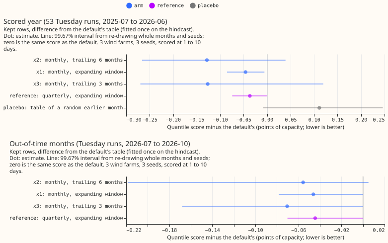
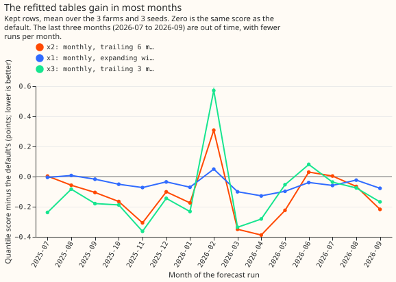
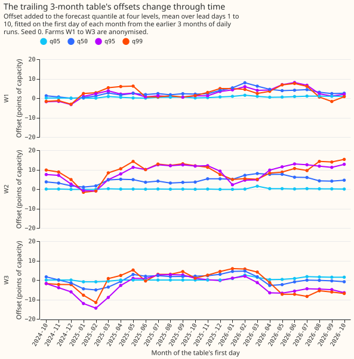

**Take-home: refitting the wind forecast's offset table every month on recent runs gains a little,
and the upper-tail miss stays.** We asked whether the offset table of Wind farms research default 1
should be refitted as time passes. Wind farms research default 1 is our current wind forecast: an
XGBoost model fitted on ERA5 weather estimates, plus the table. The table is a number added to each
forecast quantile, one for each farm and each number of days ahead, and so far it was fitted once on
442 daily forecast runs of 2024-04 to 2025-06, re-created after the fact. Experiment 342 found that
observed power exceeded the forecast's 99th-percentile quantile (q99) in 1.8% of half-hours in
2025-07 to 2026-06, where 1% is intended, and blamed a change in the farms' behaviour between the
earlier years and that year. We refitted the table on the first day of each month, using only daily
ECMWF ensemble weather forecasts whose outcomes had already been observed. We tried three training
windows: all runs since 2024-04 (x1), the last 6 months (x2), and the last 3 months (x3). We scored
53 forecast runs, one per Tuesday, at lead times of 1 to 10 days.

The three metered wind farms are anonymised as W1 to W3. The score is the quantile score over 11
levels, in points of capacity (a point is 1% of a farm's capacity; lower is better), on the kept
rows: the half-hours that the idle-band mask of experiment 210 does not flag. Each difference is the
arm's score minus the default's. All three windows lower the score by 0.05 to 0.13 points of 11.35
(0.4% to 1.1%). Only x1 has a 99.67% interval for the difference that lies wholly below zero. The
share of observed power above q99 stays at 1.7% to 1.8%, so a table that follows the change still
misses, and the change is a minor cause. The verdict is `partly supported`: x1 passes the five
adoption conditions (a candidate, minimum gain 0), and the hypothesised x2 does not.

## Arms and row set

- **Plan.** The plan was committed before any score. The one later change corrected the placebo
  check in `e00346_score.py` from an absolute difference to the signed gain.
- **Family and default.** Default plus x against Wind farms research default 1 (experiment 303's
  P1, offset table fitted once on the 442 hindcast runs), rows `fold_a_tuesdays_v1`, 107,121 scored
  half-hours at 3 farms, 3 seeds, scored at 1 to 10 days (the headline caveat). Tier 1 (acts on
  stored mixtures), minimum gain 0. Code reused from experiments 342, 340, 336, 326, 303, 259.
- **Method.** The default's XGBoost models, trained on ERA5, were refitted on CPU (the earlier fits
  used a GPU), so every run, old and new, goes through the same models. Member rows for the 494
  daily runs of 2025-06-17 to 2026-10-23 were built as experiment 259 built the hindcast. The table
  of month M uses cases whose valid time is at least 3.5 hours before M's first day. The spread
  factor, which widens or narrows the forecast quantiles around the median, is fitted on all
  daily runs. The gate arm fits it on the hindcast and the 53 Tuesday runs only, as in experiment
  340, and gives the same scores to three decimals.
- **Arms.** x1 expanding window from 2024-04; x2 trailing 6 months; x3 trailing 3 months; the
  reference quarterly refit on an expanding window; the placebo (each scored run gets the x2 table
  of a random earlier month). Tables exist for each month from 2024-10.
- **Absolute scores (kept rows).** Default 11.351 (experiment 340's frozen XGBoost reference 11.697,
  climatology 13.547; BG2 and `manual_heuristic` were not scored for wind farms here). x1 11.305,
  x2 11.223, x3 11.225, quarterly 11.314, placebo 11.462. Days 1 to 2: default 6.908, x2 6.869.
  Days 3 to 10: default 12.370, x2 12.221.
- **Contrasts (99.67% intervals, kept rows).** x2 -0.128 (-0.266 to +0.039); x1 -0.046 (-0.085 to
  -0.006); x3 -0.126 (-0.270 to +0.119); quarterly -0.037 (-0.074 to -0.000); placebo +0.111
  (-0.009 to +0.246). Days 3 to 10 hold most of the gain (x1 -0.055, x2 -0.149); days 1 to 2 hold
  little (x1 -0.005, x2 -0.039). Every contrast on all half-hours is smaller (x1 -0.020).
- **Out of time (descriptive, 2026-07 to 2026-10, 30,174 half-hours; kept rows end on 2026-09-13,
  the last day of experiment 210's mask).**
  Default 7.562; x1 -0.046 (95% interval -0.078 to -0.024), x2 -0.056 (-0.218 to +0.004), x3 -0.070
  (-0.168 to -0.036), quarterly -0.044.
- **Tails (kept rows).** The 0.01 pinball loss is 0.284 to 0.285 for every arm. The 0.99 pinball
  loss is 0.640 (default), 0.639 (x1), 0.640 (x2), 0.638 (x3). Share above q99: 1.77% default, 1.75%
  x1, 1.71% x2, 1.78% x3; above q95: 6.7% default, 6.4% x1, 5.9% x2, 6.0% x3. Curtailment-cost
  saving against `manual_heuristic` was not computed (the metric scores a substation and its
  generators together, not single wind farms).
- **Predictions that could fail.** x2 lowers the score by 0.05 to 0.15: held (0.128, interval
  includes zero). x1 gains less than x2: held. x3 is noisier and gains less than x2: half held (the
  interval is wider; the gain is equal). The 0.99 pinball loss moves under 0.05: held. The gain is
  larger in the second half of the scored year: held for x1 (-0.065 against -0.029) and x2 (-0.138
  against -0.119), failed for x3 (-0.049 against -0.196). The out-of-time gain is at least the
  scored year's: held for x1, failed for x2 and x3.

## Checks

- **Controls.** Reproduction gate: the default scores 11.351 against experiment 259's 11.352.
  Known-answer test: tables fitted on synthetic cases with a bias that grows by 6 points recover
  the window-average bias within 0.07 points (x2) and 0.18 points (x3), and the expanding window
  lags the drift by 2.9 points at 2026-06. Placebo: it loses 0.111, so it keeps none of x2's gain.
  Leakage: every one of the fitted tables (printed in `leakage.json`) uses only valid times before
  its month's first day minus 3.5 hours.
- **Median minus mean forecast, per farm (kept rows, points).** The median forecast sits 4 to 5
  points below the mean forecast, and the refit narrows the gap. Default -4.95, -5.39, -4.03 at W1,
  W2, W3; x2 -4.52, -5.29, -3.84.
- **Error of the mean forecast beside the quantile score.** The mean forecast's mean absolute error
  rises by 0.023 (x1), 0.157 (x2), and 0.214 (x3) while the quantile score falls, and the median's
  mean absolute error falls by 0.076, 0.222, and 0.221. Trigger 3 fired.
- **Triggers fired.** Trigger 3 (above). Leaving one farm out keeps every sign. See "Audit".

## Audit

Audit trigger 3 fired: the mean forecast got worse while the quantile score improved. A fresh Sonnet
agent (the maintainer's instruction for this run replaced the usual Opus agent) therefore
re-derived the headline contrasts from the stored arrays and tried to break them. Its report is
private (`data/ml-experiments/briefs/e346_audit_report.md`). Triage:

- **No leakage (accepted).** The latest valid time in each sampled table equals the month's first
  day minus 3.5 hours. Scrambling every observed value after the cutoff left the spread factor and
  the tables for earlier cases bit-identical.
- **Headline reproduced (accepted).** x1 -0.0460, x2 -0.1281, x3 -0.1264, placebo +0.1112, all
  within 0.0001 of the printed values.
- **Trigger 3 is a property of the metric, not a method fault (accepted).** The default's table is
  stale in the scored year: observed power falls below its q50 in 40.4% of kept half-hours (50%
  intended). The refit raises the central quantiles by about 2 points, which lowers the pinball
  losses and the median's error. The default's mean forecast already sits 4.8 points above its
  median, so the same shift overshoots the mean. The mean forecast is a quantity the offsets were
  not fitted for, and its error rise (+0.023, +0.157, +0.214 points) is a drawback to state.
- **The placebo is a weak control (accepted as a caveat).** It loses 0.111, so the placebo
  condition passes trivially. A fairer control would draw tables from the last 1 to 6 months.
- **Caveats (accepted).** The cells at long lead days are thin (at least 484, 177, and 89 rows for
  x1, x2, and x3) and their rows are strongly correlated. x2 and x3 lose in 2026-02. x1 is the selected
  candidate because of the pre-registered order and because its interval is narrow, on a gain of
  0.4%.

## What to try next

- Decide whether a monthly job that refits the table (x1) is worth its 0.4% gain.
- The upper tail still misses at 1.7% above q99; test an upper-tail correction fitted per month on
  the scored months themselves only if the maintainer wants the tail rather than the headline.
