**Take-home: a physics model of each wind farm, run on every ensemble member and corrected by a
small neural network, forecasts 0.27 points of capacity better than Wind farms research default 1,
but a neural network given only the physics model's median and the farm already gets 83% of the
gain, and the upper tail is still over-confident.** The quantile score measures how well a
forecast's 11 quantiles match the observed power, in points of capacity (1 point is 1% of a farm's
capacity; lower is better).

We asked whether a frozen physics model of each of the three metered wind farms (called W1 to W3
here) can replace the XGBoost model in Wind farms research default 1, called "the default" below.
The default is an XGBoost model trained on ERA5 (our estimate of past weather) and run on the 51
members of the ECMWF ensemble (51 perturbed runs of one weather forecast), plus a table of
per-quantile offsets. The physics model, called the plant, turns wind speed at 10 m and 100 m, air
temperature, and wind direction into power through a smooth speed-to-power curve with a
direction-dependent loss. We fitted each plant once on ERA5 before April 2024 and then froze it. We
passed each of the 51 members through the plant, summarised the 51 power values (median, mean,
standard deviation, 10th and 90th percentiles, and the share of members at the top level), and fed
the summary to a mixture-density head (a small neural network that fits three bell curves to each
forecast, from which the 11 quantiles are read). Four arms differ in the plant and the inputs of the
head (see "Arms").

**The headline scores every lead from 0.5 hours to 15 days, as experiments 324 and 339 do; on true
days 1 to 10 the gain is 0.23 and the 99.75% interval includes zero.** The row set holds every lead
from 0.5 hours to 351 hours, so the plan's phrase "scored at 1 to 10 days" did not describe the
scored rows. The page gives both: "every lead" means all kept rows, and "true days 1 to 10" means
the kept rows with lead 24 to 240 hours.

The best arm, y2, scored 11.081 against the default's 11.352 over every lead (-0.271, 95% interval
-0.408 to -0.127), and 10.518 against 10.752 over true days 1 to 10 (-0.234, 95% interval -0.413
to -0.049). Three results limit what the gain supports. First, a head fed only the plant's median,
the lead, and the farm scores 11.128 and so reproduces 83% of the gain. Second, y2 ties experiment
324's physics core with a neural adapter and a head (+0.001), so the new plant adds nothing over
the old core. Third, 2.3% of observations exceed the 0.99 quantile (nominal 1%), and the harm to
the 0.99 pinball loss has a one-sided 95% upper bound of +0.084 against a limit of +0.05. The
verdict is `partly supported`, and no arm is adopted.

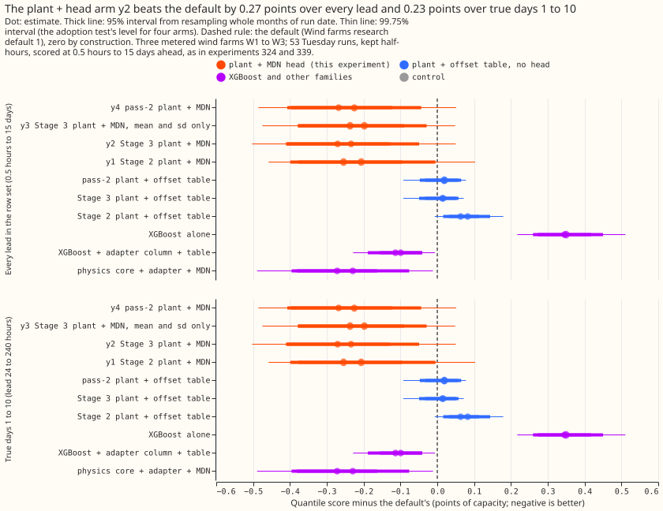

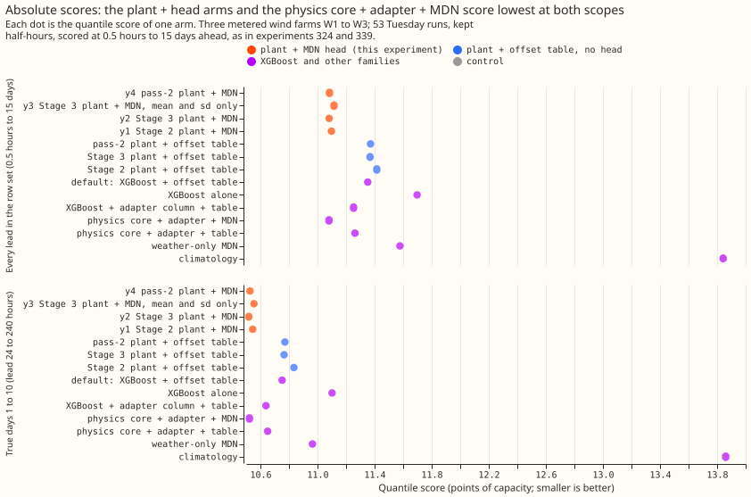

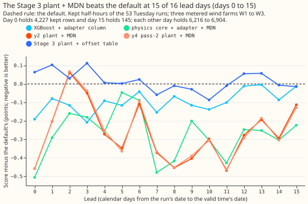

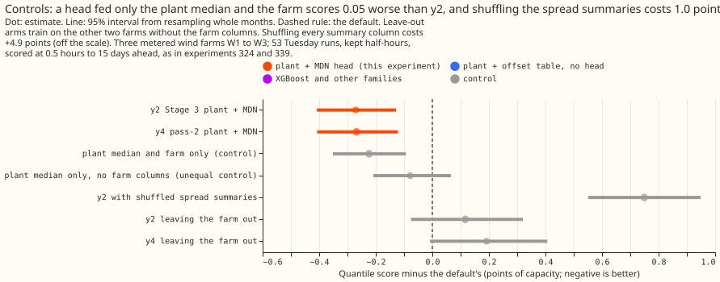

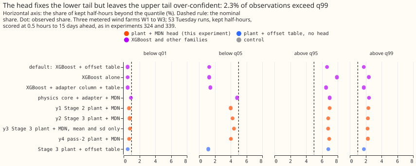

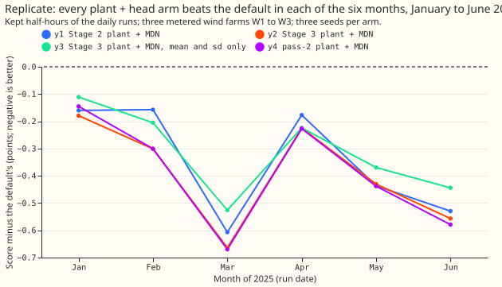

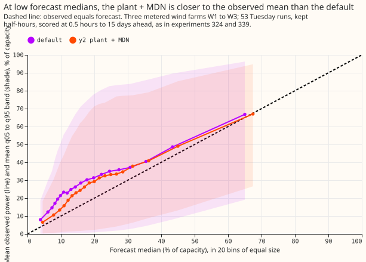

## Plant diagnostics (Stages 1 to 3b)

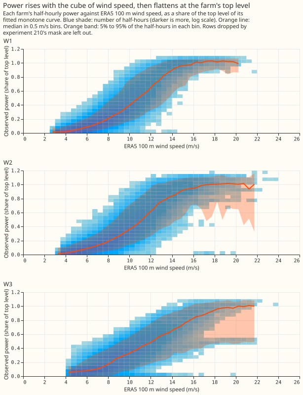

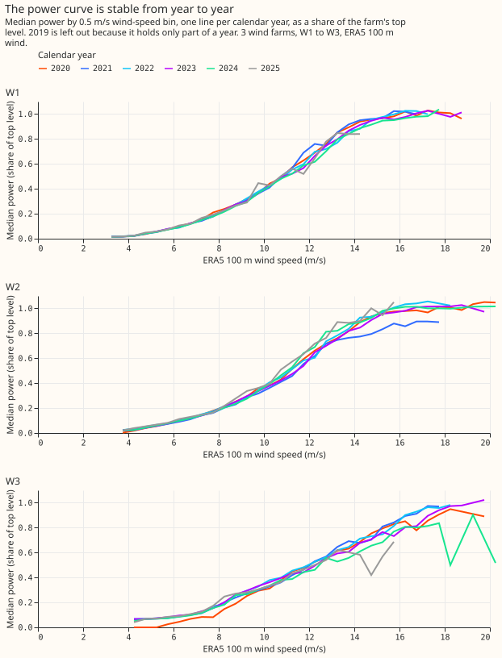

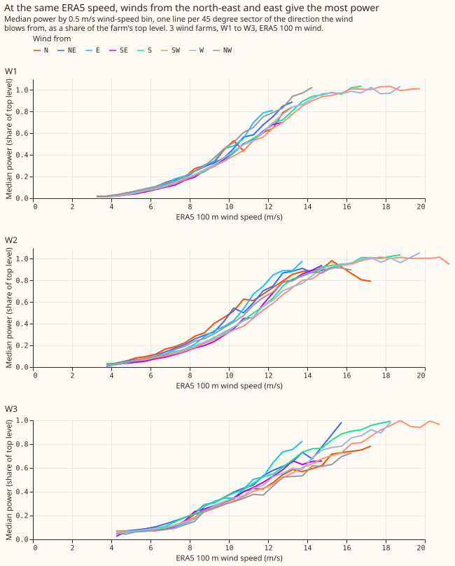

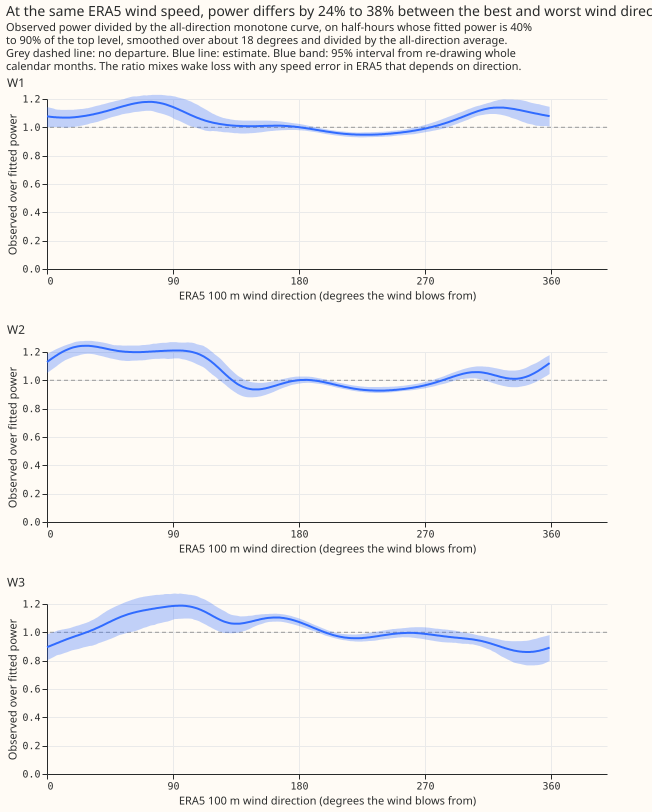

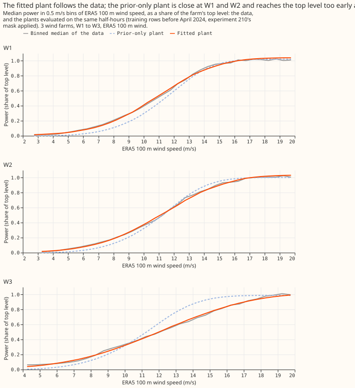

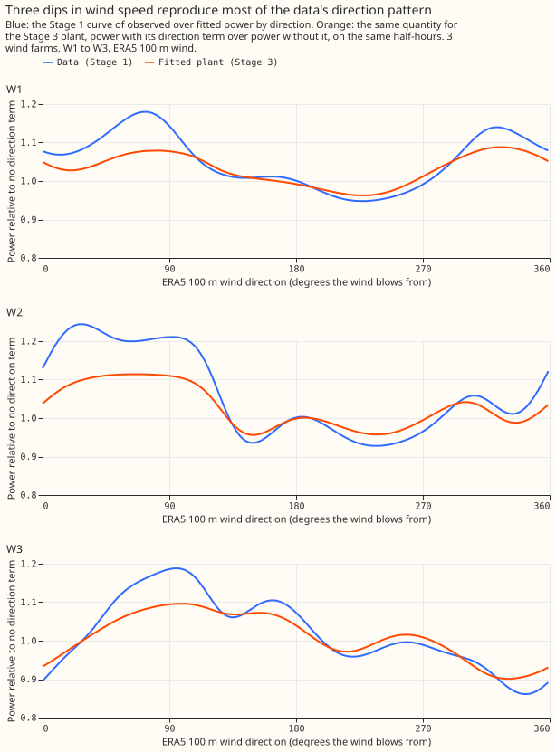

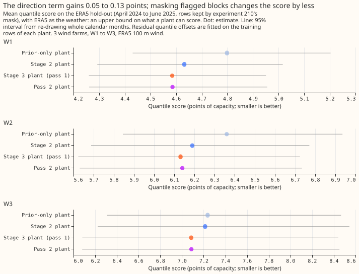

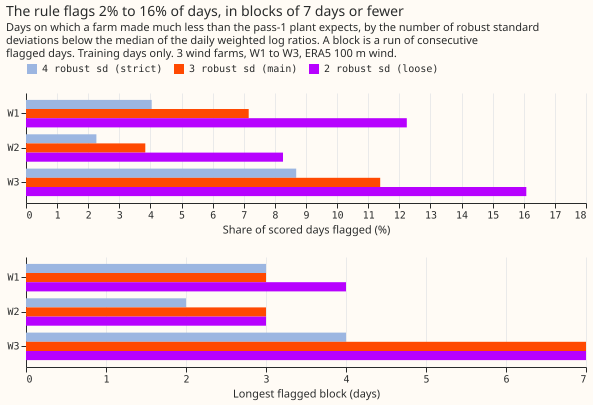

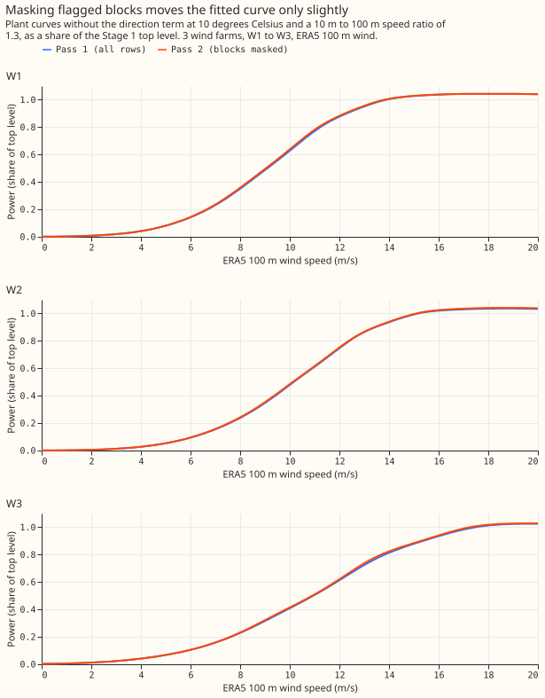

## Results

### Arms and architecture

- **y1:** Stage 2 plant (speed-to-power curve with priors on cut-in, rated, and cut-out speed, a
  blur over speed for the 25 km cell, and a hub-height shear and air-density correction), then the
  head on the six summary columns, the lead, and the farm.
- **y2:** Stage 3 plant (y1's plant plus three direction-dependent losses), same head.
- **y3:** y2's plant, with the head given only the mean and standard deviation of the 51 power
  values.
- **y4:** pass-2 plant, fitted again after masking the days on which a farm fell short of the pass-1
  plant, same head as y2.
- **Head:** one pooled network per arm and seed (two hidden layers of 64 units, three Gaussian
  components, 11 quantiles read from the mixture's CDF, capped at capacity), trained on the kept
  hindcast half-hours of W1 to W3 before 2025-04-16, with early stopping on the later runs. Five
  seeds.
- **Standard architecture: physics plant + MDN head.** The plant has no neural adapter, and the
  head sees only the plant's summary, the lead, and the farm.
- **Row set:** `fold_a_tuesdays_v1`, 53 Tuesday runs from 2025-07 to 2026-06, 96,479 kept rows
  (107,121 in all). Kept rows exclude the idle-band half-hours of experiment 210's mask. Intervals
  resample whole calendar months of run date.

### Headline numbers

| Arm | Every lead: score | Every lead: minus default | True days 1 to 10: score | True days 1 to 10: minus default |
|---|---|---|---|---|
| Default | 11.352 | 0 | 10.752 | 0 |
| y1 | 11.098 | -0.254 (95% -0.399 to -0.096; 99.75% -0.458 to -0.017) | 10.546 | -0.206 (95% -0.379 to -0.005; 99.75% -0.451 to +0.107) |
| y2 | 11.081 | -0.271 (95% -0.408 to -0.127; 99.75% -0.472 to -0.057) | 10.518 | -0.234 (95% -0.413 to -0.049; 99.75% -0.506 to +0.052) |
| y3 | 11.115 | -0.237 (95% -0.380 to -0.090; 99.75% -0.450 to -0.016) | 10.554 | -0.198 (95% -0.378 to -0.030; 99.75% -0.477 to +0.051) |
| y4 | 11.084 | -0.268 (95% -0.407 to -0.122; 99.75% -0.473 to -0.053) | 10.527 | -0.225 (95% -0.399 to -0.044; 99.75% -0.489 to +0.054) |
| Stage 2 plant + offset table, no head | 11.415 | +0.063 (95% +0.016 to +0.114) | 10.834 | +0.082 (95% +0.032 to +0.144) |
| Stage 3 plant + offset table, no head | 11.368 | +0.016 (95% -0.033 to +0.051) | 10.766 | +0.014 (95% -0.050 to +0.058) |
| Stage 3 plant driven by ERA5 (ceiling) | 6.045 | not comparable | 6.069 | not comparable |

- **The default reproduces:** the re-fit scores 11.352 against the stored 11.352 (gate passed). The
  seed standard deviation of the kept score is 0.020 to 0.028.
- **The head carries the gain, not the plant.** The plant with the offset table and no head ties
  the default (+0.016), and the head lowers that score by 0.287 (95% -0.415 to -0.151) over every
  lead and 0.248 (95% -0.408 to -0.072) over true days 1 to 10.
- **y1 to y4 are indistinguishable.** y2 minus y1 is -0.016 (95% -0.050 to +0.016), y3 minus y2 is
  +0.034 (95% -0.011 to +0.084), and y4 minus y2 is +0.003 (95% -0.007 to +0.013).
- **By farm (every lead, default then y2):** W1 10.958 then 10.688, W2 12.281 then 11.837, W3
  10.798 then 10.710. Leaving any one farm out keeps the sign of the gain. W3 alone gives -0.089
  (95% -0.325 to +0.149).
- **By lead day:** y2 is below the default at 15 of the 16 calendar lead days from 0 to 15. The
  exception is day 2 (+0.06). The gap is largest at days 7 to 9 and day 11 (0.37 to 0.47 points;
  Figure 12).
- **The idle-band rows are worse:** 8.241 for y2 against 6.051 for the default, as in experiment
  339. The all-half-hours difference is -0.026 (tolerance 0.05).

### Comparison with every comparison row

| Row | Every lead: score | y2 minus row | True days 1 to 10: score | y2 minus row |
|---|---|---|---|---|
| Default (XGBoost + offset table) | 11.352 | -0.271 (95% -0.408 to -0.127) | 10.752 | -0.234 (95% -0.413 to -0.049) |
| XGBoost alone (no table) | 11.697 | -0.616 (95% -0.815 to -0.415) | 11.102 | -0.584 (95% -0.852 to -0.336) |
| XGBoost + adapter column + table (experiment 326's arm c) | 11.253 | -0.171 (95% -0.293 to -0.046) | 10.639 | -0.121 (95% -0.279 to +0.045) |
| Physics core + adapter + MDN (experiment 324's W4) | 11.080 | +0.001 (95% -0.071 to +0.069) | 10.523 | -0.005 (95% -0.101 to +0.080) |
| Climatology by farm, month, and hour | 13.842 | -2.761 (95% -3.513 to -2.030) | 13.860 | -3.342 (95% -4.316 to -2.425) |
| Persistence (hours 0 to 6 only, 1,696 kept rows) | 15.566 on those rows (y2 6.227) | -9.340 (95% -11.388 to -7.425) | not defined | not defined |

### Standard architecture against the best single family

- **Standard architecture: physics plant + MDN head (y2) scores 0.171 below the best single family,
  experiment 326's XGBoost + adapter column + table.** The scores are 11.081 against 11.253 over
  every lead (-1.52%; 95% interval -0.293 to -0.046; 99.75% interval -0.349 to +0.017).
- **Over true days 1 to 10 the gap is 0.121 (-1.13%; 95% interval -0.279 to +0.045).** The interval
  includes zero.
- **Over all half-hours the gap reverses:** +0.054 (95% -0.041 to +0.150), because the head scores
  worse on the idle-band rows.
- **The standard architecture ties the other plant-plus-head design:** y2 minus experiment 324's W4
  is +0.001.

### Tails

| Row (every lead, kept rows) | below q01 | below q05 | above q95 | above q99 | 0.99 pinball | 5-95 coverage |
|---|---|---|---|---|---|---|
| Nominal | 1% | 5% | 5% | 1% | | 90% |
| Default | 0.51% | 1.29% | 6.65% | 1.77% | 0.640 | 92.1% |
| XGBoost alone | 0.51% | 1.29% | 7.91% | 2.40% | 0.681 | 90.8% |
| XGBoost + adapter column + table | 0.51% | 1.44% | 6.53% | 1.77% | 0.639 | 92.0% |
| Experiment 324's W4 | 0.93% | 4.82% | 6.99% | 2.42% | 0.691 | 88.2% |
| y1 | 0.69% | 4.01% | 6.98% | 2.34% | 0.682 | 89.0% |
| y2 | 0.76% | 4.25% | 6.81% | 2.28% | 0.682 | 88.9% |
| y3 | 0.79% | 4.43% | 6.79% | 2.25% | 0.677 | 88.8% |
| y4 | 0.70% | 4.04% | 6.93% | 2.28% | 0.680 | 89.0% |
| Head fed the plant median, lead, and farm only | 0.81% | 4.66% | 7.39% | 2.55% | 0.721 | 88.0% |

- **The lower tail now matches the nominal share:** 4.0% to 4.4% of observations fall below q05
  (nominal 5%), against 1.3% for the default.
- **The upper tail is over-confident:** 2.25% to 2.34% exceed q99 (nominal 1%), and the 0.99
  pinball loss is +0.042 above the default's for y2.
- **The one-sided 95% upper bound of the 0.99 pinball harm is +0.076 to +0.084 over every lead**
  (y3 +0.076, y4 +0.081, y1 +0.082, y2 +0.084) and +0.046 to +0.056 over true days 1 to 10 (y3
  +0.046, y2 and y4 +0.052, y1 +0.056). The limit is +0.05, and the 0.01 bound is at most +0.003.
- **The quantile ceiling is part of the cause.** The head caps every quantile at capacity, yet
  0.87% of kept observations exceed capacity, which puts a floor of 0.87% under the share above
  q99 (audit finding 4). The same cap is in experiment 339's heads.

### Replicate

Heads trained on 2024-04 to 2024-11 (early stopping on December 2024) and scored on the daily runs
of 2025-01 to 2025-06, three seeds, against the default's 10.210 (9.728 over true days 1 to 10).

| Arm | Every lead: minus default | t test on six months | True days 1 to 10: minus default | t test |
|---|---|---|---|---|
| y1 | -0.325 (95% -0.488 to -0.184) | t -4.13, p 0.009 | -0.316 (95% -0.496 to -0.197) | t -4.10, p 0.009 |
| y2 | -0.375 (95% -0.535 to -0.243) | t -5.02, p 0.004 | -0.376 (95% -0.563 to -0.226) | t -4.36, p 0.007 |
| y3 | -0.299 (95% -0.430 to -0.186) | t -4.84, p 0.005 | -0.292 (95% -0.447 to -0.165) | t -4.16, p 0.009 |
| y4 | -0.373 (95% -0.541 to -0.232) | t -4.69, p 0.005 | -0.372 (95% -0.570 to -0.210) | t -4.11, p 0.009 |
| Head fed the plant median, lead, and farm only | -0.354 (95% -0.493 to -0.234) | t -4.93, p 0.004 | -0.324 (95% -0.488 to -0.204) | t -4.21, p 0.008 |

All four arms beat the default in each of the six months (Figure 15), so the sign replicates.

### Controls

- **Head fed the plant's median, the lead, and the farm (five seeds):** 11.128 over every lead and
  10.587 over true days 1 to 10. y2 minus this control is -0.047 (95% -0.104 to +0.011) and -0.069
  (95% -0.154 to +0.010). The control minus the default is -0.224 (95% -0.351 to -0.093), which is
  83% of y2's gain (70% over true days 1 to 10).
- **The first, unequal control** gave the head no farm columns and scored 11.273, and y2 minus it
  was -0.192 (95% -0.353 to -0.034). The two controls differ by 0.145 (95% 0.008 to 0.283), so the
  missing farm columns, not the missing spread summaries, explain most of that gap. Only the
  control with the farm columns is the fair one.
- **Shuffled spread only (the placebo):** the head scores 12.102 when the standard deviation, the
  10th and 90th percentiles, and the saturation share come from another month of the same farm,
  and the true median and mean are kept. The spread-only placebo scores +1.020 above y2 (95% +0.856
  to +1.204), and +1.264 over true days 1 to 10. The same shuffle costs +1.057 for y1, +0.718 for
  y3, and +0.970 for y4. The head therefore reads the spread columns, and mismatched spread is
  worse than none (+0.973 above the median-and-farm control).
- **Shuffled every summary including the median:** 15.982, +4.901 above y2 (95% +4.247 to +5.519).
  The all-summaries placebo shows that the plant's median carries the signal, and does not test
  the spread.
- **Leave one farm out (no farm columns, trained on the other two):** 11.469 for y2, +0.117 above
  the default (95% -0.075 to +0.317) and +0.387 above y2 (95% +0.186 to +0.588). A farm with no
  history gains nothing from the head.
- **Nested arms:** y3 minus y2 is +0.034, and the median-and-farm control minus y2 is +0.047
  (95% -0.011 to +0.104). Neither nested arm beats its container.

### Stage 3 and 3b outcomes

- **Direction term on ERA5:** the Stage 3 plant lowers the pooled ERA5 hold-out score from 5.968 to
  5.892 (-0.076, 95% -0.132 to -0.018). The prediction of a gain of 0.02 to 0.1 holds. The
  prediction of a larger gain at W1 and W2 than at W3 fails (W1 0.047, W2 0.058, W3 0.128).
- **The injection test missed its criterion at W1 and W2.** The criterion was detecting at least
  80% of injected blocks with under 5% false flags. A 25% power loss over 3 to 14 days was found in
  12% of blocks at W1 and 1% at W2 (3 robust standard deviations), and the loss of one turbine in
  2% and 0%. The robust standard deviation of the daily log ratio is 0.13 to 0.18, so a 25% loss
  moves one day by only 1.6 to 2.1 standard deviations. At W3 the largest injected loss was found
  in 98% of blocks, with 10.6% false flags.
- **The flagged days are mostly isolated days of ERA5 speed error, not hardware outages.** The
  unmodified series flags 7.2% (W1), 3.8% (W2), and 11.4% (W3) of days at 3 standard deviations,
  against 0.13% for a Gaussian, and the longest block is 3, 3, and 7 days. Arm y4 therefore tests
  a plant fitted on a thinned training set, and says nothing about hardware outages.
- **Third pass:** a third fit after masking gives nearly the same flagged days (Jaccard 0.97 to 1.00
  against pass 2) and a hold-out score within 0.001 of pass 2's.
- **Placebo mask:** masking the same number of random day blocks moves the fitted parameters by
  amounts that the real mask exceeds by more than two placebo standard deviations for some
  quantities (the rated speed at W1 and W3, the scale at W2, and the hold-out score at W2 and W3).
  All the shifts are small: the hold-out score changes by at most 0.009 points. The prediction that
  y4 differs from y2 by under 0.05 holds (+0.003).

### Pre-registered predictions

- **Holds:** y2 beats y1 by under 0.05 (-0.016).
- **Fails:** y2 within 0.15 of the default and not beating it by 0.03. y2 beats it by 0.271.
- **Fails:** y3 within 0.03 of y2 (+0.034, interval -0.011 to +0.084).
- **Fails narrowly:** a head fed only the plant's median does as well as the full head. With the
  farm columns the median-only head scores 0.047 worse than y2 (95% -0.104 to +0.011), which is
  past the 0.03 line and inside noise.
- **Holds:** the share above q99 stays above 1% (2.25% to 2.34%).
- **Holds:** y4 differs from y2 by under 0.05 (+0.003).

### Adoption conditions

- **Condition 1 (gain) passes over every lead and fails over true days 1 to 10.** The 99.75%
  intervals of arm minus default are below zero for all four arms over every lead (y4 -0.473 to
  -0.053, y3 -0.450 to -0.016, y2 -0.472 to -0.057, y1 -0.458 to -0.017), and include zero over true
  days 1 to 10 (upper ends +0.051 to +0.107).
- **Condition 2 (tails) fails for every arm over every lead.** The 0.99 harm bound of +0.076 to
  +0.084 is above +0.05. Over true days 1 to 10 only y3 passes (+0.046), and y3 fails condition 1.
  The upper tail therefore blocks adoption, and no arm is adopted.
- **Condition 3 (replicate) passes** for all four arms at both scopes.
- **Condition 4 (controls):** the reproduction gate and the seed check pass, the spread-only
  placebo costs 0.72 to 1.06 points, and two audit triggers fired and are triaged below.
- **Condition 5 (serving):** see the next section.
- **Candidate:** y4, y3, y2, and y1 each win condition 1 over every lead and fail condition 2, so
  all four stay candidates, with y2 and y4 the best.

### Serving needs

- **y1:** frozen plant parameters per farm (about 15 numbers: the three speed thresholds and their
  widths, a scale, a blur, and a hub height), one pass of each of the 51 members' four weather
  columns through the plant, and one mixture-density head.
- **y2, y3, and y4:** the same, plus three direction losses per farm in the plant. y3 feeds the head
  two summary columns instead of six.
- **Nothing else:** no XGBoost model, no offset table, no neural adapter, and no ERA5 at forecast
  time.

### Checks

- **Median forecast minus mean forecast per farm (every lead, points of capacity), W1, W2, W3:**
  default -4.95, -5.39, -4.03; y1 -4.08, -4.29, -3.29; y2 -4.06, -4.40, -3.35; y3 -4.26, -4.48,
  -3.54; y4 -4.06, -4.34, -3.25; median-and-farm control -3.98, -4.37, -3.11. The heads bring the
  median 0.7 to 1.0 points of capacity closer to the mean than the default's median is.
- **Error of the mean and median forecast beside the y2 contrast with the default (every lead):**
  quantile score -0.271 (95% -0.408 to -0.127), mean-forecast squared error -15.5 (95% -27.1 to
  -3.2), median-forecast squared error -50.6 (95% -66.4 to -34.8), median-forecast absolute error
  -0.382 (95% -0.592 to -0.166), and mean-forecast absolute error +0.116 (95% -0.076 to +0.308).
  The root mean squared error of the mean forecast is 21.56 for y2 against 21.92 for the default.
  Over true days 1 to 10 the same errors are -12.5 (95% -25.7 to +1.9), -41.4 (95% -61.2 to -23.2),
  -0.339 (95% -0.616 to -0.063), and +0.117 (95% -0.078 to +0.338). The mean forecast is the
  nine-level mean, and absolute error is minimised by the median, so squared error is the matching
  yardstick for a mean forecast. y1, y3, y4, and the median-and-farm control agree with y2.
- **Audit triggers fired:** trigger 1 (a control fails) fired because of the injection test, and
  trigger 2 (a result contradicts its prediction) fired for the four predictions above. Trigger 3
  fired on the first scoring run, on the mean-forecast absolute error, and does not fire once
  squared error is the check. Triggers 4 (leave-one-farm-out flips a contrast), 5 (a nested arm
  beats its container), and 6 (interval width, 1.27 to 1.37 times experiment 339's) do not fire.
  Trigger 7 holds: the replicate supports the sign.
- **Audit findings and triage.** A fresh Sonnet auditor recomputed the headline from the stored
  predictions and found no leakage.
    - Finding 1, the lead scope: accepted, and fixed by scoring true days 1 to 10 and labelling both
      scopes.
    - Finding 2, the control without farm columns: accepted, and fixed by rerunning the control
      with the farm columns (five seeds; the auditor's three-seed run gave 11.140 against 11.128).
    - Finding 3, quantile score against mean-forecast error: accepted as a yardstick fault, and
      fixed by adding squared errors.
    - Finding 4, the capacity ceiling: accepted as a caveat. The fix (a ceiling above capacity)
      changes the head after the scores are read and breaks comparability with experiment 339, so
      it belongs in a new experiment.
    - Finding 5, the placebo that shuffles the median: accepted, and the spread-only placebo is now
      the placebo, with the docstring corrected.
    - Finding 6, the injection test: accepted as a limitation of the daily-ratio rule.
    - Finding 7, leakage: no change. `prior_scales()` reads the capacity-scale prior from ERA5
      through 2025-06-16, and the effect on Stage 4 is negligible (prior sd 15%). The auditor did
      not trace how the effective-capacity file was built, and every arm and the default share it.
    - Findings 8 and 9, pairing and anonymisation: no change.
  Nothing was rejected outright.

### Caveats

- **Scope:** the headline scores every lead from 0.5 hours to 15 days (31% of rows have a lead of at
  least 240 hours). The pre-registered condition 1 names days 1 to 10, and on that scope no arm
  passes it.
- **Three farms, one scored year:** 53 Tuesday runs and 12 month blocks. The interval on the gain is
  wide, and W3 alone shows no clear gain.
- **ERA5-trained plant on ensemble input:** the plant is fitted to ERA5 and run on ensemble members,
  whose mean 100 m wind speed is 4% below ERA5's at W1 at leads under 24 hours. The head absorbs
  that offset, so the plant's physics is not tested on its own.
- **Idle-band rows:** y2 scores 8.241 on them against 6.051 for the default.
- **Not computed:** the curtailment-cost saving and the threshold-weighted CRPS. The predictions
  (11 quantiles, actual, lead hours, and time series) are stored privately for that node metric.

### What to try next

- **Raise the quantile ceiling above capacity or add a tail model** to the head, and test whether
  the share above q99 falls to 1% and condition 2 passes.
- **Test a head fed the median of experiment 326's arm c and the farm,** because the plant's
  median and the farm already give 83% of the gain, and the test shows whether the plant adds
  anything over the adapter column.
- **Fit the plant's parameters on the ensemble members' own hindcast** instead of ERA5, so that
  the plant's speed bias is a fitted quantity.
