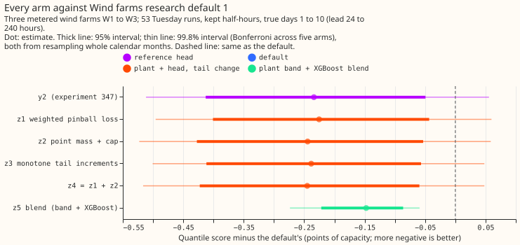
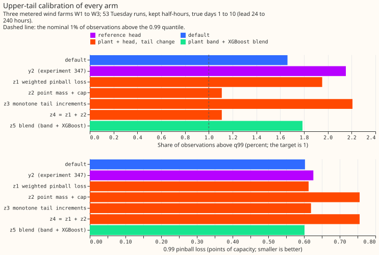
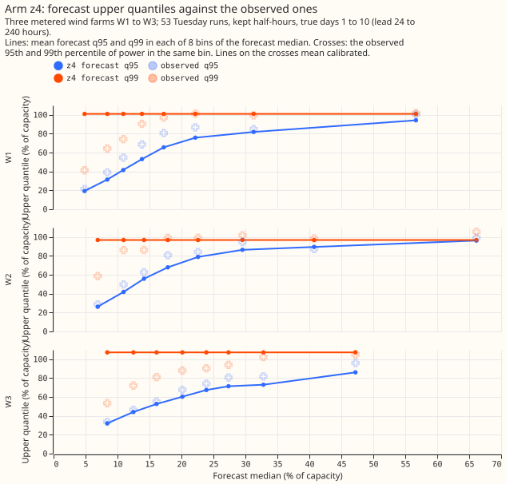
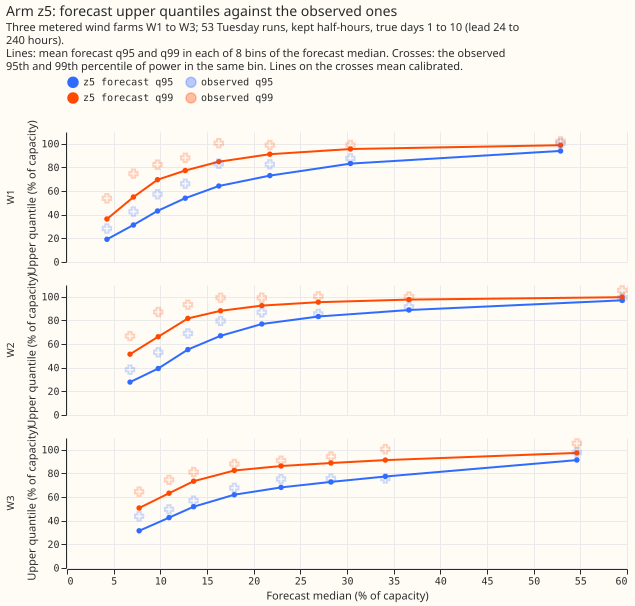
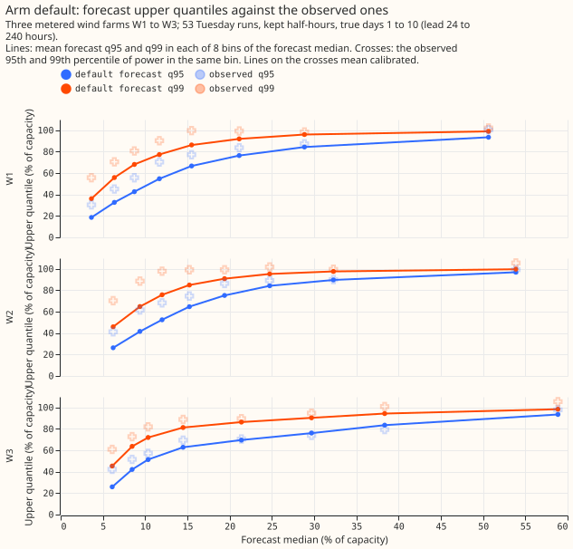

 **Take-home: the frozen physics plant with a mixture head stays about 0.23 points of capacity
better than Wind farms research default 1 over days 1 to 10, but no tail fix inside the head
calibrates the top quantile without raising the pinball loss at that quantile, and the plain recipe
of blending the plant's residual band with the default's XGBoost quantiles is the only arm whose
gain is clear.** Verdict: partly supported. The next step is to build on that blend, and to fit a
point mass with a likelihood.

We asked whether five changes to the upper tail would make experiment 347's best arm (a physics
model of each farm run on the 51 weather-ensemble members, then a three-component Gaussian mixture
head) adoptable. The head scored 0.23 points better than the default but put 2.2% of observed power
above its 0.99 quantile (2.3% over every lead). The five changes were a loss that weights the top
quantiles (z1), a point mass at the farm's maximum plus a cap (z2), monotone increments above the
0.9 quantile (z3), z1 plus z2 (z4), and a blend of the plant's residual band with the default's
XGBoost quantiles, the recipe used for the metered solar farms (z5; experiments
[270](../00270-metered-farm-xgboost-vs-plant-diagnostic/result.md),
[287](../00287-metered-farm-spread-binned-plant-heads/result.md), and
[300](../00300-metered-farm-best-guess-assembly/result.md)). All scores are in points of capacity (1
point is 1% of a farm's capacity). Terms: W1 to W3 are the three metered wind farms, whose names are
withheld. The forecast 99th percentile, q99, should lie below 99% of observations. The pinball loss
at a quantile is the standard score of that quantile. The "kept" half-hours are those that survive
experiment 210's mask of idle or unreliable periods. The "scale" is each farm's fitted maximum
output in the plant model. "True days 1 to 10" means lead hours 24 to 240, on the 53 Tuesday runs of
`fold_a_tuesdays_v1`, kept half-hours, **scored at true days 1 to 10 (lead 24 to 240 hours)**.

## Results

- **Arms.** Base is experiment 347's y2 (Stage 3 plant, summary of the 51 member powers, head with
  three Gaussian components). z1 to z4 as in the plan. The reference `y2p` is y2 trained with the
  pinball loss, weights 1. z5 works on stored quantiles: the plant's residual band in six
  equal-count bins of the plant's mean forecast and four lead bands, blended per quantile and lead
  band with weights chosen on earlier scored months. Wind farms research default 1 is XGBoost plus
  experiment 259's offset table (the research-default log has no wind version yet, so this page uses
  the name experiments 259, 339, and 347 gave it). Code reuse: experiments 230, 303, 310, 326, 336,
  and 347. - **Headline, true days 1 to 10 (kept rows, default 10.752).** y2 10.518 (-0.234; 99.8%
  interval -0.512 to +0.056); y2p 10.507 (-0.245); z1 10.527 (-0.225; -0.496 to +0.060); z2 10.508
  (-0.244; -0.523 to +0.059); z3 10.514 (-0.238; -0.501 to +0.048); z4 10.507 (-0.245; -0.516 to
  +0.048); z5 10.605 (-0.147; -0.274 to -0.059). Days 1 to 2: head arms -0.05 to -0.07, z5 -0.172.
  Days 3 to 10: head arms -0.28 to -0.31, z5 -0.158. Every head arm is within 0.011 of y2, and every
  head arm is within 0.02 of y2p (z1 is the furthest, 0.020 worse). - **Reference rows (true days 1
  to 10).** XGBoost alone 11.102; XGBoost with the adapter column 10.639; experiment 324's head
  10.523; climatology 13.860. Seed sd of the head arms on kept rows is 0.011 to 0.044. - **Standard
  architecture (physics plant + mixture head).** The best head arm (z4, 10.507) sits 0.016 points
  (0.1%) below the best other family row (experiment 324's W4, 10.523) and 0.245 points (2.3%) below
  the default. - **Replicate** (heads trained on 2024-04 to 2024-11, scored on the daily runs of
  2025-01 to 2025-06, default 9.728): y2 -0.376; y2p -0.354; z1 -0.343; z2 -0.356; z3 -0.329; z4
  -0.331; z5 -0.209 (95% -0.371 to -0.070; t test on six monthly differences p = 0.028). All have
  the same sign.

| Arm (true days 1 to 10) | Below q01 (%) | Above q95 (%) | Above q99 (%) | p01 | p95 | p99 | 5 to 95 coverage (%) |
|---|---|---|---|---|---|---|---|
| default | 0.55 | 6.62 | 1.66 | 0.285 | 2.415 | 0.603 | 92.0 |
| y2 | 0.81 | 6.69 | 2.15 | 0.283 | 2.382 | 0.626 | 88.9 |
| z1 | 0.52 | 6.43 | 1.95 | 0.283 | 2.384 | 0.613 | 90.8 |
| z2 | 0.62 | 6.43 | 1.11 | 0.283 | 2.387 | 0.756 | 89.9 |
| z3 | 0.53 | 6.68 | 2.21 | 0.283 | 2.393 | 0.620 | 90.5 |
| z4 | 0.63 | 6.48 | 1.11 | 0.283 | 2.388 | 0.756 | 90.0 |
| z5 | 0.68 | 6.62 | 1.79 | 0.287 | 2.407 | 0.602 | 90.8 |
| z5a (plant + offsets) | 0.63 | 6.32 | 1.59 | 0.285 | 2.419 | 0.610 | 89.9 |
| z5b (plant + residual band) | 1.02 | 7.18 | 2.32 | 0.295 | 2.543 | 0.650 | 89.0 |
| y2p | 0.58 | 6.38 | 1.93 | 0.283 | 2.377 | 0.612 | 90.3 |

- **Tails.** z2 and z4 put q99 on the farm's scale for almost every row (figure 3), so their 1.1%
  above q99 is the share of observations above the scale. The pinball loss gives the point mass's
  weight no gradient at levels above 1 minus that weight. The head therefore cannot learn to lower
  the weight. By farm, the share above q99 is 0.69%, 2.57%, and 0.04% for W1, W2, and W3 (W2's scale
  is below capacity).
- **Controls.** The reproduction gate holds (y2 refit 11.081 against 11.081 on all leads, kept rows).
  A base-only head (plant median, lead, farm) reproduces 71% (y2), 74% (y2p), 75% (z1), 66% (z2),
  77% (z3), and 75% (z4) of each arm's gain. The shuffled-summary placebo scores 5.6 to 5.8 points
  worse than the default. The plant is frozen and the head sees ensemble weather only.
- **Checks.** Median minus mean forecast per farm (true days 1 to 10) is -3.3 to -4.5 points for the
  default and -3.0 to -4.1 for every arm, so every arm's median stays 3.0 to 4.1 points below its
  mean, close to the default's. The mean-forecast squared error and the median absolute error move
  in the same direction as the quantile score for every arm. No audit trigger fired: the head arms'
  failed predictions (below) are explained in the tails bullet, no control failed, and no sister
  experiment has an interval to compare with.
- **Pre-registered predictions.**
    - z4 brings the share above q99 under 1.5% (holds, 1.11%) and the 0.99 pinball loss within
      0.03 of the default's (fails, 0.153 above), so the joint prediction fails.
    - z2 does most at W1 and W2 and less at W3: fails (by share above q99, W2 is worst at 2.57%
      and W3 best at 0.04%).
    - z1 lowers the 0.99 pinball loss by under 0.03 (holds, 0.013 against y2) and raises the
      quantile score by under 0.03 (holds, 0.009).
    - The headline stays within 0.05 of y2's for every arm (holds), and the base-only head
      reproduces at least 70% of the gain (holds for y2, y2p, z1, z3, and z4; fails for z2).
    - z5 lowers the 0.99 pinball loss by 10% (fails, 0.2%), puts the share above q99 under 1.5%
      (fails, 1.79%), and is within 0.1 of z4 on the headline (holds, 0.098).
- **Adoption (order z4, z5, z3, z2, z1).** No head arm passes condition 1 (every 99.8% interval
  includes zero), and z2 and z4 also fail condition 2 (0.99 pinball loss harm up to 0.212). z5
  passes conditions 1 to 4 (gain 0.147, harm to p01 and p99 at most 0.013, replicate -0.209),
  The replicate of z5 was added after the main scores were read, because the plan said that the
  default's replicate forecasts did not exist, and they do. Therefore z5 stays a candidate, and
  nothing is adopted.
- **Serving.** z1 to z4 need what y2 needs: the plant run on each member, then the head. z5 needs
  the plant, a stored table of offsets by bin, and the default's XGBoost quantiles.
- **Curtailment metric.** Not scored: `studies.node_curtailment` needs a node's export and its
  generators' forecasts together, and this experiment forecasts the three farms alone.
- **Caveats.** Scored at true days 1 to 10 only; three farms and 53 runs give wide intervals. z5's
  blend weights for the first runs of a month use actuals of the earlier month that were not yet
  observed at those runs' issue times, a small look-ahead. z5 fits on earlier scored months. Each
  head was fitted once on the hindcast and never refitted. Whether refitting changes the contrast
  was not tested.
- **What to try next.** (1) Fit the point mass's weight with a likelihood or a classification loss
  on saturated half-hours, then retest z2. (2) Apply the solar recipe to the head's own quantiles
  (plant plus head, then band, then blend), a tier 1 step. (3) Repeat z5 with a pre-registered
  replicate before any adoption.
