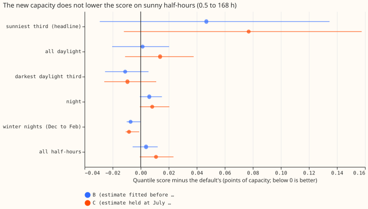
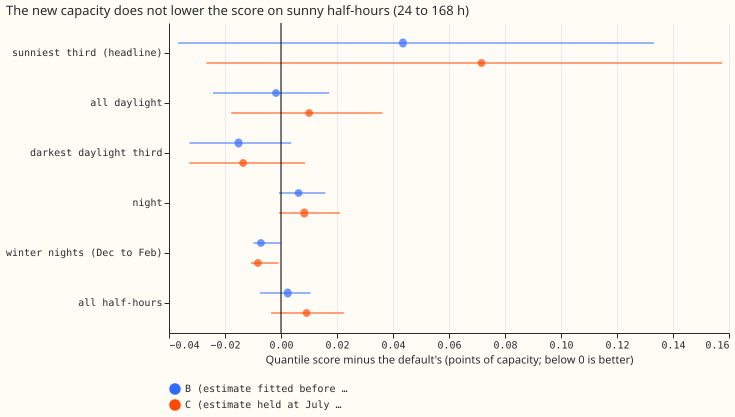
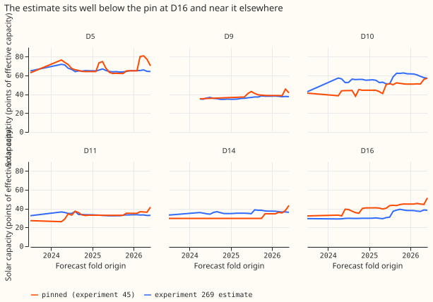

## Take-home message

**Replacing the pinned solar capacity with the capacity estimate of experiment 269 did not lower the
score on sunny half-hours, and it was no better elsewhere.** The research forecast of demand at six
Primary substations (anonymised as D5, D9, D10, D11, D14, and D16) subtracts the output of
unmetered rooftop solar from each substation's demand. The size of that solar (its capacity) is
pinned to the values of [experiment 45](../00045-pvdis-4-weekly-capacity-asymmetric-l1/result.md).
[Experiment 269](../00269-pv-capacity-gain-decomposition/result.md) found that a table learned from
six metered solar farms recovers 0.89 to 0.97 of the output of an injected farm, where the physical
fleet shape recovers 0.78 to 0.83. We asked whether a capacity read that way gives a better
forecast. We refitted the first stage of the forecast (a convex demand model with a Kalman filter,
from [experiment 139](../00139-differentiable-physics-pv-as-of-capacity-in-gam-k/result.md)) with
the pinned capacity swapped for the new estimate, which was refitted each month on earlier rows
only. Scores are quantile scores in points of the substation's capacity, smaller is better. On the
sunniest third of daylight half-hours (the third of each Primary's daylight half-hours with the
highest solar output per unit of capacity), the score rose from 4.371 to 4.418, a change of +0.047
points (95% interval from resampling whole months, -0.029 to +0.135). A positive change means a
worse score. The interval includes zero, so the experiment cannot tell. **Verdict: inconclusive.**
The pre-registered rule asks for an interval wholly below zero, which the score did not reach.

The later stages of Primary demand research default 3 (the neural-network head, the solar summary,
and the blend with the manual heuristic) and the 168 to 240 hour range were not rerun. The first
stage showed no gain to carry into them. A gain after them cannot be ruled out.

## Figures

## Results

- **Arms and what was refitted.** The experiment changes the solar capacity inside the fitted
  stage and imports the default's code (a tier 2 change), and adds a farm-response table and a
  capacity fit per month. Arm A is the first stage with the pin (experiment 45's `frozen`
  vintage). Arm B replaces the capacity with the experiment 269 estimate, refitted at each of 27
  monthly origins (2024-04 to 2026-06) on rows before the origin. Arm C holds arm B's value at the
  2025-07-01 origin for the whole scored year. The stack's own unit solar shape is unchanged.
- **How the estimate is scaled.** A fit to the real series reads too little of a solar farm's
  output. Each fit is therefore divided by the median recovery of five farms injected at that
  origin into the same Primary's demand, each read with the shape of the other five farms.
- **Row set and range.** `fold_a_daily_gap_v1`, scored year 2025-07-02 to 2026-06-30, six
  Primaries, rows outside the hand-filtered events, forecast origin 09:00 UTC, lead 0.5 to 168 hours
  and 24 to 168 hours. The 168 to 240 hour range needs the experiment 317 chain, which was not
  rerun, so the result covers 7 of NGED's 10 forecast days.
- **Headline, sunniest third of daylight half-hours (B minus A, scored year).** At 0.5 to 168 hours:
  +0.047 (-0.029 to +0.135). At 24 to 168 hours: +0.044 (-0.037 to +0.133). Error of the mean
  forecast on the same rows, 0.5 to 168 hours: +0.120 (-0.002 to +0.277).
- **Absolute scores, sunniest third, 0.5 to 168 hours:** A 4.371, B 4.418, C 4.448 (24 to 168
  hours: 4.511, 4.555, 4.583). All half-hours: A 2.773, B 2.777, C 2.784. C minus A is +0.077
  (-0.012 to +0.158) and C minus B is +0.030 (-0.004 to +0.076).
- **Replicate year (2024-07 to 2025-06), sunniest third, B minus A.** At 0.5 to 168 hours +0.040
  (-0.004 to +0.084). At 24 to 168 hours +0.044 (+0.004 to +0.085), an interval wholly above zero.
  Error of the mean forecast +0.106 (0.006 to 0.187) at 0.5 to 168 hours. Both years point the same
  way. Arms B and C are identical in the replicate year, because both read the 2025-07-01 origin
  or an earlier one.
- **The other groups, B minus A at 0.5 to 168 hours:** no group other than the sunniest third moved
  by more than 0.011 points, as the table shows.

| Group | Change in score | 95% interval |
|---|---|---|
| All half-hours | +0.004 | -0.006 to +0.012 |
| All daylight | +0.001 | -0.020 to +0.020 |
| Darkest third of daylight | -0.011 | -0.025 to +0.006 |
| Night | +0.006 | -0.001 to +0.015 |
| Winter nights (December to February, after dark) | -0.007 | -0.010 to 0.000 |

- **By Primary, sunniest third, B minus A (checks.log):** D5 -0.023, D10 +0.155, D11 +0.037, D14
  -0.046, D9 -0.063, D16 +0.218. Leaving one Primary out gives +0.013 (without D16) to +0.070
  (without D9), so the sign holds. On all half-hours, leaving out D16 gives -0.006 (-0.014 to
  0.000) against +0.004 with it, so D16 carries the all-half-hours result.
- **Capacities (figure 3; ratios of the estimate to the pin for the latest season-year).** At the
  start of the scored year (2025-07-01) the estimate is 28% below the pin at D16 (30.9 against
  43.2 points of effective capacity), 15% below at D9, and 17% above at D14. By 2026-06 the pin
  has risen above the estimate at D11 (0.79), D14 (0.83), and D16 (0.74), and the estimate is 8 to
  10% below at D5 and D9. D10 matches the pin (1.00). D9's first monthly folds keep the pin,
  because D9 has too little history for an estimate there (1,513 path weeks took the pin in the
  fit log, about four folds).
- **Tails, six Primaries, 0.5 to 168 hours (A, B, C).** Coverage below q01 is 2.20%, 2.17%, and
  2.18%; below q05 6.68%, 6.67%, and 6.73%; below q95 94.74%, 94.68%, and 94.67%; below q99
  98.35%, 98.30%, and 98.30%. Pinball loss at q01 is 0.215, 0.216, and 0.216; at q05 0.721, 0.725,
  and 0.727; at q95 0.720, 0.715, and 0.716; at q99 0.220, 0.220, and 0.220. No tail moves by
  more than 0.006 points.
- **Reference rows.** The first stage alone is not Primary demand research default 3, so it is not
  placed against the manual heuristic or climatology. The research default's own scores (2.727 at
  0.5 to 240 hours, against 3.414 for the manual heuristic and 3.664 for climatology) are in the
  [research default log](../research-default-log.md).
- **Model family.** The experiment evaluates one model family and no blend.

## Checks

- **Wiring gate.** Arm A equals experiment 139's stored pin forecasts at all six Primaries (95,939
  to 97,046 rows each, largest gap in q01, q50, and q99 0.0; `logs/checks.log`).
- **Median minus mean forecast, per Primary and arm:** 0.0 points for all three arms.
- **Mean-forecast error beside each contrast:** it moves in the same direction as the quantile
  score on the sunniest third (+0.120) and on winter nights (-0.019).
- **Triggers.** None fired. B's point estimate on the sunniest third (+0.047) is just outside the
  pre-registered band (within 0.03 points either way), but its interval covers the band and the
  predicted direction (no gain) held. Leaving one Primary out does not flip the sunniest-third
  sign.

## Caveats and lab shortcuts

- **The plant-response table is not as-of.** It is fitted once on the six farms' history to
  2026-06-30, and the farms' scale (their 99th percentile of output) uses all daylight half-hours.
  Only the capacity fit, the pin, and the injection recoveries stop at each origin. The capacity
  is as-of; the shape it is read against is not.
- **The first stage only.** The neural-network head, the solar summary, the blend, and the 168 to
  240 hour range need the chain of experiments 155, 160, 164, 317, 319, and 322 refitted from the
  new forecasts.
- **Unit shape unchanged.** The estimate is applied to the stack's physical unit shape, not to the
  empirical shape it was fitted with.
- **No scale factor.** Experiment 139's post hoc factor of 1.15 was not repeated.

## What to try next

- Apply the experiment 269 estimate with the empirical shape it was fitted with, in the first
  stage and in the ensemble's solar response.
- Test a scale factor on the estimate.
