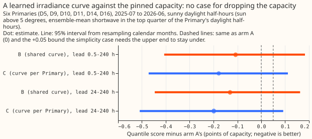
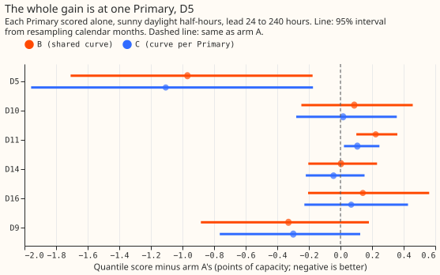
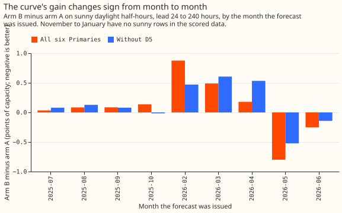
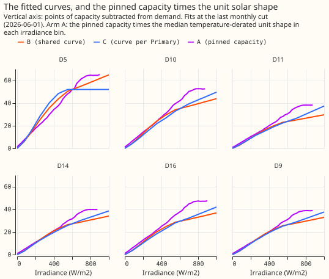

**Take-home: dropping the PV capacity estimate is not yet safe.** A learned curve of irradiance does
no better than the pinned capacity over five of the six Primaries (+0.025 points, interval -0.252 to
+0.346). Only D5's interval excludes zero (-0.969), where either the pinned capacity or the unit
solar shape is probably wrong. D11 is significantly worse with the curve (+0.223 [+0.100, +0.360]).
The useful next step is to check the D5 pin and unit shape. A curve is also a low-effort fallback for
a Primary with no trustworthy capacity. Verdict: not supported.

**Definitions.** PV capacity is the peak output of the solar panels behind a Primary, in points (1
point is 1% of the Primary's effective capacity). The pinned capacity is the capacity taken from the
weekly vintages of [experiment 45](../00045-pvdis-4-weekly-capacity-asymmetric-l1/result.md).
Irradiance is the shortwave radiation reaching the ground, in W/m2. The Primaries are six NGED
primary substations (D5, D10, D11, D14, D16, and D9). The gate is the reproduction check that must
pass before any contrast is read. CRPS is the continuous ranked probability score. Recipe R is the
fitted recipe that turns the Kalman filter's output into quantiles, and the spread table holds the
fitted widths of those quantiles.

We asked whether the forecast of Primary demand can do without an estimate of how much solar
generation each Primary has behind it. The current forecast subtracts a solar term from demand: the
pinned capacity times a fixed unit solar shape.
[Experiments 110](../00110-differentiable-physics-5-embedded-generation-and-capacity/result.md) and
[139](../00139-differentiable-physics-pv-as-of-capacity-in-gam-k/result.md) had found that fitting
the capacity from the Primary's own power did not help. We replaced the solar term with a curve of
irradiance that the fit learns, once with one shape shared by all Primaries (arm B) and once with a
shape per Primary (arm C), and compared both with the refitted pinned-capacity forecast (arm A). We
scored sunny daylight half-hours, the half-hours where the sun is more than 5 degrees above the
horizon and the ensemble-mean shortwave is in the top quarter of the Primary's daylight half-hours.
Both curves scored better than arm A on average (arm A 4.321 at 24 to 240 hours, smaller is better;
1 point is 1% of a Primary's effective capacity), but not reliably, and only one Primary, D5, has an
interval that excludes zero.

## Results

- **Arms.** A: [experiment 136](../00136-dp-bg-stage1-assembly-on-the-ensemble-mean/result.md)'s
  convex fit refitted with the pinned capacity times the temperature-derated unit shape. B: the
  solar term replaced by one monotone curve of irradiance (eight saturating ramps) with a learned
  scale per Primary, fitted on each cut's training window. C: B with a curve per Primary. The
  Kalman filter, offset, recipe R, and spread table are refitted for each arm. The neural-network
  head, the solar summary, and the heuristic blend are not refitted, because they bake in the old
  solar term. The experiment therefore compares only the convex stage. Monthly refits on a 24-month
  window. Reference rows: Primary demand research default 3 as stored, the manual heuristic, and
  climatology.
- **Row set.** `fold_a_daily_gap_v1`, six Primaries, 798,116 half-hours scored 2025-07-02 to
  2026-06-30 (origin 09:00 UTC), 90,562 of them sunny daylight. Intervals resample calendar months
  of the forecast's issue time. The decision rule's 1 - 0.05/2 level gives 97.5% bounds in the
  results below, and the headline row quotes 95% bounds. The conclusion is the same at 95%: the
  upper bound at 24 to 240 hours is +0.163 for B and +0.092 for C, both above +0.05.
- **Gate.** Arm A reproduces the stored convex stage of the chain of [experiment
  317](../00317-primary-demand-default-1-at-7-to-10-days/result.md) to within 0.000 (three
  decimals; largest quantile difference 0.000), so the gate passes. Arm A scores 0.118 worse than
  the stored research default 3 on all rows (2.845 against 2.727; interval +0.063 to +0.180)
  because the head, summary, and blend are not refitted. The stored default is read from
  experiments 322, 220, and 251.
- **Absolute scores, sunny daylight, 24 to 240 hours.** A 4.321 [3.959, 4.707]; B 4.191 [3.918,
  4.509]; C 4.122 [3.871, 4.409]; manual heuristic 4.749; climatology 4.834. All rows, 0.5 to 240
  hours: A 2.845, B 2.838, C 2.829, stored default 3 2.727, manual heuristic 3.414, climatology
  3.664.
- **Stored default 3 beats every arm.** On sunny daylight 0.5 to 240 hours the stored default 3
  scores 4.021 against A 4.236, B 4.128, and C 4.058. The contrasts below are taken against arm A,
  the convex stage, because the stored default includes the head, summary, and blend that were
  not refitted.
- **Headline, sunny daylight, B minus A (then C minus A).** At 0.5 to 240 hours -0.108 [-0.407,
  +0.183] (-0.178 [-0.472, +0.112]); at 24 to 240 hours -0.131 [-0.446, +0.163] (-0.199 [-0.509,
  +0.092]). The simplicity case (97.5% upper bound under +0.05) fails for both arms at both ranges
  (upper bounds +0.215, +0.141, +0.190, +0.121), and the gain case (interval wholly below zero)
  fails too.
- **Leave-one-Primary-out criterion: failed.** The decision rule requires that dropping one
  Primary at a time does not flip the sign of the headline contrast. Dropping D5 flips B minus A
  from -0.131 to +0.025 at 24 to 240 hours.
- **Predictions.** P1 fails: the point estimates are better than the band's lower edge of -0.10
  (B -0.108 and -0.131; C -0.178 and -0.199, nearly twice the lower edge), and the upper bounds
  exceed +0.05. P2 fails: C minus B is -0.070 [-0.111, -0.037] at 0.5 to 240 hours, so a shared
  shape is slightly too stiff. P3 holds: cold winter nights, q01 and q99 pinball, and the pooled
  score move by less than 0.03 (pooled B minus A -0.007 and C minus A -0.016 at 0.5 to 240 hours;
  cold winter nights -0.003 and -0.005). P4 holds. The one no-harm bound that breaks apart from the
  sunny row is B on all rows at 0.5 to 240 hours (upper bound +0.022 against 0.02).
- **Where the gain is.** Only D5's interval excludes zero: B minus A -0.969 [-1.708, -0.176], C
  minus A -1.106 [-1.958, -0.174], at 24 to 240 hours. Over the other five Primaries together
  the contrast is +0.025 [-0.252, +0.346] (B) and -0.031 [-0.280, +0.254] (C). D9 has a
  point-estimate gain (B -0.329 [-0.883, +0.180]). D11 is significantly worse with the curve (B
  +0.223 [+0.100, +0.360]).
- **Replicate** (even months of 2024-07 to 2025-06, sunny daylight): B minus A -0.108 [-0.261,
  +0.098] and C minus A -0.147 [-0.349, +0.070] at 0.5 to 240 hours; the same sign.
- **Curtailment metric.** Not scored: the experiment forecasts six Primaries' demand with no
  generators beside them.

Tails, sunny daylight and all rows, lead 24 to 240 hours (coverage is the share of observations at
or below the quantile; the target is the quantile's level):

| Rows | Arm | q01 coverage | q01 pinball | q05 coverage | q05 pinball | q95 coverage | q95 pinball | q99 coverage | q99 pinball |
|---|---|---|---|---|---|---|---|---|---|
| sunny daylight | A | 0.0188 | 0.2510 | 0.0625 | 0.9472 | 0.9286 | 1.1071 | 0.9730 | 0.3124 |
| sunny daylight | B | 0.0303 | 0.2532 | 0.0827 | 0.8996 | 0.9354 | 1.1099 | 0.9762 | 0.3035 |
| sunny daylight | C | 0.0278 | 0.2449 | 0.0812 | 0.8774 | 0.9378 | 1.1071 | 0.9773 | 0.3025 |
| all rows | A | 0.0246 | 0.2259 | 0.0692 | 0.7381 | 0.9468 | 0.7802 | 0.9807 | 0.2386 |
| all rows | B | 0.0250 | 0.2213 | 0.0688 | 0.7227 | 0.9447 | 0.7840 | 0.9803 | 0.2387 |
| all rows | C | 0.0246 | 0.2204 | 0.0685 | 0.7207 | 0.9451 | 0.7833 | 0.9805 | 0.2387 |

- **Tails.** The q99 pinball changes little (0.3124, 0.3035, 0.3025 on sunny rows). Every arm
  covers the upper quantiles too little on sunny rows: q95 coverage is 0.929 to 0.938 against 0.95,
  and q99 coverage is 0.973 to 0.977 against 0.99. On sunny rows B and C move the lower tail the
  wrong way: the share below q01 rises from 0.019 to 0.030 and 0.028, and the share below q05 from
  0.063 to 0.083 and 0.081, although the q05 pinball loss falls.
- **Fitted curves** (figure 4, last cut 2026-06-01). At 1000 W/m2 arm B subtracts 64.8 points at D5
  against a pinned capacity of 70.2, and 29.6 to 43.9 points at the others against pins of 41.5 to
  57.2.
- **Check: median against mean.** The median forecast minus the mean forecast is 0.0000 at every
  Primary for every arm.
- **Check: error of the mean forecast.** The error of the mean forecast points the same way as the
  quantile score (sunny daylight, 24 to 240 hours: B minus A -0.284 [-0.860, +0.294], C minus A
  -0.417 [-1.005, +0.179]), so the mean-forecast-error trigger (trigger 3) did not fire.
- **Check: audit triggers.** The leave-one-Primary-out trigger (trigger 4) fired: leaving D5 out
  flips the sign of B minus A, from -0.131 to +0.025 at 24 to 240 hours. The failed-predictions
  trigger (trigger 2) fired because P1 and P2 failed; the audit tested the explanation, a gain
  confined to D5, with the leave-one-out row. The nesting trigger (trigger 5) did not fire,
  because B is nested in C and loses to it. Triggers 1, 6, and 7 were not assessed from the
  printed report.
- **Audit.** A Sonnet agent ran the audit. The report is private
  (`data/ml-experiments/briefs/e350_audit_report.md`). The audit re-derived the numbers from the
  stored predictions and found no lookahead. Triage of its findings:
    1. The gain is D5's and comes from the median, not the spread. Recentring A's quantiles on B's
       median takes A's D5 score from 5.678 to 4.825 (B's is 4.710), and giving B A's median raises
       B's score to 5.771. This page reports the finding.
    2. The gain varies by month. B minus A runs from +0.49 (March; +0.88 in February on 47 rows)
       to -0.80 (May), and the pooled figure has nine months with sunny rows, so figure 3 shows
       it.
    3. The headline interval is the most conservative of the block choices: day blocks give
       [-0.23, -0.04] and ISO-week blocks [-0.33, +0.04]. This page uses the month blocks that the
       plan specified.
    4. Under other sunny definitions (top decile -0.246, top tercile -0.095, clear-sky index
       -0.019) the sign stays and the size varies.
    5. B turns A's small positive bias into -0.6 to -0.9 points at D10 and D16, a new bias.
- **Caveats.** The head, summary, and heuristic blend were not refitted, so the stack-level effect
  is unknown. The D5 forecast error does not isolate a cause: A's D5 bias (actual minus median) is
  -2.5 at 300 to 430 W/m2 (forecast too high) and +5.9 above 550 W/m2 (forecast too low), so a
  level error alone would not explain it, and either the pinned capacity or the unit shape is
  wrong. The experiment covers one scored year, nine months with sunny rows (October has 25 rows
  and February 47), and six Primaries. The cut schedule is monthly refits, which may matter little
  for a contrast of this size but was not tested.
- **What to try next.** (1) Fix or re-estimate the D5 pin and unit shape and rerun arm A against B
  and C; if D5's gain vanishes the curve has nothing left to offer there. (2) Use arm B's curve as
  a sanity check on each Primary's pin, and as a fallback where a Primary has no trustworthy
  capacity. (3) If a capacity-free solar term is wanted for a stack-level port, refit the head,
  summary, and blend with it first.
