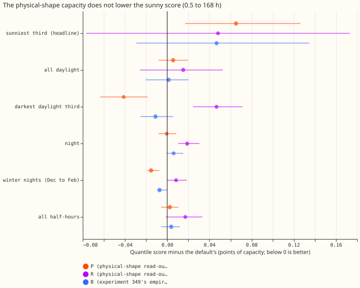
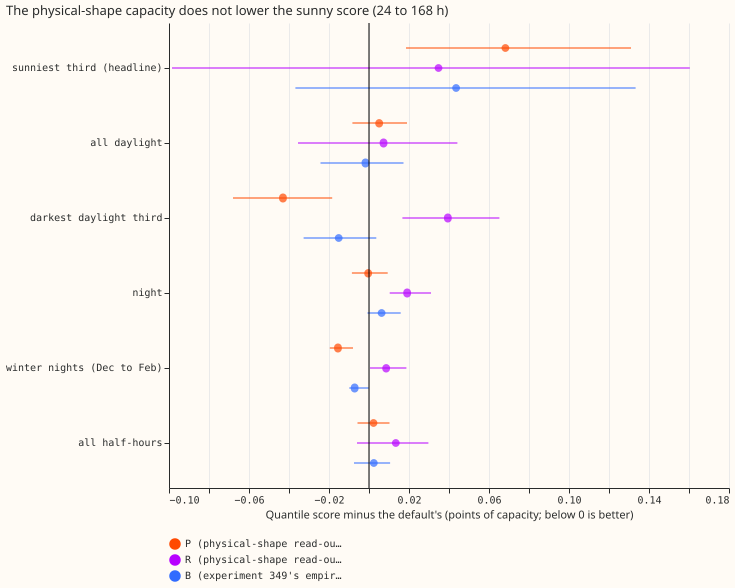
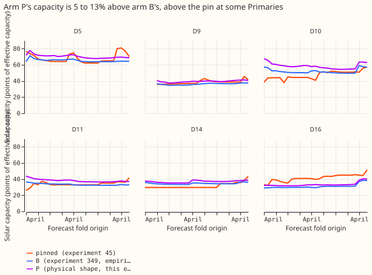

## Take-home message

**Estimating the solar capacity with the clear-sky output curve that the forecast already uses made
the forecast slightly worse on sunny half-hours, so mixing two curves is not why experiment 349 did
not improve the forecast.** The experimental forecast of demand at six Primary substations
(anonymised as D5, D9, D10, D11, D14, and D16) subtracts the output of unmetered rooftop solar from
each substation's demand. The solar capacity is fixed per substation at the values of
[experiment 45](../00045-pvdis-4-weekly-capacity-asymmetric-l1/result.md), which we call the pinned
capacity.
[Experiment 349](../00349-primary-demand-default-3-exp-269-capacity-in-the-stack/result.md)
estimated the capacity from the average daily output curve of six metered solar farms
([experiment 269](../00269-pv-capacity-gain-decomposition/result.md)). It then multiplied that
capacity by the forecast's own clear-sky output curve (the physical unit shape), which is a
different curve. The write-up of experiment 349 lists this as a shortcut that could explain why it
did not improve the forecast.

We asked whether estimating the capacity with the physical unit shape, the curve the forecast
later multiplies it by, gives a better forecast. We refitted the first stage of the forecast (a
demand model fitted by convex optimisation, with a Kalman filter; see
[experiment 139](../00139-differentiable-physics-pv-as-of-capacity-in-gam-k/result.md)) at the
start of every month (the forecast origin), using only rows before the origin. Each estimate was
divided by a recovery ratio: the median fraction of the output of five metered solar farms that the
same fit recovered when that output was added to the demand data on purpose (0.74 to 0.86 at the
2025-07-01 origin).

Arm A is the pinned capacity, arm B is experiment 349's estimate, and arm P is the physical-shape
estimate. Scores are quantile scores in points of the substation's effective capacity. Smaller
scores are better, so a positive change is worse. On the sunniest third of daylight half-hours (the
third of each Primary's daylight half-hours with the highest solar output per unit of capacity),
arm P scored 4.436 against 4.371 for arm A, a change of +0.065 (95% interval from resampling whole
months, +0.017 to +0.126). The pre-registered rule (an interval wholly above zero) gives
`refuted`. A Sonnet audit reproduced the numbers but found that the interval includes zero when D16
or D10 is left out, so the verdict is softened to **`not supported`**: no gain, and probably
slightly worse, with D16 and D10 carrying the harm. The first stage only was refitted, so the later
stages of the forecast and the 168 to 240 hour range are untested.

## Figures

## Results

- **Arms.** This is a tier 2 change: the capacity is read inside the fitted stage, with the
  default's code imported from the experiment folders that hold it. A is the pinned capacity
  (experiment 45's `frozen` vintage). B is experiment 349's arm B, refitted here from its stored
  as-of table. P is the monthly as-of read-out in the physical unit shape, divided by its own
  injection recovery (a table of 27 monthly origins, 2024-04 to 2026-06, at five Primaries and 24 at
  D9). R is P without the divisor. Arm P2, a read-out on the stack's own residual solar signal, was
  skipped because that signal exists only after the later stages are refitted.
- **Code reused.** `ml-experiments/00351-primary-demand-capacity-physical-shape-readout/` copies
  the scripts of experiment 349 and drops the empirical shape from the table builder
  (`e00351_asof_table.py`); it reads experiment 349's private as-of table for arm B.
- **Row set and range.** `fold_a_daily_gap_v1`, scored year 2025-07-02 to 2026-06-30, six
  Primaries, rows outside the hand-filtered events, origin 09:00 UTC, lead 0.5 to 168 hours and 24
  to 168 hours. The 168 to 240 hour range was not rerun, so the result covers 7 of the 10 forecast
  days that NGED (the distribution network operator) cares about.
- **Schedule.** Monthly refits of the first stage on a 24-month window, as in experiment 349. The
  contrast could depend on the schedule only through the capacity path, which changes monthly.
- **Reproduction gate.** Arm A equals experiment 139's stored pin forecasts at all six Primaries
  (largest gap in q01, q50, and q99 0.0). Arms A and B reproduce experiment 349's stored scores on
  the sunniest third (4.371 and 4.418) and on all half-hours (2.773 and 2.777).
- **Headline, sunniest third (scored year, 0.5 to 168 hours).** C1, P minus A: +0.065 (+0.017 to
  +0.126). C2, P minus B: +0.018 (-0.020 to +0.054). C3, R minus A: +0.048 (-0.077 to +0.173). B
  minus A: +0.047 (-0.029 to +0.135). At 24 to 168 hours C1 is +0.068 (+0.018 to +0.131), C2 is
  +0.025 (-0.014 to +0.063), and C3 is +0.035 (-0.099 to +0.160). Error of the mean forecast, P
  minus A, 0.5 to 168 hours: +0.142 (+0.070 to +0.249).
- **Absolute scores, 0.5 to 168 hours (A, B, P, R).** Sunniest third 4.371, 4.418, 4.436, 4.419.
  All half-hours 2.773, 2.777, 2.775, 2.790. At 24 to 168 hours the sunniest third scores 4.511,
  4.555, 4.580, 4.546.
- **Replicate year (2024-07 to 2025-06), P minus A.** Sunniest third +0.066 (+0.016 to +0.088) at
  0.5 to 168 hours and +0.073 (+0.018 to +0.099) at 24 to 168 hours, so both years point the same
  way. P minus B is +0.026 (-0.039 to +0.071).
- **The other groups, P minus A at 0.5 to 168 hours.** Improvements (negative changes) of more than
  0.01 points: cold winter nights (December to February, after dark) -0.015 (-0.019 to -0.007) and
  the darkest third of daylight -0.041 (-0.064 to -0.019). No change beyond 0.01 points in all
  half-hours (+0.002), night (0.000), or all daylight (+0.006).
- **By Primary, sunniest third, P minus A.** D5 +0.033, D10 +0.182, D11 +0.029, D14 -0.056, D16
  +0.213, D9 -0.009. Leaving one Primary out gives +0.036 (-0.006 to +0.091) without D16, +0.041
  (-0.016 to +0.111) without D10, +0.071 (+0.040 to +0.113) without D5, +0.073 without D11, +0.081
  without D9, and +0.090 without D14.
- **Capacities (figure 3, the capacity each fit applies, in points of effective capacity).** At the
  2025-07-01 origin P exceeds the pin by 10% at D5, 10% at D10, 12% at D11, and 26% at D14, and is
  below it by 24% at D16 and 7% at D9; B differs from the pin by under 3% at D10, D11, and D5 and by
  -29% at D16. Over the origins (27, and 24 at D9), P differs from the pin by more than 10% in 18
  (D10), 18 (D11), 20 (D14), 23 (D16), 8 (D5), and 1 (D9) origins. P differs from B by more than 10%
  in 20 (D10), 27 (D11), 2 (D14), 4 (D16), 1 (D5), and 8 (D9) origins; P is above B at every
  Primary. The divisor (0.74 to 0.86) scales a capacity that is already in the physical shape's
  units.
- **Tails, six Primaries, 0.5 to 168 hours (A, B, P, R).** Coverage below q01 is 2.20%, 2.17%,
  2.12%, and 2.19%; below q05 6.68%, 6.67%, 6.61%, and 6.70%; below q95 94.74%, 94.68%, 94.71%, and
  94.65%; below q99 98.35%, 98.30%, 98.34%, and 98.26%. Pinball loss at q01 is 0.215, 0.216, 0.216,
  and 0.215; at q05 0.721, 0.725, 0.727, and 0.725; at q95 0.720, 0.715, 0.716, and 0.716; at q99
  0.220, 0.220, 0.220, and 0.219. No tail moves by more than 0.006 points.
- **Reference rows.** The first stage alone is not Primary demand research default 3, so the
  manual heuristic and climatology are not placed beside it. The research default's own scores
  (2.727 at 0.5 to 240 hours, against 3.414 for the manual heuristic and 3.664 for climatology) are
  in the [research default log](../research-default-log.md).
- **Model family.** One model family and no blend.
- **Prediction scorecard.** Predicted P minus A within -0.03 to +0.05: missed (+0.065). P minus B
  within plus or minus 0.03: held (+0.018). R minus A within 0.03: missed (+0.048). Cold winter
  nights and tails within 0.02: the winter-night change is -0.015 and the tails hold.

## Checks

- **Median minus mean forecast, per Primary and arm:** 0.0 points for all four arms.
- **Mean-forecast error beside each contrast:** P minus A on the sunniest third is +0.142 (+0.070 to
  +0.249), the same direction as the quantile score. On cold winter nights the mean-forecast error
  moves the same way as the quantile score (-0.037, -0.050 to -0.015).
- **Triggers.** Audit trigger 4 (leaving one Primary out changes a verdict) fired: leaving out D16
  or D10 turns the verdict of C1 from `refuted` into `inconclusive` (+0.036, -0.006 to +0.091;
  +0.041, -0.016 to +0.111), although the sign holds. Audit trigger 2 (the result contradicts its
  prediction) is borderline: C1 misses its predicted bound by 0.015 points. One explanation was
  tested: P sits 5 to 13% above B, and arm R, which has no divisor, is nearer to the pin but has a
  wide interval. The explanation is not confirmed.
- **Audit (Sonnet, as the manager directed).** An independent re-derivation from the stored
  forecasts, with its own scoring and bootstrap code, reproduced every figure above to three
  decimals (interval ends differ in the third decimal because of resampling). Leaving out both D16
  and D10 gives -0.001 (-0.044 to +0.059). In the replicate year, leaving out D16 gives +0.036
  (-0.032 to +0.067). D16 is worse in 10 of 12 months and D10 in 11 of 12, so the harm is not from a
  few months, although the 10 worst days carry 41% of D16's total and 32% of D10's. The audit found
  no row-alignment or quantile-score flaw. The verdict is therefore `not supported`: no gain, and
  probably slightly worse, with the harm carried by D16 and D10.

## Caveats and simplifications

- **The plant-response table of arm B is not as-of.** Arm B reads experiment 349's table, which was
  fitted once to the six farms' history to 2026-06-30. Arm P uses no plant-response table: only the
  capacity fit and its injection recoveries are used, both with rows before each origin.
- **The first stage only.** The neural-network head, the solar summary, the blend, and the 168 to
  240 hour range were not rerun.
- **Divisor choice.** P divides by the injection recovery, which makes its capacity larger than the
  physical-shape units imply; R is the unit-consistent version, with a wide interval.

## What to try next

- Test the capacity's effect on cold winter nights and the darkest daylight third, where P scored
  better than the pin, in the full stack.
- Read the capacity out in the empirical shape and apply it in the empirical shape, in the first
  stage and in the ensemble's solar response, if the mismatch is still suspected.
