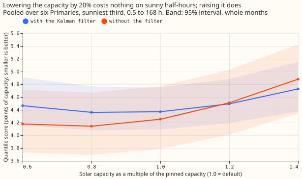
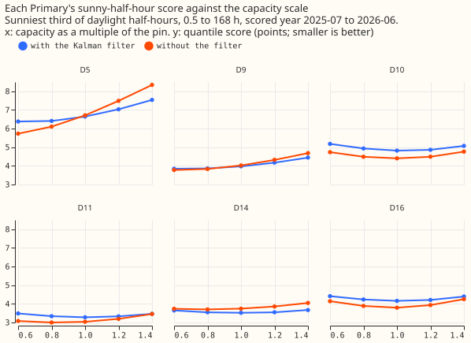
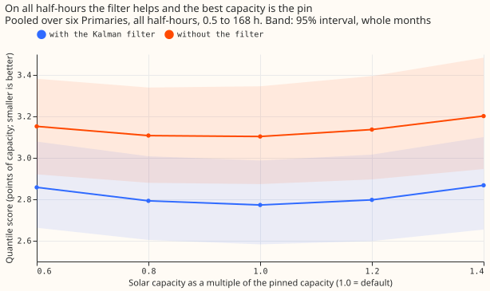
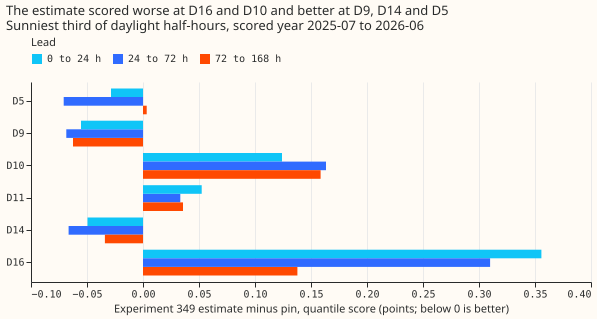
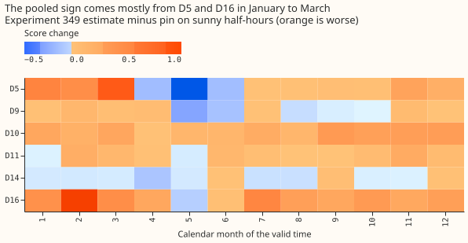

## Take-home message

**The sunny-half-hour score of the demand forecast moved by only 0.010 points (interval -0.104 to
+0.088) when the assumed solar capacity was 20% too low, but rose by 0.124 points when it was 20%
too high, and the Kalman filter halves that rise.** The forecast of demand at six Primary
substations (anonymised D5, D9, D10, D11, D14, and D16) subtracts the output of unmetered rooftop
solar from each substation's demand, and the size of that solar (its capacity) is fixed to the
weekly capacity estimates of [experiment
45](../00045-pvdis-4-weekly-capacity-asymmetric-l1/result.md), which this page calls the pin.
[Experiment 349](../00349-primary-demand-default-3-exp-269-capacity-in-the-stack/result.md) and
[experiment 350](../00350-primary-demand-capacity-free-irradiance-curve/result.md) found no reliable
gain from a different capacity. We asked how much the score depends on the capacity at all.

We refitted the first stage of Primary demand research default 3 (a convex demand model, with a
Kalman filter that corrects the forecast using the latest readings; the later stages add a
neural-network head, a summary of the solar term, and a blend with a manual heuristic) five times,
with the pinned capacity multiplied by 0.6, 0.8, 1.0, 1.2, and 1.4, and forecast each with and
without the filter. The arm at scale 1.0 with the filter (arm A of experiment 349) reproduces
experiment 349's stored default exactly. On the sunniest third of each substation's daylight
half-hours, with the filter, the quantile score (twice the mean pinball loss over 11 quantiles, in
points of the substation's effective capacity, smaller is better) is 4.361 at 0.8, 4.371 at 1.0, and
4.495 at 1.2. **Verdict: partly supported** (one of the two predictions held). We predicted that,
with the filter, the sunny score would differ by under 0.1 points between any two scales from 0.8 to
1.2 (largest minus smallest). That failed: the difference was 0.134 (95% interval 0.054 to 0.321).
We also predicted a difference of over 0.3 without the filter. That held: 0.367 (0.129 to 0.614).
The curve is flat from 0.8 to 1.0 times the pin and rises above 1.0. The later stages of the stack
(neural-network head, solar summary, blend) and the 168 to 240 hour range were not refitted.

## Figures

**Figure 2: with the filter, the sunny score is flat from 0.8 to 1.0 and rises above 1.0.**

**Figure 3: D5 and D9 prefer a lower capacity and the other four Primaries prefer the pin.**

**Figure 4: on all half-hours the filter helps and the pin is the best of the five scales.**

**Figure 1a: experiment 349's loss came from D16 and D10 at every lead band.**

**Figure 1b: the loss concentrates in January to March at D5 and D16.**

## Results

- **Arms and schedule.** Scale s in {0.6, 0.8, 1.0, 1.2, 1.4} times experiment 45's pinned weekly
  capacity path, in the first stage of experiment 349's code (the code imports that folder without
  changing it), with monthly refits on a 24-month window as in that experiment, each arm forecast
  with the filter and without it (fitted mean plus a spread table fitted on the same arm's tuning
  months). Every arm uses the same refit dates and training window, so the schedule does not differ
  between arms.
- **Row set.** `fold_a_daily_gap_v1`, scored year 2025-07-02 to 2026-06-30, six Primaries, rows
  outside the hand-filtered events, 0.5 to 168 hours (24 to 168 hours in `logs/score.log`).
- **Sunny score, pooled, 0.5 to 168 hours (95% month-resampled intervals in `logs/score.log`).**

| Scale | With filter | Without filter |
|---|---|---|
| 0.6 | 4.465 | 4.179 |
| 0.8 | 4.361 | 4.144 |
| 1.0 | 4.371 | 4.253 |
| 1.2 | 4.495 | 4.511 |
| 1.4 | 4.728 | 4.881 |

- **Planned contrasts, sunny, 0.5 to 168 hours.** C1 (filter, 0.8 minus 1.0): -0.010 (-0.104 to
  +0.088). C2 (filter, 1.2 minus 1.0): +0.124 (+0.030 to +0.219). C3 (no filter, 0.8 minus 1.0):
  -0.110 (-0.228 to -0.003). C4 (no filter, 1.2 minus 1.0): +0.258 (+0.122 to +0.388). C5 (no filter
  minus filter at 1.0): -0.118 (-0.451 to +0.191). At 24 to 168 hours: C1 -0.024, C2 +0.130 (+0.032
  to +0.232), C3 -0.103, C4 +0.242 (+0.111 to +0.373), C5 -0.186.
- **Beyond the planned range.** With the filter, 0.6 minus 1.0 is +0.094 (-0.091 to +0.295) and 1.4
  minus 1.0 is +0.358 (+0.160 to +0.554). The predicted +0.10 to +0.25 at 0.6 was just missed on the
  low side, with an interval that includes it.
- **By Primary (with the filter, 0.8, 1.0, 1.2).** D5 6.410, 6.646, 7.038; D9 3.862, 3.979, 4.178;
  D10 4.934, 4.818, 4.865; D11 3.338, 3.281, 3.329; D14 3.548, 3.519, 3.548; D16 4.236, 4.161,
  4.208. D5 and D9 improve at 0.8, as predicted for D5; the other four are best at the pin. D16 at
  0.8 is 0.075 worse, in line with experiment 349's estimate sitting 28% below the pin there and
  scoring 0.218 worse.
- **Leave one Primary out (sunny, with the filter, C2).** Without D5: +0.074 (-0.019 to +0.162).
  Without any other Primary: +0.108 to +0.143, all intervals above zero. The no-filter range falls
  from 0.367 to 0.179 without D5 and stays 0.342 to 0.441 without any other Primary.
- **Experiment 349's contrast (its arm B, which used a different capacity, minus its arm A, the
  pin), read from stored forecasts.** Pooled +0.047, as in experiment 349. By lead band: +0.067 (0
  to 24 h), +0.051 (24 to 72 h), +0.040 (72 to 168 h). By Primary: D16 +0.356, +0.310, +0.138 across
  the three bands, D10 +0.12 to +0.16 everywhere, D11 about +0.04, and D5, D9, and D14 negative
  (-0.03 to -0.07) at short leads. By month the loss concentrates in January to March (+0.15 to
  +0.29) and the gain in May (-0.145). Figures 1a and 1b show the cells.
- **No-harm groups, 0.5 to 168 hours, with the filter.** All half-hours: 2.858, 2.793, 2.773, 2.797,
  and 2.868 at scales 0.6 to 1.4, so the pin is the best scale of the five; C1 +0.020 (+0.004 to
  +0.036), C2 +0.025 (+0.003 to +0.049). Removing the filter at the pin worsens the score by +0.330
  (+0.181 to +0.484) on all half-hours and +0.509 (-0.159 to +1.030) on winter nights.
- **Tails, all rows, at scale 1.0 (filter, then no filter).** Coverage below q01 2.20% and 1.10%;
  below q05 6.68% and 3.81%; below q95 94.74% and 85.90%; below q99 98.35% and 94.04%. Pinball loss
  at q95 0.720 and 0.902, at q99 0.220 and 0.316. Across scales with the filter no tail moves by
  more than 0.03 points. Without the filter the upper tail is under-covered, so the no-filter arm's
  better sunny score does not carry to the tails.
- **Reference rows.** The first stage alone is not the research default, so no manual-heuristic or
  climatology row is given; the default's own scores are in the [research default
  log](../research-default-log.md). The experiment changes no production behaviour, so no
  curtailment-cost row is given.
- **Model family and range.** One model family, no blend, first stage only, 0.5 to 168 hours, which
  covers 7 of the 10 forecast days that National Grid Electricity Distribution (NGED), the
  distribution network operator, needs.

## Checks

- **Reproduction gate.** Scale 1.0 with the filter equals experiment 349's stored arm A in every
  period at all six Primaries (largest gap 0.0 in q01, q05, q25, q50, q75, q95, q99, mean, and
  actual; `logs/gate.log`).
- **Median minus mean forecast, per Primary and arm:** 0.000 for all ten arms.
- **Mean-forecast error beside each contrast (sunny, 0.5 to 168 hours):** C1 +0.008, C2 +0.205, C3
  -0.139, C4 +0.406, C5 -0.298, the same signs as the quantile score except C1, where both values
  are within 0.01 of zero.
- **Triggers.** Trigger 2 (a result contradicts its prediction) fired: the with-filter range (0.134)
  missed the prediction (under 0.1). The explanation, tested by the leave-one-out run and the audit,
  is that D5's export limit gives D5 a steep response; without D5 the with-filter range is 0.074.
  Trigger 4 (leaving one site out flips a contrast) fired: leaving D5 out moves C2's interval from
  above zero to across zero, and the no-filter range from 0.367 to 0.179, which changes which
  planned conditions hold. The audit confirmed this (next section). Trigger 5 (a nested arm beating
  the arm that contains it) did not fire as a failure: the no-filter arm scores 0.118 better on
  sunny half-hours at the pin, but the interval includes zero, and the filter wins on all
  half-hours.

## Audit

A fresh Sonnet auditor (the brief limited the session to Sonnet; the audit rule names Opus)
re-derived the headline numbers from the stored forecasts with its own code. Each finding is triaged
here.

- **Pooled sunny scores reproduce** to three decimals (accepted).
- **Pin scaling, fit dates, spread fitting, and leakage checks passed** (accepted). The scale
  multiplies the weekly path and the held value, the fits and the prediction use the same scaled
  capacity, and no fit sees data past its cut.
- **The no-filter arm's better sunny score is a real mechanism, with caveats** (accepted). On sunny
  rows the filter adds about 2.1 points to the forecast at every lead. The filter helps up to 24
  hours (sunny score 3.53 against 3.82 without it) and hurts at 72 to 168 hours (4.75 against 4.47).
  C5's interval includes zero (-0.118, -0.451 to +0.191), so the sentence "no filter is better on
  sunny half-hours" is not supported.
- **The verdict depends on D5** (accepted). With D5 the rule gives `partly supported`. Without D5,
  C1 (+0.031, -0.055 to +0.130) and C2 (+0.074, -0.019 to +0.162) both reach the upper edge of the
  planned band, and the no-filter range falls to 0.179, which would read as `inconclusive`. C1's
  lower edge with D5 (-0.104) is also just outside the band. The verdict word stays as
  pre-registered, and the headline carries the leave-out-D5 numbers.
- **D5's export limit explains most of its steepness** (accepted, not measured directly). The fit
  has no clip, and D5's error at the top decile of the solar shape grows almost linearly with scale
  (+9.2, +13.7, and +18.3 points at 0.8, 1.0, and 1.2), which a saturated output produces. The clip
  level itself was not tested.

## Caveats

- **First stage only.** The neural-network head, solar summary, and blend were not refitted, so a
  response that the later stages create or remove is not measured.
- **Scale multiplies the pin at every week.** It does not change the unit shape or the pin's growth
  path, so it tests the level and not the shape of the solar term.
- **12 months to resample.** Intervals resample the 12 calendar months of one year, so they are wide
  and the ranking of arms inside 0.1 points is not resolved.
- **Heterogeneity.** The pooled curve mixes D5 and D9, which prefer a lower capacity, with four
  Primaries that prefer the pin.

## What to try next

- Keep the pin for the demand stack and do not spend effort on a more exact capacity inside 0.8 to
  1.0 times the pin; the harm is above the pin.
- If a capacity estimate is used, test capping it at the pin, because the harm sits above the pin.
- Test whether a per-Primary export clip at D5 and D9 removes their preference for a lower capacity.
