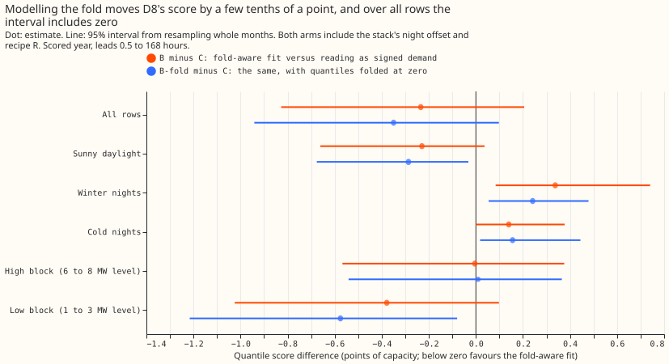
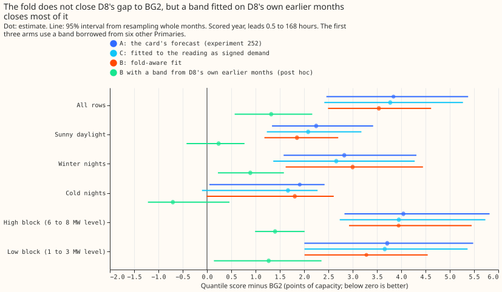
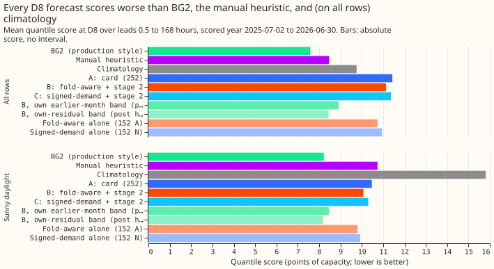
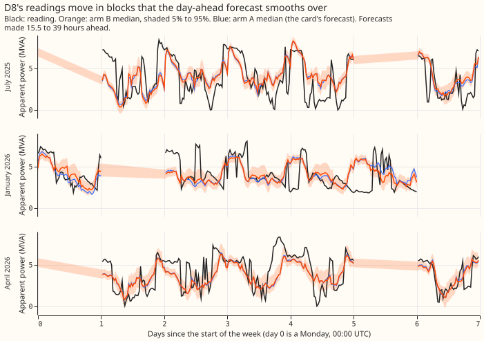
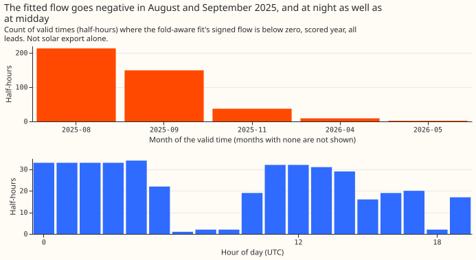

**This experiment found no evidence that the fold in D8's meter explains D8's poor forecast score.**
Fitting D8's demand model through the fold changes the quantile score by -0.23 points (95% bootstrap
interval -0.83 to +0.21), and the interval includes zero. The verdict is `not supported`. D8's score
stays about 3.5 points worse than BG2 whichever way the fold is treated. The larger problem is the
width of the forecast's uncertainty bands, which the stack calculates from the forecast errors of
six other Primaries. A band fitted on D8's own earlier months (an arm added after the main
comparison was scored, so it is exploratory) lowers the score by 2.22 points, to 1.32 points above
BG2. The evidence therefore favours trying that band change before any further work on the meter
model.

D8 (Marsh Lane) is a primary substation (Primary) whose meter reports apparent power in
megavolt-amperes (MVA). Apparent power has no sign, so a flow back into the electricity network, the
fold, appears as a positive reading. BG2 is the production-style forecast. On the quantile score,
one point is 1% of D8's effective capacity (10.38 MW), and lower is better. The stack is the current
research-default model for Primary demand (version 3): a convex demand model with a Kalman filter,
plus a night offset and a correction called recipe R.

**We rescored stored forecasts and did not refit anything.** We took the stored ensemble forecasts
of [experiment 152](../00152-dp-mva-fold-aware-gam-k-at-mva-only-primaries/result.md): one fit that
models the fold (the meter operator of [experiment
110](../00110-differentiable-physics-5-embedded-generation-and-capacity/result.md)) and one that
treats the folded readings as ordinary signed demand. We added the night offset and recipe R of
[experiment 252](../00252-gam-stack-at-eight-more-primaries/result.md) to each, and scored them
against the card's forecast (experiment 252's arm A1), BG2, the manual heuristic, and climatology.
The stack was not refitted through the meter, because `studies.dp_meter` fits only the basic design,
not the stack's T-all design and 60% solar clip. The arms are A (the card's forecast), B
(fold-modelling fit plus night offset and recipe R), and C (signed-demand fit plus the same two
corrections).

**Figure 1: the fold effect is a few tenths of a point, and its sign changes with the slice of
rows.**

**Figure 2: the borrowed band keeps every arm 2 to 4 points above BG2; D8's own band closes most of
the gap.**

**Figure 3: every stack arm scores about 3 points above BG2 in absolute terms.**

**Figure 4: D8's readings jump between levels that the day-ahead forecast smooths over.**

**Figure 5: the fitted negative flow sits in two months and at night.**

## Results

- **Arms.** A is experiment 252's arm A1 (stage-2 arm d) as stored. B is experiment 152's arm A
  (meter fit, symmetric quantiles) plus the night offset and recipe R. B-fold is experiment 152's
  arm F (quantiles folded at zero) plus the same shift. C is experiment 152's arm N plus the same
  stage 2. The fits are monthly on 3 to 14 months of data from 2025-04-01. This excludes the change
  in what D8's series measures in April 2025. The width of the uncertainty band comes from the
  forecast errors of six other Primaries (D2, D3, D4, D19, D21, and D22) on a tuning period.
- **Rows.** 96,986 half-hourly rows, one per forecast run and valid time, in the scored year
  2025-07-02 to 2026-06-30, leads 0.5 to 168 hours. The stored ensemble forecasts stop at 168 hours,
  so the 168 to 240 hour blend of Primary demand research default 3 is not applied.
- **The control gate passed.** The script reproduces experiment 252's stored D8 scores: A1 11.433
  and BG2 7.593. Experiment 152's F minus N at D8 is -0.190 here (-0.189 on its page).
- **C1, B minus C (the verdict).** All rows -0.234 (-0.827 to +0.205); sunny daylight -0.229 (-0.661
  to +0.037). With folded quantiles (B-fold minus C) all rows -0.350 (-0.941 to +0.098) and sunny
  daylight -0.287 (-0.676 to -0.032). In winter nights B is worse than C by +0.337 (+0.084 to
  +0.740). The interval over all rows includes zero, so the fold does not meet the -0.10 threshold.
  Post hoc: in the first half of the scored year B minus C is -0.487 (-1.676 to +0.439) and in the
  second half +0.018 (-0.015 to +0.054).
- **Absolute scores, all rows.** B 11.132, B-fold 11.016, C 11.366, A 11.433, experiment 152's arms
  without stage 2: fold-aware 10.739, signed-demand 10.951. BG2 7.593, manual heuristic 8.469,
  climatology 9.757. On sunny daylight rows B 10.076, C 10.306, A 10.471, BG2 8.223, manual
  heuristic 10.735, climatology 15.806.
- **C2, B minus A (descriptive).** All rows -0.301 (-0.916 to +0.144); sunny daylight -0.395 (-0.893
  to -0.087). B has no T-all design or solar clip, so the contrast mixes the fold with those pieces.
- **C3, against BG2 (descriptive).** B minus BG2 is +3.539 (+2.493 to +4.615) over all rows and
  +1.853 (+1.182 to +2.703) on sunny daylight rows. A minus BG2 is +3.840 (+2.458 to +5.378) and C
  minus BG2 is +3.773 (+2.416 to +5.271).
- **A band from D8's own history closes most of the gap (post hoc, reference arm).** Arm B with each
  month's uncertainty band fitted on D8's own earlier months (valid times before the month; July
  2025 keeps the band from other Primaries) scores 8.914 over all rows and 8.462 on sunny daylight
  rows. B with own band minus B is -2.218 (-2.901 to -1.558); minus BG2 it is +1.321 (+0.570 to
  +2.168) over all rows, +0.239 (-0.421 to +0.773) on sunny daylight rows, and +0.804 (+0.581 to
  +1.043) in the second half of the year alone. The own-history arm's tail shares are 4.4%, 9.1%,
  92.8%, and 96.6% at q01, q05, q95, and q99, against 21.4%, 31.0%, 72.0%, and 83.0% for B. The mean
  forecast is unchanged, so only the band moved. A band fitted on the scored rows themselves, which
  uses information a live forecast would not have and so is a best case, scores 8.443.
- **High-level and low-level readings.** Rows are split by whether D8's reading, as a 24-hour
  centred median, is at or above 4.5 MW (37,477 rows) or below it (59,509 rows). B minus C is -0.005
  (-0.567 to +0.375) at the high level and -0.379 (-1.025 to +0.098) at the low level. Every arm
  scores 11.3 to 11.7 at the high level against BG2's 7.7, so the gap to BG2 is concentrated in the
  high-level rows (Figure 4).
- **Reverse flow.** The fitted signed flow is below zero on 1.8% of scored rows (2.9% of sunny
  daylight rows; 410 of 17,441 distinct valid times), down to -57% of effective capacity. 362 of
  those distinct valid times are in August and September 2025, and 188 are between 00:00 and 05:30
  UTC, when no solar output exists. The readings are below 5% of effective capacity on 1.7% of rows.
  The negative flow therefore marks drops in the readings and is not evidence of solar export; the
  sign is not observable in an MVA meter.
- **The night offset and recipe R worsen D8's score.** They raise the score (higher is worse) by
  0.39 (fold-aware: 10.739 to 11.132) and 0.42 (signed-demand: 10.951 to 11.366) over all rows, and
  by about 0.4 in the second half of the year alone (9.758 to 10.174). The offset alone is 11.067
  and recipe R alone is 10.962 for the fold-aware arm.
- **The stack arms leave far too many readings below q01.** Share of readings at or below each
  quantile, all rows (nominal 1%, 5%, 95%, 99%): B 21.4%, 31.0%, 72.0%, 83.0%; C 21.6%, 31.1%,
  72.2%, 82.9%; A 21.7%, 31.2%, 72.3%, 83.0%; BG2 0.2%, 4.0%, 94.4%, 99.8%. All stack arms put 21%
  of readings below q01.
- **Not done.** The curtailment-cost metric is not computed, because D8 is one series and the metric
  needs a node with its generators. The sign of D8's flow cannot be checked without signed
  megawatts.

## Checks

- **Median minus mean (points, all rows).** B 0.00, C 0.00, A 0.00, B-fold -0.22 (the fold moves the
  median by design).
- **Mean-forecast error beside the contrasts.** Mean absolute error of the mean forecast: B 15.21, C
  15.42, A 15.48, BG2's median 13.88. B is below C and A, the same direction as C1 and C2.
- **Trigger 5 (a stage-2 arm scoring worse than the fit it corrects) fired:** the stage-2 arms score
  worse than the fit they correct (B against experiment 152's arm A, and C against arm N). The
  first-year warm-up of the offset's expanding window explains part of the gap (B scores 12.093
  against 11.722 for the unshifted fit in the first half of the scored year), but the gap remains in
  the second half (10.174 against 9.758). A Sonnet audit replaced the Opus audit (see the audit
  bullet below). The fold verdict does not depend on it, because C1's interval includes zero with or
  without stage 2 (experiment 152's own N, A, F arms: -0.19 for F minus N).
- **Triggers 3, 4, 6, and 7 did not fire:** the quantile score and the mean-forecast error agree in
  direction, there is one site so no leave-one-site-out check exists, no sister experiment has the
  same rows at D8, and no later design depends on this result.

## Prediction against outcome

- **(1) B minus C -0.30 to 0.00.** Got -0.234. Held.
- **(2) Reverse flow on 0 to 2% of half-hours.** Got 1.8% of rows. Held, but 188 of 410 valid times
  are at night, which the prediction did not expect.
- **(3) B at least 1.5 points above BG2.** Got +3.539. Held.
- **(4) B within 0.5 points of A.** Got -0.301. Held.

## What to try next

- **Fit the band on D8's own history.** Arm B is 3.5 points above BG2 at D8, and the own-history
  band removes 2.2 of those points. The remaining 1.3 points sit in the high-level rows (+1.402,
  +0.989 to +2.010) and in winter nights. A term for D8's switching between two levels could address
  them; the D8 analysis of 2026-10-26 (a private brief) discusses it.
- **Leave the night offset and recipe R off at D8** until D8 has more than 15 months of history.
- **The stack's T-all design could be fitted through the meter** at a Primary with strong reverse
  flow, such as D12; D8 does not need it.
