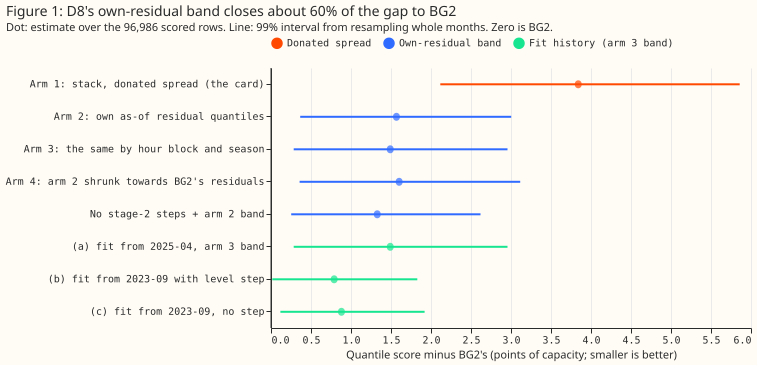
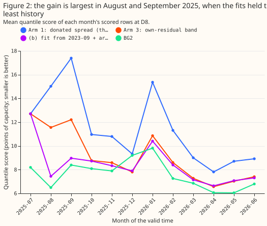
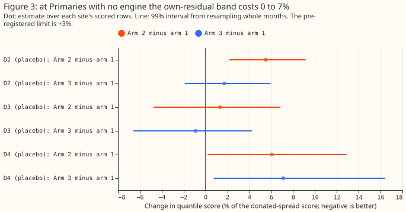
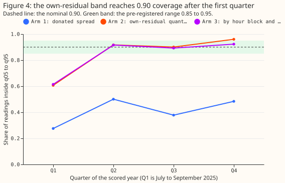
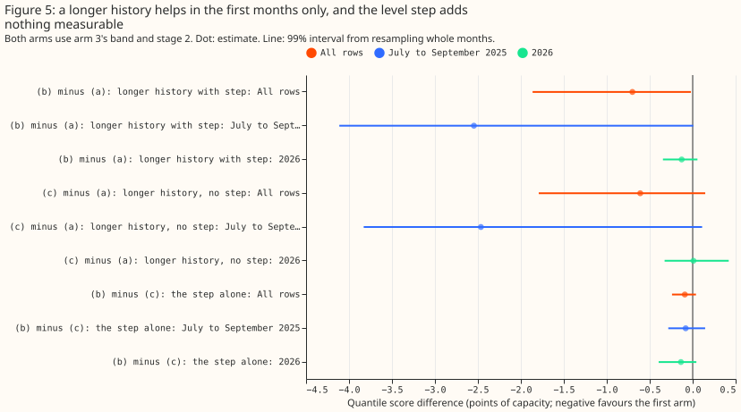

**A forecast band built from D8's own recent errors closes about 60% of D8's gap to BG2 without
changing the median forecast.**

The same rule raises the score by 1% to 6% at two of three Primaries with no engine, so it suits D8
and not yet the whole fleet. A longer fit history helps only in the first months, when the stored
fits held 3 to 5 months of data. The verdict is `partly supported`: the own-residual band (fix 1)
clears its threshold, and the longer fit history (fix 3) does not.

D8 (Marsh Lane) is a primary substation (Primary) whose forecast band the stack borrows from six
other Primaries. We asked whether a band fitted on D8's own past errors, and a fit history that
starts in September 2023 instead of April 2025, bring D8's forecast closer to BG2, the
production-style forecast. The quantile score is twice the mean pinball loss over 11 quantiles, in
points of D8's effective capacity (1 point is 1% of 10.38 MW, about 0.1 MW), and lower is better.
The stack is a generalised additive model (GAM) of demand with a Kalman filter on recent errors,
recipe R (subtract 0.75 times the last 14 days' mean error by half-hour), and a winter night offset.
We rebuilt the band from D8's residuals of the previous 365 days with
the methods of [experiment 264](../00264-dp-gas-engine-asymmetric-bands-at-d8/result.md) and
[experiment 265](../00265-dp-gas-engine-bands-prior-and-visibility-switch/result.md), tested the
rule at D2, D3, and D4 (Primaries with no gas engine), and refitted D8's monthly stack with the
longer history. The stack and its stored forecasts come from
[experiment 252](../00252-gam-stack-at-eight-more-primaries/result.md). The D8 trial in
[experiment 353](../00353-d8-research-default-with-mva-fold/result.md) first found that a band from
D8's own earlier months helps, and this experiment tests that finding against placebo Primaries.

**Figure 1: the own-residual band closes about 60% of D8's gap to BG2.**

**Figure 2: the longer history helps in August and September 2025 only.**

**Figure 3: at Primaries with no engine, arm 2 raises the score by 1% to 6%, and arm 3 by up to
7%.**

**Figure 4: coverage is 0.90 to 0.96 after the first quarter.**

**Figure 5: from October 2025 on, the longer history lowers the score by 0.11 points.**

## Results

- **Arms (fix 1, stored forecasts).** Arm 1 is experiment 252's stage-2 arm d with the donated
  spread. Arm 2 is arm 1's median plus the as-of quantiles of D8's own residuals (365-day window,
  28-day minimum, 6-hour reporting lag, refreshed every 7 origins). Arm 3 is arm 2 with the residual
  quantiles taken separately for each hour block and season. Arm 4 is arm 2 shrunk towards BG2's own
  residual quantiles. Arm A2 is arm 2's band on
  the stage-2 arm a (no night offset, no recipe R). The method code is from experiments 252 and 264,
  folders `ml-experiments/00252-*` and `ml-experiments/00264-*`.
- **Arms (fix 3, new monthly fits at D8).** (a) Fit from 2025-04, as stored. (b) Fit from 2023-09
  with
  an unpenalised level step per hour band at 2025-04-01. (c) Fit from 2023-09 with no step. Arm (d),
  the neighbours' profile as a prior, was not run, because `studies.dp_gam` has no prior hook. The
  fits are monthly, at the cuts of the stored fits. Every fit arm is scored with arm 3's band (the
  best on all rows in fix 1) and the stage-2 steps; the choice of arm 3 and of the stage-2 steps as
  the primary was made after fix 1's scores and before the fit arms' scores, and is post hoc.
- **Rows.** 96,986 half-hourly rows at D8 in the scored year 2025-07-02 to 2026-06-30, leads 0.5 to
  168 hours (the stored ensemble forecasts stop at 168 hours), `fold_a_daily_gap_v1`. Intervals
  resample whole months; the 99% level is the Bonferroni level for five planned contrasts.
- **Gate.** The script reproduces experiment 252's stored D8 scores (arm 1 11.433, BG2 7.593), and
  fit arm (a) reproduces the stored forecasts exactly (largest difference 0.0 on every quantile and
  the mean).
- **Absolute scores, all rows.** Arm 1 11.433, arm 2 9.161, arm 3 9.084, arm 4 9.195, A2 8.921, BG2
  7.593, manual heuristic 8.469, climatology 9.757. On sunny daylight rows arm 2 scores 8.641 and
  BG2
  8.223 (arm 2 minus BG2 +0.42, interval -0.72 to +1.15). On cold nights arm 2 scores 8.079 and BG2
  8.878. In 2026 arm 2 is 0.91 points above BG2 (+0.54 to +1.28).
- **C1, arm 2 minus arm 1 (fix 1's verdict contrast).** -2.27 (99% -3.37 to -1.35), so 59% of arm
  1's
  3.84-point gap to BG2. The interval lies wholly below the -1.0 threshold. Post hoc, on the 87,578
  rows after the first as-of fit (the first fit is at the origin of 2025-08-06), the contrast is
  -2.52 (-3.69 to -1.61).
- **C2 and C3.** Arm 3 minus arm 2 -0.08 (-0.14 to +0.00), and arm 4 minus arm 2 +0.03 (-0.04 to
  +0.18). The cell rule and the BG2 prior add nothing measurable to the plain own-residual band.
- **Stage-2 steps.** A2 minus arm 2 is -0.24 (-0.50 to -0.06): with the own-residual band, dropping
  the night offset and recipe R scores better, as experiment 353 advised. Most of it sits in the
  first three months, when the stage-2 steps have the least history.
- **Pre-registered conditions for arm 2.** Three of the four failed, and the fourth held. The share
  of the gap closed
  is at least 60% in 7 of 12 months; it falls short in July (0%), August (39%), September (58%), and
  May 2026 (55%), and December has a gap of 0.12 points, too small to divide by. The share of
  readings inside q05 to q95 is 0.917, 0.901, and 0.960 in the three quarters after the first, so
  the
  last one is above 0.95. Arm 2 beats BG2 in one month (December), within the allowed two, so that
  condition held.
- **Tails at D8, all rows.** Share of readings below q01: arm 1 21.7%, arm 2 3.9%, arm 3 4.3%, arm 4
  3.9%, BG2 0.2%. Below q05: 31.2%, 7.8%, 8.7%, 7.7%, and 4.0%. Above q99: 17.0%, 3.2%, 3.5%, 3.4%,
  and 0.2%. Inside q05 to q95: 0.411, 0.848, 0.838, 0.839, and 0.904. The own-residual bands still
  leave 4% of readings below q01, which matters because the lower tail is the curtailment-relevant
  one.
- **Placebos.** Arm 2 minus arm 1 is +0.114 points at D2 (+5.5% of arm 1's score, 99% interval +2.2%
  to +9.1%), +0.019 at D3 (+1.3%, -4.7% to +6.8%), and +0.139 at D4 (+6.1%, +0.2% to +12.9%). The
  limit was +3%, so D2 and D4 fail. Arm 3 raises the score by 1.7% at D2, -0.9% at D3, and +7.0% at
  D4. The share
  of readings below q01 at D2, D3, and D4 is 2.5%, 3.2%, and 4.3% with arm 1 and 2.1%, 2.9%, and
  4.5% with arm 2, so the lower tail does not worsen materially. The rise comes from the band
  ignoring lead time. The band takes residuals at the shortest lead and applies them at every lead
  to 168 hours. Coverage falls from 0.854 at 0 to 24 hours to 0.835 at 120 to 168 hours.
- **C4, fit (b) minus (a).** All rows -0.70 (99% -1.86 to -0.02), July to September 2025 -2.55
  (-4.11 to +0.01), and 2026 -0.13 (-0.35 to +0.06). The all-rows interval is not wholly below the
  -0.5 threshold, so C4 does not clear it. Fit (b) scores 8.382 against fit (a)'s 9.084, and is 0.79
  points above BG2.
- **Where the gain sits.** Monthly scores with arm 3's band, (a) against (b): July 12.70 and 12.71,
  August 11.55 and 7.44, September 12.21 and 8.97. Fit (a) rests on 3 to 5 months of data at those
  cuts, and the audit traced the gain to its cold-start error (fit (a)'s mean-forecast bias in
  August is +9.5 points against -2.1 for (b)). Post hoc, from October 2025 to June 2026 (73,331
  rows), (b) minus (a) is -0.11 (-0.27 to +0.03).
- **C5, fit (c) minus (a) in 2026.** +0.01 (-0.33 to +0.42). The prediction that (c) is worse than
  (a) in 2026 failed, so the data give no sign that the step is needed. (b) minus (c) is -0.09
  (-0.24 to
  +0.04) on all rows.
- **Level step.** The fitted steps at 2025-04-01 are negative at every hour band and cut: about -0.4
  to -0.7 MW at night, -1.4 to -1.6 MW and -1.9 to -2.3 MW in the two daytime bands, and -0.8 to
  -0.9 MW in the evening from September 2025. Fit (c) without a step scores no worse, so the GAM's
  other terms may absorb the drop.

## Checks

- **Median minus mean, points of capacity.** Arm 1 0.00 (its mean equals its median), arm 2 -0.03,
  arm 3 -0.38, A2 -0.75, fit (b) with arm 3's band -1.44. Arm 3's median sits 0.38 points below its
  mean, and fit (b)'s sits 1.44 points below. The band rule therefore moves the median by up to 0.15
  MW.
- **Error of the median forecast, MW.** Arm 1 1.607, arm 2 1.610, arm 3 1.613, BG2 1.440, so the
  own-residual band leaves the median error unchanged while the quantile score falls by 2.27
  points.  Fit (a) scores 1.613, fit (b) 1.509, and fit (c) 1.527.
- **Triggers that fired.** Three checks failed: a placebo Primary exceeded the +3% limit (D2 and
  D4),
  two predictions failed without a tested explanation (fit (c) worse than fit (a) in 2026, and the
  monthly 60% closure), and a nested arm beat the arm that contains it (stage-2 arm a beat arm d).
- **Audit.** A Sonnet audit re-derived arm 2's band, the placebos, and the fit arms from the stored
  forecasts with its own code. It confirmed every printed headline number and found no lookahead.
- **Audit findings, triaged.**
    - The fit-history gain sits in the cold-start months, so the page reports it that way, and a
      post hoc October-to-June contrast was added.
    - The step date 2025-04-01 was chosen with hindsight, so the experiment tests whether a step is
      available, not whether a forecaster would find one.
    - The band's lead-independence probably explains the placebo rise, and it is the next
      experiment.
    - The December closure share has no meaning, because arm 1 is within 0.2 points of BG2 that
      month.
    - Origins are not daily, so "every 7 origins" is 8 to 9 days. The difference is harmless.

## Caveats

- **Lead range.** The stored forecasts cover 0.5 to 168 hours; National Grid Electricity
  Distribution (NGED) needs forecasts 1 to 10 days ahead, so the 168 to 240 hour range is untested
  here.
- **Lab shortcuts.** The reporting lag of 6 hours is an assumption about NGED's delivery of
  readings.
  The first 8 to 35 days of the scored year keep the donated band, because 28 days of resolved
  residuals do not exist yet; the shortcut understates the gain.
- **One site.** D8 is one Primary, and the 12 scored months give wide intervals. The
  first-three-month
  intervals rest on three months, and the resampling cannot give them a meaningful lower bound.
- **Post hoc.** These choices were made post hoc: the choice of arm 3's band and the stage-2 primary
  for fix 3, the October-to-June
  contrast, and the after-first-fit contrast.

## What to try next

- **A band that widens with lead time.** Take the as-of residuals by lead band as well as by hour
  and season, and re-test at D2, D3, and D4 against the +3% limit. That would show whether the
  placebo cost is the lead-independence the audit suspects.
- **Apply the own-residual band at D8 only.** The score gain is larger than that of the other D8
  fixes tested in experiments 252, 264, and 353, and a version that costs nothing at other Primaries
  is the condition for using it fleet-wide.
- **Leave the longer history and the level step.** Neither earned its complexity in steady state.
