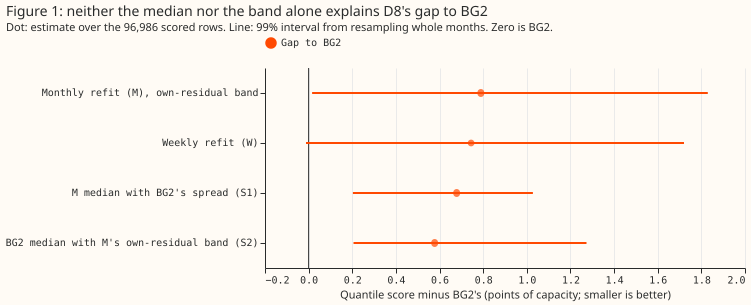
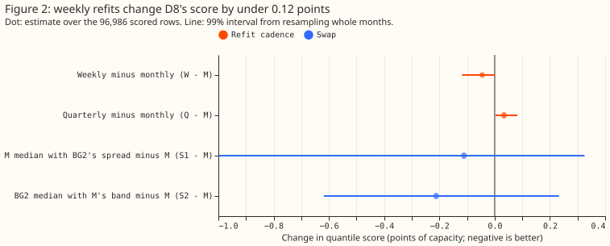
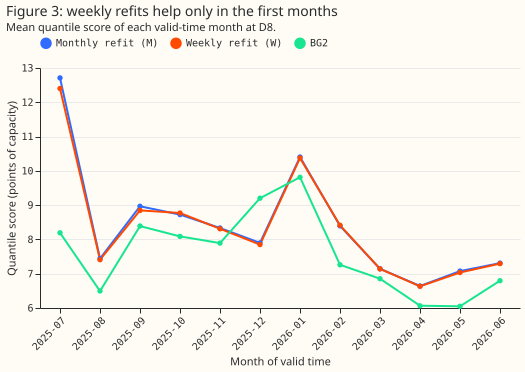

**Refitting D8's forecast weekly instead of monthly barely changes its score, so BG2's weekly refit
is not why it beats our model at D8, and the remaining gap does not come from the median or the band
alone.** D8 is the Marsh Lane electricity substation. BG2 is the XGBoost model that is our current
best reference forecast, and "the stack" is our additive-model forecast, which we compare against
it. We refitted the stack (the version of [experiment
354](../00354-d8-own-residual-bands-and-longer-fit-history/result.md): fitted from 2023-09 with a
step in its level at 2025-04-01, and a forecast band taken from D8's own past errors) monthly,
weekly, and quarterly. We also put BG2's median forecast, and separately BG2's band (the spread of
its quantile forecasts around the median), into the stack's forecast on the same 96,986 half-hours.
The score is the mean pinball loss over 11 quantiles, in points of D8's capacity (1 point is 0.1
MW), and a lower score is better. Weekly minus monthly is -0.045 points (99% interval -0.118 to
+0.001). BG2 stays 0.79 points better than the monthly stack, and neither swap closes most of that
gap.

- **Arms.** (M) monthly refit, 12 cuts, the stored fit b of experiment 354 with its own-residual
  band by hour block and season (arm 3 there). (W)
  weekly, 52 cuts. (Q) quarterly, 4 cuts. Swaps on arm M's rows: (S1) M's median with BG2's spread,
  (S2) BG2's median with M's own-residual spread, (S3) BG2's median with the donated spread of
  experiment 252. Reuses the code of experiments 252, 264, and 354.
- **Gate.** M scores 8.382 and BG2 7.593, as stored in experiment 354.
- **Absolute scores (all rows, quantile score).** M 8.382, W 8.338, Q 8.416, S1 8.271, S2 8.171, S3
  9.995, BG2 7.593, `manual_heuristic` 8.469, climatology 9.757.
- **Cadence contrasts (99% intervals, 20,000 month resamples).** W minus M -0.045 (-0.118 to
  +0.001); Q minus M +0.034 (+0.003 to +0.082). W minus M in July to September 2025 is -0.148
  (-0.309
  to 0.000), in 2026 -0.013 (-0.033 to +0.008), on sunny half-hours -0.077 (-0.285 to +0.080).
- **Swap contrasts against M.** S1 -0.111 (-0.999 to +0.325), which closes 14% of the 0.79-point
  gap to BG2. S2 -0.212 (-0.618 to +0.232), which closes 27%. S3 +1.613 (+0.602 to +2.624), so the
  donated spread is the worst part (the finding of experiment 354). In July to September 2025 S1
  scores 8.454 against M's 9.585 (-1.131, -3.421 to +0.066), so the band difference is concentrated
  in the first three months.
- **Median error and coverage.** Median absolute error is 1.509 MW for M, 1.503 for W, 1.514 for Q,
  and 1.440 for BG2. The share of readings inside q05 to q95 is 84.6% for M, 84.7% for W, 84.6% for
  Q, and 90.4% for BG2. Share below q01: M 3.9%, W 3.8%, BG2 0.2%. Share above q99: M 2.9%, BG2
  0.2%.
- **Pre-registered predictions.** H1 held: W minus M is under 0.2 points and Q minus M under 0.3.
  H2 failed: S1 closes 14%, not more than half, though S2 closes 27%, under a third as predicted.
  Verdict `partly supported`: the cadence is not the cause, but the gap does not split into a
  band part and a median part.
- **Reading of H2 (post hoc).** The two swaps together close 41% of the gap. BG2's spread is fitted
  to
  BG2's own median errors, so swapping either part alone breaks the pairing. The pairing explanation
  is a hypothesis, not a
  tested result.
- **Not run.** The placebo cadence contrast at D2, D3, and D4 failed in the forecast step (a lead
  band had no tuning residual to fit the spread on, `ValueError` in `studies.dp_ens`). The brief
  made the placebos optional ("if cheap"), so they were dropped, and the cadence result rests on D8
  only. The cadence result therefore may not carry to other Primaries; experiment 278 found weekly
  equal
  to monthly at six other Primaries.
- **Lab shortcuts.** The own-residual band uses only errors known when the forecast is made, and
  assumes a reading arrives 6 hours after its valid time. Horizon
  is 0.5 to 168 hours, not NGED's 1 to 10 days. Weather at forecast time is the ensemble forecast,
  as
  in experiment 252.
- **Checks.** Median minus mean forecast (points of capacity): M -1.44, W -1.37, Q -1.71, which is
  the own-residual band's shift of the median from the filter's mean, as in experiment 354. Error of
  the mean forecast beside the median's: M 1.505 against 1.509 MW, W 1.500 against 1.503 MW, so the
  cadence contrast has the same sign on the mean forecast. Audit triggers (the `ml-experiment`
  skill's seven conditions): none fired. The reproduction gate
  held, no result contradicts its prediction, and only one site was scored.
- **What to try next.** Fit BG2's median and spread jointly on the stack's residuals at D8 (for
  example a model of the stack's error on BG2's error), rather than swapping parts. Test weekly
  against monthly again at a Primary with long history before adopting weekly refits anywhere.

## Plan as registered before any score was read

- **Question.** D8 (Marsh Lane) scores 8.38 with the best stack of experiment 354 against BG2's
  7.59. BG2 refits weekly and the stack refits monthly. The maintainer asked, on 2026-10-26, whether
  weekly refits close the gap, and how the gap splits between the median and the band.
- **Cadence arms (fits at D8).** The stack of experiment 354's fit b (from 2023-09 with a level
  step per hour band at 2025-04-01, stage-2 arm D, own-residual band by hour block and season):
  (M) monthly cuts as stored, (W) a cut every 7 days, (Q) every third monthly cut. Only data
  available at each cut is used.
- **Swap arms (no fit).** On arm M's rows: (S1) arm M's median with BG2's spread (BG2 quantile
  minus BG2 median, added to arm M's median); (S2) BG2's median with arm M's own-residual band; (S3)
  BG2's median with the stack's donated spread; M and BG2 as stored. Report the score, median error
  in MW, and q05 to q95 coverage.
- **Placebos.** The cadence contrast at D2, D3, and D4 (stored default window, no level step).
- **Slices.** Sunny daylight half-hours and the first three scored months, separately.
- **Scoring.** Scored year 2025-07-02 to 2026-06-30, leads 0.5 to 168 hours, the 96,986 rows of
  experiment 354, month-resampled 95% and 99% intervals.
- **Weather at forecast time.** Same ensemble forecast weather and past-weather proxy as experiment
  252, so every input exists at forecast time.
- **Earlier advice followed.** Experiment 354: fit b with the own-residual band. Experiment 278:
  weekly
  equalled monthly on six other Primaries, so a null is the prior.
- **Compute.** CPU only, 6 spawned workers, one thread each, `MemoryMax=16G`.
