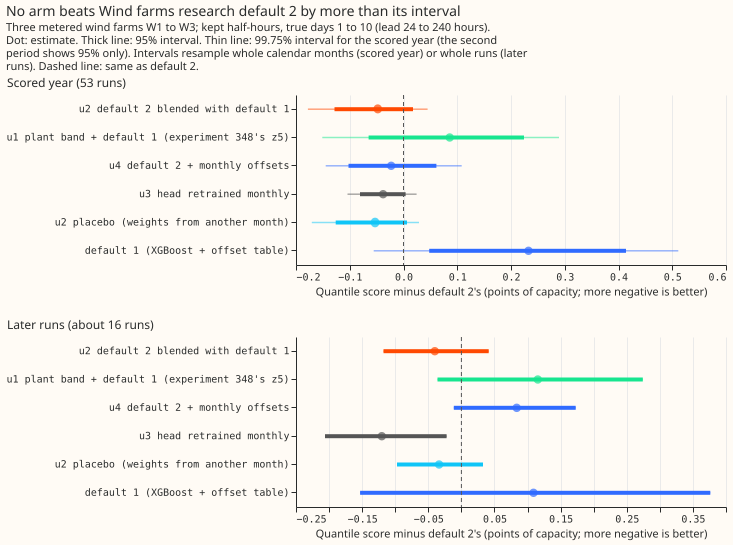
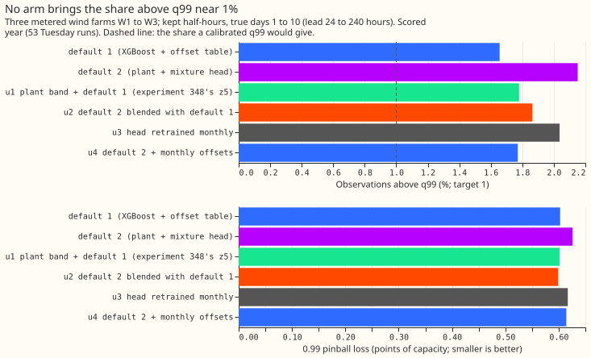
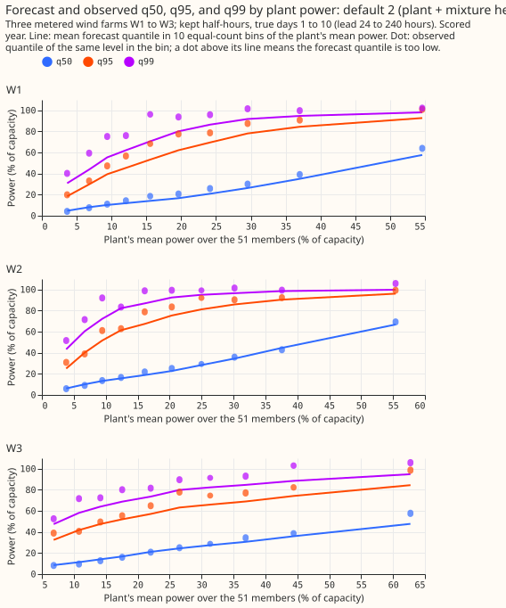
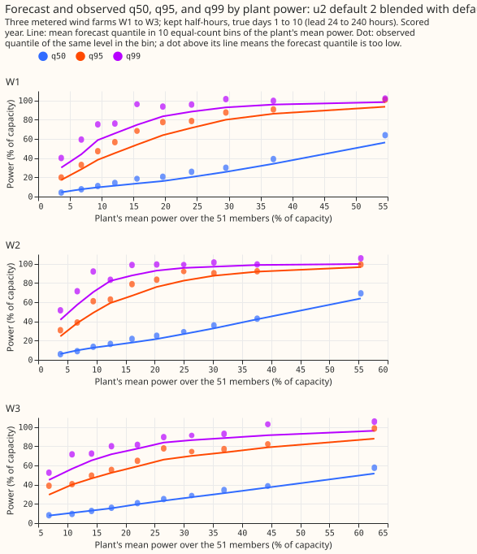

**Take-home: blending Wind farms research default 2 (a physics model plus a neural-network head)
with Wind farms research default 1 (an XGBoost model), or refitting default 2 every month, does not
fix its upper tail.** Of the half-hourly observations at 24 to 240 hours' lead, 2.15% fall above
default 2's 0.99 quantile (q99), against the 1% a calibrated q99 gives. The best arm leaves 1.77%,
and no arm clearly beats default 2. The blend's small gain is the same with shuffled weights, so it
comes from averaging two forecasts and not from learning weights. The top quantile probably needs
new information, and the monthly retrained head is the one arm worth a longer retest. Verdict: not
supported, meaning no arm fixed the tail while keeping the gain.

We asked whether four cheap changes would fix the upper tail of Wind farms research default 2 (a
physics model of each farm run on the 51 weather-ensemble members, then a mixture head) while
keeping
its 0.23-point gain over Wind farms research default 1 (an XGBoost model plus a table of quantile
offsets). The four changes were: a per-quantile blend of the two defaults whose weights are refitted
each month (u2); experiment [348](../00348-wind-plant-mdn-upper-tail/result.md)'s blend of the
physics model's residual band with default 1 (u1, the recipe of experiments
[270](../00270-metered-farm-xgboost-vs-plant-diagnostic/result.md),
[287](../00287-metered-farm-spread-binned-plant-heads/result.md), and
[300](../00300-metered-farm-best-guess-assembly/result.md)); a monthly offset layer on default 2
(u4, experiment [346](../00346-wind-research-default-1-offset-table-refit-cadence/result.md)'s
recipe); and retraining default 2's head every month (u3). Scores are in points of capacity (1 point
is 1% of a farm's capacity). W1 to W3 are the three metered wind farms, whose names are withheld. W1
to W3 are the three metered wind farms, whose names are withheld.
**Scored at true days 1 to 10 (lead 24 to 240 hours)**, kept half-hours, on the 53 Tuesday runs of
`fold_a_tuesdays_v1` (the scored year) and, once, on the Tuesday runs of 2026-07 to 2026-10 (the
replicate, about 16 runs).

## Results

- **Arms and window.** Default 2 is experiment [347](../00347-wind-physics-hybrid-plant-then-
  mdn/result.md)'s
  y2, refitted here (five seeds). u2 and u4 refit on the first day of each month on kept daily runs
  from 2025-04-16 whose valid times end at least 3.5 hours before that day (earlier runs are in-
  sample for default 2's head, so a start in 2024-04 would measure the head's
  training fit). u3 retrains on all finished
  runs from 2024-04, stopping early on the last 2 months. Kept rows end at 2026-09-13, so the
  refits of 2026-10 use runs to that date. Default 1 has 3 seeds and is paired with seed `s mod 3`.
  Code reuse: experiments 230, 259, 303, 310, 326, 336, 346, 347, and 348.
- **Schedule.** Monthly refits on a growing window for every arm; the scored year and the replicate
  use the same refits. The contrast could depend on schedule for u3 and u4 only.
- **Absolute scores, true days 1 to 10 (scored year; replicate).** Default 1 10.751 (7.231); default
  2 10.518 (7.122); u1 10.604 (7.237); u2 10.470 (7.082); u2 placebo 10.465 (7.088); u3 10.480
  (7.002); u4 10.495 (7.206). Frozen XGBoost reference 11.102 and `climatology` 13.860 (from
  experiment 347, scored year). Seed sd of the headline: default 2 0.026, u2 0.013, u3 0.019, u4
  0.029.
- **Gate.** Default 2 reproduces experiment 347 (10.518 and 11.081 over every lead), default 1
  reproduces 10.752 to within 0.001, and u1 reproduces experiment 348's z5 (10.604 against 10.605).
- **Gain over default 2, true days 1 to 10 (scored year, 99.75% month-block interval; replicate, 95%
  run-block interval).** u2 -0.048 (-0.178 to +0.045; replicate -0.040, -0.118 to +0.041); u1
  +0.086 (-0.151 to +0.289; replicate +0.116, -0.036 to +0.274); u4 -0.023 (-0.145 to +0.108;
  replicate +0.084, -0.012 to +0.173); u3 -0.038 (-0.104 to +0.024; replicate -0.120, -0.206 to
  -0.022). At days 1 to 2 u2 gains 0.166 (-0.374 to -0.023); at days 3 to 10 no arm's interval
  excludes zero.
- **Gain over default 1 (cumulative harm budget).** u2 -0.280 (-0.471 to -0.115); u1 -0.147 (-0.272
  to -0.059); u4 -0.255 (-0.620 to +0.058); u3 -0.270 (-0.567 to -0.002). No arm is worse than
  default 1; the one-sided 95% harm bound against default 1 is at most -0.078 on the headline and
  +0.044 at the 0.99 pinball loss.
- **Added value of the blend over the best single family.** The best single family is default 2
  (10.518, against 10.751 and 11.102). u2 adds -0.048 (-0.178 to +0.045); u1 adds +0.086.
- **Controls.** The shuffled-weights placebo gains 0.053 and u2 gains 0.048; u2 minus placebo is
  +0.005 (-0.021 to +0.035), so the placebo keeps the whole gain. Leakage check: every refit's
  latest valid time is at or before the month start minus 3.5 hours (`arms/leakage.json`, 32
  refits, no violation).

| Arm (scored year, true days 1 to 10) | Below q01 (%) | Below q05 (%) | Above q95 (%) | Above q99 (%) | p01 | p05 | p95 | p99 | 5 to 95 coverage (%) |
|---|---|---|---|---|---|---|---|---|---|
| default 1 | 0.55 | 1.36 | 6.62 | 1.66 | 0.285 | 1.347 | 2.414 | 0.603 | 92.0 |
| default 2 | 0.81 | 4.43 | 6.69 | 2.15 | 0.283 | 1.302 | 2.382 | 0.626 | 88.9 |
| u1 | 0.67 | 2.54 | 6.65 | 1.78 | 0.287 | 1.335 | 2.407 | 0.602 | 90.8 |
| u2 | 0.69 | 4.19 | 6.51 | 1.86 | 0.283 | 1.303 | 2.348 | 0.599 | 89.3 |
| u2 placebo | 0.70 | 4.19 | 6.48 | 1.86 | 0.283 | 1.303 | 2.350 | 0.601 | 89.3 |
| u3 | 0.80 | 4.76 | 6.36 | 2.04 | 0.283 | 1.302 | 2.360 | 0.617 | 88.9 |
| u4 | 0.78 | 4.78 | 5.71 | 1.77 | 0.283 | 1.301 | 2.359 | 0.614 | 89.5 |

- **Tails.** u2 lowers the 0.99 pinball loss by 4.3% (0.626 to 0.599) and leaves 1.86% above q99. u4
  lowers the share to 1.77% but raises the 0.99 pinball loss against default 1 (0.614 against
  0.603).
  On the replicate runs every arm has under 0.7% above q99 (default 2 0.48%, u4 0.29%, u3 0.38%), so
  the replicate cannot judge the upper tail.
- **Adoption (order u2, u1, u4, u3).** No arm passes condition 1: every scored-year interval of
  (arm minus default 2) includes zero, and u1 is worse than default 2. Nothing is adopted and no
  arm is a candidate for a later version of the research default.
- **Pre-registered predictions.**
    - u2 lowers the 0.99 pinball loss by at least 10% (fails, 4.3%) and puts the share above q99
      under 1.6% (fails, 1.86%). u2 gains at least 0.05 points (fails by 0.002, 0.048).
    - u1 matches experiment 348's gain over default 1 (holds, 0.147) and its gain over default 2
      is smaller than u2's (holds, since u1 loses 0.086).
    - u4 gains under 0.05 (holds, 0.023) and the share above q99 stays above 2% (fails, 1.77%).
    - u3 gains under 0.05 (holds, 0.038) and has a wider interval than u4 (fails, 0.129 against
      0.253 wide).
- **Serving.** u1 and u2 need the plant plus head and the XGBoost default both running, and a
  monthly job to refit weights (u1 also needs the stored residual-band table). u4 needs a monthly
  offset job. u3 needs a monthly job that retrains the head.
- **Checks.** Median minus mean forecast per farm (true days 1 to 10): default 2 -3.3, -3.5, -3.1
  points for W1 to W3; u2 -3.6, -4.0, -3.4; u3 -3.3, -3.8, -3.0; u4 -3.5, -4.2, -3.5; default 1
  -4.2,
  -4.5, -3.3. The mean-forecast absolute error moves with the quantile score for u1, u2, and u3,
  and against it for u4 (15.161 against 15.028 for default 2, while its score improves by 0.023).
  Leaving W3 out turns u2's gain into a loss (+0.017); leaving out W1 or W2 keeps it. Triggers
  fired: 1 (the placebo kept the gain), 3 (u4), and 4 (u2 without W3). The weights differ
  between months by a standard deviation of 0.12 on average, so a shuffle moves them modestly; why
  that leaves the score unchanged is explained by the audit below. The audit was run by a Sonnet
  agent, not Opus (the manager waived Opus while credits are low); the auditor re-derived
  the contrasts from the stored arrays and found no method fault. Its findings: the arrays are
  sorted, in range, and aligned (median correlation with default 2 of 0.92 to 0.99); u2 reproduces
  from its stored weights to 3e-8; a fixed weight of 0.75 on default 2 (no learning) gives -0.047,
  the same as u2, so the placebo behaves as designed and the gain is averaging; u4's opposite
  movement of mean-forecast error comes from lifting only the upper quantiles (+1.7 to +2.5 points
  from q75 to q99); u2's pooled gain is one farm (W3 -0.186, W1 +0.026, W2 +0.007), and default 1
  is competitive with default 2 only at W3; default 1 has only 3 independent seeds, so the seed sds
  of the arms that use it are optimistic; and on every lead u4 leaves 1.84% above q99, not 1.77%
  (the headline-scope figure). The auditor's own advice: u2's gain rests on W3, and only u3 and u4
  keep their sign without it, both within noise.
- **Caveats.** Scored at true days 1 to 10 only; three farms give wide intervals. The replicate is
  about 16 runs and its kept rows end at 2026-09-13. Intervals resample the seed mean of each row's
  score, so seed variation is reported separately. The runs 2025-04-16 to 2025-06-16 that stopped
  default 2's head early feed u2 and u4's first windows, a small optimism for those arms. u1's
  blend weights come from earlier Tuesday runs selected by the month of the run, so a run from late
  in a month contributes outcomes up to about 10 days into the next month, which breaks the
  3.5-hour rule that u2, u3, and u4 obey; this lookahead (also present in experiment 348's z5)
  can only flatter u1, which already loses. The u1 and u3 refits are not in `arms/leakage.json`
  (u3's check is printed in the heads log). The curtailment metric is not
  scored: it needs a node's export and its generators' forecasts together.
- **What to try next.** (1) Retest u3 on a longer out-of-time period. (2) Give the top quantile new
  information: a point mass fitted with a likelihood (experiment 348's advice), or a monthly
  recalibration of q99 on its own. (3) Use a fixed 0.75:0.25 mix of the two defaults, which the audit found
  equals u2.
