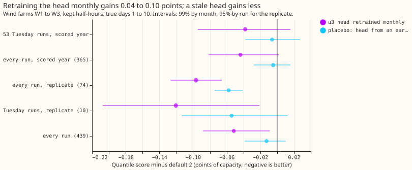
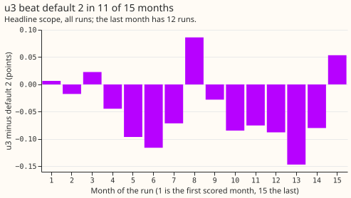
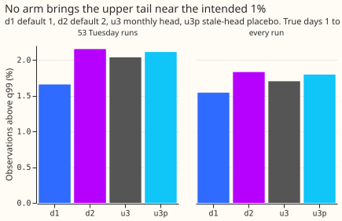

**Take-home: retraining the mixture head of Wind farms research default 2 every month improves the
quantile score slightly, by about 0.04 to 0.05 points over one year and about 0.10 points over the
latest 2.5 months, but the one-year 99% interval still touches zero, so the change is a candidate
and is not adopted.** The upper tail is not fixed. Verdict: partly supported.

Wind farms research default 2 is this project's current wind forecast: a physics model of each farm
is run on each of the 51 members of the ECMWF ensemble weather forecast, and a mixture head (a small
neural network that turns the 51 power forecasts into 11 quantiles) produces the final forecast.
Wind farms research default 1 is the earlier recipe, an XGBoost model plus a table of quantile
offsets. We asked again whether retraining the mixture head on the first day of every month beats
keeping the head fixed. Experiment
[356](../00356-wind-default-2-blend-and-monthly-refit-retest/result.md) tested this (its arm u3) on
53 Tuesday runs, meaning forecasts issued on Tuesdays, and on 10 Tuesday runs of 2026-07 onwards.
This experiment scores the same five seeds of retrained heads on every kept daily run: 439 runs from
2025-07-01 to 2026-09-13, using the data already fetched for experiment 356. "Kept" means the rows
that pass experiment 210's data-cleaning mask. The scored year is the 12 months 2025-07 to 2026-06,
and the replicate is the 74 runs of 2026-07-01 to 2026-09-13. Scores are quantile scores in points
of capacity (1 point is 1% of a farm's capacity), where a lower score is better, at true days 1 to
10 (lead 24 to 240 hours). W1 to W3 are the three metered wind farms, whose names are withheld.

## Results

| Scope | u3 minus default 2 | Interval | Stale-head placebo minus default 2 |
|---|---|---|---|
| 53 Tuesday runs, scored year (primary) | -0.038 | -0.094 to +0.016 (99%, months) | -0.006 |
| Every run, scored year (365) | -0.044 | -0.082 to +0.002 (99%, months) | -0.005 |
| Every run, 2026-07-01 to 2026-09-13 (74, replicate) | -0.096 | -0.127 to -0.066 (95%, runs) | -0.058 |
| Tuesday runs of 2026-07-01 to 2026-09-13 (10) | -0.120 | -0.207 to -0.021 (95%, runs) | -0.054 |
| Every run (439) | -0.052 | -0.088 to -0.009 (99%, months) | -0.013 |

- **Arms and schedule.** Default 2 is experiment
  [347](../00347-wind-physics-hybrid-plant-then-mdn/result.md)'s y2. u3 retrains the head monthly on
  all finished runs from 2024-04 (valid times at least 3.5 hours before the month starts), as in
  experiment 356, whose case table, default 1 and default 2 forecasts and code this experiment
  reuses (folders 356, 348, 347, 346, 336, 326, 310, 303, 259, and 230). The window of training runs
  grows by one month at each refit.
- **Absolute scores (headline).** Default 2: 10.518 (53 Tuesday runs), 10.399 (scored year, 365
  runs), 7.261 (74 runs of 2026-07-01 to 2026-09-13), 9.929 (all 439 runs). u3: 10.480, 10.355,
  7.165, 9.877. Default 1: 10.751, 10.574, 7.429, 10.103. Standard deviation across seeds of the
  headline: 0.026 for default 2 and 0.019 for u3 (Tuesdays).
- **Gate.** Default 2 reproduces 10.518, default 1 reproduces 10.751, and u3 reproduces experiment
  356's 10.480 on the 53 Tuesday runs.
- **Gain over default 2, headline (negative is better).** The table above has each scope. Relative
  to default 2's score, the gain of u3 is 0.4% on the Tuesday runs, 0.4% over the scored year, 1.3%
  on the replicate, and 0.5% on all runs. Over all runs, days 1 to 2 gain -0.032 (-0.080 to +0.015)
  and days 3 to 10 gain -0.057 (-0.098 to -0.005). A t interval over the 15 monthly differences
  (2025-07 to 2026-09), which suits few months better than a percentile bootstrap, is -0.095 to
  +0.005 (99%); u3 beat default 2 in 11 of 15 months.
- **Placebo.** Each month takes the head fitted at a random earlier month at least 3 months before
  (the first 3 months take the first head; one draw). Over the scored year the stale head gains only
  0.005. The score of u3 minus that of the stale head is -0.039 (-0.079 to +0.006). From 2026-07
  onwards the stale head still gains 0.058, probably because even a head 3 or more months old holds
  newer data than default 2. So the placebo separates recency within the scored year but not in the
  latest months, and the replicate gain may partly reflect a change in the farms or weather during
  2026.
- **Tails (true days 1 to 10).** Share of observations above q99, default 2 against u3: 2.15% and
  2.04% (53 Tuesday runs), 1.83% and 1.70% (all runs), 0.68% and 0.63% (replicate). The 0.99 pinball
  loss falls from 0.626 to 0.617 (Tuesdays) and from 0.594 to 0.583 (all runs). The share stays
  above the 1% intended. The share below q01 is unchanged (0.81% and 0.80% on Tuesdays). The share
  below q05 rises slightly (4.43% to 4.76% on Tuesdays).
- **Harm (one-sided 95% upper bound of u3 minus default 2).** Headline -0.003 (Tuesdays) and -0.015
  (scored year); 0.01 pinball loss +0.001 and 0.99 pinball loss 0.000 and -0.005. All are within the
  tolerances (0.02 and 0.05).
- **By farm (all runs, u3 minus default 2).** W1 -0.063, W2 -0.012, W3 -0.081. Leaving out any one
  farm keeps the sign (-0.046, -0.072, -0.038).
- **Adoption conditions.** (1) Gain: not met on the pre-registered scopes; the 99% intervals of the
  Tuesday runs and the scored year include zero (the scored-year interval by 0.002), and the
  interval over all runs excludes zero (-0.088 to -0.009) with the month-block interval but not with
  the t interval. (2) No harm: met. (3) Replication: met, same sign, -0.096. (4) Controls:
  reproduction gate and leakage check passed; the placebo is partly informative (above). (5)
  Serving: the change needs a monthly job that retrains the head on the finished runs. Nothing is
  adopted without the maintainer's decision, and the change stays a candidate.
- **Pre-registered predictions.** The gain is between 0.03 and 0.10 (holds, 0.038 to 0.096) but the
  interval excludes zero on only one of the scopes (partly holds). The placebo gains under half of
  u3's gain (holds over the scored year, fails on the replicate). At least 1.8% above q99 (holds on
  Tuesdays, 2.04%; fails on all runs, 1.70%). The gain is larger from 2026-07 on (holds).
- **Median and mean forecast.** The median forecast sits below the mean forecast, per farm (all
  runs, W1 to W3), by 3.19, 3.57, and 3.04 points for default 2 and by 3.26, 3.84, and 2.93 points
  for u3. The absolute error of the mean forecast moves the other way from the quantile score over
  the scored year (+0.011 on Tuesdays, +0.017 over the year, -0.003 over all runs). That fires audit
  trigger 3 of the `ml-experiment` skill (the mean forecast's error and the quantile score point in
  different directions). No other audit trigger fired: the placebo and the gate pass, and no
  leave-one-farm-out check flips a sign.
- **Audit.** A Sonnet agent (the usual Opus audit was waived while credits are low) re-derived the
  contrasts from the stored arrays with its own code and reproduced them exactly. It found no
  leakage, because every head's training and stopping rows end at least 3.5 hours before its month
  starts, and no invalid quantile. It read trigger 3 as a difference in loss: the head is fitted to
  quantiles, the squared error of the mean forecast falls (root mean squared error 20.23 to 20.17),
  and the gain sits at the 0.5 to 0.95 levels. Per seed, the all-run contrast is negative for all
  five seeds, from -0.007 to -0.087.
- **Caveats.** Three farms, kept rows, true days 1 to 10 only; farm names withheld. Daily runs of
  one month are strongly correlated, so 15 months are the effective sample, and 99% month-block
  intervals from so few months can cover less than 99%. The placebo is a single draw. The
  curtailment metric is not scored.
- **What to try next.** Options are to retest after about 6 more months of runs, and to give the
  upper tail new information (for example a second weather forecast), since retraining leaves it
  unchanged.
