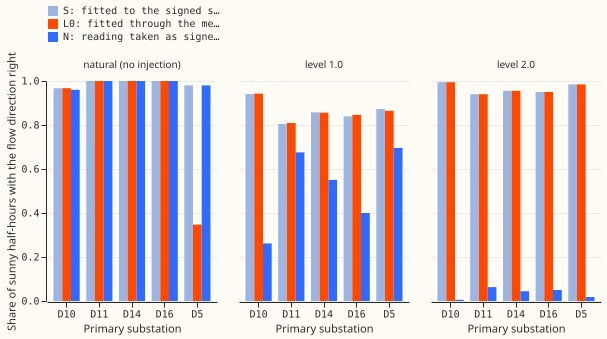
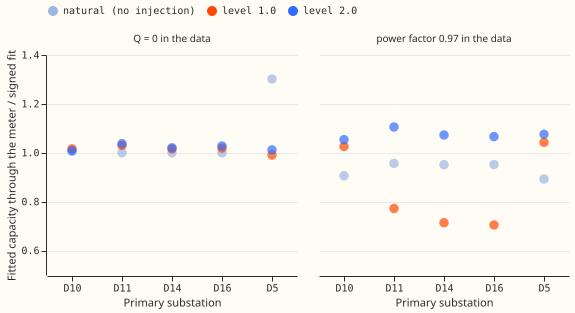

# MVA fold: known-answer test at folded signed Primaries

**Take-home.** If a substation's meter reports only the size of the flow, the convex model fitted
through the meter recovers the direction of the flow and the solar capacity about as well as a model
that sees the signed power. It does so while reactive power is zero. It also invented reverse flow
at the one site with none (D5), and it failed when the data carried reactive power at power factor
0.97. Verdict: partly supported. The sequence stops here, because the pre-registered pass rule fails
as written.

We asked whether the direction of the power flow at a Primary substation can be recovered from a
meter that reports only apparent power. We took five Primaries whose signed power is known, subtracted
the output of a real solar farm at two sizes (levels 1.0 and 2.0 times the site's median absolute
midday power), and replaced the reading with its magnitude. We then fitted the convex model through
the meter (experiment 110's L0, from [experiment 110](../00110-differentiable-physics-5-embedded-generation-and-capacity/result.md)),
and compared it with a fit to the signed series (S, the ceiling) and a fit that treats the magnitude
as signed power (N). Fits were frozen at 2025-07-01 and scored on the following year, on past
weather. The replicate cut is 2024-07-01.

## Results (scored cut, zero reactive power in the data, point forecasts)

- **Direction, sunny half-hours.** L0's accuracy is within 0.01 of S's at every site and level except
  D5 at the natural level. At level 1.0 it is 0.82 to 0.94 against N's 0.26 to 0.70. At level 2.0 it
  is 0.94 to 0.99 against N's 0.01 to 0.06. The replicate cut agrees (L0 within 0.01 of S).
- **Pre-registered rule.** At level 1.0, 4 of 5 sites reach balanced accuracy 0.80 on sunny
  half-hours (D5 is 0.69, and S is 0.66 there too). At level 2.0, balanced accuracy is 0.5 at every
  site, because 92% to 99% of the sunny half-hours are reverse flow. The rule fails as written, and
  the metric cannot tell the arms apart there. Plain accuracy, post hoc, passes at 5 of 5 sites.
- **Capacity.** L0's fitted capacity is within 15% of S's at 5 of 5 sites at both levels. The rise
  from the natural fit is about 75% to 80% of the injected capacity for both L0 and S (D10: 0.80),
  so the shortfall belongs to the signed fit, not to the fold.
- **Reading error.** L0's mean absolute error on the magnitude is below N's at every level-1.0 and
  level-2.0 cell, by 1 to 15 points on sunny half-hours (for example D10 at level 2.0: 10.4 against
  25.3).
- **Placebo fails at D5.** With no injection, L0 gets the direction right on 35% of sunny
  half-hours at D5 (S and N: 98%). Its fitted capacity is 1.30 times S's. The six starts disagree by
  45 points of capacity, and the lowest-loss one has a solar term that is large and negative at
  midday, which a loss on the magnitude cannot tell from the right answer.
- **Reactive power breaks it.** With power factor 0.97 in the data and `Q = 0` in the fit, L0
  collapses to N at D11, D14, and D16 at level 1.0 (accuracy 0.31 to 0.63, capacity 0.70 to 0.77 of S).
  The design brief's measurement puts the reactive floor at Stickney (D12) below 1% of capacity, so
  the zero-reactive case is the relevant one there.

## Checks

- **Triggers.** Trigger 1 fired (the D5 placebo). A fresh Sonnet auditor found no leakage, confirmed
  the D5 result is a mirror-basin weakness and not a bug, traced the Q1 collapse to the `Q = 0`
  assumption, and confirmed the sunny mask. It also flagged that the claim "L0 matches S" excludes D5
  at the natural level, which this page states.
- **Median against mean forecast.** Not applicable: these are point forecasts from frozen fits.
- **Departures from the plan.** Plain accuracy is added post hoc beside balanced accuracy. The audit
  was Sonnet and not Opus, as the series brief requires Sonnet only.

## Caveats and what to try next

- Frozen fits on past weather, no ensemble, no Kalman filter, no quantiles: sign recovery only.
- One farm (A) supplies the injected output, so the result is for one farm shape.
- Natural-level sites with no reverse flow (D11, D14, D16) have no balanced accuracy to report.
- Step 2 should read L0's reverse flow only after a check that rejects the D5-type mirror basin
  (for example, require the lowest-loss start to agree with the start nearest zero reverse flow).
