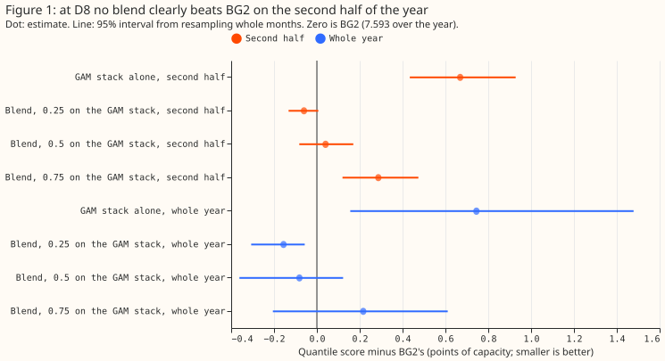
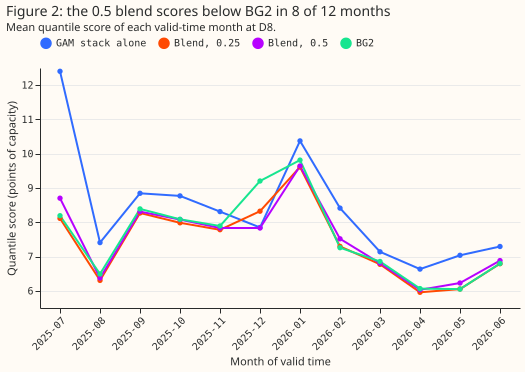
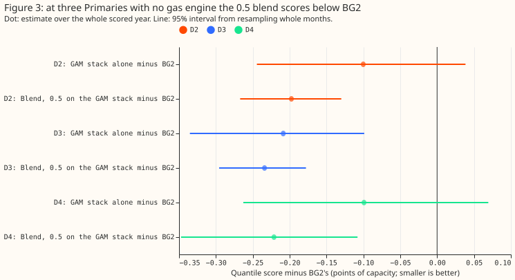

**At D8 the GAM stack adds little to BG2, so a blend of the GAM stack and BG2 does not beat BG2 by a
margin that would justify running a second stack.**

Giving the stack and BG2 weight 0.5 each scores 0.041 points above BG2 on the second half of the
scored year (95% interval -0.082 to +0.170). A weight of 0.25 on the stack scores 0.060 points below
BG2 on that half, with an interval that includes zero. The verdict is `not supported`. The stop rule
ends the planned contrasts, so the placebos, tails, and slices below are descriptive.

D8 (Marsh Lane) is a primary substation, which this page calls a Primary. At D8, BG2 (best guess 2,
the production-style forecast) scores below the GAM stack. The GAM stack is a generalised additive
model (GAM) of demand with a Kalman filter on recent errors and a band fitted on D8's own past errors
(Primary demand research default 1 refitted weekly; see
[experiment 355](../00355-d8-weekly-refit-and-median-band-swap/result.md) and
[experiment 354](../00354-d8-own-residual-bands-and-longer-fit-history/result.md)).

We asked whether the stack adds information that BG2 lacks. We used stored forecasts and no new
fits, averaging each of the 11 quantiles of the two forecasts at stack weights 0.25, 0.5, and 0.75.
The first half of the scored year (July to December 2025) chose the weight, and the second half
(January to June 2026) judged it.

The quantile score is twice the mean pinball loss over the 11 quantiles, in points of D8's effective
capacity (10.38 MW, so 1 point is about 0.1 MW). Lower is better. This experiment is interim: one
substation, one scored year, and weights chosen on a half-year.

**Figure 1: at D8 no blend scores below BG2 by an interval wholly below zero on the second half.**

**Figure 2: the 0.5 blend scores below BG2 in 8 of 12 months, and December 2025 is the largest
gap.**

**Figure 3: at three Primaries with no gas engine, the 0.5 blend scores below BG2, and below the
stack at D2 and D4.**

## Results

- **Arms.** BG2; the GAM stack (experiment 355's weekly-refit arm `W`); and blends with weight 0.25,
  0.5, and 0.75 on the stack. Code reuses experiments 252, 264, 354, and 355 (folders
  `ml-experiments/00252-*`, `00264-*`, `00354-*`, and `00355-*`) for the stored forecasts and
  scoring helpers.
- **Rows.** The scored set has 96,986 half-hourly rows at D8, 2025-07-02 to 2026-06-30, forecast
  lead times of 0.5 to 168 hours, `fold_a_daily_gap_v1`. Intervals resample whole months (20,000
  resamples). Intervals below are 95%, the level the plan set; the 99% Bonferroni intervals for the
  four planned contrasts are in `blend_scores.json`.
- **Gate.** The script reproduces 8.338 (stack, printed 8.3376) and 7.593 (BG2) before any blend is
  read.
- **Absolute scores at D8** (quantile score, points of capacity):

    | Arm | Whole year | First half | Second half |
    |---|---|---|---|
    | GAM stack | 8.338 | 8.861 | 7.816 |
    | Blend, 0.25 on the stack | 7.438 | 7.789 | 7.087 |
    | Blend, 0.5 on the stack | 7.511 | 7.836 | 7.188 |
    | Blend, 0.75 on the stack | 7.809 | 8.186 | 7.434 |
    | BG2 | 7.593 | 8.040 | 7.147 |
    | Manual heuristic | 8.469 | 9.324 | 7.617 |
    | Climatology | 9.757 | 11.324 | 8.195 |

- **Weight choice.** The first half selects 0.25 (7.789, against 7.836 for 0.5). The choice is a
  minimum over first-half scores alone, so no second-half score enters it.
- **C1, 0.5 blend minus BG2, second half (the verdict contrast).** +0.041 (-0.082 to +0.170). The
  interval is not wholly below zero, so the stop rule applies and the prediction fails.
- **C2, 0.5 blend minus BG2, whole year.** -0.082 (-0.362 to +0.122).
- **C3, 0.25 blend minus BG2, second half.** -0.060 (-0.132 to +0.006). Over the whole year the 0.25
  blend is -0.155 (-0.307 to -0.057), and the whole-year figure includes the half-year the weight
  was chosen on.
- **C4, 0.5 blend minus the stack, second half.** -0.628 (-0.794 to -0.455). The stack alone is
  +0.669 (+0.434 to +0.928) above BG2 on that half.
- **Lead bands, whole year (scores of the 0.5 blend, the 0.25 blend, and BG2).** In the 0 to 24 hour
  band they are 7.415, 7.290, and 7.436; in the 24 to 72 hour band 7.415, 7.337, and 7.489; in the
  72 to 168 hour band 7.584, 7.525, and 7.685. The 0.5 blend minus BG2 is -0.021, -0.074, and
  -0.101, each with an interval that includes zero. The 0.25 blend minus BG2 is -0.146, -0.152, and
  -0.160, each with an interval wholly below zero.
- **Months.** The 0.5 blend beats BG2 in 8 of 12 months and loses in July, February, May, and June.
  December 2025 alone is 7.84 against 9.20.
- **Sunny April-to-June half-hours (2026), the sunniest third of daylight half-hours.** Stack 7.178,
  blend 0.25 6.468, blend 0.5 6.574, BG2 6.501. The 0.5 blend minus BG2 is +0.073 (-0.215 to
  +0.394). On cold nights (below 2 °C) the stack scores 8.003, blend 0.5 7.856, and BG2 8.878.
- **Tails (whole year).** Share of readings inside q05 to q95: stack 0.847, blend 0.25 0.919, blend
  0.5 0.908, blend 0.75 0.883, BG2 0.904. Share below q01: 3.8%, 0.5%, 1.2%, 2.3%, and 0.2%. Share
  above q99: 2.9%, 0.3%, 0.7%, 1.5%, and 0.2%. Averaging the quantiles with BG2's cuts the stack's
  share below q01 from 3.8% to 0.5% at weight 0.25. BG2 has the smallest share beyond q01 and q99
  (0.2% each, against a nominal 1%), so its outer quantiles sit wider than nominal.
- **Placebos (whole year, 0.5 blend).** The stack scores below BG2 at D2, D3, and D4 already
  (-0.100, -0.209, -0.099; only D3's 95% interval, -0.335 to -0.099, excludes zero). The 0.5 blend
  minus BG2 is -0.198 (-0.267 to -0.130) at D2, -0.234 (-0.296 to -0.178) at D3, and -0.221 (-0.347
  to -0.108) at D4. The 0.5 blend minus the stack is -0.097 (-0.174 to -0.017) at D2, -0.025 (-0.099
  to +0.047) at D3, and -0.122 (-0.196 to -0.051) at D4. The first half selects weights 0.75, 0.75,
  and 0.5 at D2, D3, and D4.
- **How the stack builds its band.** The stack averages the 51 ensemble members into one mean run
  and forecasts one corrected mean from it, so no per-member forecasts exist to pool. The band is
  that median plus the as-of empirical quantiles of the stack's own past residuals (reading minus
  median at the shortest lead of each valid time), by six-hour block and season, over the trailing
  365 days, refreshed about every 7 origins: one residual width on one median.

## Checks

- **Median minus mean forecast, D8.** The stack's median is 1.37 points (about 0.14 MW) below its
  mean. BG2's median is 2.49 points above the stack's median, on average. Blend rows have no mean
  column.
- **Error of the median forecast beside each score contrast.** Median absolute error is about 1.50
  MW for the stack, 1.42 MW for the 0.25 blend, 1.43 MW for the 0.5 blend, 1.45 MW for the 0.75
  blend, and 1.44 MW for BG2. The ordering matches the quantile-score ordering, so trigger 3 did not
  fire. The correlation between the stack's and BG2's median errors is 0.86.
- **Triggers that fired.** Trigger 2 fired in a weak form: the 0.5 blend failed its prediction, and
  the monthly scores are consistent with the first half carrying the 0.5 blend's gain, December 2025
  above all, but no test confirmed that. No Opus audit ran, because this experiment's plan allowed
  Sonnet only. Triggers 1, 3, 5, 6, and 7 did not fire, and trigger 4 (leave one site out) does not
  apply to one site.

## Caveats

- **Lead range.** The stored forecasts cover 0.5 to 168 hours. NGED needs forecasts 1 to 10 days
  ahead, so the 168 to 240 hour range is untested.
- **Stack definition.** The D8 stack is the weekly-refit arm with its own-residual band. A stack
  with the donated band, or a different refit cadence, may blend differently. At D2, D3, and D4 the
  stack is experiment 354's arm 1, because the own-residual band raised the score there.
- **Weights.** A grid of three weights on a half-year of data is coarse, and the first half carries
  the stack's cold-start months.

## What to try next

- **Leave the blend out at D8.** The stack adds too little to BG2 to justify the effort of two
  stacks.
- **Test a blend at the Primaries where the stack beats BG2.** D2 and D4 score 0.10 to 0.12 points
  below the stack alone, so a blend with BG2 may help there. Choose the weights on a separate
  half-year.
