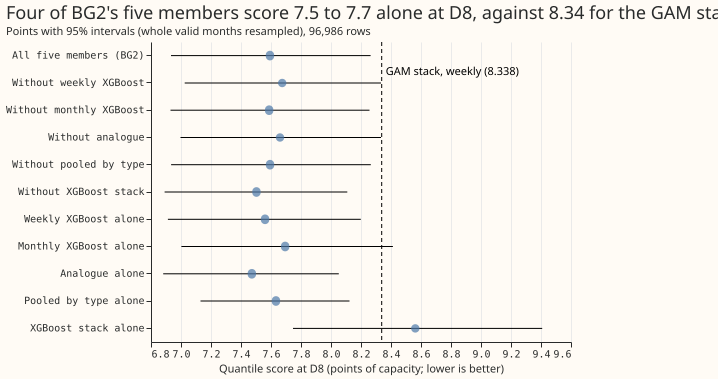

**Take-home message: BG2's lead at D8 is not a gain from blending.** Four of BG2's five members score
7.47 to 7.69 alone on the quantile score, against 8.338 for the GAM stack (Primary demand research
default 1, weekly refit, experiment 355). Dropping any one member moves the blend's 7.593 by at most
+0.082 points. The XGBoost stack member (the N1 model with the 14-day correction) scores 8.562 alone,
which is worse than the GAM stack, so the lead belongs to the other four members' models. The
prediction written before any score was read held: no drop moved D8 by 0.2 points or more.

We asked which of BG2's five members explains its lead at D8 (Marsh Lane). We rebuilt BG2's blend from
experiment 87's stored member forecasts, with no new fits. We then re-blended the members with one
dropped (re-choosing the monthly blend weights each time) and scored each member alone. Experiment 87
reports drop-one ablations for the Primaries as a group and none for D8 on its own. The scores are the
quantile score in points of capacity (one point is 0.1 MW at D8; lower is better), on the 96,986 rows
of experiments 353 to 355. The re-blended five-member arm reproduces BG2's stored 7.593. This is an
interim result: one substation, one scored year, and blending gains are not a causal account of why a
single model leads.

## Arms, D8 (96,986 rows, 95% intervals resampling whole valid months, 20,000 resamples, seed 0)

| Arm | Score | 95% interval | Minus five-member blend | Median error (MW) | q05 to q95 coverage |
|---|---|---|---|---|---|
| All five members (BG2) | 7.593 | 6.934 to 8.264 | 0 | 1.440 | 0.904 |
| Without weekly XGBoost | 7.675 | 7.025 to 8.333 | +0.082 (+0.006 to +0.180) | 1.456 | 0.895 |
| Without monthly XGBoost | 7.588 | 6.930 to 8.257 | -0.005 (-0.016 to 0.000) | 1.439 | 0.904 |
| Without analogue | 7.660 | 6.997 to 8.334 | +0.067 (+0.048 to +0.085) | 1.458 | 0.906 |
| Without pooled by type | 7.594 | 6.934 to 8.265 | +0.001 (-0.001 to +0.003) | 1.440 | 0.904 |
| Without XGBoost stack | 7.503 | 6.890 to 8.108 | -0.090 (-0.224 to +0.008) | 1.419 | 0.929 |
| Weekly XGBoost alone | 7.560 | 6.913 to 8.198 | -0.033 (-0.167 to +0.080) | 1.432 | 0.927 |
| Monthly XGBoost alone | 7.694 | 7.003 to 8.413 | +0.101 (-0.088 to +0.312) | 1.455 | 0.928 |
| Analogue alone | 7.472 | 6.882 to 8.052 | -0.121 (-0.255 to -0.013) | 1.408 | 0.925 |
| Pooled by type alone | 7.633 | 7.130 to 8.123 | +0.040 (-0.220 to +0.244) | 1.460 | 0.957 |
| XGBoost stack alone | 8.562 | 7.746 to 9.408 | +0.969 (+0.679 to +1.287) | 1.624 | 0.825 |

## Placebo Primaries (all stored rows up to 168 h with a finite actual, 121,492 rows each)

- **D2:** five-member blend 2.181; drops move it by -0.003 to +0.053 (largest: without the XGBoost
  stack, interval +0.026 to +0.081); the best single member (weekly XGBoost) scores 2.221.
- **D3:** blend 1.661; drops move it by -0.002 to +0.020; the best single member scores 1.673.
- **D4:** blend 2.403; drops move it by -0.020 to +0.021, all intervals include zero; the best single
  member (weekly XGBoost) scores 2.374, 0.029 better than the blend.
- At the placebos the blend is within 0.03 of the best single member, and the pooled-by-type member
  alone is the worst of the five at each.

## Checks

- **Median minus mean forecast:** the stored member forecasts hold quantiles only, so no mean forecast
  exists to compare; the median error in MW is in the table above.
- **Mean-forecast error beside the quantile score:** the median error moves with the score in every
  arm (lowest for analogue alone, 1.408 MW, and for the blend without the stack, 1.419 MW).
- **Triggers:** trigger 5 fires in a weak form. Analogue alone beats the blend that contains it by
  0.121 points (interval -0.255 to -0.013). A plausible reason is that the blend weights are chosen
  on earlier months across all 16 Primaries and so fit no single substation. This reason was not
  tested here, and no audit has run. The other triggers do not apply (no control, one site, no
  contradicted prediction, no later design depends on the result).

## Caveats and what to try next

- **Caveat.** Interim, one substation, one scored year; the blend weights are re-chosen per arm over
  all 16 Primaries, so the D8 numbers also reflect the other 15 substations.
- **Rows.** D8 uses experiment 355's actual (the MVA-fold series). The placebos use the raw series.
- **Scorer.** The 11 levels are averaged without weights, as in experiments 252 to 355; experiment
  87's mass-weighted scorer gives 9.6 for the same BG2 rows and is not comparable to the 7.593.
- **Next.** Compare the inputs of the weekly XGBoost and analogue members with the GAM stack's at D8,
  since the lead sits in those models.
- **Code.** `ml-experiments/00360-bg2-member-drop-one-at-d8/` imports experiment 87's folder
  (`e00087_assemble.py`, `e00087_common.py`).
