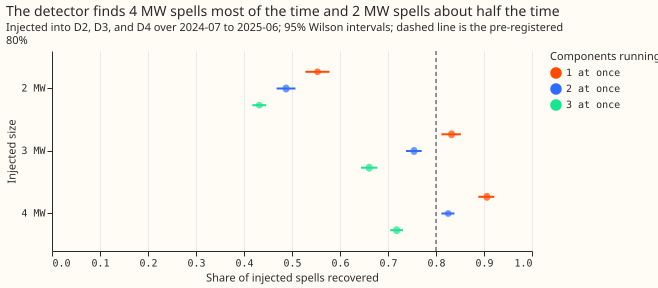
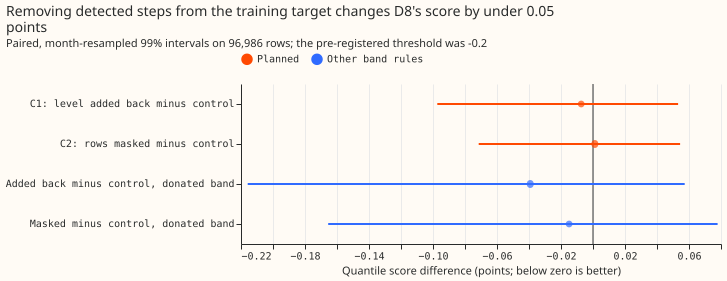
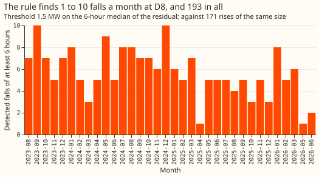

**A plain step detector separates 3 MW and 4 MW generator-like spells from D8's demand most of the
time, but removing the steps it finds from the training target does not improve D8's forecast.**

The test does not support building a particle filter on the evidence of this detector. The next
step is a detector that rejects ordinary demand swings, since the rule flags as many rises as falls.
The verdict is `not supported`.

D8 is a primary substation (Primary) whose power seems to include a dispatchable generator that
switches on and off. We asked whether a simple rule can find such steps in D8's power, and whether
taking them out of the training target helps the forecast. We added simulated on/off spells of 2, 3,
and 4 MW to three Primaries with no known generator, D2, D3, and D4, and counted how many spells
the rule found again. We then refitted D8's generalised additive model (GAM) stack with the
detected steps removed. The quantile score is twice the mean pinball loss over 11 quantiles, in
points of D8's capacity (1 point is about 0.1 MW), and lower is better. The residual-median rule
extends experiment 159's rule for multi-day drops (see
[experiment 159](../00159-switching-d8-multi-day-drops-recurrence-and-report/result.md)). The stack,
its refits, and the own-residual band come from
[experiment 354](../00354-d8-own-residual-bands-and-longer-fit-history/result.md), and the
gas-engine background from [experiment 264](../00264-dp-gas-engine-asymmetric-bands-at-d8/result.md),
[experiment 265](../00265-dp-gas-engine-bands-prior-and-visibility-switch/result.md), and
[experiment 291](../00291-d8-drops-engine-spells-load-shift/result.md).

**Figure 1: the detector finds 4 MW spells 91% of the time and 2 MW spells 55% of the time.**

**Figure 2: neither removal arm moves the score by more than 0.1 points.**

**Figure 3: the rule finds falls in every month.**

## Results

- **Detector.** The baseline of each half-hour is the median of the same half-hour on the 2 to 8
  days before and after. A fall is a run of at least 6 hours in which the 6-hour centred median of
  the residual is at or below -1.5 MW, with gaps under 6 hours merged. A multi-day drop uses
  experiment 159's rule (24-hour median, gaps under 12 hours merged, at least 2 days). At a fit
  cut only data before the cut is seen. The drop pass was added after the first catalogue run
  found only 4 drops of 2 days or longer with the 6-hour rule, and before any forecast was scored.
- **Catalogue at D8 since 2023-08-15.** 193 falls of at least 6 hours (median level -3.0 MW, median
  dwell 0.38 days) and 171 rises of the same size; 6 multi-day drops (median level -2.7 MW, median
  dwell 2.5 days). At 1.0 MW the counts are 273 falls and 11 drops; at 2.0 MW, 126 falls and 1
  drop. Prediction P2 (25 to 40 falls and 20 to 30 drops) failed on both counts: experiment 159
  found 29 drops with a different baseline.
- **Injection test.** 20 draws on each of D2, D3, and D4, 2024-07 to 2025-06, with spells and gaps
  resampled from D8's catalogue. A spell is recovered when detected segments cover at least half of
  it and the segment's level is within 30% of the injected total. One component at a time: 75%
  (3,986 spells; 95% Wilson interval 73% to 76%); 2 MW 55%, 3 MW 83%, 4 MW 91%. Two at once: 70%.
  Three at once: 59%, and 43% at 2 MW. Largest overlap with at least 80% recovery: none across all
  sizes; one component for 3 MW and above. The median start error is 0.5 hours and the median
  level error is within 6% in every cell. On the uninjected hosts the same windows are recovered
  by chance 0.4% of the time, and the rule finds 29, 5, and 6 falls a year at D2, D3, and D4.
  P1 failed on its first half (75% against 80%) and held on its second.
- **Rows.** 96,986 half-hourly rows at D8 in 2025-07-02 to 2026-06-30, leads 0.5 to 168 hours
  (the stored ensemble forecasts stop at 168 hours), `fold_a_daily_gap_v1`. Intervals resample whole
  months at the 99% level, the Bonferroni level for two planned contrasts.
- **Arms.** Monthly refits (12 fits) from 2023-09 with a level step per hour band at 2025-04-01,
  arm 3's own-residual band by hour block and season, the night offset and recipe R. Control: the
  raw target. T1: each detected segment's level added back to its rows. T0: the segment's rows
  masked from the fit. The detector flags 9% to 13% of training rows at the cuts checked
  (2024-09 and 2026-06), at a mean level of about -3.0 MW. Fit code is copied from experiment 354's
  `e00354_fit.py` with the target edit; the scripts import experiments 252, 264, and 354.
- **Gate.** The control scores 8.382, as in experiment 354's fit (b).
- **Absolute scores, all rows.** Control 8.382, T1 8.375, T0 8.384, BG2 7.593, manual heuristic
  8.469, climatology 9.757. All three arms trail BG2.
- **C1, T1 minus control.** -0.007 (99% -0.097 to +0.053), so P3 (at least -0.2) failed.
- **C2, T0 minus control.** +0.001 (-0.071 to +0.054). P4 held trivially, since neither arm helped.
- **Post hoc slices, descriptive.** On sunny daylight half-hours, T1 minus control is -0.197 (-0.699
  to -0.015) and T0 minus control -0.105 (-0.526 to +0.079). On cold nights, T1 minus control is
  -0.100 (-0.206 to +0.274). These slices were not planned, so they do not change the verdict.
- **Tail calibration, arm 3 band.** q05 to q95 coverage 0.846 (control), 0.847 (T1), 0.845 (T0).
  Share of readings below q01 0.039, 0.040, 0.040. Share above q99 0.029 in all three.
- **Scope.** Dispatchable on/off components only; solar and wind follow the weather. Only the sum of
  demand and generators is observed, so components of similar size may be unidentifiable. The
  generator behind D8 is unproven (experiments 264, 265, 291). The result is for D8 at leads of 0.5
  to 168 hours, shorter than the 10 days NGED care about.
- **Not run.** A particle filter, a production port, and a mixture band with an explicit
  on-probability. The removed component re-enters through the own-residual band, which is fitted on
  the actual power.

## Checks

- **Median minus mean forecast, points of capacity.** Control -1.44, T1 -1.31, T0 -1.30.
- **Error of the mean forecast beside the quantile score.** Mean absolute error 1.505 MW (control),
  1.499 MW (T1), 1.502 MW (T0), so both measures point the same way and the difference is small.
- **Triggers.** Trigger 2 fired in part: C1 contradicts its prediction of -0.2. The explanation
  test shows the edit moved the median forecast by 1.17 points (0.12 MW) on average for T1, and by
  1.03 points for T0, so the fit changed without improving. This fits a detector whose falls are
  partly ordinary demand swings (171 rises for 193 falls). No Opus audit was run, because the
  brief excludes Opus, and no later experiment depends on this result's sign. Triggers 1, 3, 4, 5,
  6, and 7 did not fire.

## What to try next

- Reject ordinary demand swings by requiring a fall to be matched by a rise of similar size at the
  end of its dwell, then repeat the injection test with that rule.
- Test the 6 multi-day drops alone as a mask on the training target, since they are the segments
  most likely to be the generator.
