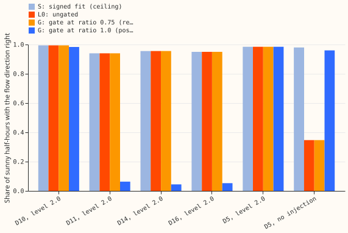

# MVA fold: gated fit through the meter, known-answer test

**A gate that checks fitted reverse flow against an independent solar forecast does not stop the
fit through the meter from inventing reverse flow.** At the registered setting the gate rejected no
fit in any of 60 cases. At a stricter post hoc setting it fixed D5, the one Primary substation with
no reverse flow, at the 2025 cut only, and it rejected the correct fits at four of five substations
when reverse flow was heavy. Verdict: refuted. The sequence stops here.

Experiment 358 found that the model fitted through an apparent-power meter invents reverse flow at
D5 when no solar output is injected. This experiment tested a gate. The fit tries six starting
points. The gate rejects a start when more than 0.5% of its training half-hours have negative fitted
power while the independent solar output is under a set multiple (the ratio) of the fitted demand.
The independent solar output is the pinned capacity times the solar shape plus, in this lab test,
the injected farm's true output. We tested the registered ratio of 0.75 and, post hoc, the ratios
1.0 and 1.25. Everything else follows [experiment 358](../00358-mva-fold-known-answer-at-folded-mw-primaries/result.md).
The ungated fit (L0) reproduces experiment 358's numbers.

## Results (reactive power zero; scored cut unless stated)

- **Registered gate (ratio 0.75) rejects nothing.** It rejects 0 of 6 starts in all 60 cases, so it
  gives the ungated fit's answer everywhere. D5 with no injection stays at 0.35 against the signed
  fit's 0.98. The rule fails on this one criterion: the gate matches the signed fit within 0.02 at 5
  of 5 substations at both injection levels, but misses D5 at the natural level by 0.63.
- **Why it rejects nothing.** On training half-hours the mirror fit's negative power falls where the
  independent solar output is at least 0.75 times the fitted demand, because true flow at midday is
  near zero and the independent forecast cannot tell a small positive flow from a small negative
  one. The invented reverse flow at D5 appears mostly on the following year's half-hours.
- **Post hoc ratio 1.0.** At the scored cut it fixes D5 with no injection (accuracy 0.96, capacity
  1.02 times the signed fit's) and matches the signed fit at level 1.0. It breaks level 2.0 at D11,
  D14, and D16 (accuracy 0.05 to 0.06 against 0.94 to 0.96, capacity 0.18 to 0.26 times the signed
  fit's), because the correct starts are rejected. At the 2024 cut it does not fix D5 (0.49, with
  every start rejected) and also breaks level 2.0 at D10, D14, and D16.
- **Ratio 1.25.** It breaks level 1.0 at D11, D14, and D5 and level 2.0 at all but D11 at the scored
  cut.

## Checks

- **Triggers.** Audit trigger 1 (a control fails: the D5 placebo) and trigger 2 (the result
  contradicts its prediction) fired. The explanation tested is the training-versus-test mismatch
  above. A fresh Sonnet auditor found the gate code a faithful copy of
  the ungated fit apart from the rejection step, found the units right, and reproduced experiment
  358's D5 numbers. It found no bug behind the null at 0.75: a start is rejected only when its fitted
  solar exceeds about 1.33 times the independent solar, and the wrong D5 starts overshoot by only
  about 1.2 times. It also noted that clipping the forecast power at zero cannot change a sign
  accuracy, so the clip is inert here.
- **Median against mean forecast.** Not applicable: point forecasts from frozen fits.
- **Departures.** Ratios 1.0 and 1.25 are post hoc. The audit used Sonnet because the series brief
  requires Sonnet only.

## Caveats and what to try next

- The gate reads the injected farm's true output, an advantage a real substation lacks, and it
  still failed.
- One farm shape (A) supplies the injected output.
- Try a rule on the meter readings alone: accept reverse flow only if the training readings come
  within a few percent of capacity of zero at midday. The brief's measurement says only Stickney
  (D12), Langrick (D22), and Marsh Lane (D8) do.
