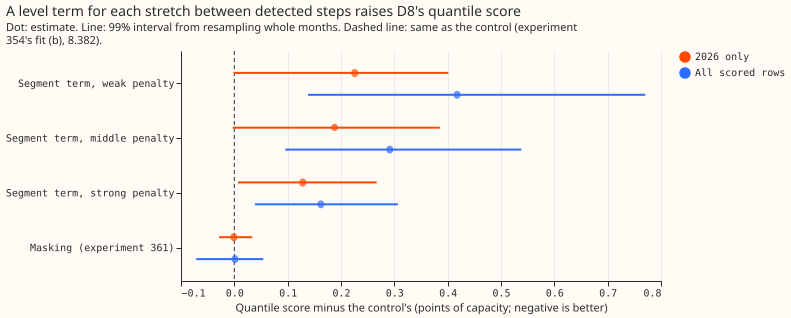
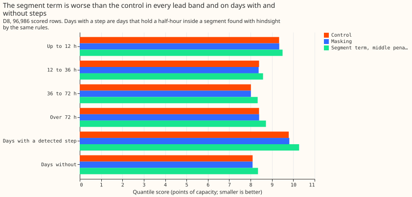
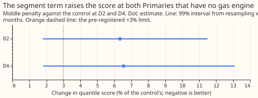
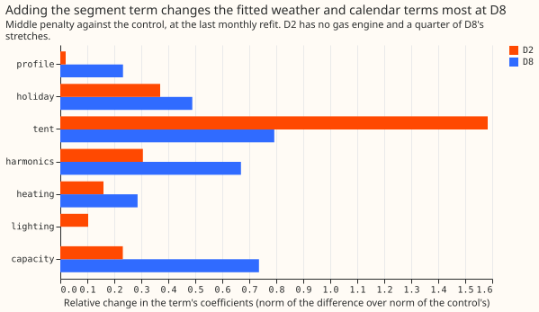
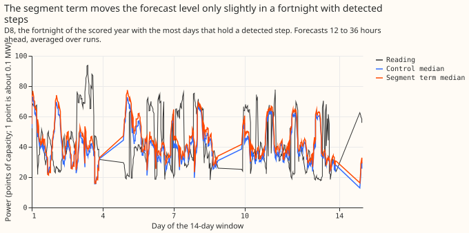

**Giving D8's forecast model a separate level for each stretch between detected steps made the
forecast worse, and the penalty strength did not rescue it.**

The weakest penalty was worst and the strongest was nearest to the control. The best segment term
is therefore no segment term. The verdict is `not supported`.

D8 is a primary substation (Primary) whose power seems to include a dispatchable generator that
switches on and off. [Experiment 361](../00361-d8-step-catalogue-detector-injection-and-gam-stack/result.md)
removed or masked the steps in the training target, and the score did not move. We asked whether
keeping every training row and adding a penalised level for each stretch between detected steps
would let the weather and calendar terms be estimated inside stretches. We refitted
[experiment 354's](../00354-d8-own-residual-bands-and-longer-fit-history/result.md) best generalised
additive model (GAM) stack monthly with the new columns and scored one year of forecasts. The
quantile score is twice the mean pinball loss over 11 quantiles, in points of D8's capacity (1 point
is about 0.1 MW), and lower is better. The random-effect-style level term is a standard device; the
detector is experiment 361's.

**Figure 1: every segment-term arm scores worse than the control, and the masking arm scores the same.**

**Figure 2: the segment term is worse in every lead band and on days with and without detected steps.**

**Figure 3: the segment term raises the score at both Primaries that have no engine.**

**Figure 4: the segment term changes the fitted solar-capacity and seasonal terms most at D8.**

**Figure 5: in the fortnight with the most detected steps, the two median forecasts follow the same shape.**

Headline caveat for every number: interim, one substation, one scored year; the detector recovers
55% of 2 MW and 91% of 4 MW injections and flags ordinary demand swings; the generator behind D8 is
unproven. Lead range: 0 to 168 hours, not the full 1 to 10 days NGED care about.

- **Arms.** C: experiment 354's fit (b) (monthly refit at 12 stored cuts, history from 2023-09, one
  level step per hour band at 2025-04-01), refitted here. M: experiment 361's masking arm, read from
  its stored forecasts. S: C plus one ridge-penalised level for each stretch between the starts and
  ends of segments found by experiment 361's step and multi-day-drop rules on power up to the cut,
  with the ridge at 0.1, 1, and 10 times the interaction penalty's scale (weak, middle, strong). At
  forecast time every row after a cut takes the latest stretch's level, so no future data enter; the
  level can be one refit period old. All frames are stage `d` with experiment 354's arm-3 band.
- **Row set.** 96,986 rows (`fold_a_daily_gap_v1`, the rows of experiment 354). Gate passed: C scores
  8.382. Stage 2 and the filter are experiment 252's, unchanged.
- **Scores (all rows).** C 8.382, M 8.384, S weak 8.800, S middle 8.674, S strong 8.545; BG2 7.593,
  `manual_heuristic` 8.469, climatology 9.757.
- **C1 (S middle minus C).** +0.291 points (99% interval +0.096 to +0.538); the pre-registered
  threshold was at most -0.2. 2026 only: +0.188 (-0.003 to +0.385).
- **C2 (S middle minus M).** +0.290 points (99% interval +0.118 to +0.510). S does not beat M, so the
  stop rule fired.
- **By lead band (S middle minus C).** Up to 12 h +0.162 (-0.010 to +0.333); 12 to 36 h +0.187
  (+0.012 to +0.373); 36 to 72 h +0.318 (+0.109 to +0.572); over 72 h +0.324 (+0.113 to +0.605).
- **By day type (S middle minus C).** Days with a detected step (hindsight detection, 16,350 rows)
  +0.486 (-0.125 to +1.157); days without (80,636 rows) +0.252 (+0.012 to +0.474).
- **MAE, correlation, bias (mean forecast).** MAE 1.505 MW (C), 1.502 (M), 1.551 (S middle);
  correlation with readings 0.459, 0.460, 0.436; bias +0.035, +0.041, +0.048 MW.
- **Placebos (S middle minus C).** D2 2.114 to 2.248, +0.134 points (+6.3%; 99% interval +0.038 to
  +0.243); D4 2.457 to 2.618, +0.161 points (+6.6%; +0.044 to +0.322). Both exceed the +3% limit.
- **Tail calibration (D8, all rows).** Readings below q01: C 3.9%, S middle 4.4%; above q99: C 2.9%,
  S middle 3.4%; inside q05 to q95: C 84.6%, S middle 83.7%.
- **S+ was not tested.** The stop rule applies, and in addition the latest stretch before every one
  of the 12 cuts was a normal stretch rather than a detected fall, so the widening would have applied
  to 0 rows. The share of training rows inside detected falls was 9.2% to 9.8% (median depth 28.5
  points, about 2.9 MW).
- **Clean-Primary check.** At D2 (345 stretches, level standard deviation 1.7 points) the middle
  penalty changes the fitted heating coefficients by 16%, the solar-capacity coefficients by 23%, and
  the seasonal harmonics by 31% (relative norm of the difference); at D8 (380 stretches, standard
  deviation 12.7 points) by 29%, 74%, and 67%. So the segment term takes over work from the weather
  terms, including at a Primary with no engine.
- **Checks.** Median minus mean forecast: C -1.44 points, S middle -1.20. Mean-forecast MAE agrees
  in direction with the quantile score (S worse). Triggers fired: 2 (the result contradicts its
  prediction, and the explanation below is untested) and 5 (the weakest-penalty arm, which contains
  the control, scores worse than it, although the strong-penalty limit is the control). See the audit
  bullet below.
- **Untested explanation.** The most likely cause is that the latest stretch's level, fitted from
  at most one month of rows and carried forward for up to a month, is a noisy guess. Setting the
  forecast level from a short moving window instead was not tried.
- **What to try next.** A state estimate at forecast time (the filter in experiment 252 already
  assimilates recent power) or a live signal for the generator, rather than a fitted past level.
  No further level-term variants.
- **Code.** `ml-experiments/00363-d8-segment-level-term-in-the-gam-stack/`; imports experiments 252,
  264, 354, and 361. Schedule: monthly refits (the same cuts as the control), so the contrast does not
  depend on a cheaper schedule.
