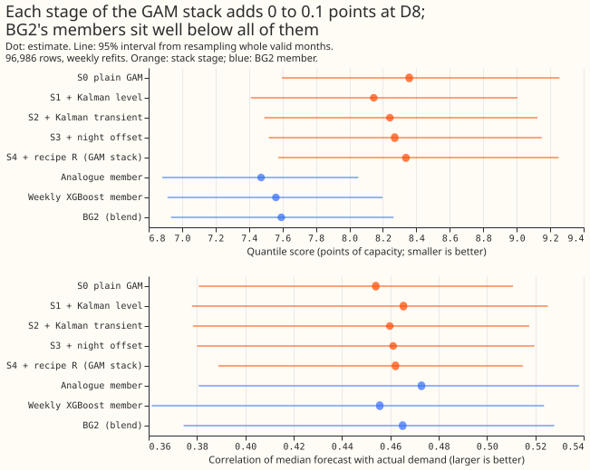
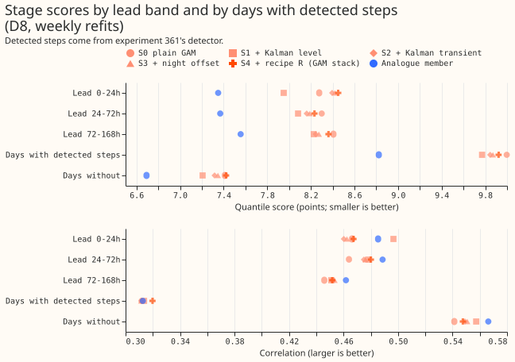
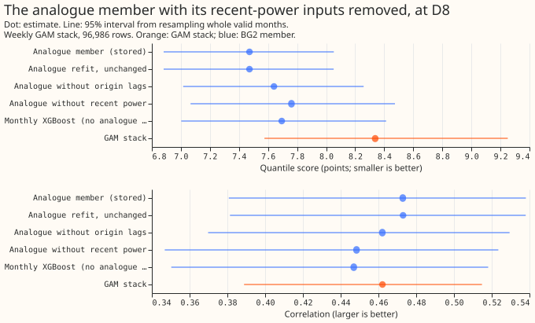
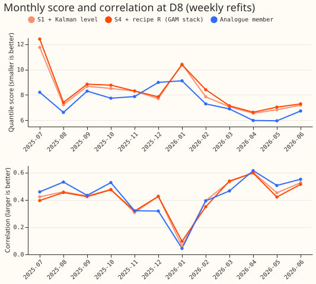
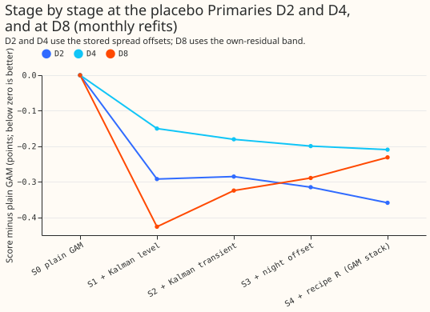
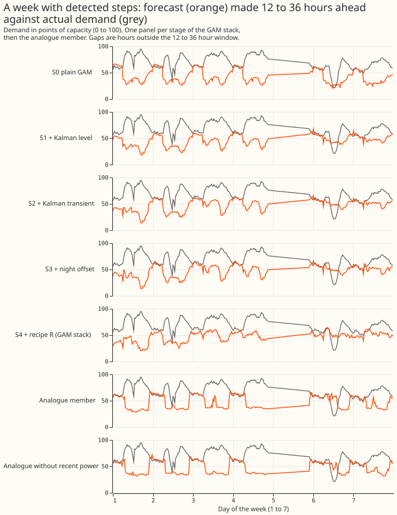
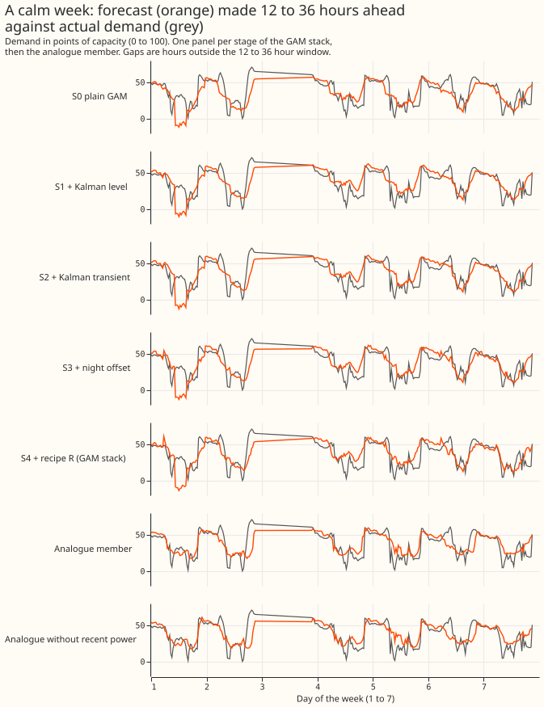
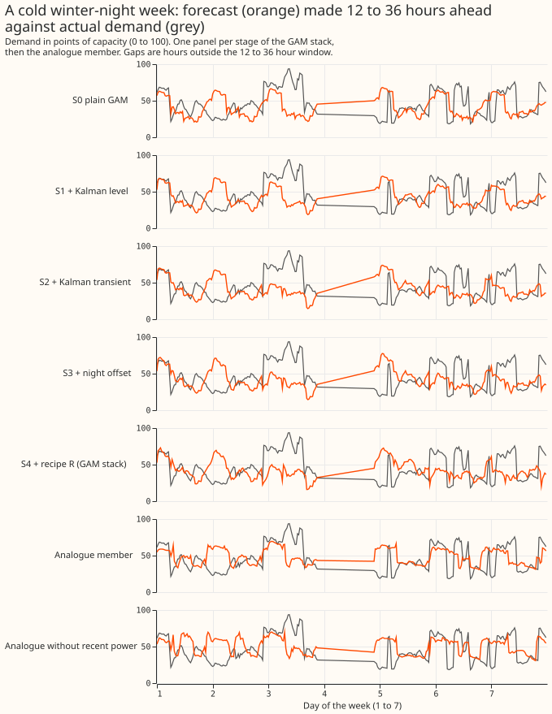
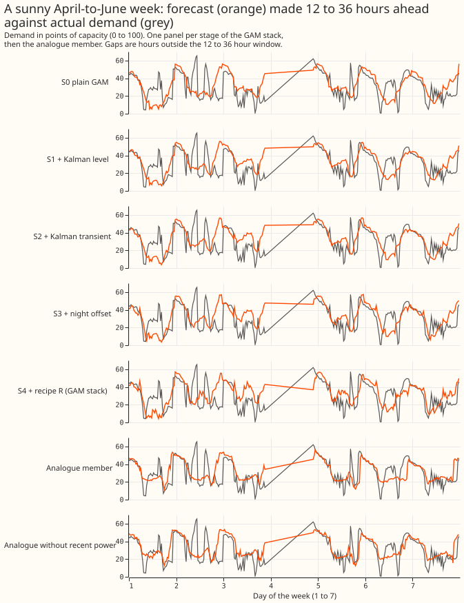

**Take-home message: the GAM stack's loss at D8 is not in one correction stage, and recent power
explains about a third of the analogue member's lead.**

This experiment asked where the GAM stack loses skill at the substation D8 (Marsh Lane, a primary
substation) against BG2, and whether BG2's analogue member wins because it sees recent power. The
analogue member is one of BG2's five members (weekly XGBoost, monthly XGBoost, analogue, pooled by
substation type, and an XGBoost stack). XGBoost is a gradient-boosted decision tree method. The
analogue member adds the mean and median of the demand at the same time of day on the six previous
weeks, and three "origin lags": demand observed shortly before the forecast was issued. The GAM
stack is Primary demand research default 1: a GAM, a Kalman filter on recent errors (a slowly moving
"level" and a short-lived "transient"), a winter night offset, recipe R (subtract 0.75 times the
last 14 days' mean error by half-hour), and an uncertainty band fitted on D8's own past errors (the
"own-residual band"). BG2 is the blend of five forecasts described in [experiment
87](../00087-bg2-best-guess-assembled-with-drop-one-ablations/result.md). We read each stage's
stored forecast from experiments
[354](../00354-d8-own-residual-bands-and-longer-fit-history/result.md) and
[355](../00355-d8-weekly-refit-and-median-band-swap/result.md), scored each stage and each BG2
member on the same 96,986 half-hourly rows, and refitted the analogue member twice with its
recent-power inputs removed. Scores are the quantile score (twice the mean pinball loss over 11
quantiles, in points of D8's 10.38 MW capacity; lower is better), the mean absolute error (MAE) of
the median in MW, the bias (forecast minus actual) in MW, and the Pearson correlation of the median
with the actual demand.

No stage adds more than 0.1 points of score. The plain GAM with the Kalman level scores 8.146 and
the full stack 8.338, against 7.472 for the analogue member. Removing recent power from the analogue
member raises its score from 7.472 to 7.761. The verdict is `not supported`: the stop rule applies
(no stage adds more than 0.1 points), and the analogue refit stayed below the predicted 8.0.

**Caveat.** This result is interim: it covers one substation and one scored year. Whether a
generator sits behind D8 is unproven ([experiments 264,
265](../00264-dp-gas-engine-asymmetric-bands-at-d8/result.md), and 291). The lead range is 0 to 168
hours, so the full 1-to-10-day horizon is not covered. The stages use weekly refits (monthly refits
give the same pattern for S1 to S4).

## Arms and numbers (D8, weekly refits, 96,986 rows)

- **Stages** (each scored with the own-residual band built from that stage's own median): S0 the
  plain GAM; S1 plus the Kalman level; S2 plus the Kalman transient; S3 plus the winter night
  offset; S4 plus recipe R (the GAM stack). The stage medians come from stored columns (`mean -
  level - anomaly`, `mean - anomaly`, `mean`) and experiment 252's stage-2 arms.
- **Gate:** S4 scores 8.338 (monthly refits 8.382) and BG2 reblends to 7.593, as stored.
- **Score (95% interval, whole valid months resampled):** S0 8.358 (7.596 to 9.256); S1 8.146 (7.411
  to 9.004); S2 8.242 (7.492 to 9.125); S3 8.271 (7.518 to 9.150); S4 8.338 (7.575 to 9.251); weekly
  XGBoost 7.560; monthly XGBoost 7.694; analogue 7.472 (6.882 to 8.052); pooled by type 7.633;
  XGBoost stack 8.562; BG2 7.593.
- **Stage contrasts (score):** S1 minus S0 -0.212 (-0.526 to +0.051); S2 minus S1 +0.096 (+0.041 to
  +0.159); S3 minus S2 +0.029 (+0.006 to +0.053); S4 minus S3 +0.067 (-0.014 to +0.167); S4 minus S0
  -0.020 (-0.339 to +0.249). The own-residual band lowers the score by 2.046 (-2.609 to -1.516)
  against the stored band.
- **Correlation:** 0.454 (S0), 0.465 (S1), 0.460 (S2), 0.461 (S3), 0.462 (S4), 0.473 (analogue),
  0.465 (BG2). The largest fall, S2 minus S1, is -0.0056 (-0.0142 to +0.0031) over all rows and
  -0.0082 (-0.0146 to -0.0029) on days without detected steps. On days with steps the change is
  +0.0017. The prediction that a stage lowers correlation only on step days failed.
- **Bias and error:** bias -0.321 MW (S0), -0.071 (S1), -0.107 (S4), +0.176 (analogue). MAE 1.526 MW
  (S0), 1.486 (S1), 1.503 (S4), 1.408 (analogue). Over all rows the analogue member's MAE is 0.094
  MW below S4's (-0.160 to -0.017).
- **By lead band (score):** S1 7.95, S4 8.45, analogue 7.35 at 0 to 24 h; S4 8.23 and analogue 7.37
  at 24 to 72 h; S4 8.36 and analogue 7.56 at 72 to 168 h.
- **By detected-step days (experiment 361's detector):** S4 9.92 and analogue 8.82 on step days; S4
  7.42 and analogue 6.69 on days without. The stack trails the analogue by 1.10 and 0.73 points.
- **Analogue refits** (monthly refits at D8, experiment 87's recipe, same seed; the unchanged refit
  reproduces the stored 7.472):

  | Arm | Score | Minus unchanged refit | |---|---|---| | Unchanged | 7.472 (6.881 to 8.052) | 0 | |
  Without the three origin lags | 7.641 (7.015 to 8.258) | +0.168 (+0.063 to +0.296) | | Without
  origin lags or analogue power from the last 7 days | 7.761 (7.066 to 8.474) | +0.289 (+0.103 to
  +0.525) | | Monthly XGBoost (no analogue columns, origin lags kept) | 7.694 (7.003 to 8.413) |
  +0.222 (+0.086 to +0.425) |

  Without recent power the analogue member still beats the stack by 0.58 points; recent power
  accounts for about a third of the analogue member's 0.866-point lead (+0.289 of 0.866).
- **Other substations D2 and D4, where no effect is expected** (monthly refits, stored spread
  offsets): at D2 the Kalman level lowers the score by 0.292 (S1 minus S0, -0.437 to -0.149) and the
  stages together from 2.437 to 2.079 (S4 minus S0 -0.359, -0.502 to -0.213), at D4 from 2.504 to
  2.294 (-0.210, -0.476 to +0.056). Prediction 3 (no stage moves D2 or D4 by more than 0.1) failed
  at D2.
- **Tails (D8):** q05 to q95 coverage 0.847 (S4), 0.925 (analogue), 0.904 (BG2); share below q01
  0.038 (S4), 0.004 (analogue); pinball at q99 0.648 (S4), 0.469 (analogue). The stack's
  own-residual band is too narrow at both ends.
- **Curtailment cost:** not scored; this experiment compares medians and bands at one substation.

## Checks

- **Median minus mean forecast.** The stages' own-residual band moves the median off the stage's
  mean forecast by 1.37 points on average for S4 (1.24 for S1, 2.14 for S0), because the band's
  median residual is added. The members' mean equals their median. The shift is the same rule for
  every stage, so it does not favour one stage.
- **Error of the median beside the score contrasts.** The score and MAE contrasts agree in direction
  at every stage (S2 minus S1: score +0.096, MAE +0.009 MW), so audit trigger 3 did not fire.
- **Triggers fired.** Trigger 2 (a result contradicts its own prediction): predictions 1, 2, and 3
  all failed, and the explanation that the lead sits in the XGBoost members' inputs was tested by
  the monthly-XGBoost row of the analogue table. Trigger 5 (a nested arm beats the arm that contains
  it): S1 beats S4, and the contrast is the finding. Trigger 1, 4 (leave one site out, not
  applicable to one substation), 6, and 7 did not fire. A separate audit re-derived the headline
  contrasts; its findings are in the pull request.

## Caveats and what to try next

- **Stage medians come from stored columns.** The plain-GAM median is `mean - level - anomaly` of
  the stored base frame, and the step-day flag uses experiment 361's detector over the whole record,
  so step days are hindsight labels.
- **Analogue refits.** Without the origin lags the lag columns are NaN in training and prediction.
  Recent power in the "no recent power" arm means all power newer than 7 days before the origin. The
  XGBoost members' weather inputs are unchanged.
- **Next:** compare the weather and calendar inputs of the XGBoost members with the GAM's at D8,
  then test the best of them inside the GAM.
- **Code:** `ml-experiments/00364-d8-stage-blame-and-analogue-recent-power/` imports the folders of
  experiments 87, 252, 264, 354, and 361. Printed numbers: `printed_report.txt`,
  `printed_checks.txt`.
