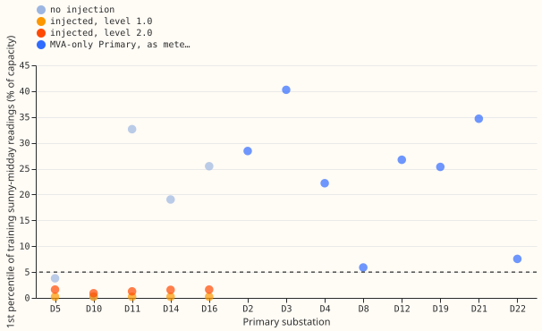

# MVA fold: reverse-flow rule on the meter readings alone

**A rule that looks for sunny-midday meter readings near zero does not reliably separate reverse
flow from none.** It still picks the wrong fit at D5, the one of the five test substations with no
reverse flow, because D5's readings also dip towards zero. It also misses heavy reverse flow:
heavy reverse flow gives large readings, not small ones, so the rule picks the naive fit at all 8
MVA-only Primaries, including Stickney (D12). Verdict: partly supported, because the registered
pass test is met, but only because it allows one substation in five to be wrong. Steps 2 to 4 of
the sequence are paused for a decision.

[Experiment 362](../00362-mva-fold-gated-fit-known-answer/result.md) found that an independent
solar forecast cannot tell invented reverse flow from real. This experiment tested a rule that
uses only the meter readings in the training years. The rule takes the training half-hours from
April to September that start 10:00 to 13:30 UTC with irradiance of at least 500 W/m². If the 1st
percentile of the meter readings on those half-hours is below 5 percentage points of capacity, the
rule uses the fit through the meter (L0). Otherwise it uses the naive fit (N), which reads the
magnitude as signed power. No model was refitted: the score of each case is the stored score of the
fit the rule chooses, from [experiment 358](../00358-mva-fold-known-answer-at-folded-mw-primaries/result.md),
which also defines the injection levels and the signed fit (S) used for comparison.

## Results (reactive power zero)

- **Registered pass test.** At the 2025 cut, the chosen fit's direction accuracy on sunny
  half-hours is within 0.02 of the signed fit's at 4 of 5 substations with no injection, and at 5 of
  5 at levels 1.0 and 2.0. At the 2024 cut the counts are 4, 4, and 5. The test passes.
- **D5 with no injection still fails.** The statistic is 3.79 at the 2025 cut and 2.88 at the 2024
  cut, both under 5, so the rule chooses L0. L0's accuracy is 0.35 against the signed fit's 0.98.
- **Census, not scored.** The statistic is 26.7 at Stickney (D12), 7.6 at Langrick (D22), and 5.9
  at Marsh Lane (D8), and 22 to 40 at the other five. All 8 exceed 5, so the rule chooses the naive
  fit everywhere, including at D12, where earlier experiments found reverse flow on 97% of summer
  midday half-hours. The prediction that the rule would pick L0 at D12 failed.
- **Power factor 0.97.** With reactive power in the data, the rule still chooses L0, which collapses
  at levels 1.0 and 2.0 (0 of 5 substations within 0.02), as in experiment 358.

## Checks

- **Triggers.** Audit trigger 1 (a failed control: D5) and trigger 2 (a result contradicting its
  prediction: the census) fired. The explanation is stated above and follows from the readings, so
  no separate audit was run: the experiment refits nothing and reads two stored result sets.
- **Median against mean forecast.** Not applicable: no forecasts were made.

## Caveats and what to try next

- The 1st percentile and the threshold of 5 were fixed before any statistic was computed.
- The census statistic uses the metered reading at the MVA-only Primaries, so a reading changed by
  generation added to the magnitude (the Marsh Lane change in April 2025) would also move it.
- Next idea: test whether the sunny-midday reading rises or falls with irradiance. The design
  brief measured a positive correlation of +0.75 to +0.83 at Stickney and a negative one at the
  other MVA-only Primaries. Not tested here.
