# Research log of the ML experiments

**This page lists every finished ml-experiment in the order it was started, what it set out to find,
and what it found.** A reader who wants the headline of each experiment starts here and follows the
link to the experiment's `result.md` for the numbers. The experiments that are planned or proposed
are on the [research plan](research-plan.md). Each experiment carries a production status. The
maintainer reviews the candidates every one to two weeks and ports the best into a new model
release; the [release log](../live_service/model-releases.md) records which experiments each release
adopted.

## Candidates for the next release

**These experiments are flagged `candidate` and are not yet adopted.** The flags are proposals for
the maintainer to confirm.

| Experiment | What would change in production | Note |
|---|---|---|
| [00001 - ERA5-trained stage 1, solar and wind, part 1](00001-era5-trained-stage1a-vs-ens-trained/result.md) | Train the weather-to-power model on ERA5 and apply it to ENS members | Needs the staged design, and helps only up to day 6 |
| [00002 - Stage 2 calibrator for solar and wind](00002-stage2-calibrator-and-mixture-vs-ens-quantile/result.md) | Pool the ERA5-trained quantiles over the ENS members | Stage 2 itself did not help |
| [00006 - Stage 1a demand inputs](00006-stage1a-demand-input-feature-sweep/result.md) | Use the clock, a COVID indicator, and recency weights as the stage 1a demand inputs | The Christmas column needs its 14-day window, a 2023 start needs a fresh year, and windchill can go |
| [00014 - CAMS irradiance for demand, part 3](00014-cams-trained-stage1-with-stage0-ens-correction-demand/result.md) | Map the ENS shortwave onto CAMS (a stage 0 quantile mapping) before a CAMS-trained stage 1a reads it | The year's mean is corrected but individual months are up to 18.6% off, and the member spread widens by 27% |
| [00017 - Retraining and error correction, part 1](00017-training-window-and-retraining-rule-drift-demand/result.md) | Train the stage 1a demand model on the last 12 months or with a 0.5-year half-life, retrain monthly, and add a 14-day error correction | The correction needs live power 2 days old, and every gain is on ERA5 weather |
| [00019 - Retraining and error correction, part 2](00019-primary-demand-stack-vs-manual-heuristic/result.md) | Add a 14-day error correction and a spread factor of 1.15 to the single-stage ENS-trained quantile model N1 for Primary demand | The correction supplies nearly all of the gain (-0.99); it is tested on forecasts 5 days apart and on a model that is never retrained |
| [00016 - Mixture calibration, solar and wind](00016-pooled-mixture-calibration-solar-wind/result.md) | Scale the solar mixture's quantiles about the median by a factor near 0.95, refitted monthly | Fixes 94% to 95% coverage at no change in CRPS; wind needs a spread factor on two lead groups, a post hoc arm |
| [00020 - Solar and wind stack](00020-solar-wind-stack-cams-stage0-spread-margin/result.md) | Add a power-curve base margin to the wind stage 1a quantile model | Lowers the wind CRPS by 0.055 points (0.007 to 0.110); the stack of margin and spread factor gives 0.071; nothing detectably helped solar |
| [00030 - Lagged power in demand, part 3](00030-lagged-power-feature-sets-primary-demand/result.md) | Add the mean and median of the 6 weekly power analogues to N1 for Primary demand, with the 14-day correction | Post hoc arm; 0.05 points below N1 with the correction (-0.08 to -0.02), 0.03 below the 00019 stack with an interval touching zero; the annual analogues hurt |
| [00024 - Pooled demand models, part 1](00024-pooling-groupings-demand-xgboost/result.md) | Train one XGBoost model per substation type (or per size band), with the series identifier as a categorical column, instead of one per series | Costs 0.15 points on Primary demand after the error correction and saves 16 of 20 models; needs the series identifier, and the test covered 20 series |
| [00033 - Best guess against production](00033-best-guess-architecture-vs-production/result.md) | Replace the production recipe with the best guess: N1 with the 14-day correction and spread factor 1.15 for Primary demand, N1 for BSP and GSP demand, ERA5-trained mixtures for solar and wind | The comparison that ranks the candidates against production; monthly retraining without the correction scored 5.12 on one seed and needs a three-seed test |
| [00035 - Quantile blend of stored models](00035-lead-weighted-quantile-blend-of-stored-models/result.md) | Serve a fixed-weight average of the quantiles of the monthly-retrained N1, `a7_cs`, and the stack for Primary demand | Lowers the quantile score by 0.10 points (-0.19 to -0.03) against the monthly-retrained N1; needs three models, one of them refitted monthly; solar and wind gains are unresolved |
| [00049 - Screening reference under monthly retraining](00049-vp1-screening-reference-under-p-roll-demand/result.md) | Serve an average of the quantiles of five XGBoost models for Primary demand (weekly refits, monthly refits, the weekly-analogue model, the pooled model, the stack) | Lowers the quantile score by 0.08 points (-0.14 to -0.02) against the weekly-retrained N1 on one validation year; needs five models; the spread factor and the fingerprints do not change the score |
| [00034 - Retraining cadence](00034-retraining-cadence-and-cheap-proxies-demand/result.md) | Retrain the Primary demand model monthly (or weekly) and drop the 14-day correction | Monthly scores 0.20 points below the stack (95% interval -0.38 to -0.01, unresolved at 99.375%); weekly 0.07 lower again |
| [00064 - Demand minus forecast solar (PVDIS-5)](00064-pvdis-5-net-demand-as-demand-minus-forecast-solar/result.md) | Give the XGBoost model for Primary demand the forecast solar output as a base margin (capacity times the calibrated ENS sunshine anomaly, with a weight fitted per series, lead band, and season, and zero beyond 10 days) | Lowers the quantile score by 0.152 points (98.75% interval -0.199 to -0.111) against the best guess; the live service cannot yet supply the inputs, the capacity held is stale, and the weights rest on one summer |
| [00078 - Current capacity and a zero start, PVDIS-5 check 2](00078-pvdis-5-current-capacity-vintages/result.md) | Refresh the capacity table that feeds the base margin once per season-year, and test a base margin of zero in the production XGBoost recipe | Re-estimating the capacity lowers the score by 0.018 points (-0.036 to -0.004); a zero start lowers `d0` by 0.071 (-0.099 to -0.047, against a refit of `d0`) in this experiment, and has not been tested on other series types |
| [00048 - Retraining cadence, part 2](00048-weekly-retraining-confirmation-and-extension-demand-generators/result.md) | Retrain the Primary, BSP, and GSP demand models weekly and drop the 14-day correction | Weekly scores 0.20 points below the stack on 292 further daily runs (99.44% interval -0.40 to -0.04), and 0.13 below monthly |
| [00081 - Weekly retraining, part 3](00081-r11-control-member-second-validation-year-demand/result.md) | Retrain the Primary demand model weekly and drop the 14-day correction | Second set of runs (control-only, 2023-07 to 2024-03): weekly scores 0.24 points below the stack (99.17% interval -0.36 to -0.15) and 0.04 below monthly (control member of the ECMWF ensemble only) |
| [00087 - Best guess assembled (BG2)](00087-bg2-best-guess-assembled-with-drop-one-ablations/result.md) | Serve the BG2 recipe: weekly refits, a five-model blend for Primary demand, weekly refits with no correction for supply points | Lowers the score by 0.283 points at Primaries and 0.634 at supply points compared with the previous best; the farm models cannot yet be ranked |
| [00094 - Explicit heating term, HT1](00094-explicit-heating-offset-primary-demand/result.md) | Add a per-series heating degree-hour term to the base margin of the Primary demand model | Lowers the cold-hour score by 0.143 points (-0.203 to -0.034) and the all-rows score by 0.022 (-0.042 to +0.000); needs a coefficient fit in training and a margin in serving; leaves cold-hour q95 exceedance at 16% to 17% |

## The experiments so far

| Experiment | Question | Verdict | Production status | Merged |
|---|---|---|---|---|
| [00087 - Best guess assembled (BG2)](00087-bg2-best-guess-assembled-with-drop-one-ablations/result.md) | Do the ideas that scored best in the last experiments, combined, beat the previous best forecast of each target class, and which idea gives which part of the gain? | Partly supported | Candidate | 2026-10-19 |
| [00001 - ERA5-trained stage 1, solar and wind, part 1](00001-era5-trained-stage1a-vs-ens-trained/result.md) | Does a weather-to-power model trained on ERA5 beat the same model trained on ENS weather? | Supported up to day 6 | Candidate | 2026-10-14 |
| [00002 - Stage 2 calibrator for solar and wind](00002-stage2-calibrator-and-mixture-vs-ens-quantile/result.md) | Does a stage 2 calibrator beat the pooled stage 1a mixture? | Partly supported | Candidate | 2026-10-14 |
| [00003 - ERA5-trained stage 1, demand, part 2](00003-era5-trained-stage1a-vs-ens-trained-demand/result.md) | Does the ERA5-trained model beat the ENS-trained model on demand series? | Not supported | Not for production | 2026-10-14 |
| [00005 - Lagged power in demand, part 1](00005-lag-placement-stage1b-vs-stage2-demand/result.md) | Where should lagged power enter a two-stage demand forecast: stage 1b, stage 2, or both? | Refuted: stage 2 is better | Not for production | 2026-10-14 |
| [00006 - Stage 1a demand inputs](00006-stage1a-demand-input-feature-sweep/result.md) | Which non-lag inputs are best for the ERA5-trained demand model (stage 1a)? | Partly supported | Candidate | 2026-10-14 |
| [00007 - CAMS irradiance for demand, part 1](00007-cams-static-correction-stage1a-residual/result.md) | Does a static CAMS correction fitted on one year remove most of the next year's daytime stage 1a residual? | Inconclusive | Not for production | 2026-10-14 |
| [00008 - Lagged power in demand, part 2](00008-lag-summaries-in-stage2-calibrator-demand/result.md) | Do summaries of recent power (minimum, mean, and maximum of the last 24 hours and of the same weekday) help the stage 2 calibrator? | Inconclusive: no gain on top of raw lags | Not for production | 2026-10-14 |
| [00009 - CAMS irradiance for demand, part 2](00009-cams-trained-stage1a-vs-era5-trained-demand/result.md) | Does a stage 1a trained on CAMS irradiance beat one trained on ERA5 shortwave, when both are applied to ENS members? | Refuted: a gain of 0.035 points, not 0.2 | Not for production | 2026-10-14 |
| [00010 - Price features for demand, part 1](00010-elexon-price-lags-stage1a-demand/result.md) | Does the lagged electricity price lower the stage 1a demand error at substations with batteries? | Inconclusive | Not for production | 2026-10-14 |
| [00011 - School-term columns for demand](00011-school-term-and-return-to-work-columns-stage1a-demand/result.md) | Do columns for the return to work after New Year and for Lincolnshire's school terms lower the stage 1a demand error after Christmas, at Easter, and in half-term holidays? | Refuted by the rule as written (inconclusive as intended): no gain in any window | Not for production | 2026-10-14 |
| [00012 - Solar and wind inputs](00012-solar-wind-stage1a-inputs-cams-and-training-start/result.md) | Which inputs and which training start work best for the solar and wind stage 1a model? | Inconclusive: no change reached the 0.15-point gain | Not for production | 2026-10-14 |
| [00013 - Primary demand baselines](00013-primary-demand-against-stored-baselines/result.md) | Where does Primary substation demand stand: does an upgraded ENS-trained quantile model (N1) beat `manual_heuristic`, and why does the production recipe lose to it? | Inconclusive: N1 is level with `manual_heuristic`; the production recipe trails it by 1.69 points | Not for production | 2026-10-14 |
| [00014 - CAMS irradiance for demand, part 3](00014-cams-trained-stage1-with-stage0-ens-correction-demand/result.md) | Does a stage 0 that maps ENS irradiance onto CAMS help the CAMS-trained demand model? | Inconclusive: a gain of 0.067 points, but monthly mismatches remain | Candidate | 2026-10-14 |
| [00017 - Retraining and error correction, part 1](00017-training-window-and-retraining-rule-drift-demand/result.md) | Do a recent training window, recency weights, monthly retraining, or a 14-day error correction lower the demand error? | Supported | Candidate | 2026-10-14 |
| [00016 - Mixture calibration, solar and wind](00016-pooled-mixture-calibration-solar-wind/result.md) | Does a correction bring the 5% to 95% band of the pooled mixture to 90% coverage for solar and wind? | Solar supported, wind refuted (a post hoc arm for wind reaches 90%) | Candidate | 2026-10-14 |
| [00015 - Price features for demand, part 2](00015-same-time-price-stage1-demand/result.md) | Does the same-time electricity price help a stage 1 demand model explain power across all fitted series? | Inconclusive | Not for production | 2026-10-14 |
| [00018 - Staged chain against N1](00018-staged-chain-vs-n1-serving-latency-lag-anomalies-demand/result.md) | Does the staged chain, with lag anomalies from the weather sources serving has, beat N1 and `manual_heuristic` on Primary substation demand? | Inconclusive: the chain is level with N1 (+0.08) and trails `manual_heuristic` (+0.52) | Not for production | 2026-10-14 |
| [00019 - Retraining and error correction, part 2](00019-primary-demand-stack-vs-manual-heuristic/result.md) | Does stacking a 14-day error correction, a 0.5-year half-life, and a spread factor of 1.15 on N1 beat `manual_heuristic` for Primary substation demand? | Supported: the stack beats `manual_heuristic` (-0.56) and N1 (-1.00); the correction supplies nearly all of it | Candidate | 2026-10-15 |
| [00020 - Solar and wind stack](00020-solar-wind-stack-cams-stage0-spread-margin/result.md) | Do the candidate changes for solar and wind (CAMS-trained stage 1a, a stage 0 quantile mapping, a power-curve base margin, a spread factor) add up to a lower CRPS than the pooled ERA5-trained mixture? | Partly supported: wind gains 0.071 points, solar does not | Candidate (wind) | 2026-10-14 |
| [00021 - Retraining and error correction, part 3](00021-error-correction-variants-bsp-gsp-demand/result.md) | Does the recent-error correction help BSP and GSP demand, and which variant works best? | Inconclusive for BSP and GSP; the 14-day additive form is the best variant | Not for production | 2026-10-15 |
| [00022 - Perfect-weather ceiling, demand](00022-era5-weather-ceiling-primary-demand/result.md) | How much would Primary demand gain from ERA5 weather in place of ENS weather at serving time, as a ceiling for better weather products? | Refuted: a gain of 0.10 points, not 0.3 | Not for production | 2026-10-15 |
| [00023 - Retraining and error correction, part 4](00023-lagged-power-and-error-correction-solar-wind/result.md) | Does recent observed power in the stage 2 calibrator, or a 14-day error correction, lower the CRPS of solar and wind forecasts? | Inconclusive: no sign of a benefit | Not for production | 2026-10-15 |
| [00026 - Capacity features, solar and wind](00026-capacity-features-solar-wind/result.md) | Does a feature stating each solar or wind farm's recent effective capacity lower the CRPS of the pooled mixture? | Inconclusive: no detectable gain | Not for production | 2026-10-15 |
| [00027 - PV_Live for GSP demand, part 1](00027-pvlive-lags-in-stage2-gsp-demand/result.md) | Does Sheffield Solar's PV_Live estimate at the lag times lower the stage 2 quantile score of the 2 GSP demand series? | Refuted: gains of 0.3 points or more are excluded | Not for production | 2026-10-15 |
| [00030 - Lagged power in demand, part 3](00030-lagged-power-feature-sets-primary-demand/result.md) | Which lagged power columns, up to all 13 lags of `manual_heuristic`, lower the quantile score of Primary demand in N1? | Inconclusive: the weekly analogues help alone and the annual ones hurt; with the correction the best arm gains 0.05 | Candidate (post hoc arm) | 2026-10-15 |
| [00028 - PV_Live for GSP demand, part 2](00028-pvlive-forecast-in-stage2-gsp-demand/result.md) | Does a forecast of the GSP's PV_Live solar generation, fed into the stage 2 calibrator, lower the quantile score of the two GSP demand series? | Inconclusive: -0.14 points, interval -0.34 to +0.04 | Not for production | 2026-10-15 |
| [00029 - Physics stage 1 for solar](00029-physics-stage1-solar-pytorch/result.md) | Does a differentiable PyTorch physics stage 1, fed into the XGBoost stage 2, beat the XGBoost stage 1 for the 6 solar farms? | Refuted: the physics stage 1 scores 0.079 points worse | Not for production | 2026-10-15 |
| [00025 - Price features for demand, part 3](00025-price-change-features-stage1-demand/result.md) | Does the change in the intra-day price, with its level, lower the stage 1 demand model's error for Primary substations beyond the level and an other-week price? | Small gain: 0.04 to 0.05 points, under the 0.1 threshold | Not for production | 2026-10-15 |
| [00024 - Pooled demand models, part 1](00024-pooling-groupings-demand-xgboost/result.md) | Which groupings of substations can share one XGBoost demand model without losing skill against one model per series? | Supported: 3 or 4 pooled models cost 0.15 points; one model for all series costs 0.29 | Candidate | 2026-10-15 |
| [00031 - Embedded PV features for demand](00031-embedded-pv-features-primary-demand/result.md) | Do trailing estimates of embedded solar capacity, as tree columns, a linear offset, or a sunshine-shaped correction, lower the Primary demand quantile score? | Inconclusive | Not for production | 2026-10-15 |
| [00032 - Pooled demand models, part 2](00032-substation-fingerprints-pooled-demand/result.md) | Do numeric fingerprints of each substation improve a by-type pooled demand model, and carry a substation held out of the pool? | Inconclusive: no fingerprint helped | Not for production | 2026-10-15 |
| [00033 - Best guess against production](00033-best-guess-architecture-vs-production/result.md) | Does the best-guess architecture beat production, N1, and `manual_heuristic` on the quantile score, twCRPS, and exceedance metrics, and how much would perfect weather add? | Supported: 4.89, 3.81, and 6.27 points below production | Candidate | 2026-10-15 |
| [00035 - Quantile blend of stored models](00035-lead-weighted-quantile-blend-of-stored-models/result.md) | Does a lead-weighted average of the quantiles of already-scored models beat the best single model for Primary demand, solar, and wind? | Supported for Primary demand (-0.10 points); null for solar and wind | Candidate (Primary demand) | 2026-10-15 |
| [00036 - BSP and GSP hierarchy](00036-hierarchy-aware-bsp-gsp-forecasts/result.md) | Do forecasts of the series beneath a BSP or GSP, and an ERA5-trained N1 applied to ENS members, lower the BSP and GSP quantile score? | Inconclusive: child forecasts and wind and solar columns gave no gain; the ERA5-trained N1 gained 0.36 to 0.40 points at the GSPs with intervals including zero | Not for production | 2026-10-16 |
| [00037 - Switching event detector, part 1](00037-switching-first-look/result.md) | Does a neighbour-balance detector find logged switching in the telemetry at a lower false-alarm rate than a single-series detector? | Inconclusive: size-weighted recall 0.326 (0.093 to 0.579) against the 0.35 bar | Not for production | 2026-10-15 |
| [00038 - Switching event detector, part 2](00038-switching-mask-value/result.md) | If the half-hours of detected switching events are left out of the stack's error correction, does the forecast improve on half-hours outside logged switching? | Refuted: +57.1% (+0.4% to +133.5%) threshold-weighted error against the 7-day correction | Not for production | 2026-10-16 |
| [00039 - PV disaggregation, part 1](00039-pv-disaggregation-cams-injection/result.md) | Can a CAMS-driven fit separate embedded solar from Primary substation demand, recovering injected solar-farm output within 25% and passing four checks on the real series? | Partly supported: recovery passes (0.854, 0.815 to 0.866), real checks pass at 6 of 8 Primaries | Not for production | 2026-10-16 |
| [00040 - PV disaggregation, part 2](00040-pv-capacity-error-bars/result.md) | Can a cross-arm misfit test detect a cloud-driven demand load that biases the capacity fitted to embedded solar, and how many directional Primaries are free of one in 2025/26? | Partly supported: calibrated (median capacity over truth 0.992, 0.951 to 1.032), but a day-long cloud load is flagged in only 0.35 of draws at 25% of capacity, so the verdict is `underpowered` | Not for production | 2026-10-16 |
| [00049 - Screening reference under monthly retraining](00049-vp1-screening-reference-under-p-roll-demand/result.md) | Under monthly retraining on a rolling 12 months, does a re-tuned spread factor, a blend of retrained models, a drop-one of each adopted input, or substation fingerprints change the Primary demand score? | Supported for the blend (-0.08 points); spread factor and fingerprints no effect; Christmas column and half-life unresolved; COVID indicator untestable | Candidate (blend) | 2026-10-16 |
| [00034 - Retraining cadence](00034-retraining-cadence-and-cheap-proxies-demand/result.md) | How does the Primary demand score change from frozen to daily retraining, with and without the 14-day correction, and which cheap proxy ranks arms like full monthly retraining? | Inconclusive at the planned level: monthly minus the stack -0.20 points (95% interval -0.38 to -0.01); weekly -0.07 lower again | Candidate | 2026-10-16 |
| [00041 - Switching-event labeller and gate](00041-sw2-0a-labeller-gate/result.md) | Can a labeller built on log-timed features that use no forecasting model pass a known-answer gate on injected transfers and placebo windows? | Partly supported: placebo 0 of 120 visible, recall 0.74 (0.57 to 0.85) on large, long transfers against a bar of 0.80; the receivers-named bar was waived post hoc | Not for production | 2026-10-16 |
| [00043 - Switching detector scoreboard](00043-sw2-1-detector-scoreboard/result.md) | How well do experiment 37's detectors find injected transfers when both start and end must be right? | Refuted at the 24-hour window: D1 minus D0 is -0.081 (-0.130 to -0.037); the 4-hour window reverses (+0.087) | Not for production | 2026-10-16 |
| [00044 - Switching events and the best guess's score](00044-sw2-2-switching-share-of-best-guess-score/result.md) | What share of experiment 33's best guess's quantile score and tail score falls in labelled switching half-hours, and in half-hours whose lagged power falls inside one? | Refuted: a perfect switching detector would lower the quantile score by 0.42% (95% interval -0.47% to 1.96%), under the 3% threshold, counting only transfers of 25% or more of the receiving load lasting over 24 hours | Not for production | 2026-10-16 |
| [00045 - Weekly solar capacity series, part 4](00045-pvdis-4-weekly-capacity-asymmetric-l1/result.md) | Can a weekly capacity series for embedded solar, with rises penalised lightly and falls heavily, recover injected changes at the 8 Primary substations metered in MW, without inventing steps? | Refuted: no pair of penalties met the tuning limits; the frozen pair scored a path error of 0.040 against 0.027 for a capacity held constant within each season-year, and gave 0.66 false steps per Primary-year against a limit of 0.5 | Not for production | 2026-10-16 |
| [00046 - Embedded solar share of Primary forecast error, PVDIS part 3](00046-embedded-solar-share-of-primary-forecast-error/result.md) | Does a solar term built from the ENS forecast of sunshine lower the error of a Primary demand forecast without radiation inputs by at least 0.35 points of capacity? | Refuted: -0.056 (-0.191 to +0.064) at 97.5%; the oracle built from the true sunshine gains -0.966 (-1.431 to -0.595) | Not for production | Pending |
| [00047 - Switching event detector, part 4](00047-sw2-4-better-residual-switching-detector/result.md) | Does adding the days to the nearest bank holiday to the demand model raise the share of simulated load transfers the 24-hour single-series detector finds, when both models raise the same number of unexplained alarms in odd months? | Inconclusive: the share found rose by +0.011 (98.75% interval -0.010 to +0.044) | Not for production | 2026-10-16 |
| [00055 - Switching event detector, part 5](00055-sw2-8-neighbour-veto-single-series-detector/result.md) | Does vetoing the single-series detector's alarms that the neighbouring substations show as a common-mode miss let the threshold fall at the same rate of unexplained alarms and find more injected transfers? | Inconclusive: the share found rose by +0.008 (98.75% interval -0.003 to +0.022) | Not for production | 2026-10-16 |
| [00058 - Switching event detector, part 5b](00058-sw2-8b-donor-step-recut-and-stronger-veto/result.md) | Is the gap in recall between injected transfers with and without a metered receiver a step-size effect of the injection, and does a veto stronger than 1.5 noise units find more transfers? | Partly supported: step size explains at least half the gap; the stronger veto gained +0.013 (98.33% interval 0.000 to +0.029) | Not for production | 2026-10-16 |
| [00059 - Switching event detector, part 6](00059-sw2-13-several-windows-in-one-detector/result.md) | Does one detector that combines the step statistic at windows of 4, 12, 24, and 48 hours find more injected transfers, by MW moved, than the best single window at the same unexplained-alarm count? | Refuted: the 24-hour window finds 0.473 of the moved MW and the maximum of four windows 0.423 (difference -0.050, 97.5% interval -0.094 to -0.022) | Not for production | 2026-10-16 |
| [00060 - Switching event detector, part 6](00060-sw2-7-profile-weighted-step-detector/result.md) | Does a step statistic that weights each half-hour by the daily profile find more of the moved MW than the constant step, on injection shapes it does not assume? | Refuted: the pooled gain in the share of moved MW found is below 0.001 (98.33% interval -0.006 to +0.008) | Not for production | 2026-10-16 |
| [00061 - Switching event detector, part 7](00061-sw2-6-paired-step-intervals/result.md) | Does scoring an onset step and its return step as one pair find more of the moved MW than the single-step detector? | Refuted: the paired score finds 0.13 less (98.33% interval -0.233 to -0.007); keeping the single-step alarms and taking the end from the strongest return step finds 0.19 more (+0.148 to +0.237) | Not for production | 2026-10-16 |
| [00062 - Switching event detector, part 7](00062-sw2-9-whitened-residual-step-detector/result.md) | Does filtering out the residual's half-hour-to-half-hour memory raise the share of moved MW the 24-hour detector finds? | Refuted: the pooled change in the share of moved MW found is -0.097 (98.33% interval -0.132 to -0.057) | Not for production | 2026-10-16 |
| [00065 - Switching event detector, part 8](00065-sw2-14-combined-single-series-and-neighbour-score/result.md) | Does one score that adds a substation's own step to its neighbours' opposite steps find more of the moved MW than the single-series detector, the neighbour gate, and the neighbour veto? | Inconclusive: the logistic-regression score gains +0.019 in share of moved MW found over the single-series detector (99.17% interval -0.011 to +0.062) and the likelihood-ratio score +0.005 (-0.010 to +0.014); a post hoc variant that adds the count of same-sign neighbour steps gains +0.034 (+0.013 to +0.091) | Not for production | 2026-10-16 |
| [00066 - Switching event detector, part 9](00066-sw2-16-end-rule-as-baseline/result.md) | Which window (4 or 24 hours) and cap (14, 30, or 60 days) should the end rule use, as the benchmark for later detectors? | Inconclusive: the 4-hour window finds 0.147 less of the moved MW than the 24-hour window (99% interval -0.248 to -0.054); a 30-day cap finds 0.534 more on transfers over 15.6 days (+0.131 to +0.780) and 0.045 less on shorter ones (-0.070 to -0.011) | Not for production | 2026-10-16 |
| [00069 - Switching event detector, part 10](00069-sw2-17-missed-onsets-of-the-end-rule/result.md) | Why do 24 of the 35 labelled real transfers over 1 day raise no alarm at their start, and does a weak alarm confirmed by a later step back recover them? | Inconclusive: the weak alarms add +0.146 of the moved MW, but the strong threshold must rise from 4.0 to 6.55 to keep 80 alarms, so the net change is +0.007 (98.75% interval -0.014 to +0.040); the first-return end rule beats the 14-day rule on a fresh draw (+0.038, +0.016 to +0.077) | Not for production | 2026-10-16 |
| [00070 - Switching event detector, part 11](00070-sw2-19-same-sign-neighbour-count/result.md) | Does counting the neighbours that step the same way as the alarming substation find more of the moved MW than the single-series detector with the PF14 end rule? | Supported: +0.048 of the moved MW (97.5% interval +0.021 to +0.096) on fresh headline-band transfers at 80 odd-month unexplained alarms; no gain on long transfers or the 35 real transfers (7 against 8) | Candidate | 2026-10-16 |
| [00071 - Switching event detector, part 12](00071-sw2-18-refit-offset-and-gap-bridging/result.md) | Does taking the step statistic from two residual models refitted half a month apart, so that no alarm is suppressed at a refit, find more of the moved MW than the benchmark detector PF14? | Supported: +0.050 of the moved MW (98.33% interval +0.012 to +0.107) at no more than 80 odd-month unexplained alarms, all of it in transfers within 24 hours of a refit. Lifting the suppression alone gives +0.056, and gap bridging changes no outcome | Candidate | 2026-10-16 |
| [00082 - Switching event detector, part 13](00082-sw2-18-19-combined-refit-offset-and-same-sign-count/result.md) | Do the refit offset (experiment 71) and the same-sign neighbour count (experiment 70) add up when used in one detector? | Supported: the combined detector XL finds 0.770 of the moved MW against 0.656 for PF14 (+0.114, 98.33% interval +0.074 to +0.182), and beats each part alone by +0.058 and +0.064; no gain on long transfers; 12 of 35 real transfers found against 8 | Candidate | 2026-10-17 |
| [00072 - Step-loss monitor for the solar farms, P35](00072-p35-step-loss-monitor-for-solar-farms/result.md) | Can a monitor find a loss of generating capacity at the 5 long-record solar farms from their daily power telemetry? | Refuted: it found 0.45 of 25% losses lasting 30 days (the plan required 0.80), 0.84 of 25% losses lasting 90 days, 0.26 of 10% losses lasting 90 days, and 3% losses barely above chance; false alarms 0.29 per farm-year on a placebo | Not for production | 2026-10-16 |
| [00068 - Switching event detector, part 13](00068-sw2-5-train-detect-retrain-loop/result.md) | Does refitting the lagless XGBoost model without the detected switching intervals, for three rounds, raise the share of moved MW the detector finds and lower the forecast error? | Inconclusive, and no gain worth porting: recall gains +0.011 (97.5% interval +0.000 to +0.034) and the forecast's mean absolute error changes -0.175% (-1.145% to +0.603%); a random mask of about equal volume does as well | Not for production | 2026-10-16 |
| [00067 - Switching event detector, part 14](00067-sw2-15-joint-edge-flow-estimator/result.md) | Does one convex fit of load flows across all boundaries between the 16 Primaries find more of the moved MW than the single-series 24-hour step detector? | Refuted: the joint estimator finds 0.108 of the moved MW against 0.646 (difference -0.538, 97.5% interval -0.605 to -0.421); a post hoc loss change lifts it to 0.527 (-0.120, -0.190 to -0.084) | Not for production | 2026-10-17 |
| [00050 - A second weather forecast for the solar anomaly, PVDIS part 8](00050-second-weather-forecast-for-solar-anomaly/result.md) | Does the GEFS ensemble, alone or blended with ENS, forecast the solar anomaly better than ENS, and does that lower the demand forecast's error? | Refuted at the gate: GEFS's cross-validated squared error is 1.109 times ENS's and the blend's 1.002, against the 0.99 needed; the demand contrasts were not run | Not for production | Pending |
| [00051 - Midday loss of the solar term, PVDIS part 3b](00051-pvdis-3b-midday-loss-of-the-solar-term/result.md) | Why does the solar correction of experiment 46 score worse than the forecast that kept its own radiation inputs at June-to-August midday: inverter clipping, a too-large coefficient, or noisy ensemble members? | Partly supported: the coefficient is too large (a fitted one lowers the median's mean absolute error by 0.991 points of capacity, -1.473 to -0.495); clipping is not distinguished from it; the ensemble members add 0.129 points of quantile score (0.057 to 0.212) | Not for production | Pending |
| [00052 - More weather products for the wind farms](00052-more-nwp-products-for-wind-farms/result.md) | Does averaging the wind best guess with the ERA5-trained model fed ICON-EU's and IFS 0.25 degree's forecast lower the wind quantile score at 1 to 2 days ahead? | Inconclusive: -0.055 (-0.200 to +0.072) against a 0.15 threshold | Not for production | 2026-10-16 |
| [00053 - UKV against ENS for the solar anomaly, PVDIS part 8b](00053-ukv-vs-ens-solar-anomaly/result.md) | Does the Met Office UKV, alone or blended with ENS, track the CAMS solar anomaly better than ENS within 120 hours? | Small gain for the blend only, from the pre-stated cross-validation gate: mean squared error 7.6% lower over 0 to 54 hours; in the validation year the correlation gain is +0.011 (-0.006 to +0.027) over 0 to 54 hours; UKV alone is worse than ENS in every band; no gain beyond 54 hours; post hoc | Not for production | Pending |
| [00056 - MVA-only Primaries against MW Primaries](00056-mva-only-primaries-skill-against-mw-primaries/result.md) | Does Flexpectation v1 forecast the 8 trial-area Primary substations that record only the magnitude of power (MVA) clearly worse than the 8 that record signed MW, relative to the rule-based `manual_heuristic`, in particular at sunny middays? | Inconclusive: at sunny middays the MVA group has 5.6 percentage points less skill, 95% interval -5.0 to 14.6; skill is lower at the MVA group all year, and one MW substation accounts for most of that gap | Not for production | Pending |
| [00054 - UKV for the wind farms](00054-product-trained-xgboost-wind-farms/result.md) | Does an XGBoost model given UKV's wind as extra inputs, trained on UKV's own history, beat the same model trained on ENS alone at 1 to 2 days ahead? | Small gain, as an upper limit: -0.198 (-0.316 to -0.069) points of capacity against a 0.15 target; the UKV data are a research archive, not the live feed | Not for production | 2026-10-16 |
| [00064 - Demand minus forecast solar (PVDIS-5)](00064-pvdis-5-net-demand-as-demand-minus-forecast-solar/result.md) | Does a Primary demand forecast with an explicit solar term (capacity times a calibrated forecast of the sunshine anomaly) match the best guess by 0.10 points of capacity, and beat its placebo twin? | Supported: the base-margin arm `am` is -0.152 (-0.199 to -0.111) against the best guess at 98.75% | Candidate | 2026-10-19 |
| [00063 - SW2-10 joint fit, v2 in miniature](00063-sw2-10-linear-joint-fit-v2-in-miniature/result.md) | Does one linear fit per Primary, holding a weather baseline without radiation, embedded solar capacity times the CAMS sunshine shape, and a share term per labelled transfer, beat the frozen v1 baseline outside switching, and recover injected solar and transfers? | Inconclusive: C1 is -0.322 points of capacity (-0.437 to -0.207) at 5 Primaries, close to the 0.35-point threshold, but both injection gates failed for reasons of test design | Not for production | Pending |
| [00057 - UKV for the solar farms](00057-product-trained-xgboost-solar-farms/result.md) | Does an XGBoost model given UKV's shortwave, cloud, and temperature as extra inputs, trained on UKV's own history, beat the same model trained on ENS alone at 1 to 2 days ahead? | Inconclusive: -0.035 (-0.119 to +0.037) points of capacity against a 0.10 target; a gain above 0.12 is ruled out | Not for production | 2026-10-16 |
| [00048 - Retraining cadence, part 2](00048-weekly-retraining-confirmation-and-extension-demand-generators/result.md) | Does weekly retraining of the demand model still beat the stack on the 292 daily runs experiment 34 left out, and does retraining help BSP, GSP, solar, and wind? | Supported: weekly minus the stack -0.20 points (99.44% interval -0.40 to -0.04); weekly minus monthly -0.13 (-0.24 to -0.03); solar and wind change by 0.04 or less | Candidate | 2026-10-16 |
| [00073 - Solar orientation mix and DC:AC ratio, PVDIS part 6](00073-pvdis-6-orientation-mix-and-dc-ac-ratio/result.md) | Can the share of east-, south-, and west-facing solar behind a Primary, and the ratio of DC to AC capacity, be read from its power? | Partly supported: the blend helps, its shares are not identified, DC:AC is not recovered | Not for production | 2026-10-17 |
| [00077 - Fitted solar shape in arm am, PVDIS part 6b](00077-pvdis-6b-fitted-solar-shape-in-arm-am/result.md) | Does a fitted east-south-west solar shape, with shares fixed across training years, lower the score of experiment 64's arm `am` by more than 0.5%? | Refuted: the score is unchanged (-0.001 points, 98.33% interval -0.018 to +0.014), and another Primary's shape scores the same | Not for production | 2026-10-17 |
| [00076 - Leak check on PVDIS-5](00076-pvdis-5-leak-check-beyond-10-days/result.md) | Does experiment 64's gain at 10 days and beyond, where its solar term is zero, come from a leak? | Supported: no route for a leak found; a refit with no solar term reproduces the gain, so it matches a start-at-zero effect, and the offset in training adds +0.004 (-0.012 to +0.021) without the 14-day correction | Not for production | 2026-10-17 |
| [00078 - Current capacity for PVDIS-5](00078-pvdis-5-current-capacity-vintages/result.md) | Does a solar capacity re-estimated before each forecast run lower the error of experiment 64's best forecast, and does a start at zero matter for XGBoost? | Small gain: -0.018 points (98.75% interval -0.036 to -0.004), under the 0.05 threshold; a zero base margin lowers `d0` by 0.071 (-0.099 to -0.047, against a refit of `d0`) | Candidate | 2026-10-17 |
| [00079 - Direction of flow at the MVA-only Primaries, PVDIS part 7](00079-pvdis-7-mw-at-mva-only-primaries/result.md) | Can a fit of the magnitude of demand minus solar recover the solar capacity and the direction of flow at Primaries metered only in MVA? | Partly supported: the capacity is recovered (median error 0.09 against 0.29 for the naive fit) and the direction with a balanced accuracy of 0.78, but 7 of the 8 real MVA-only Primaries show no reverse flow and Stickney cannot be checked | Not for production | 2026-10-17 |
| [00080 - Zero starting value, BM0](00080-bm0-zero-base-margin-xgboost-quantile-models/result.md) | Does starting XGBoost from zero instead of its estimated base score lower the quantile score of the production-style models for Primary, bulk and grid supply point, solar, and wind series? | Inconclusive: no gain for Primary substations (-0.017 points, 98.75% interval -0.072 to +0.054), supply points, or solar; worse for wind without the power-curve margin (+0.049) | Not for production | 2026-10-17 |
| [00079 - Direction of flow at the MVA-only Primaries, PVDIS part 7](00079-pvdis-7-mw-at-mva-only-primaries/result.md) | Can a fit of the magnitude of demand minus solar recover the solar capacity and the direction of flow at Primaries metered only in MVA? | Partly supported: the capacity is recovered (median error 0.09 against 0.29 for the naive fit) and the direction with a balanced accuracy of 0.78, but 7 of the 8 real MVA-only Primaries show no reverse flow and Stickney cannot be checked | Not for production | 2026-10-18 |
| [00083 - Tail calibration, worked example](00083-curtailment-cost-and-tail-calibration-worked-example/result.md) | Are the tails of the stored demand forecasts of experiment 48 too narrow? | Inconclusive (no registered contrast): every forecast is too narrow in both tails, with coverage of the 0.05 quantile 0.066 to 0.085 and of the 0.95 quantile 0.891 to 0.927; the single-series curtailment-cost metric was withdrawn | Not for production | 2026-10-17 |
| [00084 - Substation-limit curtailment cost, worked example](00084-substation-limit-curtailment-cost-worked-example/result.md) | Does the substation-limit curtailment metric run on the pilot, and are there enough half-hours beyond a limit to rank forecasts? | Inconclusive (no registered contrast): 19 half-hours are beyond a limit of 0.9 times the earlier maximum in the scored year, so the pilot proves the arithmetic and cannot rank forecasts | Not for production | 2026-10-17 |
| [00085 - Cheaper retraining schedules](00085-cheaper-retraining-schedules-rank-arms-like-weekly-demand/result.md) | Do cheaper retraining schedules rank the cadence and starting-value contrasts the way full weekly retraining does? | Partly supported: a monthly 12-month-window refit and a weekly 150-round refit reproduce the monthly-minus-weekly gap (+0.118 and +0.125 against +0.125); the starting-value gap (-0.017) is too small to test | Not for production | 2026-10-18 |
| [00074 - Sunshine analogues against the explicit solar forecast (AN1)](00074-an1-same-time-analogues-vs-explicit-solar-forecast-demand/result.md) | Under monthly retraining, do same-time sunshine analogues lower the daylight error of a Primary substation more than an explicit forecast of its solar panels' output, and do they add anything once that forecast is in the model? | Inconclusive: both lower the error (by 0.149 and 0.095 points against a monthly refit without sunshine inputs), and the analogues add 0.066 points of gain (-0.149 to +0.015) on top of the explicit forecast | Not for production | 2026-10-17 |
| [00075 - Normal running arrangement forecast, SW2-11](00075-sw2-11-nra-forecast-with-labelled-switching-masks/result.md) | With labelled switching removed from the training targets, does the weekly-refitted Primary demand model forecast the normal running arrangement as well outside switching as the plain model, and does the signed MW moved at each lag help? | Inconclusive: removing the switching changed the quantile score by +0.004 points of capacity (98.33% interval -0.026 to +0.025); the signed MW and the corrected lags did not help | Not for production | 2026-10-17 |
| [00086 - Normal running arrangement forecast with detector labels, SW2-12](00086-sw2-12-detector-labels-for-nra-forecast/result.md) | Do the XL detector's switching labels give the same gain as NGED's logs when each lag is corrected for switching? | Inconclusive: detector labels raised the score by 0.48 points of capacity on rows with a lag inside a logged event (98.33% interval -0.06 to +1.72) and by 0.056 outside switching (+0.016 to +0.126); oracle labels changed it by -0.29 (-2.06 to +0.68) | Not for production | 2026-10-18 |
| [00089 - Normal running arrangement forecast, longest history, SW2-22](00089-sw2-22-longest-history-nra-forecast-with-ara-lags-masked/result.md) | With switching removed from the training targets, does the longest history (2021-03 onward) beat 12 months, and does setting lags inside an abnormal arrangement to missing help? | Refuted: masking raised the score by 0.409 points of capacity on rows with a lag in an abnormal arrangement (98.33% interval +0.281 to +0.517); the longest history changed it by +0.009 (-0.052 to +0.069) | Not for production | 2026-10-18 |
| [00090 - Lag unusualness inputs, SW2-28](00090-sw2-28-lag-unusualness-inputs-all-rows-and-switching/result.md) | Does giving the Primary demand model the PIT of each lag against a climatology improve the forecast on all rows, and widen the quantiles on rows with a lag inside a logged switching event? | Refuted: the PIT inputs raised the score by 0.355 points of capacity on all rows outside switching (97.5% interval +0.209 to +0.513); on rows with a lag inside a logged event +0.795 (-0.325 to +2.787, inconclusive) | Not for production | 2026-10-18 |
| [00088 - Normal running arrangement forecast on injected switches, SW2-21](00088-sw2-21-nra-forecast-recovers-normal-arrangement-during-and-after-injected-switches/result.md) | When a Primary substation is inside a switching transfer or has just left one, does the NRA forecast recover the true unmodified power, with the MW from the injection and from the refit-offset neighbour-count detector run only on data before the origin? | Inconclusive: with the true MW, a booster trained on NGED's logged transfers closes 83% (70% to 91%) of the error a transfer adds; with the MW from the refit-offset neighbour-count detector as built, a booster trained on that detector's transfers closes 16% (-17% to 67%), -0.149 points of capacity against the plain forecast (98.75% interval -1.174 to +0.148) | Not for production | 2026-10-18 |
| [00091 - Calibrated probability of an abnormal running arrangement, SW2-26](00091-sw2-26-calibrated-probability-of-abnormal-arrangement/result.md) | Can the switching detector that uses only past data give a calibrated probability that a past half-hour lies inside an abnormal running arrangement (a period when a normally open switch is closed)? | Inconclusive: the calibrated score's Brier score is 3.3% below the yes-or-no flag (97.5% interval -7.6% to +1.6%), against a 20% target; 11.2% below in a post hoc subset of large transfers (-20.3% to -2.0%); area under the curve (0.5 is no skill) 0.53 against NGED's logs | Not for production | 2026-10-18 |
| [00094 - Explicit heating term, HT1](00094-explicit-heating-offset-primary-demand/result.md) | Does a per-series heating degree-hour term in the XGBoost base margin lower the cold-hour error of Primary demand? | Small gain: -0.143 points (98.75% interval -0.203 to -0.034) in cold hours up to 48 h, under the 0.3 threshold; q95 exceedance in cold hours barely moves (0.167 to 0.162) | Candidate | 2026-10-18 |
| [00092 - Drift diagnostics, LV0](00092-lv0-drift-diagnostics-on-stored-predictions-demand/result.md) | How has Primary demand drifted since 2022, and does a level shift explain why longer training history and pooled XGBoost models score worse? | Inconclusive. Most series drift by 1 point of capacity a year or more in some hours, but the loss from extra history is not linked to drift once one series is set aside, and the pooled models' extra bias does not follow each series' level | Not for production | 2026-10-18 |
| [00093 - Old training year, AGE1](00093-age1-old-training-year-after-level-normalisation-demand/result.md) | Does an old training year still hurt a frozen Primary demand model once a trailing 365-day level is subtracted? | Refuted: an old training year scores 1.57 percentage points of capacity worse than a recent one, and removing the level takes off 42% of the gap, and none of it without the substation with the largest gap | 2026-10-18 | [PR](https://github.com/openclimatefix/nged-substation-forecast/pull/1335) |
| [00097 - Tail recalibration, CAL1](00097-cal1-post-hoc-recalibration-of-bg2-quantiles-tails/result.md) | Which post-hoc recalibration of the best guess's stored quantiles gives the best tail coverage without hurting the centre? | Refuted by the pre-registered rule, inconclusive about recalibration in general: no arm passed both tests; stored Primary q05 and q95 cover 0.035 and 0.938 at 12 to 36 hours, and no arm of 1 to 7b moved them by more than 0.013 | Not for production | 2026-10-18 |
| [00095 - Old training year, AGE2](00095-age2-old-year-penalty-with-the-same-weather-product-demand/result.md) | Does an old training year still hurt a frozen Primary demand model when the old and recent years use the same weather product? | Refuted: on ERA5 the 2021-07 year is 1.71 points of capacity behind the 2024-07 year (99% interval 1.15 to 2.29), no smaller than the 1.57 on the control member, so the penalty is age, not the weather product | 2026-10-18 | [PR](https://github.com/openclimatefix/nged-substation-forecast/pull/1338) |
| [00098 - Switching event detector, part 14](00098-det-bg-solar-and-heating-offsets-in-switching-detector-residual/result.md) | Do the best guess's solar and heating offsets in the lagless demand model's residual make RO-NC find more of the moved MW? | Inconclusive: RO-NC recall 0.766 for the control, +0.003 (-0.014 to +0.011) with CAMS solar, -0.002 (-0.019 to +0.012) with ERA5 solar, +0.010 (-0.012 to +0.034) with heating added, although CAMS solar cuts the summer midday residual by 12% | Not for production | 2026-10-18 |
| [00081 - Weekly retraining, part 3](00081-r11-control-member-second-validation-year-demand/result.md) | Do the weekly-retraining findings of experiments 48 and 49 hold on 274 control-member runs of 2023-07 to 2024-03, and on an 18 km fold? | Supported: weekly minus the stack -0.24 points (99.17% interval -0.36 to -0.15); weekly minus monthly -0.04 (-0.06 to -0.01); Christmas column and half-life unresolved over the fold | Candidate | 2026-10-18 |

### 00087: the best guess so far and what each part contributes (BG2)

**Weekly refitting and a blend of five models lower the forecast error at Primary substations and
at bulk and grid supply points, while the solar and wind farm forecasts are still too close to
call.** The experiment combined the ideas that scored best in earlier experiments, refitted each
XGBoost model weekly or monthly as its idea requires, and scored 292 daily runs from July 2025 to
June 2026. The verdict is partly supported.

- **Headline result:** at 16 Primary substations the quantile score is 5.260 points of capacity
  against 5.543 for the stack (-0.283, 98.75% interval -0.425 to -0.146). At 4 supply points it is
  12.925 against 13.559 (-0.634, -1.111 to -0.279). At solar and wind farms, training on the
  ensemble forecasts scored +0.050 (-0.125 to +0.168) and +0.228 (-0.178 to +0.653) against
  experiment 33's ERA5-trained mixture, and the farm models refit monthly.
- **Finding for later experiments:** the solar offset lowers the Primary score by only 0.010 over
  the whole year, and adding the 14-day correction raises the supply-point score by 0.305 (0.060 to
  0.594). The solar forecast bands are too wide at the 0.05, 0.95, and 0.99 quantiles.
- **Write-up and pull request:**
  [result](00087-bg2-best-guess-assembled-with-drop-one-ablations/result.md),
  [PR #1326](https://github.com/openclimatefix/nged-substation-forecast/pull/1326).

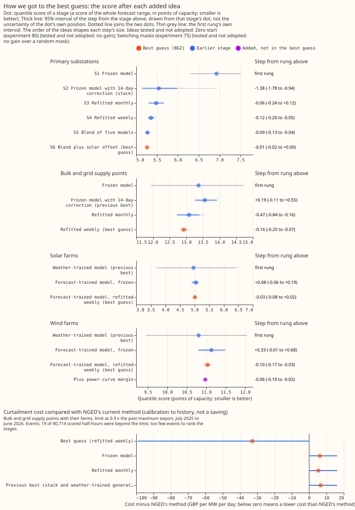

### 00081: do the weekly-retraining findings hold on a second set of forecast runs?

**Weekly retraining of the Primary demand model beat the stack again, by 0.24 points of capacity, on
274 runs from 2023-07 to 2024-03 for which the project holds only the control member of the ECMWF
ensemble (ENS).** The
experiment scored 13 Primary substations and repeated experiment 48's and 49's contrasts. The
verdict is supported. The Christmas column and the 2-year half-life stayed unresolved over the whole
fold, but dropping the Christmas column raised the error by 1.2 points inside the Christmas window.

- **Headline result:** weekly minus the stack -0.240 points (99.17% interval -0.360 to -0.145);
  weekly minus monthly -0.039 (-0.064 to -0.012); blend minus weekly -0.038 (-0.070 to -0.007),
  short of the -0.05 threshold.
- **Finding for later experiments:** without D8, D12, and D5, weekly minus the stack is -0.093
  (95% -0.189 to -0.014). An all-18 km fold had the same signs for the first four contrasts, with
  intervals that include zero.
  Neither fold separates retraining from adapting to the 9 km weather product.
- **Write-up and pull request:** [result](00081-r11-control-member-second-validation-year-demand/result.md),
  [PR #1313 (Experiment 81: do the weekly-retraining findings hold on July-to-March forecast
  runs the project has not scored?)](https://github.com/openclimatefix/nged-substation-forecast/pull/1313).

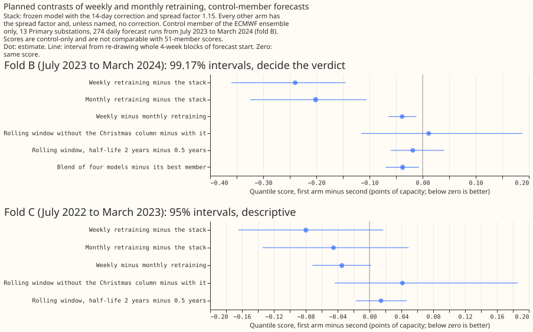

### 00001: ERA5-trained stage 1a against ENS-trained, for solar and wind

**Stage 1a trained on ERA5 forecasts solar and wind power better than the same columns trained on
ENS weather, up to a lead of 6 days.** The experiment applied an XGBoost model trained on ERA5 and
CAMS to each of the 51 ENS members, averaged the members, and compared the mean absolute error with
an ENS-trained model. It used 6 solar farms and 3 wind farms on one held-out year (53 weekly runs,
row set `fold_a_tuesdays_v1`).

- **Headline result:** the error fell by 1.70 points of capacity for wind (interval −2.33 to −1.08)
  and 0.57 for solar (−0.83 to −0.32). Beyond day 6 the gain is not material.
- **The gain comes from training on ERA5 weather,** not from the length of the history: a model
  trained on only the ENS months had the same error.
- **A likely reason (not tested directly):** a model trained on forecast weather learns the
  forecast's errors, which flattens the weather-to-power curve, most of all for wind, where power
  rises steeply with wind speed. A model trained on ERA5 learns the sharper curve.
- **Wind peaks gain most.** In the top decile of observed wind power the gain is 6.14 points.
- **A flaw in the first run:** the production-recipe control memorised calendar position, which
  inflated the first result by 1.13 points for solar and 3.40 for wind. Every arm now omits calendar
  columns, and every later experiment includes a climatology row.
- **Write-up and pull request:** [result](00001-era5-trained-stage1a-vs-ens-trained/result.md),
  [PR #1184 (Study: stage 1 pilot, an ERA5-trained weather-to-power model against the ENS-trained
  control)](https://github.com/openclimatefix/nged-substation-forecast/pull/1184).

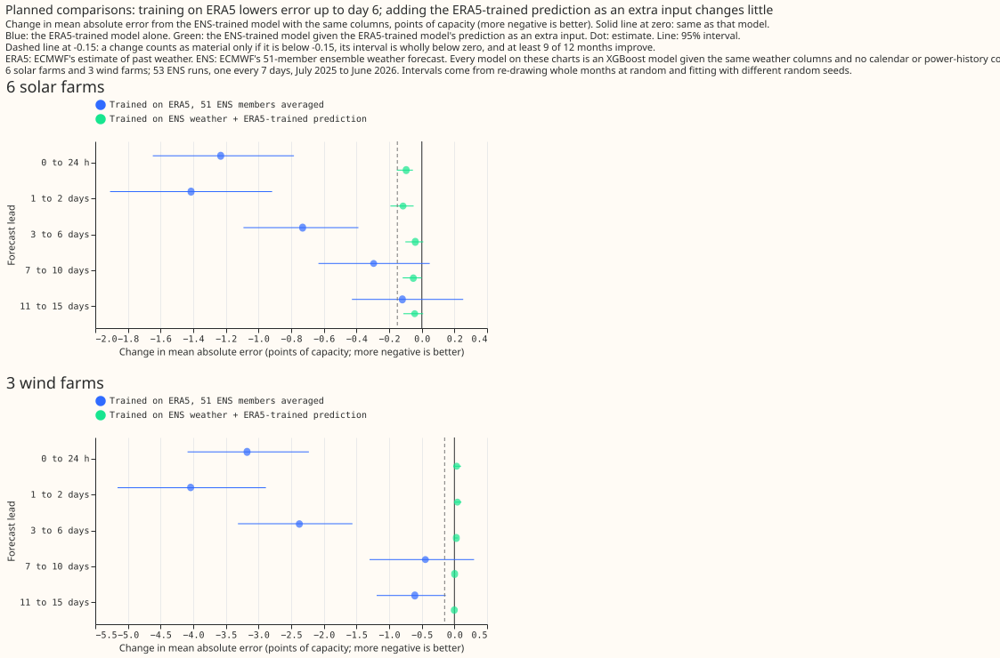

### 00002: a stage 2 calibrator against the pooled stage 1a mixture

**Pooling the ERA5-trained stage 1a quantiles over the ENS members beats an ENS-trained quantile
model, and a stage 2 calibrator with a learned blend did not improve on the pooled mixture.** The
experiment scored the continuous ranked probability score (CRPS) on the same 9 generator series.

- **Headline result:** the pooled mixture beat the ENS-trained quantile model by 0.62 points of
  capacity for wind (−0.99 to −0.26) and 0.24 for solar (−0.36 to −0.06). Stage 2 against the
  mixture was not material (solar +0.40, wind +0.26).
- **Training on the long ERA5 history** changed the CRPS by only 0.01 to 0.09 points against
  training on the ENS months.
- **A likely reason stage 2 did not help:** it had little to correct. The mixture is already close
  to calibrated for one product, and the calibrator was trained on about 15 months of ENS data for 9
  series.
- **What the test did not stress:** it used one weather product and no lagged power, so it did not
  test the two jobs stage 2 is meant to do.
- **Write-up and pull request:**
  [result](00002-stage2-calibrator-and-mixture-vs-ens-quantile/result.md),
  [PR #1189 (Stage 2 pilot: shared calibrator and learned blend against the pooled stage 1a
  mixture)](https://github.com/openclimatefix/nged-substation-forecast/pull/1189).

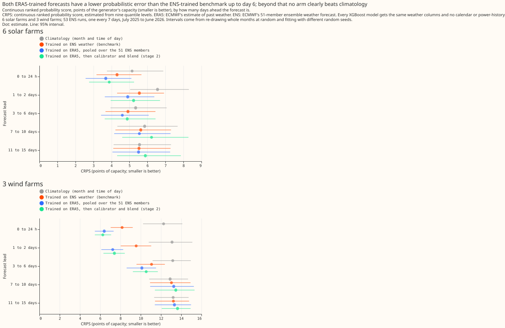

### 00003: ERA5-trained stage 1a against ENS-trained, for demand series

**For demand series, the ERA5-trained model forecasts worse than the ENS-trained model.** The
experiment repeated 00001 on 22 series that are not wind or solar farms, on a new row set of 73 runs
(every fifth day) so that every weekday is represented in every lead band.

- **Headline result:** with weather only, the ERA5-trained error is larger by 1.37 points of
  capacity
  (+0.68 to +2.17). With calendar columns and lagged power the two are equal (+0.10, −0.26 to
  +0.50).
- **The likely cause is drift:** the error falls steadily as the training start moves later, from
  2019
  to 2023, which suggests that the customer mix and the embedded generation changed.
- **Write-up and pull request:**
  [result](00003-era5-trained-stage1a-vs-ens-trained-demand/result.md),
  [PR #1192 (Experiment 00003: ERA5-trained stage 1a against ENS-trained, for demand
  series)](https://github.com/openclimatefix/nged-substation-forecast/pull/1192).

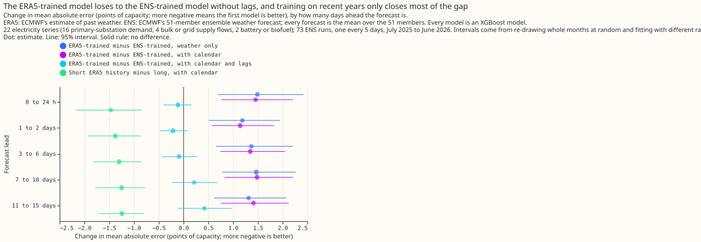

### 00005: where lagged power enters a two-stage demand forecast

**For Primary substations, recent power helps more in the stage 2 calibrator than in stage 1b.** The
experiment gave both placements identical inputs and calibrated both, on 20 substation series and
the 73 runs of the validation year. Every lagged arm is a ceiling, because the recent residuals use
ERA5 weather at past times.

- **Headline result:** the primary contrast, stage 1b with a calibrator minus the calibrator with
  lags, was +0.84 points of capacity for leads up to 48 hours (99% interval +0.28 to +1.50, 9 of 12
  months favouring the calibrator). Lagged power in the calibrator scored 5.31 against 6.14 for
  stage 1b and 7.11 for no lags. Using both placements lowered the quantile score by at most 0.12
  points.
- **Finding for later experiments:** a lag-free calibrator lowered the quantile score by about 1
  point of capacity at short leads and raised the median's error. Stage 1a alone scored no better
  than day-type climatology. The grid supply points' error is dominated by drift.
- **Write-up and pull request:** [result](00005-lag-placement-stage1b-vs-stage2-demand/result.md),
  [PR #1195 (Experiment 5: where lagged power enters a two-stage demand
  forecast)](https://github.com/openclimatefix/nged-substation-forecast/pull/1195).

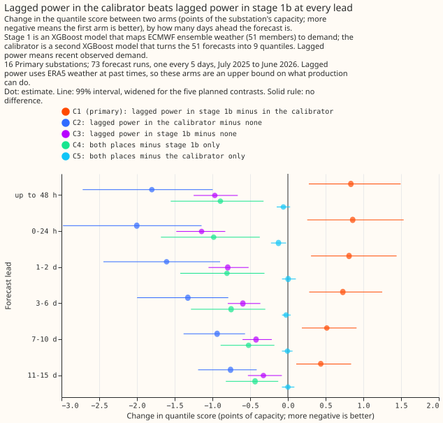

### 00006: which inputs work best for the ERA5-trained demand model (stage 1a)

**The clock is the largest single input for Primary substations, but it lowers the error by only
about 0.5 points of capacity, and the choice of training window matters as much.** The experiment
trained one XGBoost model per substation on ERA5 weather and scored held-out ERA5 months (it does
not
forecast), for 14 scored Primary substations, two bulk supply points, and two grid supply points.
It chose inputs on 2024-07 to 2025-06 and scored them once on 2025-07 to 2026-06.

- **Headline result:** hour and weekday lower the Primary error by 0.55 points (99.4% interval
  -0.71 to -0.41) on the selection year and 0.46 (-0.61 to -0.30) on the confirmation year, against
  1.5 predicted. The chosen Primary set adds a COVID indicator and the days to Christmas, which
  lowers the error by a further 0.29 on the confirmation year, supported at 95% and not at the
  planned level, and the Christmas column gains little over a year and a lot at Christmas, where it
  lowers the Primary error by 1.62 points over 15 December to 7 January. For grid supply points the
  COVID indicator beats the clock.
- **Training history and lockdown handling matter about as much as any column:** recency weights
  lower the confirmation-year error by 0.46 more. A 2023-09 start lowers it by 0.86 more, but it
  did not help on the selection year and needs a fresh year before anyone adopts it.
- **Time of year adds nothing, because the weather block already carries the season.** Windchill
  changes the error by less than 0.01 points, and trailing temperature means do not help.
- **Different substation types need different sets:** bulk supply points gain from holiday flags,
  and grid supply points gain from the COVID indicator, and have errors about four times larger.
- **Write-up and pull request:** [result](00006-stage1a-demand-input-feature-sweep/result.md),
  [PR #1202 (Experiment 00006: which input features work best for the ERA5-trained demand
  model)](https://github.com/openclimatefix/nged-substation-forecast/pull/1202).

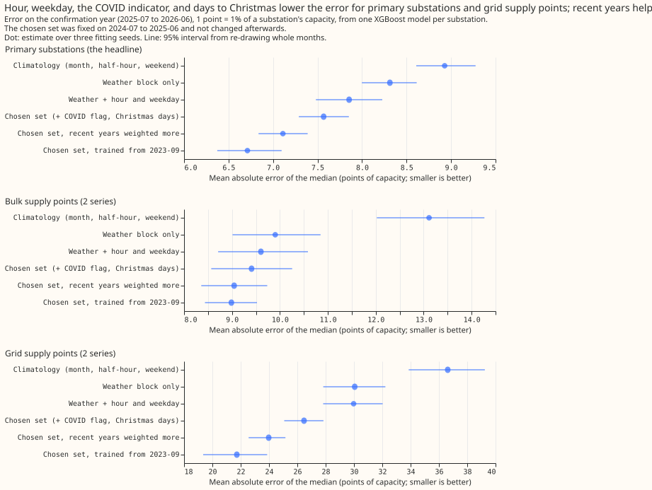

### 00012: inputs and training start for the solar and wind stage 1a model

**No input change lowered the solar or wind error by the 0.15 points the plan counted as a gain.**
The experiment tested a CAMS-trained model, a stage 0 model that calibrates ENS irradiance to CAMS,
a
clear-sky-ratio target (solar), a power-curve base margin (wind), a smaller weather block, and two
later training starts, on 6 solar farms and 3 wind farms (row set `fold_a_tuesdays_v1`).

- **Headline result:** CAMS-trained minus ERA5-trained for solar is -0.140 points of capacity (99.5%
  interval -0.277 to -0.044), largest within 24 h at -0.35. The stage 0 model made the 51-member
  average 0.160 higher (-0.017 to +0.382), although it improved the control member alone from
  8.34 to 7.82. The clear-sky-ratio target (-0.048) and the base margin (-0.030) were equivalent to
  the benchmark.
- **Finding for later experiments:** training starts in 2023-09 and 2024-04 were within 0.3 points
  of 2019-09 for solar and wind, and a gain of 0.15 points is not ruled out.
- **Write-up and pull request:**
  [result](00012-solar-wind-stage1a-inputs-cams-and-training-start/result.md),
  [PR #1217 (Plan experiment 12: inputs and training start for the solar and wind stage 1a
  model)](https://github.com/openclimatefix/nged-substation-forecast/pull/1217).

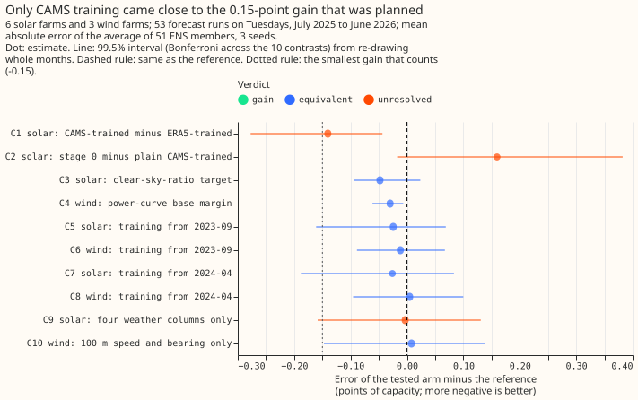

### 00021: the error correction on BSP and GSP demand, and its variants

**The 14-day error correction did not lower the BSP and GSP quantile score, and no variant beat the
plain 14-day additive form.** The experiment post-processed N1's stored forecasts with power that is
2 days old, on 73 forecast runs with ENS weather.

- **Headline result:** the correction minus N1 on the 4 BSP and GSP series was +0.36 points of
  capacity over all leads (99.375% interval -0.19 to +0.98). On the 16 Primary substations it was
  -0.99 (-1.82 to -0.18), the same as with power 3.5 hours old.
- **Absolute scores (all leads, BSP and GSP):** N1 13.66, corrected 14.02, `manual_heuristic` 14.70,
  `climatology` 15.11.
- **Variants (Primary, minus the 14-day additive form):** 7-day window +0.19, 28-day window -0.07
  (-0.15 to +0.01), multiplicative +2.28, per-half-hour +0.02, recency-weighted +0.04.
- **Finding for later experiments:** N1's BSP series have no bias (+0.01), so a bias correction has
  nothing to remove there; the GSP series are biased low by 5.2 points, the correction removes 3.2,
  and the score still does not improve.
- **Write-up and pull request:** [result](00021-error-correction-variants-bsp-gsp-demand/result.md),
  [PR #1228 (Experiment 21: which error correction works best, and does it help BSP and GSP
  demand?)](https://github.com/openclimatefix/nged-substation-forecast/pull/1228).

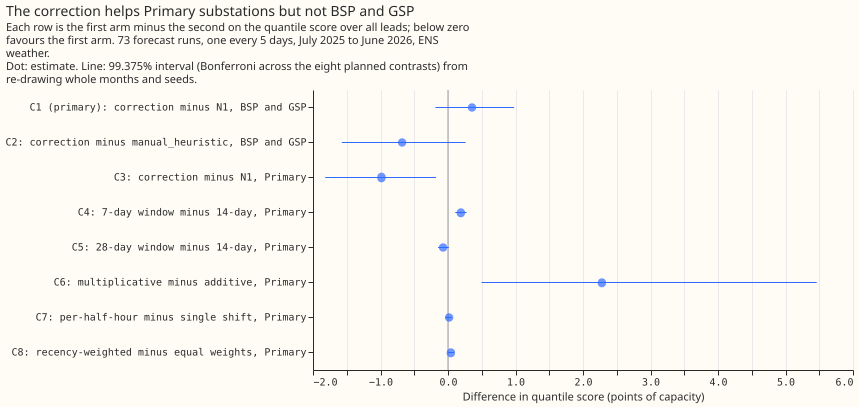

### 00022: the weather ceiling for Primary demand

**ERA5 weather in place of ENS weather at serving time lowered the Primary demand quantile score by
only 0.10 points, so better weather products have little to offer Primary demand.** The experiment
used experiment 19's full stack on the 16 Primary substations and 73 forecast runs. ERA5 arrives
about 5 days late, so the arm is a ceiling and no serving system could use it.

- **Headline result:** the all-variable ERA5 arm minus the ENS arm was -0.10 points of capacity over
  all leads (99.38% interval -0.16 to -0.04); the ENS arm scored 5.32 and the ERA5 arm 5.22.
- **By variable:** shortwave radiation alone gave -0.08 (-0.13 to -0.04); temperature gave -0.01
  (-0.04 to +0.01).
- **By lead:** the gain was -0.08 at 3 to 6 days and -0.15 at 11 to 15 days, and ERA5 was slightly
  worse (+0.03) under 24 hours.
- **Finding for later experiments:** if a second weather product is tried for Primary demand, test
  its shortwave radiation first.
- **Write-up and pull request:** [result](00022-era5-weather-ceiling-primary-demand/result.md), [PR
  #1227 (Experiment 22: how much would Primary demand gain from ERA5 weather in place of ENS
  weather?)](https://github.com/openclimatefix/nged-substation-forecast/pull/1227).

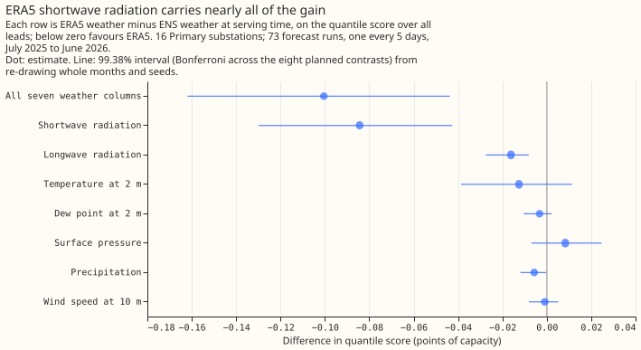

### 00025: price-change features for stage 1 demand

**Adding the change in the half-hourly price to the price level lowered the Primary demand error by
only 0.04 to 0.05 points, and national demand and wind scored 0.22 and 0.40 points below the price
change arm.** The experiment
trained the ERA5 stage 1 model with the price at the target half-hour and its changes over 1, 2, 4,
and 12 half-hours. The price is known only after the half-hour, so no score is a forecast skill.

- **Headline result:** changes minus level only was -0.037 points of capacity (97.5% interval
  -0.056 to -0.018) in the selection year and -0.050 (-0.083 to -0.018) in the confirmation year;
  changes minus other-week changes was -0.039 and -0.047. The pre-registered threshold was 0.1.
- **Comparison arms:** national demand and wind scored 0.22 and 0.40 points below the price change
  arm, and the price level alone was 0.10 worse than no price in the confirmation year (the
  interval includes zero).
- **BSP and GSP:** the four series show no consistent sign.
- **Finding for later experiments:** try national demand and wind before any price column, and keep
  a control with the real price level and other-week changes.
- **Write-up and pull request:** [result](00025-price-change-features-stage1-demand/result.md), [PR
  #1231 (Experiment 25: does the change in the intra-day price help a stage 1 demand model explain
  power?)](https://github.com/openclimatefix/nged-substation-forecast/pull/1231).

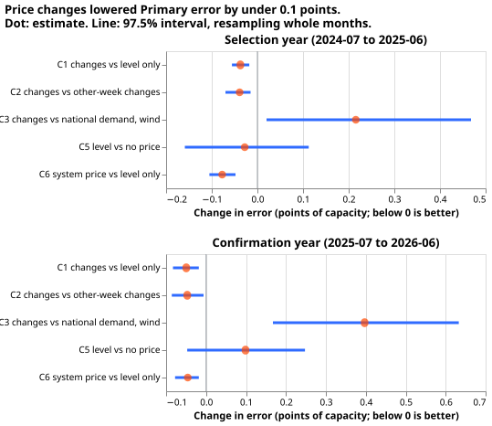

### 00029: a differentiable physics stage 1 for the solar farms

**Fitted PV physics did not beat the XGBoost stage 1 for the 6 solar farms, and added nothing when
given to it as a column.** The experiment fitted a PyTorch PV model with priors on tilt, azimuth, DC
capacity, and the AC-to-DC ratio to each farm's metered power, ran it on every ENS member, and
passed its output to a per-farm XGBoost quantile layer (row set `fold_a_tuesdays_v1`).

- **Headline result:** the PyTorch physics stage 1 minus the XGBoost stage 1 is +0.079 points of
  capacity (98.75% interval +0.029 to +0.135), and the hybrid (physics plus the nine weather
  columns) is -0.000 (-0.015 to +0.018). The XGBoost stage 1 scores 5.026.
- **Finding for later experiments:** the physics point forecast has a member-average mean absolute
  error of 7.53, against 7.64 for the XGBoost stage 1a of experiment 00012 (a descriptive
  comparison), so physics is a candidate for interpretation and checks of a farm's orientation, not
  for the quantile pipeline. The fitted
  tilts (18 to 35 degrees) and azimuths (within 1.3 degrees of south) are plausible. A synthetic
  test recovers parameters well only when the data come from the fitted chain: a different sky
  model gave a +6.2 degree tilt bias.
- **Write-up and pull request:** [result](00029-physics-stage1-solar-pytorch/result.md), [PR #1236
  (Experiment 29: does a differentiable physics stage 1 beat the XGBoost stage 1 for solar
  farms?)](https://github.com/openclimatefix/nged-substation-forecast/pull/1236).

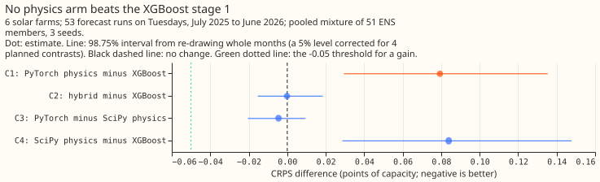

### 00031: embedded solar capacity features for Primary demand

**None of the capacity features lowered the all-lead quantile score of Primary demand forecasts.**
The arms gave N1 trailing estimates of each substation's embedded solar capacity (from recent power,
irradiance, and the Embedded Capacity Register) as columns, a linear offset, or a sunshine-shaped
correction (row set `fold_a_every5d_v1`, 16 Primary substations).

- **Headline result:** quantile score, in points of capacity, against the 00019 stack without its
  half-life. Register-based PV products (A3) +0.006 (99.17% interval -0.022 to +0.033); the shaped
  correction (A5) +0.016 (-0.069 to +0.100); the capacity statistics as columns +0.167 (+0.091 to
  +0.243), a loss in all 12 months.
- **Finding for later experiments:** in 95% breakdowns the shaped correction lowers the score by
  0.37 in sunny daylight (-0.51 to -0.25) and raises it by 0.68 under heavy cloud; a possible cause,
  untested, is ENS irradiance that is biased against CAMS, so calibrate ENS to CAMS first. True
  PV_Live generation lowers the score by 0.82 at the 2 GSPs (-1.06 to -0.55).
- **Cut for time:** the no-fit physics baseline and the post hoc tweak were not run.
- **Write-up and pull request:** [result](00031-embedded-pv-features-primary-demand/result.md),
  [PR #1239 (Experiment 31: do embedded-solar capacity features lower the error of Primary demand forecasts?)](https://github.com/openclimatefix/nged-substation-forecast/pull/1239).

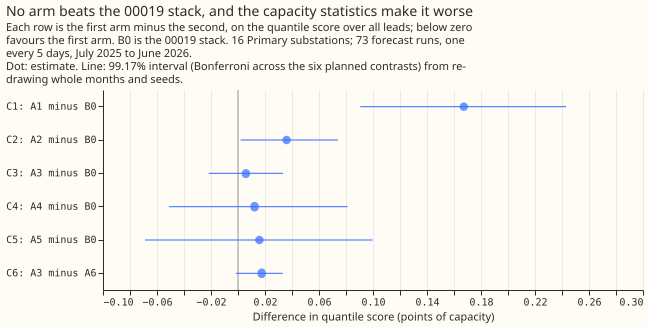

### What the experiments taught us so far

- **A 14-day error correction put N1 below `manual_heuristic` for Primary demand.** The correction
  lowered the quantile score by 0.99 points on N1, a model frozen at its training end, and the
  0.5-year
  half-life added nothing to that frozen model (00019).
- **Use the 14-day additive error correction for Primary demand, with power 2 days old, and do not
  yet use it for BSP and GSP.** It scored the same with 2-day-old power as with 3.5-hour-old power,
  a 7-day window and a ratio form were worse, and on 4 BSP and GSP series it did not lower the
  quantile score (00021).
- **A weather product as accurate as ERA5 would lower the Primary demand score by 1.9%.** ERA5
  weather
  in place of ENS weather lowered the quantile score by 0.10 points, nearly all from shortwave
  radiation and none up to 2 days ahead (00022).
- **Check for calendar memorisation.** When the same valid time repeats across many ENS runs, a
  model
  with calendar columns can memorise it. Give each experiment a climatology row, and group folds by
  valid time.
- **Choose a row set that covers every weekday.** The 53 Tuesday runs of 00001 and 00002 put every
  case of the first day on a Tuesday or Wednesday, which does not suit demand.
- **Training on ERA5 weather helps solar and wind, but a longer history does not add to it, and for
  demand a long history hurt.** The solar and wind gain appeared even when the ERA5-trained model
  saw only the ENS-era months, so the gain comes from the weather it was trained on and not from the
  years. For demand, training from 2019 was worse than training from 2023, probably because the
  customer mix and embedded generation drifted.
- **Put recent power in the stage 2 calibrator, and calibrate before judging it.** For Primary
  substations, the calibrator with recent-origin inputs beat a stage 1b correction, and a lag-free
  calibrator is worth about 1 point of capacity at short leads (00005).
- **The term and return-to-work columns showed no detectable gain on top of the Christmas column for
  Primary demand.** Over the three validation years, the return and term columns moved the Primary
  error by +0.06 points from 2 to 20 January (99.2% interval -0.17 to +0.30), +0.20 at Easter (-0.19
  to +0.59), and -0.29 over the half terms (-0.68 to +0.07), and Both was not 0.2 points better than
  a calendar shifted by 17 days (00011). The arm with the full history and the COVID indicator
  scored 0.26 points higher on the whole year than the base arm.
- **A change that helps the point forecast of solar or wind need not help the pooled mixture's
  CRPS.** CAMS-trained solar lowered the member-average error by 0.14 points (00012) and the
  mixture's CRPS by 0.009 (00020), and a stage 0 mapping widened the member spread by a quarter. A
  power-curve base margin lowered the wind CRPS by 0.055 (00020).
- **Attach the forecast solar term to the XGBoost model as a base margin, with a weight fitted on
  the training window and zero beyond 10 days.** The base-margin arm lowered the Primary demand
  quantile score by 0.152 points (98.75% interval -0.199 to -0.111) against the best guess `d0` and
  0.256 against `d1l`, where the fixed-coefficient shift of 00046 lowered `d1l` by 0.056, and
  subtracting the forecast solar from a model trained on gross demand was not shown to match the
  best guess (00064).
- **Do not expect a zero start to help the production XGBoost models.** Experiment 78 found that a
  zero base margin lowered its reference model `d0` by 0.071 points, but on the production recipe
  the zero start changed the Primary score by -0.017 (-0.072 to +0.054) and the solar score by
  -0.010 (-0.036 to +0.028), and worsened wind models without a power-curve margin by 0.049 (00080).
- **Refresh the capacity table that feeds the base margin once per season-year.** A table
  refreshed that often captured almost all of the gain from a current capacity (00078).

### 00007: does a static CAMS correction remove the stage 1a daytime residual?

**The cheap first test for P2 and P4 was inconclusive.** A correction with fixed coefficients on
ERA5 shortwave and CAMS irradiance, fitted per substation on 2024-07 to 2025-06 and scored on
2025-07 to 2026-06, removed 46.6% of the daylight squared residual at 13 Primary substations
(98.33% interval 38.4% to 53.1%), just under the planned 50%. A fixed daytime shift alone removed
39.1%, CAMS given ERA5 added a partial R squared of 0.11 (0.08 to 0.13), and the stability ratio was
0.84. One substation sets the pooled figure: without it the share is 18.2%. A CAMS-trained stage 1a
(the second stage of P2) is worth its own test, and the slope statistics of P2 wait for it. See
[`result.md`](00007-cams-static-correction-stage1a-residual/result.md) and [PR #1210 (Experiment 7:
does a static CAMS correction remove the stage 1a daytime
residual?)](https://github.com/openclimatefix/nged-substation-forecast/pull/1210).

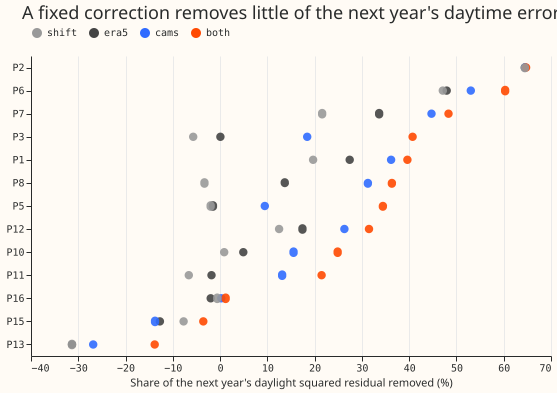

### 00008: summaries of recent power in the stage 2 calibrator

**Adding the minimum, mean, and maximum of the last 24 hours and of the same weekday to the
calibrator with raw lags changed the score by no resolvable amount.** The experiment reused 00005's
stage 1 statistics on the same 73 runs, and every arm with ERA5 residuals is a ceiling.

- **Headline result:** C1 (summaries added to L3) was -0.02 points of capacity for leads up to 48
  hours (98.75% interval -0.14 to +0.13). Replacing the raw power lags with summaries was worse
  (+0.29).
- **Finding for later experiments:** summaries alone, without ERA5 residuals, scored 1.18 points
  better than no recent power up to 48 hours. They are available at forecast time, but the stage 1
  statistics beneath them come from an ERA5-trained stage 1a.
- **Write-up and pull request:**
  [result](00008-lag-summaries-in-stage2-calibrator-demand/result.md),
  [PR #1209 (Experiment 00008: summaries of recent power in the stage 2
  calibrator)](https://github.com/openclimatefix/nged-substation-forecast/pull/1209).

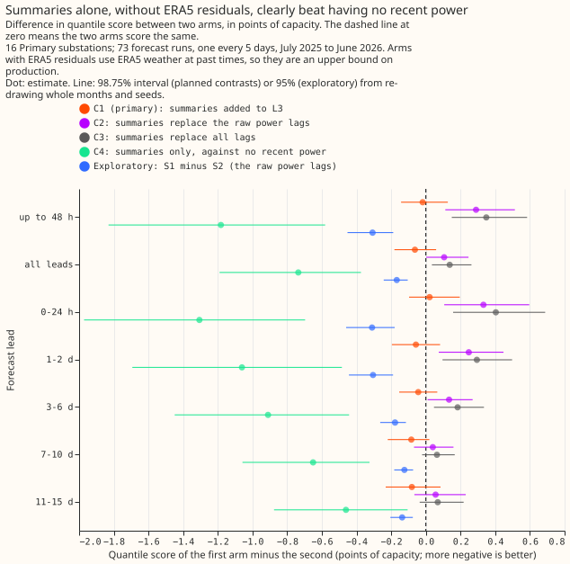

### 00009: a stage 1a trained on CAMS irradiance, for demand

**Training stage 1a on CAMS irradiance in place of ERA5 shortwave lowered the Primary quantile score
by 0.035 points of capacity, a sixth of the 0.2 points the plan required.** The contrast over all
leads at the 16 Primary substations is -0.035 (97.5% interval -0.070 to +0.001), and -0.043 (-0.081
to -0.004) without the substation that set experiment 00007's pooled figure. The score falls by 0.07
to 0.08 points in the first 2 days, no gain is resolved from day 7, and the gain appears in daylight
only. At the observed weather, where the CAMS-trained arm also reads CAMS, the daylight error of the
median falls by 0.88 points, so the smaller gain at ENS is probably a mismatch at application: the
ENS members' shortwave averages 7% above ERA5's, which this experiment did not test. The paired
interval was far narrower than the plan guessed (0.035 points either side, not 0.2). See
[`result.md`](00009-cams-trained-stage1a-vs-era5-trained-demand/result.md) and [PR #1213 (Experiment
9: does a stage 1a trained on CAMS irradiance beat one trained on ERA5
shortwave?)](https://github.com/openclimatefix/nged-substation-forecast/pull/1213).

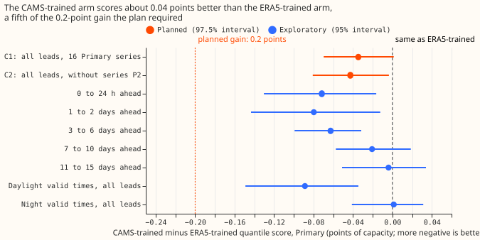

### 00013: Primary substation demand against the stored baselines

**The upgraded single-stage model N1 did not beat `manual_heuristic`, and the production recipe
trails
`manual_heuristic` by 1.69 points of capacity at every lead.** The experiment scored
`manual_heuristic`,
`climatology`, the production recipe, a stage 1 trained on ERA5, and N1 (an XGBoost quantile model
trained on the ENS control member, with lagged power measured from the forecast origin) on the 16
Primary substations and the 73 runs of `fold_a_every5d_v1`.

- **Headline result:** N1 minus `manual_heuristic` was +0.22 points of capacity over all leads (99%
  interval -0.54 to +0.97) and -0.57 up to 48 hours (-1.33 to +0.27) in the mean absolute error of
  the
  median. The production recipe minus `manual_heuristic` was +1.69 (+0.98 to +2.59).
- **Absolute scores (all leads):** `manual_heuristic` 8.23, N1 8.45, production 9.92, `climatology`
  10.33 points of capacity.
- **Why the production recipe loses:** about 0.6 points is a level offset (every arm forecast the
  validation year 2 to 3 points too low, `manual_heuristic` by 1.3), and the rest matches the lack
  of
  recent power, which lagged power from the origin recovers (1.15 points, C4).
- **Finding for later experiments:** compare Primary arms against `manual_heuristic`, and test a
  drift correction in P8.
- **Write-up and pull request:** [result](00013-primary-demand-against-stored-baselines/result.md),
  [PR #1218 (Experiment 13: Primary substation demand against the stored
  baselines)](https://github.com/openclimatefix/nged-substation-forecast/pull/1218).

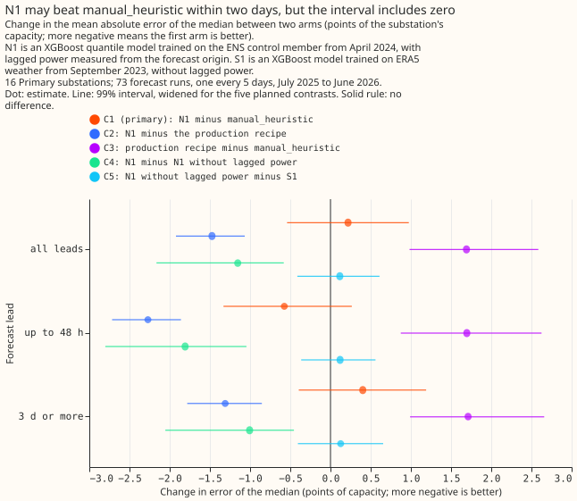

### 00020: stacking the candidate changes for solar and wind

**For wind, a power-curve base margin and a spread factor together lower the pooled mixture's CRPS
by 0.071 points of capacity, and the base margin carries the gain; for solar, nothing helped.** The
experiment stacked a CAMS-trained stage 1a, a stage 0 quantile mapping, the base margin (wind only),
and the spread factor against the production recipe's pooled ERA5-trained mixture, and dropped each
component in turn, for 6 solar farms and 3 wind farms (row set `fold_a_tuesdays_v1`).

- **Headline result:** wind full stack minus recipe, -0.071 (99.58% interval -0.133 to -0.014);
  solar
  full stack minus the production recipe, +0.035 (-0.075 to +0.116).
- **Components:** the wind base margin alone gives -0.055 (-0.110 to -0.007). For solar,
  CAMS-trained
  gives -0.009, stage 0 +0.036, and the spread factor +0.006, each with an interval that includes
  zero.
- **Finding for later experiments:** the stage 0 quantile mapping widens the member spread by about
  a
  quarter and leaves monthly ratios to CAMS from 0.83 to 1.10, and it did not lower the solar CRPS
  in this experiment.
- **Write-up and pull request:**
  [result](00020-solar-wind-stack-cams-stage0-spread-margin/result.md),
  [PR #1226 (Experiment 20: do the candidate changes for solar and wind add up to a better pooled
  mixture?)](https://github.com/openclimatefix/nged-substation-forecast/pull/1226).

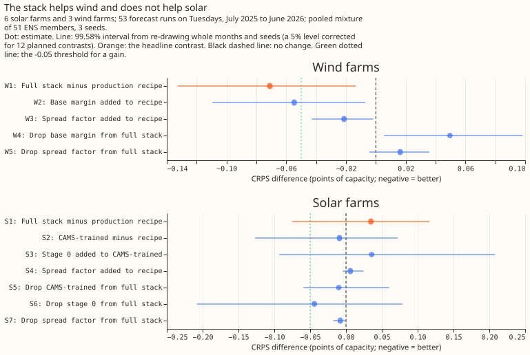

### 00018: the staged chain against the single-stage model for Primary demand

**The staged chain, built only from weather that serving has and with NGED's real telemetry delay,
had a quantile score not distinguishable from N1's and a point estimate above
`manual_heuristic`'s.** The experiment gave the stage 2 calibrator lag anomalies from ERA5T, CAMS,
and the ENS control member's early leads, with the newest usable power 7 hours before the 09:00 UTC
origin.

- **Headline result:** the chain minus N1 was +0.08 points of capacity over all leads (99.17%
  interval -0.11 to +0.25), -0.27 up to 48 hours (-0.62 to +0.03). The chain minus
  `manual_heuristic` was +0.52 (-0.25 to +1.25).
- **Absolute scores (all leads):** `manual_heuristic` 5.89, N1 6.33, chain 6.41.
- **What the serving sources cost:** 0.13 points against final ERA5, and 3.5 more hours of telemetry
  delay cost another 0.13. Lag anomalies lowered the score by 0.04 against raw lagged power.
- **Finding for later experiments:** a spread factor of 1.15 lifts the 5% to 95% coverage from 86%
  to 90%, and every arm under-forecast the validation year by 1.3 to 3.5 points.
- **Write-up and pull request:**
  [result](00018-staged-chain-vs-n1-serving-latency-lag-anomalies-demand/result.md),
  [PR #1224 (Experiment 18: does the staged chain beat the single-stage model for Primary
  substation demand?)](https://github.com/openclimatefix/nged-substation-forecast/pull/1224).

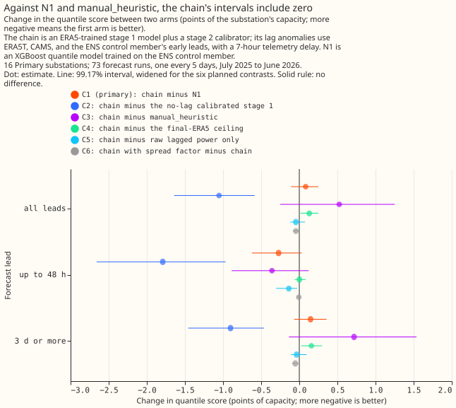

### 00014: a stage 0 for the CAMS-trained demand model

**Mapping the ENS shortwave onto CAMS lowered the Primary quantile score of the CAMS-trained stage
1a by 0.067 points of capacity, but the verdict is inconclusive.** The contrast over all leads at
the 16 Primary substations is -0.067 (97.5% interval -0.094 to -0.039), in 12 of 12 months and
entirely in daylight, so the CAMS-trained arm with stage 0 is 0.102 points better than the
ERA5-trained arm. The pre-registered rule also required the corrected shortwave to stay within 5%
of CAMS in every month, and it was up to 18.6% off in December although the year's mean matched
(ratio 1.000). The gain is smallest in the first day, whose interval reaches zero. The mapping
widened the member spread by 27%, against a predicted 10%, and a post hoc monthly mapping did no
better. See [`result.md`](00014-cams-trained-stage1-with-stage0-ens-correction-demand/result.md) and
[PR #1219 (Experiment 14: does a stage 0 that maps ENS irradiance onto CAMS help the CAMS-trained
demand
model?)](https://github.com/openclimatefix/nged-substation-forecast/pull/1219).

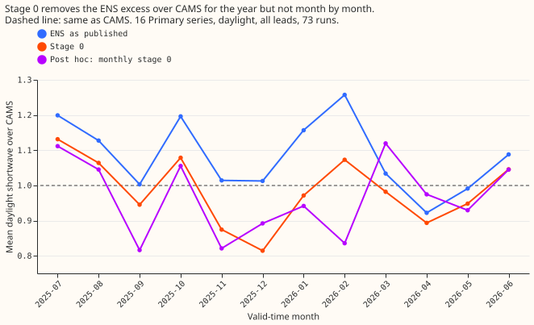

### 00010: the lagged electricity price in the stage 1a demand model

**Adding the Elexon price from 7 days earlier to the ERA5-trained demand model did not reliably
help at the substation hosting the largest battery, and the experiment could not test a battery
response.** The
price is Elexon's Market Index Data (the `APXMIDP` half-hourly index, free, 98.5% of half-hours
covered from 2019). The comparison arms were demand and wind at the same lag, and a price taken from
an earlier week.

- **Headline result:** at B2, the only listed series with enough history in the selection year, the
  price lowered the error by 0.92 points of capacity (98.3% interval -2.10 to +0.07), and by 0.06
  (-0.38 to +0.23) in the confirmation year. The pre-registered contrast C4, the gain at the listed
  series minus the gain at the others, was -0.55 (-1.43 to +0.20) and then +0.47 (+0.06 to +0.91),
  the wrong sign.
- **Finding for later experiments:** NGED's register lists battery storage of at least 5% of
  capacity at only 2 of the 20 series (B2 and P4), and P4 has too little history for the selection
  year, so this series set cannot test a battery response. The shuffled price from an earlier week
  gave about five sixths of the selection-year gain.
- **Write-up and pull request:** [result](00010-elexon-price-lags-stage1a-demand/result.md),
  [PR #1215 (Experiment 10: lagged electricity price in the stage 1a demand
  model)](https://github.com/openclimatefix/nged-substation-forecast/pull/1215).

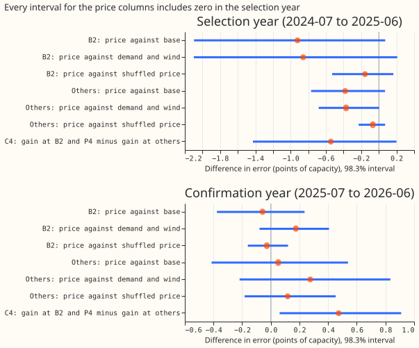

### 00011: school-term and return-to-work columns in the stage 1a demand model

**The return-to-work and school-term columns did not lower the Primary demand error after Christmas,
at Easter, or over the half-term holidays.** All 20 series lie in a box that is essentially
Lincolnshire, so the experiment used Lincolnshire County Council's recommended term calendar for
2021-22 to 2025-26, collected by hand and validated by script. The base arm was the XGBoost arm of
experiment 00006 with the 14-day Christmas column, trained from 2021-09-01.

- **Headline result:** for Primary substations, the return and term columns together changed the
  error by +0.06 points of capacity from 2 to 20 January (99.2% interval -0.17 to +0.30), +0.20 over
  Easter (-0.19 to +0.59), and -0.29 over the half terms (-0.68 to +0.07), against 7.18 for the base
  arm over the whole year. Both was not 0.2 points better than either calendar shifted by 17 days,
  so C6 failed, and C5 failed because its interval reaches -0.11.
- **Verdict wording:** the rule as pre-registered gives "refuted". Its refutation clause was looser
  than intended. Read as intended, the verdict is inconclusive for Easter and the half terms,
  because the data do not rule out a gain of 0.15 points there.
- **Finding for later experiments:** the base arm's Primary error averages 8.4 points from 2 to 20
  January, and the new columns change it by +0.06. The arm with the full history and the COVID
  indicator scored 0.26 points higher on the whole year than the base arm (99.2% interval 0.12 to
  0.43).
- **Write-up and pull request:**
  [result](00011-school-term-and-return-to-work-columns-stage1a-demand/result.md), [PR #1214
  (Experiment 11: school-term and return-to-work columns for the stage 1a demand
  model)](https://github.com/openclimatefix/nged-substation-forecast/pull/1214).

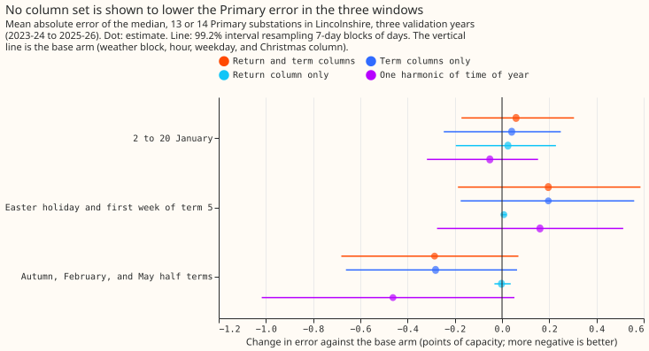

### 00017: training window, recency, and retraining rule for demand

**Question.** Does training the stage 1a demand model on recent rows, retraining it monthly, or
correcting it by its last 14 days of error lower the Primary substation demand error, as drift
suggests?

**Verdict: supported.** On 16 Primary substations, with monthly rolling origins from January 2022 to
June 2026 on ERA5 weather, all-history training retrained monthly scores 7.62 points of capacity.
The 14-day correction lowers it by 1.52 points (99.44% interval 1.13 to 1.95), a half-life of 0.5
years by 0.92 (0.64 to 1.22), and a 12-month window by 0.84 (0.53 to 1.19). Retraining yearly
instead
of monthly adds 0.52 points, and a model never retrained adds 3.80.

**What changes later experiments.** The bias of the all-history model runs from forecast too high
(2022 to 2025) to too low (2026), so a window change needs several years of rolling origins to be
judged. The correction stacks with a 0.5-year half-life (5.82 points, post hoc).

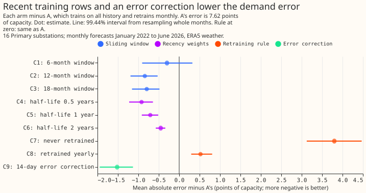

Details: [result.md](00017-training-window-and-retraining-rule-drift-demand/result.md),
[PR #1223](https://github.com/openclimatefix/nged-substation-forecast/pull/1223).

### 00016: calibration of the pooled mixture for solar and wind

**A scalar spread factor brings the pooled mixture's 5% to 95% band for solar from about 95% to
about 90% coverage, with no change in the CRPS.** The experiment corrected the pooled mixture of
00002's ERA5-trained stage 1a with a spread factor, a spread factor per lead band, a
location-and-scale calibrator, and a free quantile calibrator, each fitted on earlier validation
months, for 6 solar farms and 3 wind farms (row set `fold_a_tuesdays_v1`).

- **Headline result:** uncorrected solar covers 94.3% to 95.3% of non-trivial cases in every lead
  band, and `spread` gives 89.5% to 91.8% with a CRPS change of +0.006 points of capacity (99.4%
  interval -0.004 to +0.024).
- **Wind:** the uncorrected band covers 95.3% and 94.4% in the first two bands and about 90% after
  that. No planned arm brings the first two bands within 2.5 points of 90, and the fit per lead band
  existed for only 3 months of the first band. A post hoc spread factor on two lead groups
  does, with a CRPS change of -0.021 (-0.042 to -0.002), a small gain.
- **Finding for later experiments:** a location-and-scale calibrator per lead band undershoots
  90% in two wind bands (86.7% and 83.9%) and its CRPS interval is 0.36 points wide.
- **Write-up and pull request:** [result](00016-pooled-mixture-calibration-solar-wind/result.md),
  [PR #1221 (Experiment 16: calibration of the pooled mixture for solar and
  wind)](https://github.com/openclimatefix/nged-substation-forecast/pull/1221).

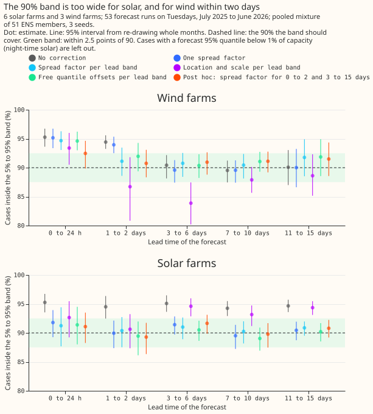

### 00019: stacking small gains on N1 for Primary demand

**Stacking a 14-day error correction, a recency half-life, and a spread factor on N1 beat
`manual_heuristic` on the quantile score, and the correction supplied nearly all of the gain.** The
experiment used the 16 Primary substations, ENS weather, and 73 forecast runs.

- **Headline result:** the stack minus `manual_heuristic` was -0.56 points of capacity over all
  leads
  (99.44% interval -0.93 to -0.26), and the stack minus N1 was -1.00 (-1.88 to -0.14).
- **Absolute scores (all leads):** stack 5.32, `manual_heuristic` 5.89, N1 6.33.
- **Components:** dropping the correction from the stack raised the score by 0.97 (+0.15 to +1.81);
  the 0.5-year half-life moved it by -0.01 (-0.03 to +0.02); dropping the spread factor raised it by
  0.03 (+0.005 to +0.05).
- **Finding for later experiments:** N1 forecast the validation year 2.6 points too low, and the
  correction cut that bias to 0.5. The correction was tested on forecasts 5 days apart and on a
  model
  that is never retrained.
- **Write-up and pull request:** [result](00019-primary-demand-stack-vs-manual-heuristic/result.md),
  [PR #1225 (Experiment 19: does stacking small gains beat manual_heuristic for Primary
  demand?)](https://github.com/openclimatefix/nged-substation-forecast/pull/1225).

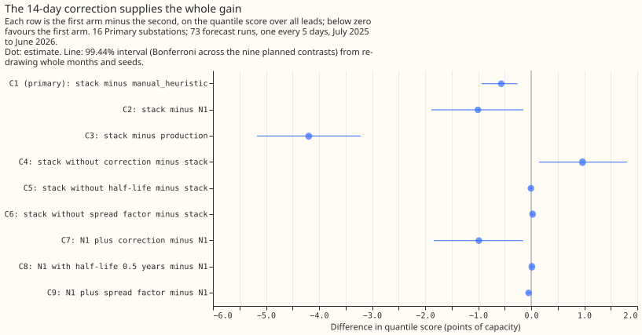

### 00015: the same-time electricity price in a stage 1 demand model

**The price at the same half-hour as the target lowered the pooled demand error in the selection
year, but a price from another week did almost as well, and the gain did not repeat in the
confirmation year.** The stage 1 demand model maps the observed price and ERA5 weather at time t to
power at time t
on 17 series (18 in the confirmation year), scored at observed values.

- **Headline result:** price against no price, pooled: -0.52 points of capacity (97.5% interval
  -0.88 to -0.11) in the selection year and -0.18 (-0.50 to +0.08) in the confirmation year. Price
  against a price from another week: -0.07 (-0.17 to +0.03) and -0.06 (-0.18 to +0.07).
- **Finding for later experiments:** national demand and wind at time t did no worse than the price
  in either year (pooled intervals include zero; 0.43 points lower in the confirmation year), so the
  price may be a proxy for national conditions. The gain was largest from 12:00 to 20:00 and at the
  series with the largest errors, and the other-week price reproduced most of it there.
- **Write-up and pull request:** [result](00015-same-time-price-stage1-demand/result.md), [PR #1220
  (Experiment 15: same-time price in a stage 1 demand
  model)](https://github.com/openclimatefix/nged-substation-forecast/pull/1220).

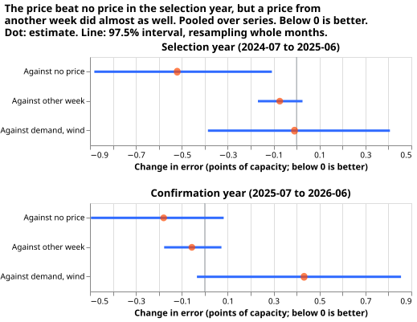

### 00023: recent observed power for solar and wind

**Recent power did not help the stage 2 calibrator for solar or wind, and a 14-day correction built
from the mean error made the forecast worse.** The experiment gave the calibrator lagged power and
summaries of the latest day for 6 solar farms and 3 wind farms, and shifted the pooled mixture by
its own mean error over the previous 14 days (row set `fold_a_tuesdays_v1`).

- **Headline result:** lagged power added to the calibrator, solar -0.012 (99.58% interval -0.122 to
  +0.088), wind +0.012 (-0.090 to +0.146). The 14-day correction on the mixture, solar +0.437
  (+0.215 to +0.664), wind +0.413 (-0.003 to +0.924).
- **Finding for later experiments:** a calibrator trained on the ENS control member alone scored
  0.27
  (solar) and 0.31 (wind) points worse than the pooled mixture before any lag was added. Shifting by
  the median error (post hoc) instead of the mean error moved the CRPS by +0.010 (solar) and -0.064
  (wind), both with intervals that include zero.
- **Write-up and pull request:**
  [result](00023-lagged-power-and-error-correction-solar-wind/result.md),
  [PR #1229 (Experiment 23: does recent observed power help solar and wind forecasts?)](https://github.com/openclimatefix/nged-substation-forecast/pull/1229).

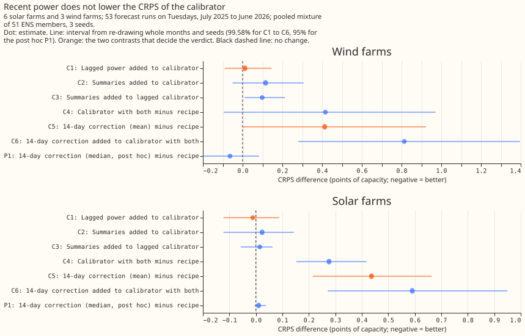

### 00026: effective-capacity features for solar and wind

**A trailing effective-capacity feature did not lower the CRPS detectably for solar or wind.** The
experiment added the 99th percentile of a farm's power at the 10% of steps with the most CAMS
irradiance (solar) or ERA5 100 m wind (wind) over the last 28 days, read with a 5-day cutoff, to the
stage 1a quantile models of 6 solar farms and 3 wind farms (row set `fold_a_tuesdays_v1`).

- **Headline result:** single feature minus no feature, solar -0.018 (98.75% interval -0.162 to
  +0.096), wind +0.013 (-0.054 to +0.101).
- **Finding for later experiments:** the single feature moved solar farm E's CRPS by -0.235
  points (its shuffled copy by -0.034) and raised it for solar farm A and wind farm W3. Adding the
  wind power-over-wind-cubed feature lowered the wind CRPS by 0.061 (-0.107 to -0.025), an
  exploratory contrast.
- **Write-up and pull request:**
  [result](00026-capacity-features-solar-wind/result.md),
  [PR #1233 (Experiment 26: does a recent effective-capacity feature
  lower the solar and wind forecast error?)](https://github.com/openclimatefix/nged-substation-forecast/pull/1233).

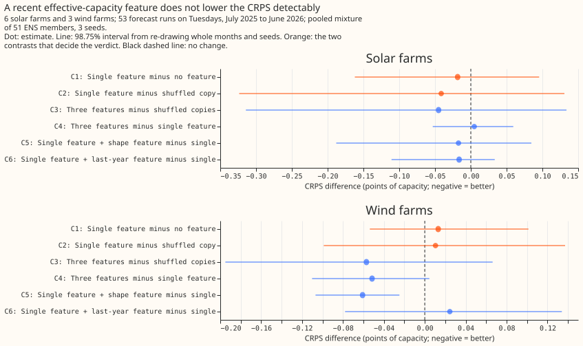

### 00027: PV_Live at the lag times for GSP demand

**PV_Live at the lag times did not help the stage 2 calibrator for the two grid supply points
(GSPs), Walpole and Bicker Fen.** The experiment gave the calibrator PV_Live's estimate of the GSP's
solar generation at the lag times, as a level, as a share of PV_Live's capacity, and added to the
lagged delta (row set `fold_a_every5d_v1`).

- **Headline result:** the quantile score of the arm with PV_Live minus the arm without, over all
  leads: delta plus PV_Live -0.03 (98.33% interval -0.13 to +0.09), PV_Live level -0.08 (-0.26 to
  +0.08), PV_Live share -0.06 (-0.22 to +0.09). The arm without PV_Live scores 19.04.
- **Finding for later experiments:** PV_Live at the valid time lowered stage 1a's point error at
  Bicker Fen by 1.28 points (-1.90 to -0.67) and not at Walpole (-0.03, -0.27 to +0.23), so a
  PV_Live
  forecast as a stage 1 input is the open question (exploratory; the valid-time value is not known
  at the forecast origin).
- **Write-up and pull request:** [result](00027-pvlive-lags-in-stage2-gsp-demand/result.md),
  [PR #1234 (Experiment 27: does PV_Live at the lag times help the stage 2 forecast of GSP demand?)](https://github.com/openclimatefix/nged-substation-forecast/pull/1234).

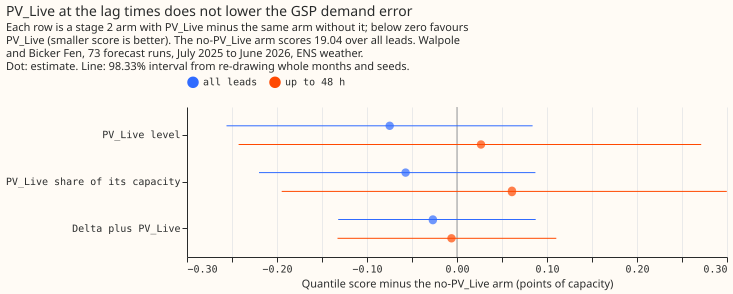

### 00030: lagged power columns for Primary demand

**Adding all 13 lags of `manual_heuristic` to N1 did not lower its quantile score, because the 7
annual analogues hurt and the 14-day correction removes the gain of the 6 weekly ones.** N1 is the
single-stage model; arms added weekly analogues, annual analogues, summaries, recent values, and
same-day-type analogues (row set `fold_a_every5d_v1`, 16 Primary substations).

- **Headline result:** quantile score, in points of capacity. C3, all 13 lags minus N1, -0.01
  (99.375% interval -0.45 to +0.43, seed 0). The weekly analogues alone, -0.30 (-0.63 to -0.02, 3
  seeds); the annual analogues on top, +0.29 (+0.13 to +0.49). With the correction N1 scores 5.34,
  and a post hoc arm with the weekly mean and median scores 5.29 (-0.05 against N1, -0.08 to -0.02).
- **Finding for later experiments:** judge every lag set against N1 with the correction (5.34) and
  the 00019 stack (5.32), not N1 alone (6.33).
- **Cut for time:** 3 seeds for 4 arms only, and the residual-lag arm was not run.
- **Write-up and pull request:** [result](00030-lagged-power-feature-sets-primary-demand/result.md),
  [PR #1237 (Experiment 30: which lagged power columns lower the error of Primary substation demand forecasts)](https://github.com/openclimatefix/nged-substation-forecast/pull/1237).

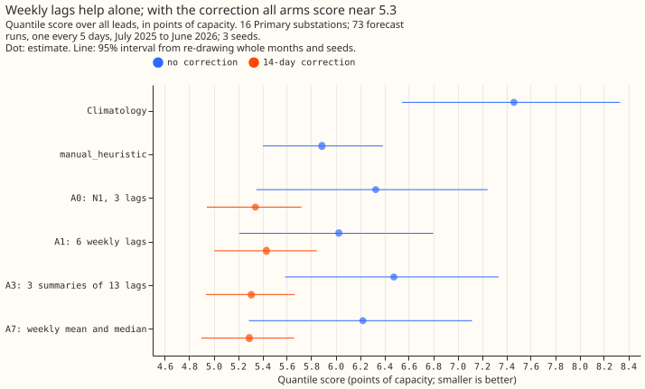

### 00028: a solar forecast for the GSPs in the stage 2 calibrator

**A forecast of each grid supply point's (GSP's) PV_Live solar generation did not clearly lower the
stage 2 quantile score for Walpole and Bicker Fen.** A simple XGBoost model, trained on ERA5 weather
and applied to the 51 ENS members, gave the calibrator the member mean and spread of the solar share
at the target time (row set `fold_a_every5d_v1`).

- **Headline result:** solar forecast minus none over all leads -0.14 (95% interval -0.34 to
  +0.04), and the true PV_Live value as an oracle -0.50 (-0.91 to -0.12), mostly at leads of 7 to
  15 days.
- **Finding for later experiments:** the solar forecast beat a climatology up to day 6 (mean
  absolute error 5.0 to 7.0 points of PV_Live capacity against 8.8 to 9.5), and its member mean was
  too high by 1.8 to 3.0 points at every lead band.
- **Write-up and pull request:** [result](00028-pvlive-forecast-in-stage2-gsp-demand/result.md),
  [PR #1235 (Experiment 28: does a GSP solar forecast help the stage 2 demand forecast?)](https://github.com/openclimatefix/nged-substation-forecast/pull/1235).

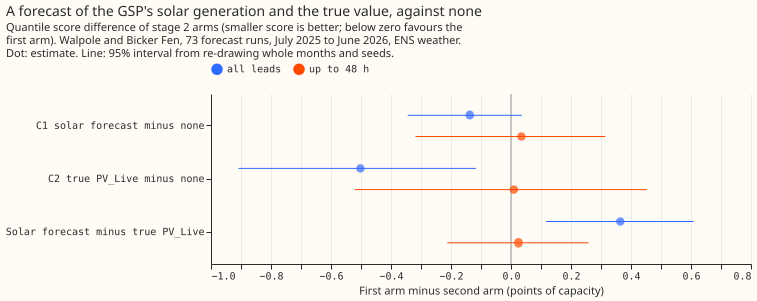

### 00024: which groupings of substations can share one XGBoost model

**Training one XGBoost model per substation type, or per size band, costs 0.15 points of capacity
against one model per substation, and one model across all substations costs 0.29.** The experiment
refitted 00019's model on 20 demand series (8 Primary substations that meter in MW, 8 in MVA, 2 BSP,
2 GSP) with every grouping, on 73 forecast runs with ENS weather.

- **Headline result:** by type with the series identifier minus per series, Primary quantile score
  over all leads: +0.15 points (99.44% interval +0.03 to +0.26); all series in one model: +0.29
  (+0.19 to +0.42). Absolute Primary scores: per series 5.32, by type 5.47, all series 5.61.
- **Finding for later experiments:** the series identifier is essential. Without it the by-type
  pool loses a further 0.82 points and the all-series pool 0.85. On the 16 Primary substations a
  random
  grouping scores the same as the by-type grouping (5.47 each), so the number of models matters
  more than which Primary substations share one.
- **Write-up and pull request:** [result](00024-pooling-groupings-demand-xgboost/result.md),
  [PR #1230 (Experiment 24: which groupings of substations can share one XGBoost model (plan))](https://github.com/openclimatefix/nged-substation-forecast/pull/1230).

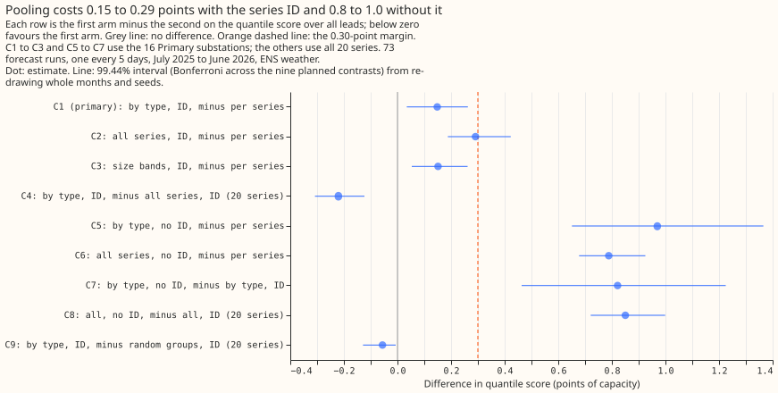

### 00032: fingerprints of each substation in a pooled demand model

**Adding location, training-window statistics, or recent-window statistics to the by-type pooled
model changed the Primary quantile score by at most 0.02 points, and the fingerprints made a
substation held out of the pool worse.** The experiment added three fingerprint blocks to 00024's
by-type pool with the series identifier, and refitted each pool without one of 8 Primary
substations to forecast it as a new substation. The pre-registered verdict is inconclusive, because
the lower limits of the four warm contrasts C1 to C4 are all below zero (-0.002 to -0.049).

- **Headline result:** identifier and both fingerprints minus identifier alone, Primary quantile
  score over all leads: +0.02 points (99.375% interval -0.05 to +0.10; absolute 5.49 against 5.47).
  Held-out substation with training-window statistics minus no fingerprint: +1.39 (+0.99 to +1.91).
- **Finding for later experiments:** training-window statistics replace the identifier for series
  seen in training (+0.01 points, upper limit +0.02), but a pool of 7 other series learns them as 7
  identifiers, so they do not carry a new substation. Post hoc, recent-window statistics alone
  lowered the held-out score by 0.23 points (-0.29 to -0.16, 95%, one seed).
- **Write-up and pull request:** [result](00032-substation-fingerprints-pooled-demand/result.md),
  [PR #1241 (Experiment 32: do substation fingerprints improve a pooled demand model?)](https://github.com/openclimatefix/nged-substation-forecast/pull/1241).

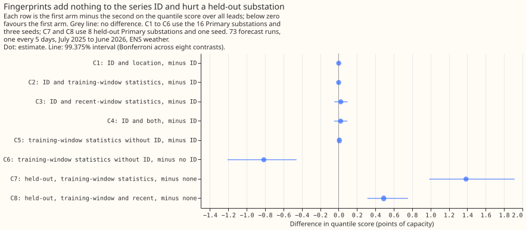

### 00033: the best-guess architecture against production, N1, and `manual_heuristic`

**The best guess lowered the quantile score below production's by 4.89 points of capacity for
Primary demand (98.33% interval -5.66 to -4.06), 3.81 for solar (-5.07 to -2.64), and 6.27 for wind
(-7.65 to -5.28).** The experiment compared the architecture that experiments 1 to 32 point to with
the stored production forecast, N1, `manual_heuristic`, `climatology`, six notable ideas, and an
ERA5-weather ceiling, on the quantile score, MAE of the median, twCRPS and Brier score at
`historical_p99`, and the exceedance rates of the 0.90 and 0.95 quantiles. The pre-registered
verdict is supported.

- **Headline result:** Primary demand scores 5.32 against 9.52 for production, 5.89 for
  `manual_heuristic`, and 6.33 for N1. Production's 5% to 95% band covers 10% to 20% of cases, and
  the 14-day correction accounts for 1.38 of the 4.89-point Primary gap.
- **Finding for later experiments:** monthly retraining without the correction scored 5.12 on one
  seed, below the best guess's 5.32 on the same seed, and the correction did not add to it, with the
  cause untested. The twCRPS at `historical_p99` mostly does not separate the arms; solar and wind
  N1 came within 0.1 and 0.3 points of the ERA5-trained best guess. Better weather would lower the
  wind score by 5.46 and the Primary demand score by 0.11.
- **Write-up and pull request:** [result](00033-best-guess-architecture-vs-production/result.md),
  [PR #1242 (Experiment 33: best-guess architecture against production, N1, and manual_heuristic)](https://github.com/openclimatefix/nged-substation-forecast/pull/1242).

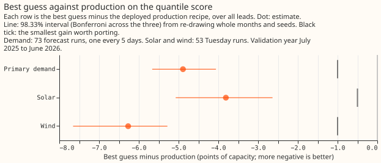

### 00035: a lead-weighted blend of quantiles from stored models

**Averaging the quantiles of three stored Primary demand models lowered the quantile score by 0.10
points; solar and wind gains were too small to resolve.** The experiment refitted nothing. It
averaged each quantile level of two or three stored models per technology, with weights chosen
only on earlier months, and scored the result on the cases of experiment 33. The verdict is
supported, on Primary demand alone.

- **Headline result:** the lead-band blend of the monthly-retrained N1, `a7_cs`, and the stack
  minus the monthly-retrained N1 (the best single member, chosen with hindsight), Primary quantile
  score over all leads: -0.097 points (98.33%
  interval -0.187 to -0.026; absolute 5.025 against 5.122). Solar -0.039 (-0.115 to +0.031) and
  wind -0.074 (-0.194 to +0.055) are null.
- **Finding for later experiments:** one fixed weight vector scores as well as weights per lead
  band (+0.005, -0.008 to +0.023 for Primary demand), and the blend scored 0.048 points worse when
  the
  14-day correction was applied afterwards instead of to each member first (+0.008 to +0.101, 95%).
- **Write-up and pull request:**
  [result](00035-lead-weighted-quantile-blend-of-stored-models/result.md),
  [PR #1244 (Experiment 35: does a lead-weighted blend of quantiles beat the best single model?)](https://github.com/openclimatefix/nged-substation-forecast/pull/1244).

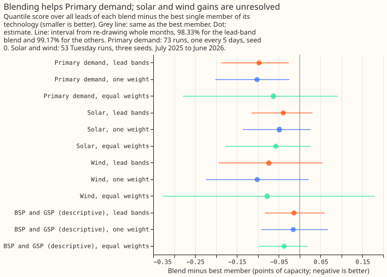

### 00049: which Primary demand components still improve the score under monthly retraining

**Averaging the quantiles of five XGBoost models lowered the Primary demand quantile score by 0.08
points once the models were retrained, and no other contrast had an interval excluding zero.**
Stage 0 re-used stored predictions, and stage 1 refitted P-roll, the cheap stand-in for monthly
refitting. The verdict is supported, on the blend alone.

- **Headline result:** the blend minus the best single model (weekly refits), Primary quantile score
  over all leads: -0.076 points (99.17% interval -0.135 to -0.023; absolute 4.968 against 5.044).
  The spread factor chosen on earlier months minus the fixed 1.15 is -0.0001 (-0.012 to +0.018).
  Adding substation fingerprints (recent-window statistics) to the pooled model is +0.009 (-0.037 to
  +0.050).
- **Finding for later experiments:** the 12-month window of P-roll holds no lockdown days, so it
  cannot test the COVID indicator. The Christmas column and the half-life are unresolved on one
  winter. P-roll scores 5.150 (quantile score, in points of capacity) and is the screening reference
  row.
- **Write-up and pull request:**
  [result](00049-vp1-screening-reference-under-p-roll-demand/result.md),
  [PR #1271 (Experiment 49: which Primary demand components still improve the score under monthly retraining?)](https://github.com/openclimatefix/nged-substation-forecast/pull/1271).

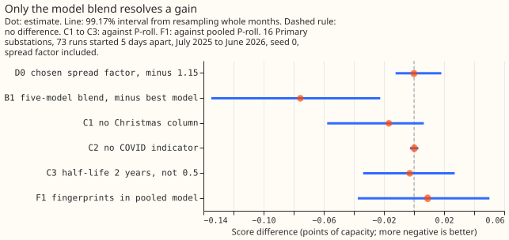

### 00036: forecasts of the series beneath a BSP or GSP

**Adding forecasts of the series beneath a bulk supply point (BSP) did not lower its quantile
score, and the ERA5-trained N1 gained 0.36 to 0.40 points of capacity at the grid supply points
(GSPs) with intervals that include zero.** The experiment gave the N1 model of Boston, Skegness,
Walpole, and Bicker Fen the summed median forecasts of the Primary substations and metered
generators beneath, a regression on those forecasts, an N1 trained on ERA5, and wind and solar
columns. The pre-registered verdict is inconclusive.

- **Headline result:** B1 minus B0 over all leads is +0.04 (99.17% interval -0.18 to +0.25) at
  Boston and +0.19 (-0.10 to +0.73) at Skegness, and B3 minus B0 is -0.36 (-1.60 to +0.43) at
  Walpole and -0.40 (-1.84 to +0.97) at Bicker Fen. An oracle that sees the observed children scores
  5.58 and 3.42 points below N1 at the two BSPs.
- **Finding for later experiments:** the oracle's gain is not headroom for a forecast of the
  children, because the forecast columns gained nothing. The ERA5-trained N1 gained 0.41 points
  over all leads (95% interval 0.15 to 0.66, exploratory) at Boston, and 0.66 to 0.88 points up to
  day 6.
- **Write-up and pull request:** [result](00036-hierarchy-aware-bsp-gsp-forecasts/result.md),
  [PR #1245 (Experiment 36: do forecasts of the series beneath a BSP or GSP lower its error?)](https://github.com/openclimatefix/nged-substation-forecast/pull/1245).

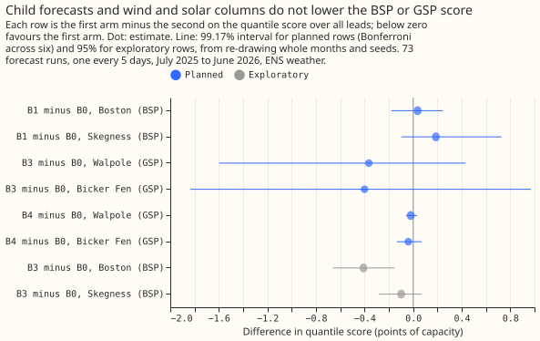

### 00037: logged switching in the telemetry

**A detector that checks neighbouring substations recovered a third of the MW of the 18 visible
validation transfers, but the verdict is inconclusive.** The experiment turned the NGED switching
logs into 612 closures of 2 hours to 60 days, found that 37 of them show a visible step (about 6
by chance), and scored two detectors that never read the logs against them, with thresholds set on
odd months and recall measured on even months.

- **Headline result:** the neighbour-balance detector D1 (4-hour window, threshold 4) reaches a
  size-weighted recall of 0.326 (95% interval 0.093 to 0.579) at 0.38 unexplained alarms per
  series-month, against 0.036 (0.000 to 0.131) for the single-series detector D0 at 0.14. Shifted
  logs give 0.004. D1 misses the 0.35 bar and clears the 0.20 bar, so the verdict is inconclusive.
- **Finding for later experiments:** at about 0.5 alarms per series-month D0 reaches 0.224 and D1
  0.362, so the pre-registered grid overstated the gap. A 24-hour D0 reaches 0.276. The stack's
  threshold-weighted score share in confirmed half-hours is 40%, but one 370-hour closure on series
  18 holds nearly all of it.
- **Write-up and pull request:** [result](00037-switching-first-look/result.md),
  [PR #1246 (Experiment 37: do logged switching closures show up in the telemetry, and does a
  neighbour-balance detector beat a plain one?)](https://github.com/openclimatefix/nged-substation-forecast/pull/1246).

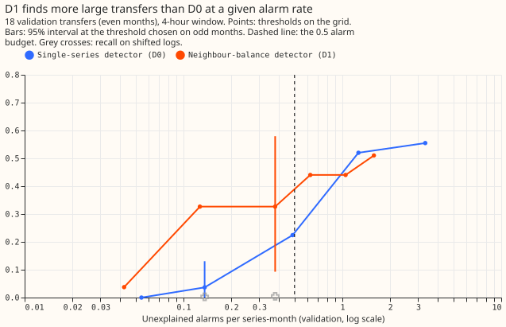

### 00038: the value of detecting switching events

**Leaving the half-hours that the neighbour-balance detector flags out of the stack's error
correction raised the forecast's tail error, so the verdict is refuted.** The experiment masked
detected intervals from the 14-day and 7-day corrections of the proxy stack (experiment 00017's
ERA5-weather baseline) and of experiment 00019's real stack, and scored half-hours outside logged
closures against an oracle mask from the logs and a random mask of equal volume.

- **Headline result:** the primary contrast, D1 mask with a 7-day window against the plain 7-day
  correction, is +57.1% (95% interval +0.4% to +133.5%) in threshold-weighted error at each series'
  P99. The oracle mask lowers the 14-day error by 8.9% (-21.8% to +0.0%), and 95% of that gain
  sits in January 2026, the month of the 17-18 closure. The random mask changes it by +0.1%.
- **Finding for later experiments:** a post hoc revision of the interval builder gives -5.4%
  (-15.1% to +1.5%), but raises the mean absolute error by 0.25 points, and 3 of 17 long closures
  improve. The plain 7-day window beats the 14-day window by 5.2% (-10.8% to +0.0%) in the proxy
  stack but loses by 8.5% (+2.4% to +10.7%) in the real stack.
- **Write-up and pull request:** [result](00038-switching-mask-value/result.md),
  [PR #1247 (Experiment 38: is detecting a switching event worth anything to the forecast?)](https://github.com/openclimatefix/nged-substation-forecast/pull/1247).

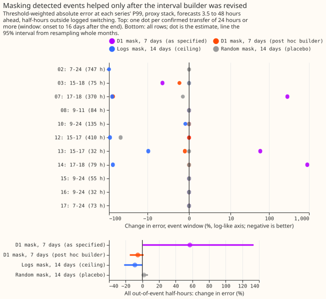

### 00039: separating embedded solar from Primary substation demand

**A fit of a calendar-plus-temperature demand term minus one CAMS-driven PV shape recovers injected
solar-farm output to within 25%, and the real series pass four checks at 6 of 8 Primaries, so the
pre-registered verdict is `recovers-but-confounded`.** The experiment injected the output of 6
metered solar farms, scaled to 20% of each Primary's effective capacity, into the demand of the 8
directional Primary substations (218 units), and ran four checks (placebo sky, season, cloud-demand
term, day type) on the real series.

- **Headline result:** the half-hourly fit recovers a median 0.773 of the injected capacity (95%
  interval 0.740 to 0.818). The daily fit recovers 0.854 (0.815 to 0.866), which passes the
  recovery rule. In 2025/26 Kirton fails the season and cloud-term checks, and Wrangle T1 fails
  the placebo check by a hair, so the placebo check passes at 7 of 8 Primaries and all four at 6.
- **Finding for later experiments:** injection cannot detect a demand confound, because a linear fit
  returns the same increment on any demand. The fitted capacity is 0.9 to 3.2 MW per Primary
  before dividing by the recovery ratio. The next experiment is PVDIS-2B, a richer demand model.
- **Write-up and pull request:** [result](00039-pv-disaggregation-cams-injection/result.md),
  [PR #1248 (Experiment 39: can a CAMS-driven fit separate embedded solar from Primary substation demand?)](https://github.com/openclimatefix/nged-substation-forecast/pull/1248).

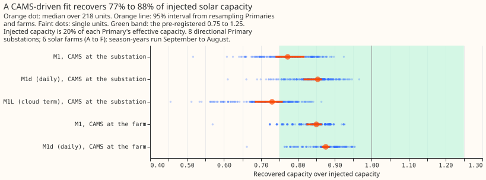

### 00040: how far the capacity fitted to embedded solar can be trusted

**A cross-arm misfit test is calibrated and detects four of five cloud-driven loads at 25% of the
true capacity, but it detects a day-long cloud load in only 0.35 of draws, so the verdict is
`underpowered`.** The test compares the capacity that six least-squares fits assign to the same
series, using known injected solar-farm output and eight known loads in the real series of the 8
directional Primary substations.

- **Headline result:** pure injected solar output gives a median capacity over truth of 0.992 (95%
  interval 0.951 to 1.032) and a false-positive rate of 0.055. Kirton is flagged in 6 of 7
  season-years and no other Primary is flagged in any. The bound on the capacity at the other seven
  is 0.18 to 0.23 at five, 0.47 at Trusthorpe, and 0.71 at Wrangle T1, where the test has almost
  no power.
- **Finding for later experiments:** the two loads that the misfit test cannot see, a day-long cloud
  load and a load that rises with sunshine, set the bound. Evening demand after dark responds to
  cloud at some Primaries and offers a measurement of the first.
- **Write-up and pull request:** [result](00040-pv-capacity-error-bars/result.md),
  [PR #1249 (Experiment 40: how far can the capacity fitted to embedded solar be trusted?)](https://github.com/openclimatefix/nged-substation-forecast/pull/1249).

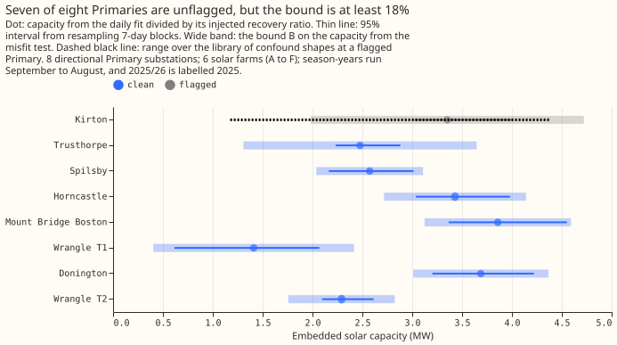

### 00034: how often to retrain the Primary demand model, and which cheap proxy stands in

**Refitting the Primary demand model monthly lowered the quantile score from 5.32 to 5.12 points of
capacity, refitting weekly lowered it by a further 0.07, and the 14-day correction stopped
helping.** The experiment refitted N1 for 16 Primary substations at six cadences and scored 73
forecast runs from July 2025 to June 2026. The pre-registered verdict is inconclusive: the
99.375% interval on monthly minus the stack is -0.44 to +0.08.

- **Headline result:** monthly retraining minus the stack, quantile score over all leads: -0.20
  points (99.375% interval -0.44 to +0.08; 95% interval -0.38 to -0.01). Weekly minus monthly:
  -0.07 (-0.18 to -0.00). The correction at weekly cadence: +0.23 (+0.03 to +0.44).
- **Finding for later experiments:** of four cheap proxies for monthly retraining, only monthly
  refits on a rolling 12-month window (150 rounds, `eta` 0.15) reproduced full monthly
  retraining's contrasts, at about a third of the GPU time. A frozen reference overstates a
  feature that follows recent demand level (weekly analogues: -0.05 frozen, -0.01 retrained).
- **Write-up and pull request:** [result](00034-retraining-cadence-and-cheap-proxies-demand/result.md),
  [PR #1243 (Experiment 34: retraining cadence and cheap proxies for Primary demand (plan))](https://github.com/openclimatefix/nged-substation-forecast/pull/1243).

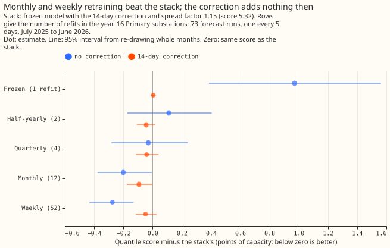

### 00041: a labeller for logged switching events, gated on known answers

**A Sonnet labeller called no placebo card visible but found 0.74 of large, long injected
transfers (25 of 34; 0.57 to 0.85), under the 0.80 bar, so the verdict is partly supported.** On
300 known-answer cards it called 0 of 120 placebo cards visible (95% interval 0.00 to 0.03). Where
a metered receiver exists the recall is 0.89 (46 of 52; 0.77 to 0.95), and where only the donor
steps it is 0.60. A rules-only labeller on the same features reaches 0.65 with 3 of 120 placebo
cards visible. The receivers-named bar was waived by the maintainer after the rules-only results.

- **Finding for later experiments:** Sonnet reaches 0.80 only for transfers of 25% or more of the
  receiving load lasting over 1 day, so detector scoring treats every other band as don't-care.
- **Process finding:** the first test set's injected cards differed from placebo cards in the
  minute of the log time, the sheet's sides, and the clock time, and a reviewer caught it; the
  gate was rerun on a rebuilt set. SW2-0b needs the same check on real cards against sentinels.
- **Cost:** 14.9 million subagent tokens for 1,156 card labellings, about 12,900 per card, with no
  Opus run.
- **Agreement:** the two Sonnet labellers agree with kappa 0.79.
- **Write-up and pull request:** [result](00041-sw2-0a-labeller-gate/result.md),
  [PR #1253 (Experiment 41: SW2-0a switching-event labeller and its known-answer gate (plan))](https://github.com/openclimatefix/nged-substation-forecast/pull/1253).

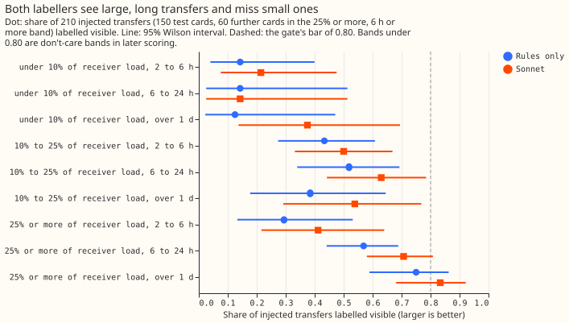

### 00041, part 2 (SW2-0b): the labelled set of real switching jobs

**Of 537 logged switching jobs of 2 hours to 60 days, 66 (12%) show a visible transfer of load
between substations, and 9 of 148 detector alarms with no logged closure do.** Two independent
Sonnet runs labelled 1,017 summary cards (817 real, 200 hidden known-answer cards) and Opus settled
66 disagreements. No hidden placebo card (0 of 100) and no quiet alarm window (0 of 40) was called
visible. Few of the 440 not-visible jobs are proven quiet, because Sonnet misses transfers under 25%
of the receiving load and under 1 day, and 13 of the 35 conserved calls rest on one substation
with mostly missing readings.

- **Finding for later experiments:** score detectors against the 82 visible cards, and treat the
  331 not-visible operations of under 1 day as don't-care.
- **Cost:** 20.1 million subagent tokens, a third above the estimate of 15 million.
- **Write-up:** [labelled set](00041-sw2-0a-labeller-gate/labelled-set.md).

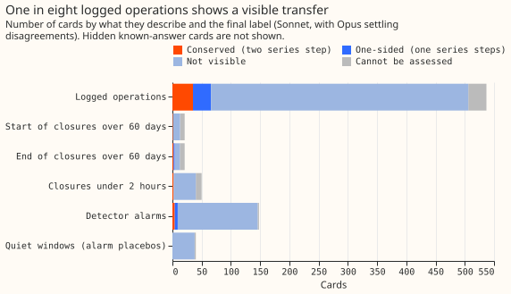

### 00043: how well do the two existing switching detectors find transfers?

**On 600 injected transfers, the neighbour-balance detector D1 finds fewer large, long transfers
than the single-series detector D0 over a 24-hour window, so the hypothesis is refuted there.** D0
finds 47 of 160 (0.29) and D1 finds 34 (0.21); D1 minus D0 is -0.081 (95% interval -0.130 to
-0.037). Over a 4-hour window D1 finds 40 and D0 26 (+0.087, +0.044 to +0.136). A detector counts as
finding a transfer only when its start is within 2 hours and its end within 6 hours or 10% of the
length.

- **Finding for later experiments:** both detectors find 0.08 to 0.17 of all injected transfers, and
  D1 finds almost none of the 84 headline transfers that have no metered receiver (5 of 84 at the
  4-hour window, 2 of 84 at 24 hours).
- **Precision:** about half of the alarms match a logged closure; precision is 0.42 to 0.57 whatever
  the setting.
- **Write-up and pull request:** [result](00043-sw2-1-detector-scoreboard/result.md),
  [PR #1262 (Experiment 43: how well do the two existing switching detectors find transfers?)](https://github.com/openclimatefix/nged-substation-forecast/pull/1262).

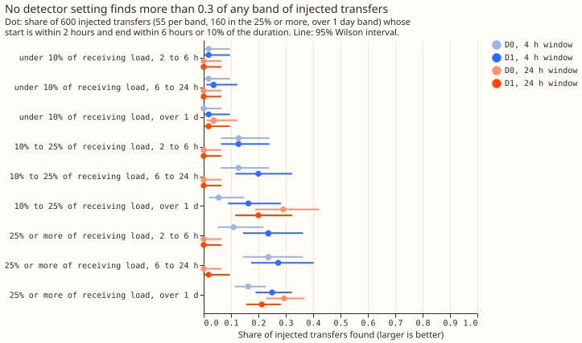

### 00044: how much labelled switching events hurt the best guess

**A perfect switching detector would lower experiment 33's best guess's quantile score for Primary
demand by 0.42% (95% interval -0.47% to 1.96%), under the plan's 3% threshold, so the verdict is
refuted.** The experiment fitted nothing. It split the best guess's scores for the 16 Primary
substations from July 2025 to June 2026 by whether the target half-hour, or its lagged power (the
earlier power readings the forecast takes as inputs), lies inside a labelled switching event of 25%
or more of the receiving load lasting over 24 hours.

- **Headline result:** flagged half-hours are 1.35% (0.04% to 3.22%) of the half-hours scored and
  carry 3.4% (0.04% to 8.68%) of the summed quantile score, 2.5 times their share of half-hours.
  Only 6 such events fall in the year, on 3 series, so the intervals are wide and say little about
  the other 13 series.
- **Sensitivity:** with every visible event, whatever its size or length, the quantile-score bound
  is 2.35% (-0.22% to 5.73%). The flagged half-hours carry 55% (2% to 70%) of the tail score, which
  rests on a few short events.
- **Finding for later experiments:** the stored `moved_share_of_receiver` of the labelled set is
  missing (NaN) for 62 of the 81 labelled events that touch a Primary series, partly from series
  ids written as strings, so scores against it need the share recomputed.
- **Write-up and pull request:** [result](00044-sw2-2-switching-share-of-best-guess-score/result.md),
  [PR #1261](https://github.com/openclimatefix/nged-substation-forecast/pull/1261).

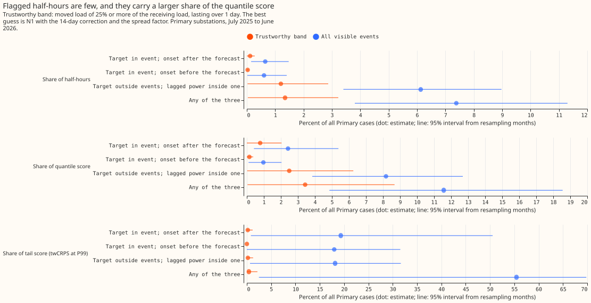

### 00045: a weekly series of embedded solar capacity

**No single pair of penalty settings for a weekly capacity series was both quiet on noise and able
to follow a real fall, so the verdict is refuted; for SW2-10, use one capacity per season-year and
read it as a range.** The experiment added the recorded output of real
solar farms to the demand of the 8 Primary substations metered in MW, in known steps, ramps, and
temporary falls, and measured how far each method's weekly capacity lay from the known amount. The
plan's literal clause order also reads inconclusive, because its detection clause was evaluated on a
degenerate pair; the page says why refuted applies. On the semi-synthetic baseline, which favours
the season-year constant by construction, no weekly fit beat the constant. On the real series plus
injection, every weekly fit beat it on ramps and steps (0.012 to 0.017 against 0.020).

- **Headline result:** the median path error on ramps and steps (the mean gap between the fitted and
  the true weekly capacity, as a share of the true mean capacity, on the semi-synthetic baseline) is
  0.027 for the season-year constant, 0.040 for the frozen asymmetric fit, and 0.159 for a weekly
  fit with no penalty. The frozen fit gives a median of 0.66 false steps of 10% per Primary-year on
  a constant capacity (limit 0.5, worst Primary 1.43 against 1.0) and recovers 0.000 of a 30% fall
  lasting 26 weeks. The relative change in path error against the season-year constant (C2) is
  +0.400. On the plan's main interval, which resamples the 8 Primaries only, the 95% interval is
  +0.029 to +0.634, so its lower limit above 0 is a second route to refuted. The two-way interval,
  which also resamples farm-seeds, is -0.078 to +0.773.
- **Finding for later experiments:** a pair chosen after the scoring run (a=2, r=10) recovers 0.576
  of the fall but gives a median of 1.22 false steps. The smallest step that the frozen pair detects
  in 80% of injections is above 25% of capacity at all 8 Primaries in both seasons. The free weekly
  fit reaches 80% at 5% steps at 3 of the 8 Primaries from April to September, with a median of 11.6
  false steps per Primary-year. The latest week of a real-time estimate has 3.63 times the path
  error of the final fit, and the 90% intervals cover 0.620 of non-step weeks and 0.347 of step
  weeks. The recommended series for SW2-10 is the season-year constant.
- **Process finding:** the first tuning attempt used a baseline that had removed the weekly noise
  and was redone, and the constant-path unit was redefined after its results were seen; both
  attempts are in the write-up.
- **Write-up and pull request:** [result](00045-pvdis-4-weekly-capacity-asymmetric-l1/result.md),
  [PR #1266 (Experiment 45: PVDIS-4 plan, a weekly capacity series that rises easily and falls reluctantly)](https://github.com/openclimatefix/nged-substation-forecast/pull/1266).

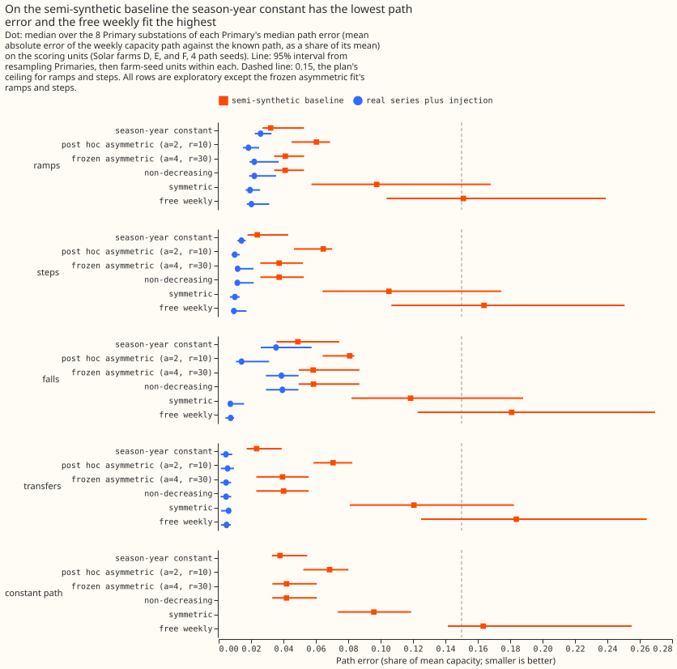

### 00046: how much of the best guess's daylight error is embedded solar? (PVDIS part 3)

**We asked how much of a Primary substation's daylight forecast error comes from solar panels behind
its meter, by adding the panels' capacity times the sunshine anomaly (sunnier or cloudier than the
average for that month and half-hour) to a demand forecast without radiation inputs.** Built from the
true sunshine, which no real forecast has, the correction lowers the quantile score (the
probabilistic forecast error score) by 0.966 points (-1.431 to -0.595), about 20% of the 4.724
points the demand forecast scores. Built from the ECMWF ensemble forecast of sunshine, it lowers the
score by 0.056 points (97.5% interval -0.191 to +0.064), against a threshold of 0.35, so the verdict
is `refuted`. The ensemble anomaly tracks the true one for about 2 days and then fades, and the gain
follows it: -0.262 at 0 to 24 hours, -0.277 at 1 to 2 days, and about 0 beyond.

- **Finding for later experiments:** the sunshine correction built from the ensemble forecast scored
  +0.048 (-0.059 to +0.141) against the best-guess recipe with its radiation inputs, so it is no
  better. It is also not shown to be no worse, because the sign changes by month and by series. The
  next experiment in the series (PVDIS-5, which retests the correction with weekly capacity
  estimates) is a non-inferiority and explanation test with a margin set in advance, with a gain
  test only for 0 to 48 hours.
- **Coefficient:** a fixed coefficient of 1 was too large, because the residual's slope on the
  oracle correction is -0.771. A coefficient fitted on the training window gives -0.143 (-0.231 to
  -0.057, exploratory) against the plain correction.
- **Fragile small gain:** without one series (anonymised as D9) the correction gains -0.113 (-0.230
  to -0.000, rounded; the interval touches zero), and it is positive in June to August, so it is not
  a consistent gain. Its lower bound stays above -0.35 in every pooled scope.
- **Exploratory midday read:** at 09:00 to 15:00 UTC on day+1 the correction gains -0.434 (-0.559 to
  -0.283) in April to September and scores no worse than the best-guess recipe, and the quantiles
  move from too narrow to slightly too wide. In June to August at day+2 and day+3 it scores worse
  than the best-guess recipe. Whether that justifies porting is not decided.
- **Write-up:** [result](00046-embedded-solar-share-of-primary-forecast-error/result.md).

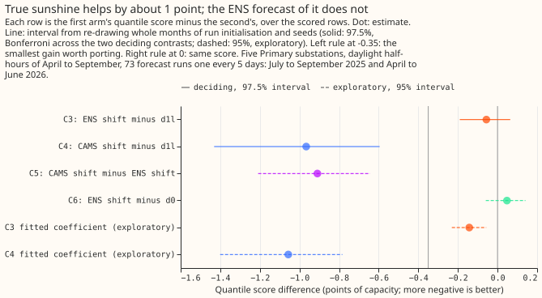

### 00050: does a second weather forecast beat ENS at the solar anomaly? (PVDIS part 8)

**We asked whether the American GEFS ensemble forecast, alone or blended with the ECMWF ensemble
(ENS), predicts the sunshine anomaly (sunnier or cloudier than usual) better than ENS, because
experiment 00046 found that the sunshine forecast limits the gain from a solar correction.** In
cross-validation on the training window, GEFS made 10.9% more squared error against the satellite-
based CAMS anomaly than ENS did, and was worse in all 9 held-out months. The fitted blend made 0.2%
more, against the 1% less the gate needed, so the verdict is `refuted` and the demand contrasts were
not run. On the validation year GEFS correlates with the CAMS anomaly 0.072 less than ENS at 0 to 24
hours (95% interval -0.100 to -0.039), and the blend 0.002 more (-0.001 to +0.006).

- **Finding for later experiments:** a second global ensemble shares ENS's errors, so a gain inside
  2 days needs a product of a different kind, such as a high-resolution regional model or a
  satellite-based nowcast. The fitted blend gives GEFS about 0.1 weight inside 2 days and none from
  2 to 10 days.
- **Unverified:** the 00 UTC GEFS run's availability by 09:00 UTC was not observed in that window,
  so the same-day run, the optimistic case for GEFS, was assumed.
- **Write-up:** [result](00050-second-weather-forecast-for-solar-anomaly/result.md).

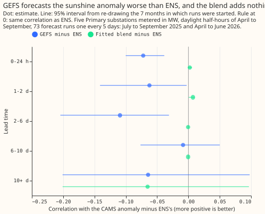

### 00051: why does the solar term lose at sunny summer middays? (PVDIS part 3b)

**We asked why the solar correction of experiment 46 scored worse than the forecast that kept its own
radiation inputs (`d0`) at 09:00 to 15:00 UTC in June to August, using only experiment 46's stored
forecasts.** Three explanations were tested against a rule written in advance. The correction built
from the sunshine that actually occurred (the oracle shift) is too large: the actual power fell by
only 0.4 to 0.7 of the amount the correction removed, in every month and hour bin, and a coefficient
fitted on half the weeks lowers the median's mean absolute error on the other half by 0.991 points
of capacity (-1.473 to -0.495). A hinge for inverter clipping was lower than a straight line by only
0.103 points (-0.233 to +0.030, which includes 0), and a hinge fitted after the coefficient repair
changed the error by +0.003 (-0.071 to +0.084, post hoc), so clipping is not distinguished from a
scale error. The members of the European Centre for Medium-Range Weather Forecasts ensemble forecast
(ENS) add 0.129 points (0.057 to 0.212) to the correction's quantile score at 2 and 3 days ahead.

- **Findings that bear on later experiments:** fit the solar coefficient per lead band and season, test
  dropping the member spread, and test non-inferiority against `d0` with a margin the PVDIS-5 plan
  confirms or halves (0.10 points was set here), judged on at least 25 weeks of forecast start.
- **Open cause:** the page does not say why the coefficient is below 1. Overstated capacity, error
  in the CAMS sunshine, clipping, demand that rises with sunshine, and panel temperature all fit.
- **Write-up:** [result](00051-pvdis-3b-midday-loss-of-the-solar-term/result.md).

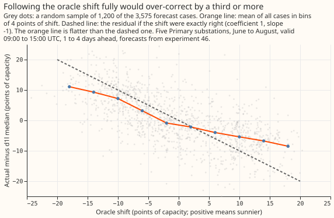

### 00052: do more weather forecasts lower the wind farms' error at 1 to 2 days ahead?

**We asked whether averaging the wind best guess with the same ERA5-trained wind-power model fed
ICON-EU's and IFS 0.25 degree's forecast wind lowers the quantile score at 1 to 2 days ahead.** The
test covered the three metered wind farms. The average scored 0.055 points of capacity better at
lead days 1 and 2 (95% interval -0.200 to +0.072), against a threshold of 0.15, so the verdict is
`inconclusive`. Over all leads it scored 0.018 worse (-0.020 to +0.054).

- **Finding for later experiments:** the products fed were runs about half a day older than the ENS
  run, with no bias correction. The blend scored worse at lead days 3 to 6 (+0.122; 95% interval
  +0.028 to +0.221) only because of a spread factor fitted on earlier blends, since its weights
  equal the best guess from August (+0.005 without the factor). One farm scored -0.233 (-0.447 to
  -0.035) at days 1 and 2 and another +0.151 (+0.028 to +0.287); both reads are exploratory. The
  placebo passed: weight selection rejected the shuffled forecasts.
- **Write-up:** [result](00052-more-nwp-products-for-wind-farms/result.md).

### 00047: does a bank-holiday column in the demand model help the switching detector?

**Adding the days to the nearest bank holiday to the demand model did not measurably raise the share
of simulated load transfers the 24-hour single-series detector finds, so the verdict is
inconclusive.** The share found rose from 0.348 to 0.360 (+0.011, 98.75% interval -0.010 to +0.044)
on 89 simulated transfers of 25% to 40% of the receiving load lasting over 1 day, with both models
matched to raise the same number of alarms in odd months that the switching log does not explain. The
experiment cannot resolve a gain below about 0.04.

- **Finding for later experiments:** the column cut unexplained alarms within 1 day of a bank holiday
  from 26 to 9 or 10 and the demand model's error on bank holidays by about 1.15 points of capacity,
  but the matched threshold rose by 0.22 instead of falling, probably because the residual became
  more persistent, so the detector gained nothing. Matching on odd months left the new model at 64
  to 67 unexplained alarms in even months against 71 to 80 for the baseline.
- **Series status:** experiment 43 was refuted at the 24-hour window and this experiment is
  inconclusive; neither found a detector improvement.
- **Write-up and pull request:** [the full result page](00047-sw2-4-better-residual-switching-detector/result.md),
  [PR #1268](https://github.com/openclimatefix/nged-substation-forecast/pull/1268).

### 00061: does pairing an onset step with its return step find more of the moved load? (SW2-6)

**Taking each alarm interval's end from the strongest opposite step finds 0.19 more of the moved
power than D0M, the single-step detector, while scoring the onset and return steps as one pair finds
0.13 to 0.21 less.** We added known load transfers to the power history. The paired-step alarm
score, with or without a prior on the duration taken from the labelled real transfers, found 0.13
and 0.21 less of the moved MW than the single-step detector D0M at the same number of unexplained
alarms (98.33% intervals -0.233 to -0.007 and -0.310 to -0.092), because holding their unexplained
alarms to D0M's count needed a lone onset step of 8.8 noise units. The arm that kept D0M's alarms
and moved only the end found 0.63 to 0.65 of the moved MW against 0.44 to 0.47, a gain of 0.19
(+0.148 to +0.237), and still misses 0.35 to 0.37.

- **Finding for later experiments:** that arm finds 7 of the 35 labelled real transfers of more than
  1 day against D0M's 2, and 24 of the 35 still have no alarm at the start under D0M, so the onset
  now limits the real transfers. The arm's end rule needs a check on the 4-hour window and with a
  cap longer than 14 days.
- **Write-up and pull request:** [the full result page](00061-sw2-6-paired-step-intervals/result.md),
  [PR #1291](https://github.com/openclimatefix/nged-substation-forecast/pull/1291).

### 00065: does one score from a substation's own step and its neighbours' opposite steps find more of the moved load? (SW2-14)

**Adding the neighbours' opposite-sign steps to a substation's own step did not find clearly more
of the moved load than the own step alone; the neighbour evidence that helped was how many
neighbours stepped the same way, which a veto already uses.** We injected 620 known load transfers
(power moved between substations for over 1 day) into 16 Primary substations and counted the share
of the moved megawatts (MW) found, with every detector held to 80 unexplained alarms on odd months
and each interval end taken from the strongest opposite step in the next 14 days. The
single-series detector finds 0.646 (0.354 missed). The logistic regression finds 0.665 (+0.019,
99.17% interval -0.011 to +0.062), and the likelihood-ratio sum finds 0.651 (+0.005, -0.010 to
+0.014). The neighbour gate finds 0.550.

- **Finding for later experiments:** the post hoc logistic regression with the count of same-sign
  neighbour steps finds 0.681 (+0.034 over the single-series detector, +0.013 to +0.091; +0.023
  over the veto, +0.004 to +0.068). The next experiment should pre-register one score with the
  three pieces of evidence. Every one of the 16 series has a neighbour measured only in MVA, so a
  flag for that is constant and cannot help.
- **Write-up and pull request:** [the full result page](00065-sw2-14-combined-single-series-and-neighbour-score/result.md),
  [PR #1296](https://github.com/openclimatefix/nged-substation-forecast/pull/1296).

### 00067: does one convex fit of load flows across all boundaries find more of the moved load? (SW2-15)

**Fitting block-shaped flows to the hourly residual of all 16 Primary substations at once found
far less of the moved load than the single-series 24-hour step detector. The cause is the hourly
noise model, not the conservation of power, so a joint fit would have to start from the 24-hour
step statistics.** We injected 620 known load transfers (power moved between substations for over 1
day) and counted the share of the moved megawatts (MW) found, with every detector held to about 80
unexplained alarms on odd months. The step detector finds 0.646 (0.354 missed). The joint
estimator finds 0.108 (0.892 missed), a difference of -0.538 (97.5% interval -0.605 to -0.421).

- **Finding for later experiments:** a post hoc change of the loss lifts the estimator to 0.527
  (-0.120 against the step detector, -0.190 to -0.084). With that change it matches the step
  detector for transfers with a metered receiver and a donor step of 10 noise units or more (0.92
  against 0.89 of transfers found) and finds almost nothing where no receiver is metered and the
  step is under 6. On the 35 labelled real transfers of over 1 day it finds 4, against 7.
- **Write-up and pull request:** [the full result page](00067-sw2-15-joint-edge-flow-estimator/result.md),
  [PR #1298 (Experiment 67: one convex fit of load flows across all boundaries (SW2-15))](https://github.com/openclimatefix/nged-substation-forecast/pull/1298).

### 00062: does removing the residual's half-hour-to-half-hour memory help the switching detector? (SW2-9)

**Filtering the residual's short memory out before the 24-hour step makes the switching detector
find fewer load transfers, because the filter shrinks a day-long step faster than it shrinks the
noise.** We added 620 known load transfers (power moved between substations for over 1 day) to the
history of 16 Primary substations and compared the detector on the unfiltered residual with the same
detector on a residual filtered by a first-order autoregressive filter. The filtered detector found
0.34 to 0.37 of the moved megawatts (MW) and the unfiltered detector 0.44 to 0.47, a range over five
daily shapes of transfer. The pooled change over the three shapes that experiment 60 added was
-0.097 (98.33% interval -0.132 to -0.057), so the filtered detector misses 0.63 to 0.66 of the moved
MW. At 4 hours the change was -0.145 (-0.209 to -0.097).

- **Finding for later experiments:** the median fitted coefficient is 0.92, so a persistent step
  keeps about 8% of its size after filtering, while the noise of the 24-hour step keeps about 12%.
  The signal-to-noise ratio of a constant step is therefore 0.52 to 0.85 of the unfiltered value for
  all 16 substations, which predicts the result without injecting a transfer. The interval-end misses
  (72 of 215 large-step constant-MW transfers for the unfiltered detector, 56 for the filtered one)
  are not the filter's to fix. Work on the interval end (SW2-6) or the combination of windows
  (SW2-13) next.
- **Write-up and pull request:** [the full result page](00062-sw2-9-whitened-residual-step-detector/result.md),
  [PR #1293](https://github.com/openclimatefix/nged-substation-forecast/pull/1293).

### 00066: which window and cap should the end rule of the switching detector use? (SW2-16)

**Lengthening the end rule's search from 14 to 30 or 60 days repairs the end of transfers longer
than 15.6 days and breaks some shorter ones. A rule that ends at the first return step of at least
half the onset step's size beats the 14-day rule on both sets of transfers.** An alarm interval runs
from the step that raises an alarm (the onset step) to the opposite step (the return step) that ends
it, and the cap is how many days after the onset the search for the return step may run. We added
known load transfers to the power history and gave each alarm of the single-step detector D0M an
interval end from the strongest opposite step within a cap. On a new set of 215 transfers lasting
15.6 to 60 days, the 14-day cap found 0.013 of the moved MW and a 30-day cap 0.547, a gain of 0.534
(99% interval +0.131 to +0.780). On experiment 58's 620 transfers, of which 1.5% last over 14 days,
the 30-day cap found 0.045 less (-0.070 to -0.011) and the 60-day cap 0.080 less (-0.113 to -0.035).
The 4-hour window at about the same alarm rate found 0.147 less than the 24-hour window (-0.248 to
-0.054). The verdict is `inconclusive` by the pre-registered rule, because the longer cap fails its
guard on the short transfers.

- **Finding for later experiments:** a post hoc rule that takes the first opposite step of at least
  half the onset step's size, and otherwise keeps the tracked end, gains +0.042 (+0.013 to +0.066)
  on the 620 transfers and +0.412 (+0.067 to +0.621) on the long set over the 14-day end rule, and the
  cap hardly matters for it. It needs a confirmation on a fresh draw before it becomes the benchmark.
  On the 35 labelled real transfers of more than 1 day, D0M finds 2, the 14-day end rule 7, and the
  post hoc rule 8. The end rule needs up to the cap's worth of hindsight, so detectors built on it
  serve training-time masks and the event table for NGED, not live forecast inputs.
- **Write-up and pull request:** [the full result page](00066-sw2-16-end-rule-as-baseline/result.md),
  [PR #1297](https://github.com/openclimatefix/nged-substation-forecast/pull/1297).

### 00069: why do real load transfers raise no alarm at their start? (SW2-17)

**Half of the 24 real transfers with no alarm at their start are not a threshold problem, and
accepting weaker alarms that a later step back confirms did not find more of the moved power.** Of
the 35 labelled real transfers over 1 day, 24 have no alarm of the single-step detector D0M within 2
hours of the start. Of those 24, 6 lie in gaps in the data, 3 where the monthly refit of the XGBoost
forecast suppresses the alarm, 3 have an alarm 2 to 12 hours from the labelled start, 8 have a sharp
step of 2 to 4 noise units, 2 have a spread or late step, and 2 show no step. On injected transfers,
a rule that also raises a weak alarm at half the strong threshold when a matching opposite step
follows within 14 days recovered 0.146 more of the moved MW than the strong alarms alone, but the
strong threshold had to rise from 4.0 to 6.55 to keep 80 odd-month unexplained alarms, which lost
0.140. The net change against the benchmark was +0.007 (98.75% interval -0.014 to +0.040), and the
verdict is `inconclusive`.

- **Finding for later experiments:** the first-return end rule PF14 beat the 14-day strongest-step
  rule on a fresh draw, by +0.038 (+0.016 to +0.077) on 625 headline-band transfers and +0.416
  (+0.059 to +0.595) on 206 long transfers, so PF14 is the benchmark end rule. The monthly refit and
  a 2-hour onset tolerance account for 6 of the 24 unalarmed real transfers, and a lower threshold
  does not address them. PF14 and the weak-alarm rule need up to 14 days of hindsight, so they serve
  training-time masks and the event table for NGED, not live forecast inputs.
- **Write-up and pull request:** [the full result
  page](00069-sw2-17-missed-onsets-of-the-end-rule/result.md), [PR
  #1300](https://github.com/openclimatefix/nged-substation-forecast/pull/1300).

### 00072: can a step-loss monitor find a lost inverter at the solar farms? (P35)

**A solar farm's daily power readings show that the farm has lost 25% of its output only if the loss
lasts 90 days or more, and they show a smaller or shorter loss rarely or never, so they cannot give
early warning of one lost inverter.** We added artificial losses to the real power of 5 of the
project's 6 solar farms (farm E has too short a record) and scored three monitors, each tuned to
about 0.35 false alarms per farm-year on a placebo. The change-point monitor found 0.45 of 25%
losses lasting 30 days, against the 0.80 the plan required, so the verdict is `refuted`. It found
0.84 of 25% losses lasting 90 days and 0.26 of 10% losses lasting 90 days. A loss of 3% was found
0.02 to 0.07 of the time, against 0.00 to 0.02 when no loss was added.

- **Finding for later experiments:** a farm has only 3.1 usable days a week from April to
  September and 2.0 from October to March, and the daily reading wanders by 6% to 11%, so a 30-day
  loss holds about 13 usable days. A hysteresis rule (7 usable days in a row at least 10% below
  normal) found 0.86 of 25% losses lasting 30 days, better than the change-point fit, after a
  median delay of 14.5 days. Nothing found 10% losses lasting 30 days (0.04 to 0.13).
- **A next experiment could:** obtain outage notices and curtailment records from National Grid
  Electricity Distribution for the 6 solar farms, so that monitors are tested on more than farm A's
  three low months.
- **Write-up and pull request:** [the full result
  page](00072-p35-step-loss-monitor-for-solar-farms/result.md), [PR
  #1305](https://github.com/openclimatefix/nged-substation-forecast/pull/1305).

### 00070: does counting the neighbours that step the same way find more of the moved load? (SW2-19)

**Counting how many neighbouring substations step in the same direction as the alarming substation
finds more of the moved load on injected transfers, so the count is worth testing again on more real
transfers. The 35 labelled real transfers are too few to confirm the gain.** A
logistic alarm score on the substation's own 24-hour step, the largest opposite neighbour step, the
number of neighbours, and the same-sign neighbour count found 0.712 of the moved MW on 615 fresh
headline-band transfers per injection shape that start in even months, against 0.665 for the
single-series detector with the PF14 end rule, a difference of +0.048 (97.5% interval +0.021 to
+0.096) at 80 odd-month unexplained alarms for both. The verdict is `supported`.

- **Finding for later experiments:** the gain sits in transfers with no metered receiver and a
  donor step of 2 to 4 noise units (68 of 537 found by PF14, against 167 of 537 found by
  LOGIT_SAME). Long transfers gain nothing (0.000). On the 35 labelled real transfers the score
  found 7 against PF14's 8.
- **Write-up and pull request:** [the full result
  page](00070-sw2-19-same-sign-neighbour-count/result.md), [PR
  #1303](https://github.com/openclimatefix/nged-substation-forecast/pull/1303).

### 00068: does refitting without the detected switching help the detector and the forecast? (SW2-5)

**Refitting the lagless XGBoost model without the load transfers the detector found barely changed
what the detector finds or the forecast error, so in these 16 series the limit on the detector is not
that the forecast has learned the transfers.** We ran three rounds of
refitting the XGBoost model that forecasts a Primary substation's demand from weather and calendar
inputs, with zero weight on the half-hours inside the intervals found on the previous round's
residual, and detecting again. To test the loop we added 130 synthetic load transfers to the
measured power before the model trained, and the detector found a larger share of the moved
megawatts (MW), rising from 0.522 to 0.532 (+0.011, 97.5% interval +0.000 to +0.034). The forecast's
mean absolute error on half-hours with no logged or labelled switching changed by -0.175% (-1.145%
to +0.603%). A mask of equal volume at random times did as well.

- **Finding for later experiments:** the share of the moved MW that is missed stays at 0.47 (the
  130 transfers in the training data) and 0.34 (620 transfers added to the residual after the
  forecast) across all four rounds, so the onset step is where to look next.
- **Write-up and pull request:** [the full result page](00068-sw2-5-train-detect-retrain-loop/result.md),
  [PR #1299](https://github.com/openclimatefix/nged-substation-forecast/pull/1299).

### 00071: does ignoring alarms near a refit make the detector miss load transfers? (SW2-18)

**The detector's blind spot at the monthly refit of its residual model lowered recall by about 5% of
the moved power, and lifting that blind spot recovers it; bridging data gaps changes nothing.** The
benchmark detector PF14 raises an alarm when a substation's residual steps by 4.0 noise units or
more over 24 hours, and ends the alarm interval at the first opposite step. It ignores every alarm
within 24 hours of the monthly refit of its XGBoost residual model. We computed the step statistic
from the model refitted on the 1st except within 24 hours of that refit, where it comes from a
second model refitted on the 16th. On injected transfers that start in even months, the two-model
statistic found 0.715 of the moved MW against 0.665 for PF14 (+0.050, 98.33% interval +0.012 to
+0.107), at no more than 80 odd-month unexplained alarms (alarms more than 24 hours from a logged
closure), and the verdict is `supported`. All of the gain lies in the 13% of transfers within 24
hours of a refit (+0.431 there, -0.005 elsewhere).

- **Finding for later experiments:** lifting the suppression with the first model alone finds
  slightly more on injected transfers (+0.056), so the second model matters only for the 3 real
  transfers that start at a refit, where it finds 3 and the lift alone finds 2. Gap bridging changes
  the outcome of 0 of 1,860 transfers, because the panel holds only 3 gaps of a day or longer, and
  the 6 real "data gap" transfers lie on series whose residual panel has no earlier rows. The 8
  sharp small steps and the 3 transfers whose alarm falls 2 to 12 hours from the labelled start are
  untouched.
- **Write-up and pull request:** [the full result
  page](00071-sw2-18-refit-offset-and-gap-bridging/result.md), [PR
  #1302](https://github.com/openclimatefix/nged-substation-forecast/pull/1302).

### 00085: do cheaper retraining schedules rank arms the way weekly retraining does? (SPD1)

**A monthly refit on the latest 12 months of data, or a weekly refit with 150 rounds at a higher
learning rate on the whole history, gives the same monthly-minus-weekly gap as full weekly
retraining, at 0.03 to 0.31 of its fit time; a quarterly refit scores much worse.** For the 16
Primary substations, monthly minus weekly retraining scored +0.125 points of capacity at the full
setting (95% interval +0.036 to +0.229), +0.118 with a 12-month window, and +0.125 with 150 rounds.
Quarterly refits scored 0.38 above weekly refits on the same window. The zero-start gap was -0.017
(-0.062 to +0.037) at full weekly retraining, too small to rank any schedule. The experiment does
not cover the `am`-against-`d0` or five-model-blend contrasts. Cheap schedules suit research
contrasts that are 0.05 points or larger.

- **Write-up:** [the full result page](00085-cheaper-retraining-schedules-rank-arms-like-weekly-demand/result.md).

### 00094: does an explicit heating term lower the cold-hour error? (HT1)

**Giving the XGBoost demand model an explicit heating term lowered its error in cold weather by a
little, and did not fix the cold-weather tail.** For the 16 Primary substations, the heating term
lowered the quantile score (an error measure in points of capacity) by 0.143 points in cold hours
(ensemble-mean forecast temperature below 3 °C) at leads up to 48 hours (98.75% interval -0.203 to
-0.034), under the 0.3 threshold fixed in advance, and by 0.022 over all rows (-0.042 to +0.000).
The share of observations above the q95 forecast, which a calibrated forecast would hold at 0.05,
fell from 0.167 to 0.162 in those hours. The median forecast stayed about 2.7 points of capacity too
low in cold hours at leads over 48 hours. A decreasing monotone constraint on temperature gained
about half as much (0.074, -0.111 to -0.020) and needs no new serving column. Added to experiment
64's solar term at the 5 Primaries that have one, over 73 forecast runs, the heating term lowered
the all-rows score by 0.050 (-0.065 to -0.036). The 16-substation arms have no solar term. The
experiment did not locate the remaining cold-hour error; the ENS temperature forecast is one
untested candidate.

- **Write-up:** [the full result page](00094-explicit-heating-offset-primary-demand/result.md).

### 00084: can the substation-limit curtailment metric rank forecasts on the pilot?

**Two substations hold too few half-hours beyond a limit to rank forecasts, so the pilot proves the
arithmetic and a ranking waits for the January 2027 delivery of about 2,500 series.** We scored
experiment 48's stored forecasts for Boston and Skegness by what capping the generators beneath them
would have cost. The limit is 0.9, 0.75, or 0.5 times each substation's maximum export before the
scored year, because the maintainer understands (unconfirmed) that NGED curtails early to keep
headroom, so the published thermal limit is a reference only. At 0.9 there are 19 half-hours beyond
the limit, and 81% of the best guess's avoidable cost is breach, not unneeded cuts. Every cost is a
calibration to history, not a saving. The best guess is cheapest at all three limits, but at 0.9 no
difference between arms is statistically significant at the 5% level. No verdict on the forecasts is
drawn. The thermal limits are NGED's, Supported by NGED Open Data.

- **Write-up:** [the full result page](00084-substation-limit-curtailment-cost-worked-example/result.md).

### 00083: are the tails of the stored demand forecasts too narrow?

**Every stored forecast of experiment 48 is too narrow in both tails, and weekly retraining has the
lowest pinball loss at both levels.** We built `studies.tail_calibration` and scored experiment 48's
stored forecasts across 20 demand series. Coverage of the 0.05 quantile is 0.066 to 0.085 and of the
0.95 quantile is 0.891 to 0.927, against targets of 0.05 and 0.95. The experiment first also built a
single-series curtailment-cost metric, which we withdrew because curtailment binds at a substation
and not at a single meter. No verdict on the forecasts is drawn.

- **Finding for later experiments:** write the 0.01 and 0.99 quantiles in every prediction set.
- **Write-up:** [the full result page](00083-curtailment-cost-and-tail-calibration-worked-example/result.md).

### 00082: do the refit offset and the same-sign neighbour count add up? (SW2-18 and SW2-19)

**The two improvements find different missed load transfers, so using both finds about twice as much
extra moved power as either alone.** The combined detector XL takes the 24-hour residual step from
two models refitted half a month apart (experiment 71) and scores each alarm candidate partly by the
number of neighbouring substations stepping the same way (experiment 70). On fresh injected
transfers that start in even months it found 0.770 of the moved MW against 0.656 for the benchmark
PF14, the benchmark detector (+0.114, 98.33% interval +0.074 to +0.182; MW is megawatts, and a noise
unit is the usual size of a substation's 24-hour residual step), at no more than 80 odd-month
unexplained alarms. The verdict is `supported`.

- **Finding for later experiments:** XL beats the refit-offset detector alone by +0.058 (+0.034 to
  +0.096) and the neighbour-count score alone by +0.064 (+0.028 to +0.127), and the share of moved
  MW missed falls from 0.344 to 0.230. Long transfers gain nothing. On the 35 labelled real
  transfers of more than 1 day XL found 12 and PF14 8. The misses that remain sit mostly in
  transfers with a donor step of 2 to 4 noise units and no metered receiver.
- **Write-up and pull request:** [the full result
  page](00082-sw2-18-19-combined-refit-offset-and-same-sign-count/result.md), [PR
  #1314](https://github.com/openclimatefix/nged-substation-forecast/pull/1314).

### 00080: does a zero starting value lower the error of the production XGBoost models? (BM0)

**Starting XGBoost from zero instead of from its own estimate does not lower the error of the
production forecasts, so the 0.071-point gain that experiment 78 found for its reference model is
not a lever for the production recipe.** XGBoost's quantile model begins from a base score that it
estimates from the training labels, one value per quantile level. We refitted the production-style
models with a start of zero and compared them with experiment 48's stored models on the same 292
daily runs. The quantile score (lower is better; 1 point is 1% of a series' capacity) changed by
-0.017 points (98.75% interval -0.072 to +0.054) at the 16 Primary substations retrained weekly,
+0.006 (-0.091 to +0.092) at the bulk and grid supply points, -0.033 (-0.084 to +0.031) for the
frozen Primary stack, and -0.010 (-0.036 to +0.028) at the solar farms. Wind models without a
power-curve margin were worse with a zero start by 0.049 (95% interval 0.032 to 0.065). The verdict
is `inconclusive`.

- **Finding for later experiments:** do not test the starting value again for demand or solar. Four
  times as many rounds raised the Primary score by 0.211 points (0.100 to 0.352), so the fixed 500
  rounds are not too few, and early stopping on the last 90 days of the training window stopped
  between 90 and 1,292 rounds at the demand series and gained nothing detectable. The open
  question is the number of rounds, not the starting value.
- **Noise floor:** GPU fits are not bit-reproducible. A refit of the estimated-start frozen model
  scored 0.004 to 0.007 points from the stored one.
- **Write-up:** [the full result page](00080-bm0-zero-base-margin-xgboost-quantile-models/result.md).

### 00079: can the direction of flow be recovered at Primaries metered only in MVA? (PVDIS-7)

**Hiding the sign of a Primary's power and recovering it finds the solar capacity to a median error
of 0.09 of the capacity from the signed power (0.29 for a fit that ignores the sign) and the
direction of flow with a balanced accuracy of 0.78 (0.5 is a guess), but 7 of the 8 real Primaries
metered only in MVA show no reverse flow to find, and the eighth, Stickney, cannot be checked.** A
Primary is a substation that steps 33 kV down to 11 kV. For the 7 Primaries the reading in
megavolt-amperes (MVA) can stand in for megawatts (MW) from April to September. We subtracted the
output of real solar farms, scaled to each Primary's median midday power, from the power of the 8
Primaries metered in MW, threw the sign away, and fitted the magnitude of demand minus solar. The
difference in median capacity error, unfolding fit minus the fit that ignores the sign, was -0.198
(99% interval -0.409 to -0.068). The balanced accuracy of the direction was 0.819 once Wrangle T1
(a Primary that exports power on most sunny days, where the fit fails) was left out. A
reactive-power floor equal to 20% of midday power cut the balanced accuracy to 0.666. The verdict
is `partly supported`.

- **Finding for later experiments:** get signed power for Stickney before quoting any fitted value
  there, because Stickney's sunny-midday reading is about 2.4 times its typical reading and the
  registered fit does not explain the rise. Test any starting sign pattern for the fit on a Primary
  that exports power on most sunny days first. Do not read the sign recovery as valid where
  reactive power exceeds about 10% of midday power.
- **Write-up:** [the full result page](00079-pvdis-7-mw-at-mva-only-primaries/result.md).

### 00076: does experiment 64's gain beyond 10 days come from a leak? (PVDIS-5 leak check)

**We found no route for a leak, and a refit with no solar term reproduces the gain of experiment
64's best arm at 10 days and beyond, so the gain matches the XGBoost model starting its fit at
zero.** Experiment 64's arm `am` gives the XGBoost model a base margin (a starting prediction) of
solar capacity times a forecast of sunshine, and the margin is zero from 10 days, yet `am` still
beat the best guess `d0` there. The audit found a margin of exactly zero from 10 days in the
training rows and in the validation rows checked, and the weights use the training window. A refit
(`am0`) with a zero margin everywhere scores 0.102 points of capacity (95% interval -0.158 to -0.047,
lower is better) below `d1l`, the same recipe as `d0` without the radiation inputs, with no
14-day correction applied. The solar offset in training adds +0.004 (-0.012 to +0.021). The verdict
is `supported`.

- **Finding for later experiments:** compare a margin arm with a zero-margin refit, and with a refit
  of `d1l` in the same pipeline, because `d1l` was fitted in experiment 46's pipeline, so a refit of
  `d1l` is the next test. Score the arms without the 14-day correction as well, because the
  correction moves contrasts at long leads by about 0.03 points.
- **Write-up:** [the full result page](00076-pvdis-5-leak-check-beyond-10-days/result.md).

### 00078: does a re-estimated solar capacity lower the error of experiment 64's best forecast? (PVDIS-5 check 2)

**Re-estimating the solar capacity before each forecast run lowers the quantile score of `am`, the
best-scoring forecast of experiment 64, by only 0.018 points, so a capacity table refreshed once a
season-year is enough. A larger finding is that XGBoost's estimated starting prediction raises the
score by 0.07 to 0.10 points compared with a start at zero.** Experiment 64's `am` is an XGBoost
model for the power at a Primary substation that starts from a solar term (a base margin): the
substation's solar capacity times a forecast of how sunny the day will be. That experiment held the
capacity fixed. Here we re-estimated each substation's capacity before every forecast run from only
the data available then, and predicted again with the same fitted models. The quantile score (lower
is better; 1 point is 1% of a substation's capacity) fell by 0.018 points (98.75% interval -0.036
to -0.004), under the 0.05 threshold. The fall sits mostly in May 2026, when the estimates were 13%
to 31% above the held capacity. A weekly refresh made no distinguishable difference (-0.005, -0.013
to +0.003). A refit of the reference models `d1l` and `d0` in this pipeline scores the same as the
stored ones, and `d0` started from a base margin of zero scores 0.071 points (-0.099 to -0.047)
below the refit `d0`. The solar term still lowers the score by 0.100 (-0.142 to -0.061) against
that zero-start `d0`. The verdict is `small gain`.

- **Finding for later experiments:** score each XGBoost reference with a zero-start twin, and test a
  zero base margin in the production recipe, because the effect is larger than the capacity effect
  and needs no extra production work.
- **Write-up:** [the full result page](00078-pvdis-5-current-capacity-vintages/result.md).

### 00073: can the mix of solar panel orientations and the DC to AC ratio be read from a Primary's power? (PVDIS-6)

**A fitted solar shape, a blend of east, south, and west shapes, predicts held-out power 1.3% better
than all-south panels at all 8 Primary substations, but the shares in the blend are not identified,
and the DC:AC search did not recover a farm's ratio once the farm sat in a Primary's power.** We
added made-up east-south-west output, and real solar-farm output, to the real power of the 8
Primaries and checked what each fit recovered. Without noise the orientation fit found the shares
with a median error of 0.088 where guessing the fleet mix (0.2 east, 0.6 south, 0.2 west) gives
0.300. With the real series' noise added the error was 0.200, and the shares of the free fit changed
by a median 0.24 between consecutive September-to-August years. On held-out 28-day blocks the blend
lowered the root mean square error of daylight power by 1.3% (98.75% interval -2.4% to -0.5%). The
DC:AC search had a median absolute error of 0.055 on a farm's own output and 0.195 once the farm sat
in a Primary's power, so it was dropped before any real-series fit. The verdict is `partly
supported`, read by the pre-registered rule.

- **Finding for later experiments:** use the blend as a fitted solar shape, with its shares fixed
  across training years, and do not publish its shares as panel orientations. A known-answer test of
  a linear fit must add noise, because the noise-free version cannot fail (median error 0.09 without
  noise, 0.20 with it). Four of 8 Primaries have a pooled west share of 0.46 to 0.58 with an interval
  that excludes 0.2, and a fit to rows after dark would show whether that lean is evening demand.
- **Write-up and pull request:** [the full result
  page](00073-pvdis-6-orientation-mix-and-dc-ac-ratio/result.md), [PR #1304 (Experiment 73: can
  the mix of solar panel orientations and the DC to AC ratio be
  recovered?)](https://github.com/openclimatefix/nged-substation-forecast/pull/1304).

### 00077: does a fitted solar shape lower the error of experiment 64's best arm? (PVDIS-6b)

**A blend of east-, south-, and west-facing solar shapes fitted to each Primary left the score of
arm `am` unchanged.** A Primary is a 33/11 kV or 66/11 kV substation. Arm `am` is experiment 64's best
forecast, an XGBoost model that starts from an explicit solar term, the substation's solar capacity
times a forecast of how sunny the day will be. The blend scored 4.466 points, against 4.467 for
south-facing panels (1 point is 1% of a substation's capacity). We fitted one set of shares per
Primary on rows up to 30 June 2025 and scored the forecasts on experiment 64's rows: 5 Primaries and
3 seeds. The difference was -0.001 points (98.33% interval -0.018 to +0.014), which excludes a gain
of 0.5% of `am`'s score (0.022 points). The shape of another Primary scored the same (+0.001, -0.006
to +0.007), as did all-south panels at the blend's tilt (-0.001, -0.014 to +0.011). The forecast
sunshine mattered: the same arm given the sunshine of another date scored 0.323 points worse (-0.441
to -0.212). The verdict is `refuted`.

- **Finding for later experiments:** improve the sunshine forecast and the capacity table, not the
  panel shape. A gain of 1.3% in a fit with known weather (experiment 73) did not carry into the
  forecast.
- **Write-up and pull request:** [the full result
  page](00077-pvdis-6b-fitted-solar-shape-in-arm-am/result.md), [PR #1308 (Experiment 77: does the
  fitted solar shape lower the error of arm am? (PVDIS-6b))](https://github.com/openclimatefix/nged-substation-forecast/pull/1308).

### 00059: does one detector over several windows find more transfers than the best single window? (SW2-13)

**Neither of two ways of combining four window lengths found more of the moved MW than the 24-hour
window alone, and most misses of large transfers are an interval end placed outside tolerance.** On
injected transfers that start in even months, with every detector set to the same count of
unexplained alarms on odd months, the 24-hour window finds 0.473 of the MW moved (95% interval 0.410
to 0.511). The maximum of the four windows' scores finds 0.423, and their sum finds 0.451. The
maximum minus the 24-hour window is -0.050 (97.5% interval -0.094 to -0.022), so the 24-hour window
still misses 0.527 of the moved MW.

- **Finding for later experiments:** of the 541 rows of transfers with a metered receiver and a donor
  step of 4.0 noise units or more, the 24-hour window misses 223, and 170 of those have a found start
  and an end placed outside tolerance, against 4 with no alarm. The missed ends are off by 7.5 hours
  at the median, against a tolerance of 6 hours for the median 32-hour transfer (the larger of 6 hours
  and 10% of the duration). The 24-hour window is the single-window benchmark for SW2-7, SW2-14, and
  SW2-15, and the share found by start alone is worth reporting beside the share found by start and
  end.
- **Write-up and pull request:** [the full result page](00059-sw2-13-several-windows-in-one-detector/result.md),
  [PR #1289](https://github.com/openclimatefix/nged-substation-forecast/pull/1289).

### 00060: does a step that weights each half-hour by the daily profile find more of the moved load? (SW2-7)

**The daily shape of the moved load does not limit the 24-hour switching detector, so a shape-aware
step statistic is not worth building.** We added known load transfers to the power history in five
daily shapes. A step weighted by each substation's predicted power found the same transfers as the
constant step on every shape, including the shape the weights assume. The pooled gain in the share of
the moved MW found, over the three shapes the weights do not assume, was below 0.001 (98.33%
interval -0.006 to +0.008), and both detectors missed 0.53 to 0.56 of the moved MW. The two steps
correlate at 0.996 wherever the constant step exceeds 3 noise units, a noise unit being the typical
size of the step on a quiet day.

- **Finding for later experiments:** of the 215 constant-MW transfers with a donor step of 6 noise
  units or more, 72 have an alarm at the right start and the wrong end, and 15 have no alarm at the
  start. Only 2 of the 35 labelled real transfers of more than 1 day are found, against 0.355 of the
  injected transfers in experiment 58. The injected transfers may be easier to find than the real
  events, or the real events may be smaller in noise units. Paired-step intervals (SW2-6 in the
  research plan) are a candidate next test.
- **Write-up and pull request:** [the full result page](00060-sw2-7-profile-weighted-step-detector/result.md),
  [PR #1290](https://github.com/openclimatefix/nged-substation-forecast/pull/1290).

### 00058: is the recall gap without a metered receiver a step-size effect, and does a stronger veto help? (SW2-8b)

**Much of the gap in recall between injected transfers with and without a metered receiver comes
from the injected step being too small for the detector to see, and a stronger neighbour veto adds
almost nothing.** Of the 274 transfers without a metered receiver, 211 step by less than the alarm
threshold of 4.0 noise units, against 40 of the 346 with one. Matched on the largest step of the
donor and metered receivers, the gap
falls from 0.33 to -0.002 (98.33% interval -0.166 to +0.119), and matched on the donor's step alone
it is +0.161 (+0.013 to +0.322), so step size explains between about half and all of it. A veto of
1.0 noise units finds 0.368 against 0.355 without a veto (+0.013, 0.000 to +0.029).

- **Finding for later experiments:** of the 306 transfers with a metered receiver that step by 4.0
  noise units or more, 134 are still missed. SW2-7, the planned detector that models the moved load as
  a share of the donor's daily profile, matches the injection
  shape, so it needs scoring on transfers injected with a different shape, on the 14 and 35 labelled
  real transfers, and by bins of step in noise units.
- **Write-up and pull request:** [the full result page](00058-sw2-8b-donor-step-recut-and-stronger-veto/result.md),
  [PR #1286](https://github.com/openclimatefix/nged-substation-forecast/pull/1286).

### 00055: does a neighbour veto help the single-series switching detector?

**A neighbour veto makes the single-series detector slightly more precise, and at the strengths
tried it finds only about 1 point more of the injected transfers.** With the veto the 24-hour
threshold fell from 4.00 to 3.70 noise units at the same rate of unexplained alarms, and the
detector found 0.363 of 620 injected transfers against 0.355 without it (+0.008, 98.75% interval
-0.003 to +0.022). The verdict is inconclusive, and a stronger veto than 1.5 noise units was not
tried.

- **Finding for later experiments:** the veto removes 35% of the unexplained 24-hour alarms and 20%
  of the alarms a logged closure explains, a ratio of 1.8. It loses 2 of the 220 transfers found
  without it and gains 7, raises the precision of the real alarms by about 3 points at 24 hours and
  6 to 7 points at 4 hours, and loses 6 and gains 2 of 300 transfers that start near a bank
  holiday. The gain sits in the transfers with no metered receiver, but those transfers have a
  smaller injected step (median 16% of the donor's load against 55%), so the next experiment re-cuts
  recall by step size first.
- **Series status:** experiments 43, 47, and 55 found no detector change that raises recall by more
  than about 1 point at the 24-hour window.
- **Write-up and pull request:** [the full result page](00055-sw2-8-neighbour-veto-single-series-detector/result.md),
  [PR #1282](https://github.com/openclimatefix/nged-substation-forecast/pull/1282).

### 00053: does the UKV forecast the solar anomaly better than ENS? (PVDIS part 8b)

**We asked whether the Met Office UKV, a 2 km weather model that runs to 2 to 5 days ahead, forecasts
how sunny each half-hour will be better than the European ensemble forecast (ENS), at the 5 Primary
substations that decide experiment 46's verdict.** Each forecast's output of a generic solar fleet
was compared with the satellite-based CAMS estimate, as a departure from the forecast's own monthly
average, on 72 forecast runs from July 2025 to June 2026. The run is post hoc and was not
pre-registered: the brief and the PVDIS-8 plan fixed the arms, the lead bands, the 1% margin and the
15-fold month-block cross-validation beforehand, while the `ukv3w` control and the `t54_late`
variant were chosen after seeing results. The UKV alone was worse than ENS in every lead band
(correlation lower by 0.034 to 0.364 within 54 hours). A blend with weights fitted on the earlier 15
months cut the cross-validated mean squared error by 3.8% to 13.8% in every band within 54 hours,
which gives the verdict `small gain`. In the validation year the blend's correlation gain was
smaller than its uncertainty: +0.019 (-0.000 to +0.038) at 0 to 6 hours and +0.011 (-0.006 to
+0.027) over 0 to 54 hours, with 3 of 6 origin-month blocks favouring the blend, and at 48 to 54
hours its validation mean squared error (0.0382) was worse than ENS's (0.0337). The blend gained
nothing beyond 54 hours. Forming 3-hour window means from the UKV, as ENS delivers its flux, scored
slightly better than the native hourly values, so the UKV's time resolution is not what limits it.
On 14 days of overlap with CAMS, the live MOGREPS-UK ensemble was also no better than ENS.

- **Findings that bear on later experiments:** the one UKV we found with a matched history is the CEDA
  archive, which is not the live product and is licensed for non-commercial use, so the gain is a
  ceiling; the demand contrasts at 0 to 48 hours were not run, because the gain is a ceiling from a
  non-live product and its interval over 0 to 54 hours includes zero; the manager decides.
- **Write-up:** [result](00053-ukv-vs-ens-solar-anomaly/result.md).

### 00056: does Flexpectation v1 need special handling for Primary substations metered only in MVA?

**At sunny middays the best-guess forecast has 5.6 percentage points less skill at the 8 Primary
substations metered only in MVA than at the 8 metered in MW, but the 95% interval (-5.0 to 14.6)
includes zero, so the verdict is `inconclusive`.** The experiment found no evidence that Flexpectation
v1 needs special handling, and could not rule out a loss of up to about 15 percentage points. An
MVA meter records the magnitude of the power with no sign, so a substation whose net flow embedded
solar pushes through zero loses the direction of flow. The experiment fitted nothing. It took
the forecasts that experiment 33 stored for July 2025 to June 2026, and compared the quantile
score of the best-guess forecast of Primary-substation demand with that of a simple rule-based
forecast, `manual_heuristic`, at each group of 8. Skill is the percentage by which the best guess's
quantile score is lower. At sunny middays (April to September, 10:00 to 13:30 UTC) the skill is 15.9%
at the MW substations and 10.3% at the MVA substations.

- **Finding for later experiments:** skill is lower at the MVA group all year (a gap of 10.5
  percentage points, 2.1 to 17.5), not specifically at middays, and one MW substation with 31%
  skill accounts for most of that gap (3.8 percentage points without it; checked after seeing the
  results).
- **Near-zero flow:** 1.5% of the MVA group's half-hours have power within 10% of capacity of
  zero, against 2.5% of the MW group's, and the best guess's skill on them is 18.8% in the MVA
  group against 46.1% in the MW group (gap 27.4 percentage points, -0.3 to 48.2). At sunny
  middays, leaving those half-hours out cuts the gap from 5.6 to 2.0 percentage points.
- **Write-up:** [result](00056-mva-only-primaries-skill-against-mw-primaries/result.md),
  [PR #1284](https://github.com/openclimatefix/nged-substation-forecast/pull/1284).

### 00054: does UKV, learned from its own history, help the wind-farm forecast?

**Giving the Met Office's UKV wind forecast to a wind-farm forecast that already uses the European
Centre's ensemble (ENS) lowered the error by about 0.2 points of the farms' capacity at 1 to 2 days
ahead, a small but real gain, so the verdict is `small gain`.** The error is the quantile score, and
1 point is 1% of a farm's capacity. We trained XGBoost models for three metered wind farms, each on
its own forecast history, and the gain at 24 to 54 hours after the ENS run's 00 UTC start is -0.198
points (95% interval -0.316 to -0.069), against a decision threshold of 0.15. The UKV data come
from the CEDA research archive, not the live feed, so the result is an upper limit on what a
service could get.

- **Finding for later experiments:** a shuffled-UKV placebo differs from ENS alone by no more than
  0.04 points, and UKV alone scores 0.88 points worse than ENS alone. W1 gains clearly (-0.413),
  W2 probably gains (-0.198, interval -0.378 to -0.000), and W3 shows no gain (+0.018); all three
  reads are exploratory. The ENS-only model scored 0.218 better than the ERA5-trained best guess at
  these leads, an unresolved difference (-0.472 to +0.069; exploratory).
- **A next experiment could:** build a matched history of the live UKV for the farms, or test UKV at
  lead day 0 on Open-Meteo's live history.
- **Write-up:** [result](00054-product-trained-xgboost-wind-farms/result.md).

### 00064: does demand minus forecast solar match the best guess? (PVDIS-5)

**Giving the XGBoost model the forecast solar output as a starting offset (a fixed amount added to
every tree prediction) beat `d0`, the best-guess recipe of experiment 33, by 0.15 points of
capacity.** Subtracting the forecast solar from an XGBoost model trained on gross demand (metered
power plus the panels' output) was not shown to score within 0.10 points of `d0`. The verdict is
`supported`. We built four Primary demand forecasts that each carry an explicit solar term. The
solar term is the panels' capacity times a calibrated forecast of the sunshine anomaly from the
European Centre for Medium-Range Weather Forecasts ensemble (ENS). We scored the forecasts on 5
Primary substations over daylight half-hours of April to September. The starting-offset arm `am`
scores -0.152 points (98.75% interval -0.199 to -0.111) against the best guess `d0` and -0.300
(-0.407 to -0.198) against its placebo twin, which is the same arm given the solar shape of another
date. At leads under 48 hours the gain is -0.272 (-0.420 to -0.145).

- **Finding for later experiments:** the fitted weight on the ENS shift is -0.60 to -0.29, well
  short of -1, and the slope on the true-sunshine shift stays at about -0.73 when the lagged-power
  and cloud-proxy columns are removed, which points to noise in the Copernicus Atmosphere Monitoring
  Service (CAMS) sunshine estimate or a mismatch between its shape and the panels' output; the
  diagnostic does not separate the two, and the cloud-proxy columns absorb about 0.15 of the slope
  at leads under 2 days. The weight was set to zero beyond 10 days, where the ENS anomaly has a
  correlation of 0.03 with CAMS.
- **Arm `b`:** training on gross demand and subtracting the forecast solar scores +0.105 (-0.090 to
  +0.292) against `d0`, so it is not shown to match, and it is worse than `d0` from 6 days.
- **What is untested:** a capacity table current for the validation year (the capacity held is 5% to
  19% below experiment 45's 2025/26 constants), more than one summer in the weights, and the live
  service supplying a base margin.
- **Write-up:** [result](00064-pvdis-5-net-demand-as-demand-minus-forecast-solar/result.md),
  [PR #1294](https://github.com/openclimatefix/nged-substation-forecast/pull/1294).

### 00074: do same-time sunshine analogues add anything once the solar forecast is explicit? (AN1)

**Telling the XGBoost model of a Primary substation's power about sunshine, in either of two ways,
lowered its daylight error by 0.09 to 0.15 points of capacity, and the two ways help in different
conditions, so the next test needs more forecast weeks.** A Primary substation steps 33 kV or 66 kV
down to 11 kV, and 1 point is 1% of its capacity. The explicit forecast of the solar panels' output,
given to the model as a starting offset, wins at leads under 2 days (the time from the forecast start
to the half-hour forecast) and on cloudy rows. Analogues, which are recent days at the same time of
day with similar sunshine, match it on sunny rows and in August and September. The verdict is
`inconclusive`. We refitted the XGBoost model every month for 5 Primary substations and scored the
daylight half-hours of April to September. The explicit offset scored 0.149 points lower than the
same monthly refit without sunshine information (99.17% interval -0.201 to -0.104), and 3 analogues
scored 0.095 points lower (-0.185 to -0.007). The analogues scored 0.054 points higher than the
offset (-0.053 to +0.161). Adding the analogues to the offset scored 0.066 points lower than the
offset alone (-0.149 to +0.015). A gain of 0.05 points would be worth porting, but the half-width of
0.08 could neither show nor rule out a gain of that size.

- **Finding for later experiments (exploratory, 95%):** one analogue scores as well as three (-0.008,
  -0.037 to +0.019) and five score worse (+0.034, +0.014 to +0.060). Matched analogues beat random
  days on sunny rows (-0.188, -0.307 to -0.060) and lose to them on cloudy rows (+0.137, +0.002 to
  +0.293).
- **What is untested:** the analogue gain on top of the offset with a second validation year, and
  analogues matched on the day type alone.
- **Write-up:** [result](00074-an1-same-time-analogues-vs-explicit-solar-forecast-demand/result.md),
  [PR #1306](https://github.com/openclimatefix/nged-substation-forecast/pull/1306).

### 00063: does a linear joint fit of baseline, solar, and transfers beat the Flexpectation v1 baseline? (SW2-10)

**In hindsight, the solar part of a joint fit lowers the error of a Primary substation's median
forecast by about a third of a point, but the tests that check whether each part comes out at the
right size could not be passed.** "In hindsight" means the weather and sunshine inputs are estimates
of the past that do not exist at forecast time. The verdict is `inconclusive`. We fitted one linear
model per substation: a weather baseline without radiation inputs, plus the embedded-solar capacity
times the CAMS (Copernicus Atmosphere Monitoring Service) sunshine shape, plus a share of the
donor's power for each labelled switching job. We compared it with the Flexpectation v1 baseline
outside switching, at 5 Primaries, and then added known solar-farm output and known transfers to
check what the fit recovered.

- **Headline result:** C1, the joint fit's mean absolute error minus the Flexpectation v1
  baseline's, is -0.322 points of capacity (-0.437 to -0.207), against a threshold of 0.35. The
  sunshine is a past estimate and the capacity is fitted on the same power, so the figure is a
  ceiling.
- **Finding for later experiments:** the injection gates could not be passed, because of the test
  design. CAMS sunshine matches a real solar farm's anomaly with a slope of 0.65 to 0.87, so the
  0.76 recovery of an injected capacity reflects how well CAMS sunshine matches a real farm, and the
  fit's own regressor shape is recovered at exactly 1.000. A placebo transfer share has a 95th
  percentile of 0.63 for donors under 3 MW at 6 to 12 hours and 0.14 for donors over 5 MW, so a gate
  of 0.10 needs a scale set by donor size. The plan's filter on observed weeks left 2 event-Primary
  pairs, and 7 once events were allowed in any week.
- **A next experiment could:** keep the positive control, scale the share gate by donor size, use
  intervals of 24 hours or longer, allow events in unobserved weeks, and cover all 8 Primaries.
- **Write-up and pull request:** [result](00063-sw2-10-linear-joint-fit-v2-in-miniature/result.md),
  [PR #1292](https://github.com/openclimatefix/nged-substation-forecast/pull/1292).

### 00057: does UKV, learned from its own history, help the solar-farm forecast?

**Giving the Met Office's UK Variable-resolution (UKV) weather forecast to a solar-farm forecast
that already uses the ensemble forecast of the European Centre for Medium-Range Weather Forecasts
(ENS) lowered the error by only about 0.03 points of the farms' capacity at 1 to 2 days ahead, whose
95% interval includes zero, so the verdict is `inconclusive`.** The error is the quantile score, and
1 point is 1% of a farm's capacity. We trained XGBoost models for six metered solar farms, each on
its own forecast history, and the difference at 24 to 54 hours after the ENS run's 00 UTC start is
-0.035 points (95% interval -0.119 to +0.037), against a decision threshold of 0.10. The UKV data
come from the CEDA research archive, not the live feed, so any gain would be an upper limit.

- **Finding for later experiments:** UKV helps the solar farms far less than it helped the three
  wind farms of experiment 54, and a gain above 0.12 points is ruled out. UKV alone scores 0.40
  points worse than ENS alone, and the shuffled-UKV placebo and the 3-hourly UKV control differ from
  the plain arms by under 0.03 points. After UKV's upgrade of 2026-01-21 the ENS-plus-UKV model
  beats the ENS-only model by 0.133 points (95% interval -0.262 to -0.017; exploratory).
- **A next experiment could:** try a source of a different kind, such as a satellite-based nowcast
  at lead day 0, since a second numerical forecast adds little at these leads.
- **Write-up:** [result](00057-product-trained-xgboost-solar-farms/result.md).

### 00048: weekly retraining of the demand model, checked on the runs experiment 34 left out

**Refitting the Primary demand model weekly, with no error correction, scored 0.20 points of
capacity below the best setup tested earlier (5.44 against 5.64) on 292 daily forecast runs that
experiment 34 had not scored.** Scores are the quantile score in percentage points of capacity, and
the earlier setup, called the stack, is a model fitted once with a 14-day error correction. The
experiment refitted the XGBoost demand model (N1) weekly and monthly for 16 Primary substations and
for 2 bulk supply point (BSP) and 2 grid supply point (GSP) substations. It refitted the weather-to-
power model monthly for 6 solar and 3 wind farms. The verdict is supported. A 7-day or 14-day error
correction was not shown to help a refitted model, and monthly refitting changed solar and wind
scores by 0.04 points or less.

- **Headline result:** weekly minus the stack -0.20 points (99.44% interval -0.40 to -0.04); weekly
  minus monthly -0.13 (-0.24 to -0.03); the 7-day correction on the weekly model +0.16 (-0.06 to
  +0.36, worse, unresolved).
- **Finding for later experiments:** at the 2 BSP and 2 GSP substations weekly retraining gained
  0.66 points over the stack (-1.23 to -0.27), more than predicted, on 4 series. The 7-day
  correction window was 0.09 worse than the 14-day window. The Primary gain is fragile: it rests on
  12 months, three series carry most of it (without D8 the interval includes zero), and the 292
  runs share their months with experiment 34's 73, so a second validation year is the open test.
- **Write-up and pull request:** [result](00048-weekly-retraining-confirmation-and-extension-demand-generators/result.md),
  [PR #1269 (Experiment 48: does weekly retraining still win on the runs experiment 34 left out?)](https://github.com/openclimatefix/nged-substation-forecast/pull/1269).

### 00075: the normal running arrangement forecast with labelled switching masks

**Outside switching, the Primary demand forecast was already close to the normal running
arrangement: removing the labelled switching from training, and adding the MW it moved, changed the
quantile score by under 0.06 points of capacity, so the verdict is inconclusive.** The experiment
refitted the XGBoost demand model weekly for 16 Primary substations on four arms and scored them on
292 daily runs, on half-hours outside labelled switching.

- **Headline result:** training without the switching minus plain training +0.004 points (98.33%
  interval -0.026 to +0.025), above the +0.02 margin. The plain arm scored 5.257.
- **Signed MW and corrected lags:** adding the signed MW columns +0.013 (-0.013 to +0.052);
  subtracting the moved MW from each lag +0.004 (-0.019 to +0.019).
- **Finding for later experiments:** on the 37,394 half-hours whose lag sits inside an event,
  corrected lags (each lag minus the moved MW) lowered the score by 0.42 points (95% interval -1.51
  to +0.02), while the MW columns raised it by 1.07. SW2-12, the same test with a detector's
  labels, should try corrected lags together with the MW columns first.
- **Caveat:** per-case scores differ between runs of the same fit, so only 9% matched experiment
  48 to 0.001.
- **Write-up and pull request:**
  [result](00075-sw2-11-nra-forecast-with-labelled-switching-masks/result.md),
  [PR #1307 (Experiment 75: can a Primary demand forecast learn the normal running arrangement
  from labelled switching?)](https://github.com/openclimatefix/nged-substation-forecast/pull/1307).

### 00086: the normal running arrangement forecast with the detector's labels

**Correcting the lags for switching did not lower the Primary demand forecast's error with either
source of labels, and the detector's labels raised the error slightly on all rows outside switching,
so the verdict is inconclusive.** The experiment refitted the XGBoost demand model monthly for 16
Primary substations and scored 292 daily runs, giving the model each lag minus the moved MW and the
moved MW as three columns.

- **Headline result:** on the 37,394 half-hours outside switching whose lag sits inside a logged
  event, detector labels minus the plain arm +0.48 points of capacity (98.33% interval -0.06 to
  +1.72); NGED's logs minus the plain arm -0.29 (-2.06 to +0.68). The plain arm scored 10.778.
- **Outside switching:** detector labels raised the score by 0.056 (+0.016 to +0.126), above the
  +0.02 margin the plan allowed.
- **Finding for later experiments:** the detector marks 302,619 scored half-hours (8.1 times as many
  as the 37,394 of the logs), and both mark only 5,741 (15% of the logs' half-hours). One option for
  the next experiment is to inject switching events of known size and test whether the corrected-lag
  forecast recovers the true normal running arrangement. The 768 trained boosters are kept for it.
- **Write-up and pull request:**
  [result](00086-sw2-12-detector-labels-for-nra-forecast/result.md),
  [PR #1322 (Experiment 86: do the detector's switching labels give the same gain as NGED's
  logs?)](https://github.com/openclimatefix/nged-substation-forecast/pull/1322).

### 00089: the normal running arrangement forecast on the longest history

**Setting past power readings that fall inside an abnormal running arrangement (ARA) to missing made
the Primary demand forecast worse, and training on all history since March 2021 instead of 12 months
changed nothing; the verdict is refuted.** The experiment refitted the XGBoost demand model monthly
for 16 Primary substations, removed ARA half-hours from the training targets, and scored 292 daily
runs.

- **Headline result:** masking minus no masking on the 352,765 half-hours with a lag inside an ARA
  +0.409 points of capacity (98.33% interval +0.281 to +0.517); longest history minus 12 months
  +0.009 (-0.052 to +0.069) on all rows outside switching. The 12-month arm scored 5.468 there.
- **Finding for later experiments:** removing the labelled switching from the training targets did
  not make the longer history help, so that switching does not explain why a long history fails to
  help demand forecasts. The union of the labels marks 9 to 16% of half-hours per year from 2022,
  and
  masking on the union raised the error in all three pairs of arms (12 months, longest history, and
  longest history from 2024-04-01).
- **Write-up and pull request:**
  [result](00089-sw2-22-longest-history-nra-forecast-with-ara-lags-masked/result.md),
  [PR #1331 (Experiment 89: does the longest history, with switching masked, improve the NRA
  forecast?)](https://github.com/openclimatefix/nged-substation-forecast/pull/1331).

### 00090: lag unusualness inputs

**Telling the Primary demand XGBoost model how unusual each lag is made the forecast worse; the
verdict is refuted.** The experiment refitted the XGBoost demand model monthly for 16 Primary substations,
trained on half-hours outside switching, and scored 292 daily runs with and without the PIT (the
share of ordinary readings below the lag, at the same time of day, kind of day, and month) of each
of the three lags.

- **Headline result:** on the 2,928,842 half-hours outside switching, the PIT arm scored 0.355
  points of capacity worse than the plain arm (97.5% interval +0.209 to +0.513). On the 37,394 of
  them with a lag inside a logged event, +0.795 (-0.325 to +2.787).
- **Tails:** coverage of the 5%-to-95% band fell from 0.888 to 0.874 outside switching and from
  0.770 to 0.740 on rows with a lag inside a logged event, so the XGBoost model did not widen its band.
- **Finding for later experiments:** widening the quantiles when a lag may be inside an abnormal
  arrangement needs an explicit rule (SW2-27) rather than an input to the booster. The lag-free
  booster PIT and neighbour arms were not run.
- **Write-up and pull request:**
  [result](00090-sw2-28-lag-unusualness-inputs-all-rows-and-switching/result.md).

### 00088: does the normal running arrangement forecast recover the true power during a switch?

**A demand forecast whose input lags are corrected for a switching transfer (load that NGED moves
from one Primary substation to its neighbours) recovers the power the substation would have drawn
only when the megawatts (MW) moved are known, and the detector's MW, as built, is not yet good
enough, so the verdict is inconclusive.** The normal running arrangement (NRA) is the network as it
is when no transfer is on. The experiment injected known transfers into the recorded power of 16
Primary substations and scored forecasts against the true unmodified power, only at forecast
origins inside a transfer: 613 cases per shape from 172 transfers that start in four of the
even-numbered months of the validation year (13% of the year's substation-origin pairs, not the
whole year).

- **Headline result:** with the true MW, an XGBoost model trained on NGED's logged transfers closes
  83% (70% to 91%) of the gap between the plain forecast and a forecast made from lags the transfer
  never touched (-0.790 points of capacity against the plain forecast, 98.75% interval -1.397 to
  -0.412). With the MW from the refit-offset neighbour-count detector as built, the same kind of
  model trained on that detector's transfers closes 16% (-17% to 67%), -0.149 points of capacity
  (-1.174 to +0.148).
- **Finding for later experiments:** from the second day after a transfer began, the detector's MW
  was about 1.5 times the true MW, because overlapping detector intervals are added, and the
  detector kept reporting MW for days after a transfer ended (a rise in error of 0.35 to 0.46
  points of capacity over the plain forecast). Taking the largest of the overlapping steps instead,
  a choice made after seeing the results, gave -0.406 (-1.223 to -0.083) during a transfer.
  Dropping the transfer's half-hours from the training data added nothing (+0.070, -0.015 to
  +0.171).
- **Write-up and pull request:**
  [result](00088-sw2-21-nra-forecast-recovers-normal-arrangement-during-and-after-injected-switches/result.md),
  [PR #1328 (Experiment 88: does the full NRA forecast recover the normal running arrangement
  during and after injected switches?)](https://github.com/openclimatefix/nged-substation-forecast/pull/1328).

### 00091: a probability that a past half-hour lies inside a switching period

**A probability built from the causal switching detector is not reliably better than the
detector's yes-or-no flag, and against NGED's switching logs it has almost no skill, so the verdict
is inconclusive.** The experiment injected 839 transfers of known size and timing (and 183 lasting
1 to 60 days) into the power of 16 Primary substations. For each half-hour of the 7 days before a
forecast origin, it scored the probability that the half-hour lies inside an abnormal running
arrangement.

- **Headline result:** the calibrated score of the latest candidate (the most recent interval the
  detector proposes) has a Brier score 3.3% below the flag (97.5% interval -7.6% to +1.6%), against
  a 20% threshold. In a post hoc subset that drops transfers whose donor substation steps by under 4
  noise units, the gain is 11.2% (-20.3% to -2.0%).
- **Finding for later experiments:** a rule that widened the forecast's uncertainty bands using this
  probability would do so for only about 8% of the half-hours that NGED's logs mark as switching
  (the detector flags 1,607 of 19,099).
- **Duration:** area under the curve (0.5 is no skill) is 0.81 to 0.86 for injected transfers under
  14 days and 0.67 to 0.68 over 14 days.
- **Next:** one option is an input that measures how unusual the recent lag power is, which needs
  no switching label (experiment 90).
- **Write-up and pull request:**
  [result](00091-sw2-26-calibrated-probability-of-abnormal-arrangement/result.md),
  [PR #1333 (Experiment 91: can the causal switching detector give a calibrated probability of an
  abnormal running arrangement?)](https://github.com/openclimatefix/nged-substation-forecast/pull/1333).

### 00092: how has Primary demand drifted since 2022? (LV0)

**Primary substation demand has drifted since 2022, differently in each substation, but a plain
level shift does not explain why longer training history or pooled XGBoost models score worse.** We
measured the residual (observed power minus the forecast of experiment 17's XGBoost model, frozen in
2022) in the stored forecasts of six experiments, in percentage points of effective capacity
("points"). Of 13 Primary substations with at least 24 months of data, 12 drift by at least 1 point
a year in some hours of the day. The April-to-September midday residual falls by 1.3 points a year
(95% interval -2.3 to -0.9), which may reflect growing embedded solar output (untested). The extra
loss from all history over a 12-month window tracks each series' level change at r = 0.70, but only
through one series; in the other 12 series r = -0.03. The extra bias of pooled models does not
follow each series' level (r = 0.13). Weekly refits gain 0.017 points of mean pinball loss over
monthly refits, and the gain was larger only in the 3 series with the steepest all-hours slope. The
experiment AGE1 (does an old training year still hurt once its level is removed) should run before
LV1 (level-normalised long history).

- **Write-up:** [the full result page](00092-lv0-drift-diagnostics-on-stored-predictions-demand/result.md).

### 00093: does an old training year still hurt once the level is removed? (AGE1)

**Taking each substation's average demand level out of the training data removes under half of the
extra forecast error that an old training year causes, and removes none of it for 12 of the 13
substations.** The old year differs from the recent year in more than its level. We trained one
XGBoost quantile model per substation on one year (2021-07 to 2022-06 or 2024-07 to 2025-06), raw
or with a trailing 365-day average demand level subtracted, and scored 13 primary substations on 365
daily runs from July 2025 to June 2026. The old year scored 1.57 percentage points of capacity worse
than the recent year (98.3% interval 1.14 to 2.00). With the level removed, the gap was 0.91 (0.69
to 1.20). Level removal therefore took off 42% of the gap, short of the half predicted. Without the
substation with the largest gap, the gaps were 0.61 raw and 0.68 with the level removed. The old
years also use 18 km weather grid spacing against 9 km in the recent year, which this experiment
could not separate from age, so the next experiment should test the change of weather product.

- **Write-up:** [the full result page](00093-age1-old-training-year-after-level-normalisation-demand/result.md),
  [PR #1335](https://github.com/openclimatefix/nged-substation-forecast/pull/1335).

### 00097: which post-hoc recalibration of the best guess fixes its tails? (CAL1)

**The best guess's stored tails are already close to nominal, and no recalibration fitted on earlier
months improved them by more than the sampling noise of 9 months.** At 12 to 36 hours lead for
Primary substations, the stored q05 covers 0.035 of measurements (nominal 0.05) and q95 covers 0.938
(nominal 0.95). We fitted eight recalibrations of the stored quantiles of the weekly-retrained best
guess on every earlier month and scored them on October 2025 to June 2026 for 16 Primary substations
and 4 bulk or grid supply points. No arm moved Primary q05 or q95 coverage by more than 0.013, less
than the plus or minus 0.02 interval, and a global factor of 1.15 made the quantile score worse
(+0.00032 points of capacity, 95% interval +0.00021 to +0.00043). Coverage of q95 swung between 0.88
and 0.97 from month to month, and the stored median covers only 0.45, and a static table cannot
correct either.

- **Write-up:** [the full result page](00097-cal1-post-hoc-recalibration-of-bg2-quantiles-tails/result.md),
  [PR #1340](https://github.com/openclimatefix/nged-substation-forecast/pull/1340).

### 00098: do the best guess's solar and heating offsets sharpen the switching detector? (DET-BG)

**A cleaner summer residual did not make the switching detector find more moved power.** We gave
the XGBoost demand forecast behind the refit-offset neighbour-count detector (RO-NC) the solar
offset of the project's best-guess forecast, from ERA5 or CAMS irradiance (two estimates of past
weather), and then a heating offset, and re-ran experiment 82's detector on the same synthetic
load transfers. The CAMS solar offset cut the median summer midday
residual of the 5 Primaries with a solar capacity by 12% (5.26 to 4.63 points of capacity), and
the ERA5 offset cut nothing, because H0.5 already reads ERA5 shortwave. RO-NC's MW-weighted recall
stayed at 0.764 to 0.776 in every arm, and every contrast interval straddles zero (heating added to
CAMS solar: +0.010, 98.75% interval -0.012 to +0.034). The remaining misses are small transfers
with no metered receiver, so the next test needs a different signal.

- **Write-up:** [the full result page](00098-det-bg-solar-and-heating-offsets-in-switching-detector-residual/result.md),
  [PR #1341](https://github.com/openclimatefix/nged-substation-forecast/pull/1341).

### 00095: does an old training year score worse because of the weather product, or its age? (AGE2)

**An old training year scores worse than a recent one, and the coarser weather forecast of the old
years is not the main reason.** We trained one XGBoost quantile model per Primary substation (13
substations) on one year of data, once and not retrained, with ERA5 weather or with the control
member of the ECMWF ensemble forecast, and scored 365 daily forecast runs from July 2025 to June
2026. On ERA5 the 2021-07 year scored 1.71 points of capacity worse than the 2024-07 year (99%
interval 1.15 to 2.29), against 1.57 (1.12 to 2.03) on the control member, so the gap did not shrink
when both years used one weather product. On ERA5 the gap fell with each newer year (1.71, 1.26, and
0.46 points for the 2021-07, 2022-07, and 2023-07 years). One substation, D8, carries most of the
gap; its demand fell smoothly, with no step or stuck meter. Experiment 93 found that an average
level shift does not explain the gap, and this experiment found the same for the weather product.
Explicit demand-shape terms, such as heating and embedded solar, are the next candidates.

- **Write-up:** [the full result
page](00095-age2-old-year-penalty-with-the-same-weather-product-demand/result.md),   [PR
#1338](https://github.com/openclimatefix/nged-substation-forecast/pull/1338).

