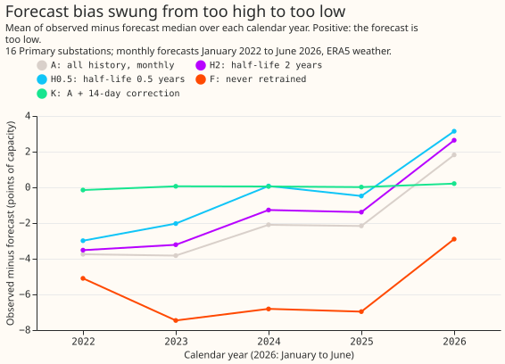
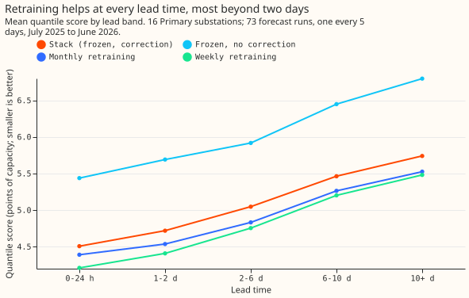
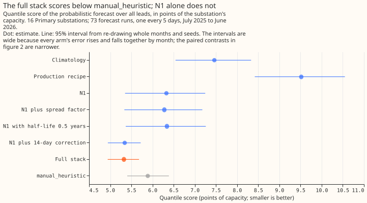
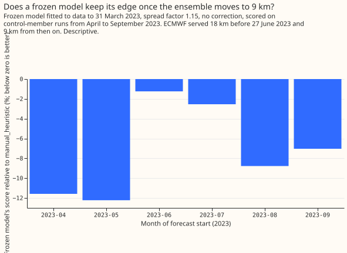
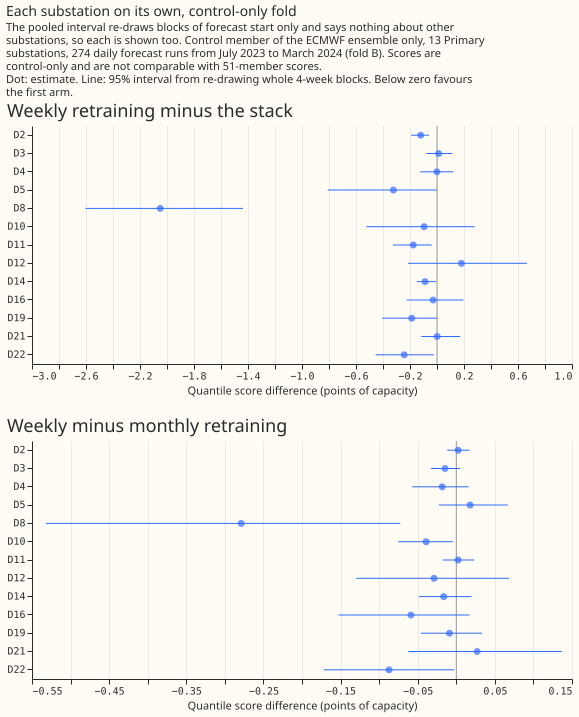
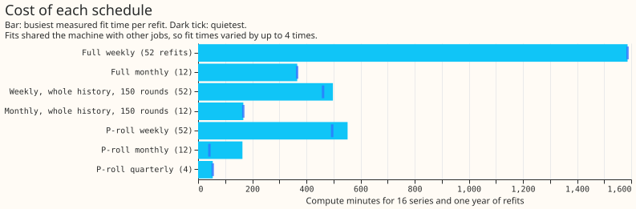

# Retraining cadence and the demand reference: how often to refit the demand model

**The series found that refitting the Primary demand XGBoost model every week, with no error
correction, beat the earlier best setup (a model fitted once, plus a 14-day correction built from
its recent errors) by about 0.2 points of capacity on two separate sets of forecast runs.** The gain
is concentrated in a few substations, and the case for weekly over monthly refitting is small (0.04
to 0.13 points). The series has eleven experiments. They scored 16 Primary substations (substations
that step power down to the local distribution network) unless a row says otherwise.

- **What worked:** refitting often. Weekly refitting scored 0.20 points below the earlier best setup
  on 292 daily runs (99.44% interval -0.40 to -0.035) and 0.24 below it on 274 runs from a different
  period (99.17% interval -0.360 to -0.145). Averaging the quantiles of several retrained models
  gained a further 0.04 to 0.10 points. - **What the series rules out:** a 14-day error correction
  on a model that is refitted weekly (+0.23 points worse in experiment 34), refitting quarterly
  (0.38 points worse than weekly in experiment 85), re-tuning the spread factor, and substation
  fingerprints. The series also found no accuracy reason to refit solar and wind XGBoost models:
  monthly refits changed those scores by 0.04 points or less. - **What to try next:** a weekly refit
  at production settings on a third period, since three substations carry much of the gain; the
  Christmas column and the half-life on a second winter, where the intervals were wide; and the
  blend of weekly refits with the weekly-analogue model, which cleared its threshold once and missed
  it once.

**Scores are in points, where 1 point is 1% of a series' capacity, and smaller is better.**
Experiments 34, 35, 48, 49, 80, 81, and 85 use the quantile score, an error measure that rewards a
forecast that is both close and honest about its uncertainty. Experiment 17 uses the mean absolute
error of the median. Experiment 23 uses the continuous ranked probability score. A contrast is the
score of one arm minus the score of another, so a negative contrast favours the first arm. The
**stack** is the earlier best setup: an XGBoost model fitted once, with a 14-day correction and a
spread factor of 1.15 that widens its quantiles. Every figure is reused from a finished experiment
write-up.

## What the data looks like

**A demand model fitted once drifts: its error changes sign over four years, which is why recent
rows help.** The chart plots the mean signed error (observed minus forecast) of the all-history
model by calendar year. It runs from about -3.8 points in 2022 and 2023 (forecast too high) to +1.8
in the first half of 2026 (forecast too low). The 14-day correction stays within 0.2 points of zero
in every year. [Experiment 17](../00017-training-window-and-retraining-rule-drift-demand/result.md)
drew the chart, on ERA5 weather.

**Retraining helps at every lead time, and most beyond two days.** The chart plots the quantile
score by lead band. Monthly refits score 4.39
against 4.51 for the stack in the first 24 hours, and 5.26 against 5.46 at 6 to 10 days.
[Experiment 34](../00034-retraining-cadence-and-cheap-proxies-demand/result.md) drew the chart.

**The reference baselines are `manual_heuristic` (5.89 in experiment 19), which forecasts from the
power at the same time of day in earlier weeks, and `climatology` (7.46).** The production recipe
scored 9.52, and its 5% to 95% band covered 10% of cases. [Experiment
19](../00019-primary-demand-stack-vs-manual-heuristic/result.md) drew the chart.

**A frozen model's lead over `manual_heuristic` swings by month, so a single month cannot show a
change in the weather product.** The chart plots the frozen model's score relative to
`manual_heuristic` by month, across the move of the ECMWF ensemble from 18 km to 9 km resolution on
2023-06-27. The lead swings from 11.6% (April) to 1.2% (June) to 8.8% (August). [Experiment
81](../00081-r11-control-member-second-validation-year-demand/result.md) drew the chart.

## What the experiments found

**What worked: a 14-day error correction put a model that is fitted once ahead of
`manual_heuristic`, and it supplied nearly all of the stack's gain.** [Experiment
17](../00017-training-window-and-retraining-rule-drift-demand/result.md) found that every rule that
follows recent data beat training on all history, and the 14-day correction beat all of them: 6.10
against 7.62 (-1.52, 99.44% interval -1.95 to -1.13), on ERA5 weather that arrives about 5 days
late. [Experiment 19](../00019-primary-demand-stack-vs-manual-heuristic/result.md) repeated the
test with forecast-time ENS weather. The stack scored 5.32 against `manual_heuristic`'s 5.89 (-0.56,
99.44% interval -0.93 to -0.26), and the correction supplied -0.99 of the stack's -1.00 against
N1, the same XGBoost model without the correction.

**What worked: refitting the XGBoost model monthly scored below the stack at 95%, and refitting
weekly scored below monthly.** [Experiment
34](../00034-retraining-cadence-and-cheap-proxies-demand/result.md) refitted the model once a year,
every 6 months, quarterly, monthly, weekly, and daily, and scored 73 runs. Monthly minus the stack
was -0.20 (95% interval -0.38 to -0.01; the stricter 99.375% interval, -0.44 to +0.08, included
zero, so the verdict was inconclusive). Weekly minus monthly was -0.07 (99.375% interval -0.18 to
-0.00). Daily scored within 0.01 of weekly on three months. The gain per step shrinks as refits
become more frequent.

**The 14-day correction stops helping once the XGBoost model is refitted often, and hurts at weekly
cadence.** Experiment 34 found the correction raised the score (worse) by +0.11 at monthly cadence
(unresolved) and +0.23 at weekly cadence (99.375% interval +0.03 to +0.44). [Experiment
48](../00048-weekly-retraining-confirmation-and-extension-demand-generators/result.md) found a 7-day
correction +0.16 worse (-0.06 to +0.36) and a 14-day correction +0.08 worse (-0.13 to +0.27) on the
weekly model, neither resolved. The correction still lowered the frozen model's score by 1.45 points
(95% interval -1.87 to -0.98), so the correction helps an XGBoost model that is not refitted.

**Weekly refitting held on 292 further daily runs, and on a second period.** [Experiment
48](../00048-weekly-retraining-confirmation-and-extension-demand-generators/result.md) scored the
292 daily runs experiment 34 left out. Weekly refitting scored 5.44 against the stack's 5.64 (-0.20,
99.44% interval -0.40 to -0.035) and beat monthly (5.57) by 0.13 (-0.24 to -0.03). At the 2 bulk
supply point and 2 grid supply point substations, weekly refitting scored 0.66 below the stack
(-1.23 to -0.27). [Experiment
81](../00081-r11-control-member-second-validation-year-demand/result.md) repeated the test on 274
runs from 2023-07 to 2024-03, with the control member of the ensemble only, on 13 substations.
Weekly minus the stack was -0.240 (99.17% interval -0.360 to -0.145), and weekly minus monthly was
-0.039 (-0.064 to -0.012; the 95% t-interval over months, -0.078 to -0.000, only just excludes
zero).

**The gain is concentrated in a few substations.** Without the three substations that carry it (D8,
D12, and D5 in experiment 81), the gain over the stack is 0.09 points (95% interval -0.189 to
-0.014). Substation D8 alone gains 2.05 (-2.60 to -1.44). On the earlier 273-run fold from 2022-07
to 2023-03 (18 km weather), weekly minus the stack was -0.080 (99.17% interval -0.187 to +0.051),
the same sign with an interval that includes zero. Experiment 81 found no sign that weekly refitting
adapts to the 9 km weather product: its gain over the stack fell from -0.552 in December to -0.137
in March.

**A cheaper schedule reproduces the gap between weekly and monthly refitting, at a fraction of the
compute.** Experiment 34 tested four stand-ins for monthly refitting and found that only the rolling
12-month window (monthly refits on the latest 12 months, 150 rounds, learning rate 0.15, called
P-roll) matched full monthly refitting on all three rank tests, at 0.03 points of score and about a
third of the GPU time. Warm-start boosting (updating the previous model) failed, and got worse with
more updates. [Experiment
85](../00085-cheaper-retraining-schedules-rank-arms-like-weekly-demand/result.md) tested six cheaper
schedules against the gap full weekly retraining gives between monthly and weekly refits (+0.125,
95% interval +0.036 to +0.229). The monthly 12-month window gave +0.118 and a weekly whole-history
refit with 150 rounds gave +0.125. Quarterly refits on the 12-month window scored 0.381 above weekly
(+0.207 to +0.565). The starting-value gap (-0.017) was too small to rank any schedule, so agreement
on that contrast says nothing.

**An average of retrained models gained a small amount that varies between periods.** [Experiment
35](../00035-lead-weighted-quantile-blend-of-stored-models/result.md) averaged the quantiles of the
monthly-retrained model, a weekly-analogue model, and the stack: -0.097 (98.33% interval -0.187 to
-0.026) against the best member. [Experiment
49](../00049-vp1-screening-reference-under-p-roll-demand/result.md) blended five models and gained
-0.076 (99.17% interval -0.135 to -0.023) against the best single model, weekly refits.
Experiment 81 blended four models and gained -0.038 (-0.070 to -0.007), short of the -0.05 threshold
that justifies serving a blend.

**What did not work, so the next experiment need not try it:**

- **Re-tuning the spread factor under retraining:** -0.0001 (99.17% interval -0.012 to +0.018).
  The score is flat from 1.05 to 1.15 (experiment 49).
- **Substation fingerprints in a pooled model:** +0.009 (-0.037 to +0.050) (experiment 49).
- **A zero starting value for XGBoost:** -0.017 (98.75% interval -0.072 to +0.054) at Primary
  substations, and worse by +0.049 for wind models without a power-curve margin (experiment 80).
- **Retraining solar and wind models:** monthly refits changed the solar score by -0.044 and the
  wind score by 0.01 (experiment 48).
- **The 14-day correction on solar and wind:** about 0.4 points worse in the CRPS (experiment 23).
- **The Christmas column and the training half-life:** unresolved in two experiments (49 and 81),
  so the column and the half-life of 0.5 years stay.

## What was tried

| Experiment | Question | Verdict | Headline number |
|---|---|---|---|
| [17](../00017-training-window-and-retraining-rule-drift-demand/result.md) | Do a recent training window, recency weights, monthly retraining, or a 14-day correction lower the demand error? | Supported | 14-day correction -1.52 (-1.95 to -1.13) against all-history monthly retraining; mean absolute error, ERA5 weather |
| [19](../00019-primary-demand-stack-vs-manual-heuristic/result.md) | Does the stack (correction, half-life, spread factor) beat `manual_heuristic` for Primary demand? | Supported | Stack minus `manual_heuristic` -0.56 (-0.93 to -0.26); the correction supplies -0.99 of -1.00 |
| [21](../00021-error-correction-variants-bsp-gsp-demand/result.md) | Which correction variant works best, and does it help BSP and GSP demand? | Inconclusive | BSP and GSP +0.36 (-0.19 to +0.98); no variant beat the 14-day additive form |
| [23](../00023-lagged-power-and-error-correction-solar-wind/result.md) | Does recent power, or a 14-day correction, help solar and wind forecasts? | Inconclusive | Lags within about 0.1; correction about 0.4 worse (CRPS) |
| [34](../00034-retraining-cadence-and-cheap-proxies-demand/result.md) | How often should the Primary demand model be refitted, and which cheap proxy stands in? | Inconclusive at the planned level | Monthly minus the stack -0.20 (95% -0.38 to -0.01); weekly minus monthly -0.07 |
| [35](../00035-lead-weighted-quantile-blend-of-stored-models/result.md) | Does a lead-weighted blend of stored models beat the best single model? | Supported for Primary demand only | -0.097 (-0.187 to -0.026); solar -0.039 and wind -0.074, both null |
| [48](../00048-weekly-retraining-confirmation-and-extension-demand-generators/result.md) | Does weekly refitting still beat the stack on the 292 runs experiment 34 left out? | Supported | Weekly minus the stack -0.20 (-0.40 to -0.035); minus monthly -0.13 (-0.24 to -0.03) |
| [49](../00049-vp1-screening-reference-under-p-roll-demand/result.md) | Which Primary demand components still help under monthly retraining? | Supported for the blend only | Blend -0.076 (-0.135 to -0.023); spread factor, fingerprints, half-life, and Christmas column null or unresolved |
| [80](../00080-bm0-zero-base-margin-xgboost-quantile-models/result.md) | Does a zero starting value lower the error of the production-style XGBoost models? | Inconclusive | Primary -0.017 (-0.072 to +0.054); wind +0.049 worse |
| [81](../00081-r11-control-member-second-validation-year-demand/result.md) | Do the weekly-retraining findings hold on 274 runs from 2023-07 to 2024-03? | Supported | Weekly minus the stack -0.240 (-0.360 to -0.145); without three substations -0.093 |
| [85](../00085-cheaper-retraining-schedules-rank-arms-like-weekly-demand/result.md) | Do cheaper schedules rank arms like weekly retraining? | Partly supported | Cadence gap +0.118 and +0.125 against +0.125; quarterly +0.381 |
