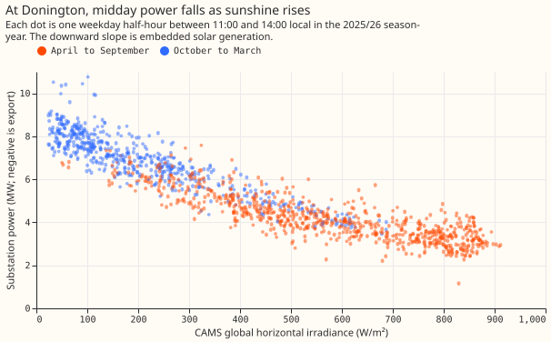
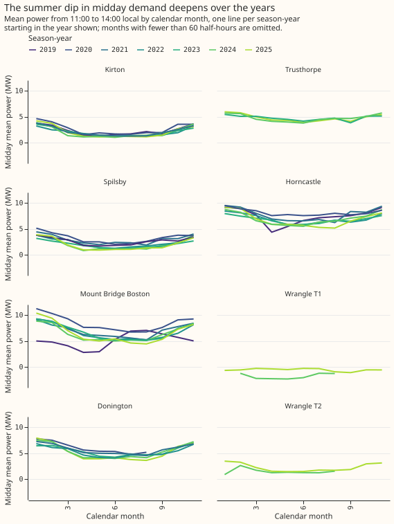
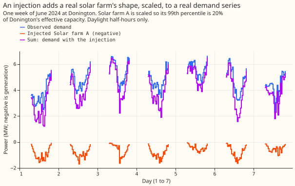
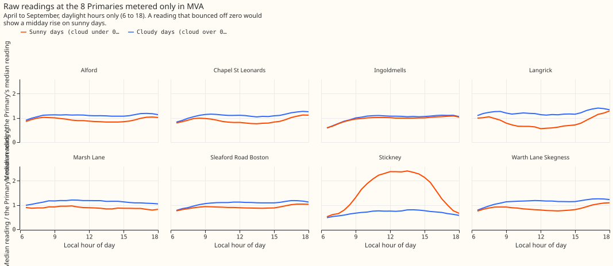
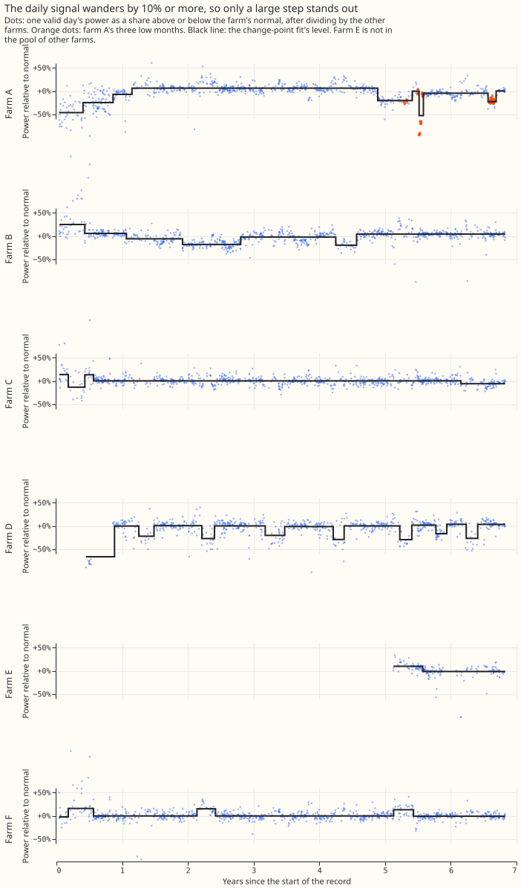

# Solar disaggregation: separating embedded solar from substation demand

**The series found that the output of solar panels behind a substation can be estimated from the
substation's power, and that giving the forecast an explicit solar term lowers its daylight error by
0.15 points of capacity. It also found that the limit is now the forecast of sunshine and not the
panels.** The series has 15 experiments. A Primary substation steps 33 kV or 66 kV
down to 11 kV in the electricity distribution network. Its meter reads demand minus the output of
solar panels connected below it, so a sunny day lowers the metered power. We call those panels
embedded solar.

- **What worked:** a fit of calendar-plus-temperature demand minus one satellite-driven solar shape
  recovers about 85% (the daily fit) of solar-farm output added to a substation's demand. XGBoost, given the
  panels' capacity times the forecast sunshine as a starting offset, scores 0.152 points of capacity
  lower than the best guess (98.75% interval -0.199 to -0.111).
- **What the series rules out:** GEFS, and UKV alone, as a replacement for ENS in the sunshine forecast (a UKV and ENS blend gives a
  small gain that one validation year cannot confirm), a fitted mix of panel orientations, a capacity series that changes week by
  week, and a monitor that spots a lost inverter from daily readings.
- **What to try next:** improve the sunshine forecast itself and refresh the capacity table once a
  season-year. A source of a different kind, such as outage notices from National Grid Electricity
  Distribution (NGED), could test the losses that the readings cannot show.

**Scores are quantile scores in points, where 1 point is 1% of a substation's capacity, and smaller
is better.** `d0` is the best-guess recipe of experiment 33. Every page named below
is a finished experiment write-up, and every figure is reused from those pages.

## What the data looks like

**The power at a substation with embedded solar falls as the sun rises.** The chart below plots one
substation's midday power against satellite-measured sunshine, one dot per midday half-hour. The
downward slope is the embedded solar. [Experiment
39](../00039-pv-disaggregation-cams-injection/result.md) drew it.

**Midday power falls in summer at the substations plotted, and the capacity fitted in experiment 39 rose at 4 of the 5 Primaries with 4 or more years of data.**
Each line is one season-year (a 12-month period), so the lines show whether
the solar capacity has grown. Wrangle T1 sits near or below zero.

**A labelled example is real solar-farm output added to real demand.** The fit never sees the
answer, so we can check how much of the added capacity the fit finds again. The figure shows one
week of June 2024, with the farm's output scaled to 20% of the substation's capacity.

**Eight further Primaries are metered only in the size of their flow (MVA), not its direction.**
The fit finds no reverse flow at seven of them. At Stickney, the readings on sunny days rise at
midday, and the reading cannot say whether the flow reversed. [Experiment
79](../00079-pvdis-7-mw-at-mva-only-primaries/result.md) drew this.

**A solar farm's own daily output wanders by 6% to 11% of its normal level, so a small loss hides
inside the noise.** The black line is the monitor's fitted level; the orange dots are three months
when farm A really did run low. [Experiment
72](../00072-p35-step-loss-monitor-for-solar-farms/result.md) drew this.

## What worked

**A simple fit finds most of the added solar capacity, and passes most real-data checks.**
[Experiment 39](../00039-pv-disaggregation-cams-injection/result.md) added real solar-farm output to
the demand of the 8 Primaries that meter in both directions. The daily version of the fit recovered
0.854 (95% interval 0.815 to 0.866) of the added capacity. 6 of the 8 Primaries passed four
further checks on the real series, and Wrangle T1 failed the placebo-sky check.

**The fitted capacity is close to unbiased on pure solar output on average, but a cloud-driven demand load can still
hide inside it.** [Experiment 40](../00040-pv-capacity-error-bars/result.md) found a median fitted
capacity of 0.992 of the true value (0.951 to 1.032) and a false-alarm rate of 0.055. The test
for a cloud-driven load caught a day-long load in only 0.35 of trials, so each capacity carries a
bound of 0.18 to 0.71 of the capacity. Kirton is flagged as confounded.

**Giving XGBoost the solar term as a starting offset lowers daylight error by 0.15 points.** The
offset is the panels' capacity times a calibrated forecast of how sunny the day will be, times a
weight fitted on the training years. [Experiment
64](../00064-pvdis-5-net-demand-as-demand-minus-forecast-solar/result.md) scored arm `am` at 4.467
against 4.620 for `d0`, which is -0.152 (98.75% interval -0.199 to -0.111). The same arm given the
sunshine of another date scored 0.300 worse (0.198 to 0.407), so the forecast sunshine is doing the
work. Climatology scores 5.272 and the manual heuristic 4.952. Arm `am` is a candidate for a
model release.

**Part of experiment 64's gain is XGBoost starting from zero, and a capacity table refreshed once a
season-year is enough.** [Experiment 76](../00076-pvdis-5-leak-check-beyond-10-days/result.md)
found no route for a leak, and a refit with no solar term reproduced the gain at 10 days and
beyond. [Experiment 78](../00078-pvdis-5-current-capacity-vintages/result.md) then showed that a
capacity re-estimated before every forecast run lowers the score by only 0.018 points (-0.036 to
-0.004). A zero start lowers `d0` by 0.071 (-0.099 to -0.047), and the solar term still lowers the
score by 0.100 against a `d0` that starts from zero.

**The sunshine forecast, not the panels, now limits the gain.** [Experiment
46](../00046-embedded-solar-share-of-primary-forecast-error/result.md) built the solar term from
the true sunshine and scored 0.966 points lower than the same forecast without radiation inputs
(-1.431 to -0.595), about 20% of its error. The ENS forecast of sunshine lowered the score by 0.056
(-0.191 to +0.064). [Experiment 77](../00077-pvdis-6b-fitted-solar-shape-in-arm-am/result.md) found
that a fitted panel shape leaves the score unchanged (-0.001, 98.33% interval -0.018 to +0.014),
while sunshine from another date worsens it by 0.32.

## What was tried

| Experiment | Question | Verdict | Headline number |
|---|---|---|---|
| [39](../00039-pv-disaggregation-cams-injection/result.md) | Can a satellite-driven fit separate embedded solar from demand? | Partly supported | 0.854 (0.815 to 0.866) of injected capacity recovered; real checks pass at 6 of 8 Primaries |
| [40](../00040-pv-capacity-error-bars/result.md) | Can a misfit test flag a cloud-driven load that biases the capacity? | Partly supported | Capacity over truth 0.992 (0.951 to 1.032); a day-long load detected in 0.35 of trials, short of 0.80 |
| [45](../00045-pvdis-4-weekly-capacity-asymmetric-l1/result.md) | Can a weekly capacity series, easy to rise and slow to fall, be read from the data? | Refuted | Path error 0.040 against 0.027 for one capacity per season-year; 0.66 false steps per Primary-year against a limit of 0.5 |
| [46](../00046-embedded-solar-share-of-primary-forecast-error/result.md) | Does a solar term built from ENS sunshine lower daylight error by 0.35 points? | Refuted | -0.056 (-0.191 to +0.064); true sunshine -0.966 (-1.431 to -0.595) |
| [50](../00050-second-weather-forecast-for-solar-anomaly/result.md) | Does GEFS, or a GEFS and ENS blend, forecast the sunshine anomaly better than ENS? | Refuted | GEFS squared error 10.9% above ENS; the blend 0.2% above |
| [51](../00051-pvdis-3b-midday-loss-of-the-solar-term/result.md) | Why does the solar term lose at sunny summer middays? | Partly supported | The coefficient of 1 is too large and the cause is not identified; a fitted one lowers the median's error by 0.991 (-1.473 to -0.495); ensemble members add 0.129 (0.057 to 0.212) |
| [53](../00053-ukv-vs-ens-solar-anomaly/result.md) | Does the Met Office UKV forecast the sunshine anomaly better than ENS? | Small gain (blend only) | Squared error 4% to 14% lower within 2 days in cross-validation; validation correlation +0.011 (-0.006 to +0.027) over 0 to 54 hours; UKV alone worse |
| [64](../00064-pvdis-5-net-demand-as-demand-minus-forecast-solar/result.md) | Does demand minus forecast solar match the best guess? | Supported | Arm `am` -0.152 (-0.199 to -0.111) against `d0` |
| [72](../00072-p35-step-loss-monitor-for-solar-farms/result.md) | Can a monitor find a lost inverter at a solar farm? | Refuted | 0.84 of 25% losses lasting 90 days found; 0.45 of those lasting 30 days; 3% losses near chance |
| [73](../00073-pvdis-6-orientation-mix-and-dc-ac-ratio/result.md) | Can the east, south, and west panel mix and the DC to AC ratio be read from power? | Partly supported | Share error 0.09 without noise and 0.20 with it, against 0.30 for guessing; DC to AC ratio not recovered; the blend scores 1.3% better than south-only |
| [74](../00074-an1-same-time-analogues-vs-explicit-solar-forecast-demand/result.md) | Do same-time sunshine analogues add anything once the solar forecast is explicit? | Inconclusive | Adding analogues changes the score by -0.066 (-0.149 to +0.015); a gain of 0.05 is neither shown nor ruled out |
| [76](../00076-pvdis-5-leak-check-beyond-10-days/result.md) | Does experiment 64's gain at 10 days and beyond come from a leak? | Supported (no leak found) | A refit with no solar term reproduces the gain |
| [77](../00077-pvdis-6b-fitted-solar-shape-in-arm-am/result.md) | Does a fitted solar shape lower arm `am`'s error? | Refuted | -0.001 (-0.018 to +0.014) |
| [78](../00078-pvdis-5-current-capacity-vintages/result.md) | Does a capacity re-estimated before each run lower arm `am`'s error? | Small gain | -0.018 (-0.036 to -0.004); a zero start lowers `d0` by 0.071 (-0.099 to -0.047) |
| [79](../00079-pvdis-7-mw-at-mva-only-primaries/result.md) | Can the flow direction and solar capacity be recovered at Primaries metered only in MVA? | Partly supported | Capacity error 0.09 against 0.29 for the naive fit; direction balanced accuracy 0.78 |
