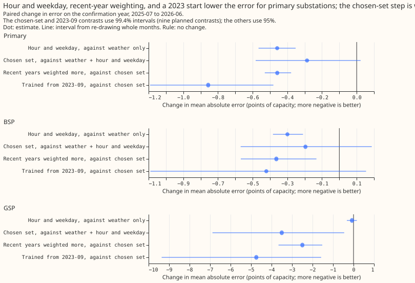
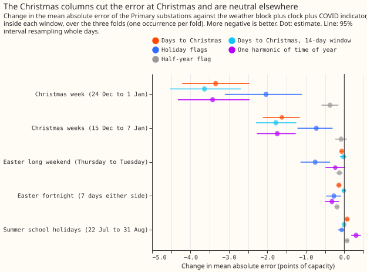

# Demand inputs

**At Primary substations, a calendar-and-solar set of inputs lowered the demand forecast error by
0.1 points of capacity or more with an interval clear of zero: the hour and weekday, the COVID
indicator, a Christmas column limited to the 14 days either side of 25 December, and an explicit
forecast of the unmetered solar output.** A heating term gave 0.14 points in cold hours up to 48
hours ahead on one winter, which is under its 0.3 target. The electricity price, school terms,
statistics of installed solar capacity, substation fingerprints, and the PV_Live estimate of solar
generation gave no gain of 0.1 points that held up.

The experiments added one kind of information at a time to an XGBoost demand forecast and scored
the change against the same XGBoost model without it. They scored 13 to 16
[Primary substations](../../glossary.md#primary-substation) (experiment 74: 5), over one or two
validation years, and experiments 27 and 28 scored two grid supply points. Errors are in [points of
capacity](../../glossary.md#capacity-and-points-of-capacity), a negative change is an improvement,
and each number names its metric: the error of the median (the mean absolute error of the middle
forecast) or the [quantile score](../../glossary.md#quantile-score-and-pinball-loss). Several gains
in the selection year (the year used to choose inputs) vanished in the confirmation year (the later
year used to check them) or against a control.

**For Primary substations on the confirmation year (July 2025 to June 2026), adding the hour and
weekday to the weather lowered the error of the median by 0.46 points (99.4% interval -0.61 to
-0.30), the largest single input.** The panels show the same contrasts for the 2 bulk and 2 grid
supply points, which have too few series to settle. Source: [experiment
6](../../00006-stage1a-demand-input-feature-sweep/result.md), an ERA5-trained [stage
1a](../../glossary.md#stages-0-1a-and-2) XGBoost model on 14 Primaries.

## Does it work?

**The hour and weekday, the COVID indicator, and a windowed Christmas column help; school terms do
not.** In experiment 6 the hour and weekday lowered the error of the median by 0.55 points on the
selection year, a third of the 1.5 predicted, and the pre-registered COVID indicator by 0.26 (-0.40
to -0.10). The Christmas column is weaker evidence. The 15 December to 7 January window was chosen
after the run, and the column lowered the Primary error there by 1.78 points (95% interval -2.30 to
-1.26) and changed it by 0.00 elsewhere. The gain is concentrated: the median-error series barely
moved (3.96 to 3.95 in the confirmation year) and a series picked after the fact fell from 22.23 to
4.13. Dropping the column from the chosen set changed the selection-year Primary error by +0.14
(-0.06 to +0.35), and the whole-year effect was -0.10. [Experiment
11](../../00011-school-term-and-return-to-work-columns-stage1a-demand/result.md) found no gain from
return-to-work or school-term columns on Lincolnshire Primaries: +0.20 at Easter (99.2% interval
-0.19 to +0.59) and -0.29 in half-terms (-0.68 to +0.07). The experiment's own rule gives `refuted`,
and its write-up reads Easter and half-terms as inconclusive.

**The Christmas columns cut the Christmas error and leave other days unchanged.** Source:
[experiment 6](../../00006-stage1a-demand-input-feature-sweep/result.md), post hoc windows (chosen
after seeing the results), three folds.

**An explicit forecast of the unmetered solar output lowers the daylight error; same-time analogues
may too, and the data could not rank the two.** In [experiment
74](../../00074-an1-same-time-analogues-vs-explicit-solar-forecast-demand/result.md), five Primaries
refitted monthly and scored on daylight April-to-September rows, the explicit offset lowered the
quantile score by 0.149 (99.17% interval -0.201 to -0.104) and 3 analogues by 0.095 (-0.185 to
-0.007), against a monthly refit with neither. An offset built from another date's sunshine scored
0.246 worse than the real offset. Statistics of installed capacity did not help 16 Primaries
(+0.006, -0.022 to +0.033; [experiment 31](../../00031-embedded-pv-features-primary-demand/result.md)).

**Both ways of telling the XGBoost model about sunshine lowered the daylight error, and the intervals
overlap.** Source: [experiment
74](../../00074-an1-same-time-analogues-vs-explicit-solar-forecast-demand/result.md), 5 Primaries,
one validation year.

**Satellite sunshine as a training input gave no resolved gain, and a correction of the forecast
sunshine a further small one.** Training on [CAMS](../../glossary.md#ens-era5-and-cams) irradiance
changed the Primary quantile score by -0.035 (97.5% interval -0.070 to +0.001), `refuted` against
0.2 planned ([experiment 9](../../00009-cams-trained-stage1a-vs-era5-trained-demand/result.md)).
Mapping the ENS shortwave onto CAMS lowered it by a further 0.067 (-0.094 to -0.039), which makes the
pair 0.102 better than the ERA5-trained arm, but the monthly ratio to CAMS still ran from 0.81 to
1.13, so the verdict is `inconclusive` ([experiment
14](../../00014-cams-trained-stage1-with-stage0-ens-correction-demand/result.md)). PV_Live,
Sheffield Solar's estimate of solar generation, gave no resolved gain at the two grid supply points
Walpole and Bicker Fen ([experiment 27](../../00027-pvlive-lags-in-stage2-gsp-demand/result.md),
-0.03; [experiment 28](../../00028-pvlive-forecast-in-stage2-gsp-demand/result.md), -0.14 with
interval -0.34 to +0.04).

**The electricity price gave no gain that held against a control.** The price at the target
half-hour lowered the pooled error of the median by 0.52 in the selection year (97.5% interval -0.88
to -0.11) and 0.18 in the confirmation year (-0.50 to +0.08), and a price from another week matched
about 0.45 of the 0.52 ([experiment 15](../../00015-same-time-price-stage1-demand/result.md)).
Price changes ([experiment 25](../../00025-price-change-features-stage1-demand/result.md)) and lagged
prices ([experiment 10](../../00010-elexon-price-lags-stage1a-demand/result.md)) did no better.

**Substation fingerprints and a heating term gave little.** Fingerprints changed the quantile score
by +0.02 (-0.05 to +0.10; [experiment
32](../../00032-substation-fingerprints-pooled-demand/result.md)). A heating term lowered it by 0.143
in cold hours up to 48 hours ahead (98.75% interval -0.203 to -0.034) and by 0.022 over all rows
(-0.042 to +0.000), on 16 Primaries over one winter in which three ISO weeks hold 66% of the cold
rows. The q95 forecast was still exceeded in 16.2% of those hours ([experiment
94](../../00094-explicit-heating-offset-primary-demand/result.md)). Experiments 24 and 30 are in the
candidates below.

## Best design so far

**Among the experiments of this theme, no single one assembled the parts; the parts that beat their
controls are below.** Experiment 87 (the production-reference theme) assembled several of them in
[BG2](../../glossary.md#bg2). Give the weather-to-power XGBoost model the hour and weekday and the
days to Christmas inside a 14-day window ([experiment
6](../../00006-stage1a-demand-input-feature-sweep/result.md)). Where a clean solar capacity estimate
exists, add the forecast unmetered solar output as a [base margin](../../glossary.md#base-margin)
([experiment 74](../../00074-an1-same-time-analogues-vs-explicit-solar-forecast-demand/result.md),
using the offset of [experiment
64](../../00064-pvdis-5-net-demand-as-demand-minus-forecast-solar/result.md); experiment 74 is
`not-for-production`). In BG2 the offset lowered the score by 0.114 on its daylight April-to-September
rows at the 5 Primaries that carry one, and by 0.010 over the whole year at all 16 Primaries
([experiment 87](../../00087-bg2-best-guess-assembled-with-drop-one-ablations/result.md)). The
stage 0 mapping ([experiment
14](../../00014-cams-trained-stage1-with-stage0-ens-correction-demand/result.md)) and the heating
term ([experiment 94](../../00094-explicit-heating-offset-primary-demand/result.md)) are
candidates, not yet part of the design.

## Candidates for production

**Five experiments here are marked `candidate`, and each rests on one validation year or an
unconfirmed input.**

- **Stage 1a inputs ([experiment 6](../../00006-stage1a-demand-input-feature-sweep/result.md)):**
  the clock, the COVID indicator (-0.26), recency weights (-0.32, half-life 2 years), and the
  windowed Christmas column for the ERA5-trained stage 1a XGBoost model. A training start of 2023-09
  stays unconfirmed (0.86 better on the confirmation year, 0.05 on the selection year).
- **Stage 0 ([experiment
  14](../../00014-cams-trained-stage1-with-stage0-ens-correction-demand/result.md)):** a quantile
  mapping of ENS shortwave onto CAMS for a CAMS-trained stage 1a, 0.067 points better.
- **Pooling ([experiment 24](../../00024-pooling-groupings-demand-xgboost/result.md)):** one XGBoost
  model per substation type or size band (3 or 4 models instead of 20), 0.15 points worse (99.44%
  interval +0.03 to +0.26), with the series identifier.
- **Weekly mean and median ([experiment
  30](../../00030-lagged-power-feature-sets-primary-demand/result.md)):** two extra columns in N1
  with the [14-day correction](../../glossary.md#14-day-correction), 0.05 points better than N1 with
  it (-0.08 to -0.02). The arm is post hoc, and against the experiment 19 stack the 0.03 gain
  touches zero (-0.06 to +0.00).
- **Heating term ([experiment
  94](../../00094-explicit-heating-offset-primary-demand/result.md)):** a per-series [base
  margin](../../glossary.md#base-margin). The experiment advises a second winter before porting.

## Gotchas and implementation details

- **Add a placebo twin of every added input**, a copy with the same level but the wrong timing.
  A price from another week matched 0.45 of the 0.52-point price gain ([experiment
  15](../../00015-same-time-price-stage1-demand/result.md)), the
  shuffled price matched most of the gain at the battery site ([experiment
  10](../../00010-elexon-price-lags-stage1a-demand/result.md)), an offset from another date scored
  0.246 worse ([experiment
  74](../../00074-an1-same-time-analogues-vs-explicit-solar-forecast-demand/result.md)), and a
  shuffled capacity control matched the register products ([experiment
  31](../../00031-embedded-pv-features-primary-demand/result.md)). Without the twin, a column that
  only carries a level is credited. Re-check with a different data source.
- **Check a calendar column against a half-year flag and score it inside the special days.** The
  unwindowed days-to-Christmas column flips sign every late June, so it acts as a half-year flag, and
  a time-of-year harmonic matched the Christmas gain but worsened summer ([experiment
  6](../../00006-stage1a-demand-input-feature-sweep/result.md)). A column can also help a few days a
  year and barely move the yearly mean. Add a placebo calendar shifted by a fixed number of days
  ([experiment
  11](../../00011-school-term-and-return-to-work-columns-stage1a-demand/result.md)). Re-check with
  more years than 3.
- **Fix `colsample_bytree` at 1.0 in every arm of a column ablation.** Experiments
  [6](../../00006-stage1a-demand-input-feature-sweep/result.md),
  [30](../../00030-lagged-power-feature-sets-primary-demand/result.md),
  [31](../../00031-embedded-pv-features-primary-demand/result.md), and
  [32](../../00032-substation-fingerprints-pooled-demand/result.md) did so because column
  subsampling hands the wider arm a free win. None measured the size of that effect. Re-check if the
  arms are ever given equal column counts.
- **Give every arm the same starting level.** A start at zero lowered the error by 0.071 (-0.099 to
  -0.047) against XGBoost's estimated base score in [experiment
  78](../../00078-pvdis-5-current-capacity-vintages/result.md), and experiment 74 quotes 0.07 to 0.10
  points, so it started every arm at the median of the training labels ([experiment
  74](../../00074-an1-same-time-analogues-vs-explicit-solar-forecast-demand/result.md)). [Experiment
  76](../../00076-pvdis-5-leak-check-beyond-10-days/result.md) did not test the effect. Re-check with
  a different pipeline.
- **Judge a lag set against N1 with the 14-day correction.** The weekly lags gained 0.30 without the
  correction and lost 0.09 with it ([experiment
  30](../../00030-lagged-power-feature-sets-primary-demand/result.md)). Re-check if the correction
  changes.
- **Read a selection-year gain only after a confirmation year.** The price gain at the battery site
  fell from -0.92 to -0.06 ([experiment
  10](../../00010-elexon-price-lags-stage1a-demand/result.md)), and a 2023-09 training start gained
  0.05 and then 0.86 ([experiment
  6](../../00006-stage1a-demand-input-feature-sweep/result.md)). Re-check with a third year.
- **Test an input on the weather it will be served with.** A CAMS-trained XGBoost model lowered the
  daylight error by 0.88 reading CAMS and by 0.04 reading ENS ([experiment
  9](../../00009-cams-trained-stage1a-vs-era5-trained-demand/result.md)), and an ERA5-trained solar
  forecast ran 1.8 to 3.0 points too high on ENS members ([experiment
  28](../../00028-pvlive-forecast-in-stage2-gsp-demand/result.md)). Re-check with a different weather
  product.
- **Report a pooled share with and without the largest-residual substation.** One substation set the
  pooled share in [experiment 7](../../00007-cams-static-correction-stage1a-residual/result.md).
  Re-check on new series.
- **Give every pooled XGBoost model the series identifier, and no fixed-window statistics for a
  held-out series.** Dropping the identifier raised the score by 0.82 for by-type pools ([experiment
  24](../../00024-pooling-groupings-demand-xgboost/result.md)), and training-window statistics
  worsened a held-out substation by 1.39, probably because 7 series learn them as identifiers
  ([experiment 32](../../00032-substation-fingerprints-pooled-demand/result.md)). Re-check with a
  pool of hundreds of series.
- **Score cold-hour and special-day contrasts on more than one winter.** Three ISO weeks held 66% of
  the cold rows at leads up to 48 hours ([experiment
  94](../../00094-explicit-heating-offset-primary-demand/result.md)), and the Christmas windows rest
  on three Christmases ([experiment
  6](../../00006-stage1a-demand-input-feature-sweep/result.md)). Re-check when a second winter
  exists.

## What we have not settled

- **A second validation year.** The analogues on top of the offset (-0.066, -0.149 to +0.015) and the
  heating term need one.
- **Battery response to price.** Only the largest battery site was testable, and national demand and
  wind scored at least as well as the price, so the price may be a proxy for them.
- **Stage 0 on more than 14 months of ENS and all members**, and half-term effects with more than 9
  half-terms.

The theme's [research plan](plan.md) lists the proposals still waiting.
