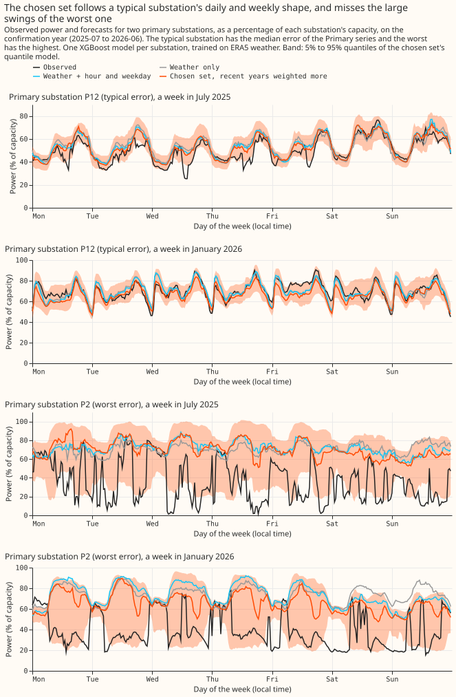
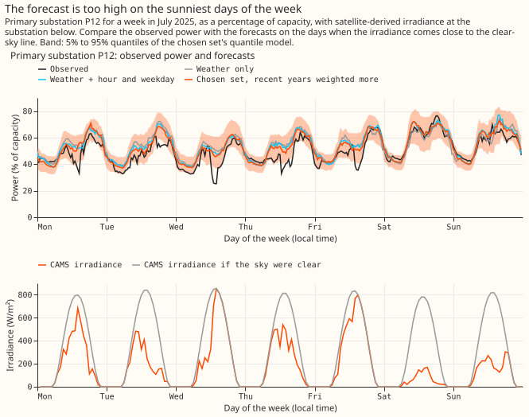
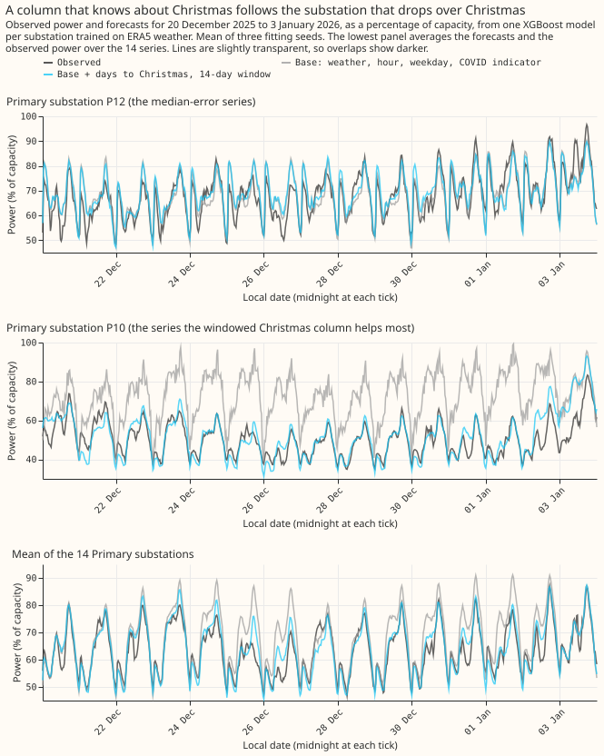

# Demand inputs: which extra information helps the substation demand forecast

**Most extra inputs to the demand forecast improve it by less than 0.1 points of capacity.** Three
inputs are the exceptions: recent power in the second-stage calibrator, the hour and weekday, and a
Christmas column. The series has 13 experiments. Each one added a different kind of information to
the XGBoost model that forecasts how much power a substation draws: recent power readings, satellite
sunshine, the electricity price, the school calendar, or a shared model for several substations.
Most experiments scored forecasts for 20 time series of substation power, 16 of them from Primary
substations. A Primary substation steps 33 kV or 66 kV down to 11 kV in the electricity distribution
network. The other 4 series are 2 bulk supply points and 2 grid supply points, which sit higher in
the network.

**The forecast has stages, and the page names them.** Stage 1a is an XGBoost model that maps weather
and the calendar to power. Stage 1b adds recent power readings (lags) to that model. Stage 2, the
calibrator, corrects the quantiles of the earlier stage using recent forecast errors. Stage 0 is a
correction applied to the weather inputs before stage 1a reads them.

**Scores are in points of capacity, where 1 point is 1% of a time series' effective capacity, and
smaller is better.** A quantile score measures how well the forecast quantiles fit what happened. An
error of the median is a mean absolute error of the middle forecast. A difference between two arms
is
the score of the first arm minus the score of the second, so a negative difference means the first
arm is
better, except where the text says the number is an extra score. Each interval is a confidence
interval
from resampling whole months; its level (97.5% to 99.44%) is set by the number of contrasts the
experiment planned. Each experiment scored its inputs on a selection year and then on a confirmation
year, or on one validation year. ERA5 is the European Centre for Medium-Range Weather Forecasts'
(ECMWF) reanalysis, a record of past weather. ENS is ECMWF's 51-member ensemble weather forecast.
CAMS is the Copernicus Atmosphere Monitoring Service's satellite-derived irradiance (sunshine
reaching the ground). The figures are reused from the experiment write-ups linked below.

- **What the experiments found:**
    - Recent power helps most in the second-stage calibrator. It scored 0.84 points better than the
      same readings in stage 1b (99% interval +0.28 to +1.50). That figure overstates a live
      forecast, as the first finding below explains.
    - The hour and weekday lower the error by about 0.5 points, and a Christmas column lowers it by
      1.8 points from 15 December to 7 January.
    - Training on CAMS irradiance instead of ERA5 shortwave lowers the score by 0.035 points, and a
      correction to the ENS irradiance lowers it by a further 0.067.
    - One XGBoost model per substation type (4 models) scores 0.15 points worse than one model per
      series (20 models).
- **What gave no resolved gain:** extra summaries of recent power (minimum, mean, and maximum), the
  electricity price at the same half-hour or its changes, school-term columns, and fingerprints of
  each substation. None reached its planned threshold. Experiments 8 and 30 are inconclusive and
  could not exclude a gain of 0.15 points.
- **Follow-ups the results point to:** national demand and wind would test whether the price is
  needed at all, because both scored at least as well as the price. The lag placement would be
  re-tested with forecast-time weather in place of the ERA5 weather that makes the first result a
  ceiling. A stage 0 fitted on more than 14 months of ENS and on all ensemble members would test the
  monthly mismatch: stage 0 fixed the mean over the year but left the monthly mean up to 18.6% off
  CAMS, and a post hoc mapping per calendar month, fitted on one year, did no better.

## What the data looks like

**A Primary substation's demand follows a daily and weekly shape, and a few series swing far outside
it.** The chart shows one week of July 2025 and one of January 2026 for the Primary substation with
the median error (P12) and the Primary substation with the highest error (P2), with the forecasts of
the chosen
input set. P12's power follows the morning and evening peaks and the weekend dip. P2's power
repeatedly falls to 10% to 40% of capacity for hours, which none of the inputs tested explains.
[Experiment 6](../../00006-stage1a-demand-input-feature-sweep/result.md) drew the chart.

**Sunny days lower the power at the substation plotted, which fits embedded solar that the weather
inputs do not see.** The chart shows P12's week of July 2025 with CAMS irradiance below. On the five
weekdays with irradiance above 450 W/m², the observed power dips 10 to 25 points of capacity below
the forecasts. On the cloudy weekend it does not. One week cannot separate cloud from weekday.
[Experiment 6](../../00006-stage1a-demand-input-feature-sweep/result.md) drew the chart.

**The error is largest at Christmas, when the forecast without a holiday column misses the dip.**
The chart shows the observed power and the forecasts over Christmas 2025, with and without the
windowed Christmas column. The Primary error without the Christmas column is 9.66 points from 15
December to 7 January
against 7.52 on the other days. [Experiment
6](../../00006-stage1a-demand-input-feature-sweep/result.md) drew the chart.

**The ENS forecast of daylight shortwave differs from satellite irradiance by up to 26%, depending
on the month.** The chart plots the ratio of ENS daylight shortwave to CAMS, as published and after
the
stage 0 correction. The published ratio runs from 0.92 to 1.26 by month. [Experiment
14](../../00014-cams-trained-stage1-with-stage0-ens-correction-demand/result.md) drew the chart.

**This page has no chart of the electricity price.** [Experiment
10](../../00010-elexon-price-lags-stage1a-demand/result.md) and [experiment
15](../../00015-same-time-price-stage1-demand/result.md) plot the price's effect on the error, not the
price itself.

## What the experiments found

**Recent power helps most when it enters the second-stage calibrator, not the first-stage model.**
[Experiment 5](../../00005-lag-placement-stage1b-vs-stage2-demand/result.md) gave both placements the
same inputs on 20 series and 73 runs. Stage 1b with a calibrator scored 0.84 points worse than the
calibrator with lags (99% interval +0.28 to +1.50) for leads up to 48 hours. The scores were 5.31
for lags in the calibrator, 6.14 for stage 1b, and 7.11 for no lags. Using both placements lowered
the score by at most 0.12 points. Every lagged arm overstates what a live forecast could do, because
the lagged residuals use ERA5 weather at past times, which a live forecast lacks. A calibrator
without lags scored about 1 point worse at short leads.

**More lagged power adds little once the calibrator or the 14-day correction has the recent level.**
[Experiment 8](../../00008-lag-summaries-in-stage2-calibrator-demand/result.md) added the minimum,
mean, and maximum of the last 24 hours and of the same weekday. The score changed by -0.02 points
(98.75% interval -0.14 to +0.13) for leads up to 48 hours. [Experiment
30](../../00030-lagged-power-feature-sets-primary-demand/result.md) gave the single-stage model N1 all
13 lags of `manual_heuristic`. The 6 weekly analogues lowered the score by 0.30 points (-0.63 to
-0.02), the 7 annual analogues raised the score by 0.29 (+0.13 to +0.49), and with the 14-day
correction N1
scores 5.34. A weekly mean and median arm, added post hoc and scored on one validation year, scores
5.29, which
is 0.05 below N1 (-0.08 to -0.02).

**Of the non-lag inputs tested, the hour, the weekday, and a Christmas column clearly helped.**
[Experiment
6](../../00006-stage1a-demand-input-feature-sweep/result.md) scored input sets for the ERA5-trained
stage 1a model on 14 Primary substations. Hour and weekday lowered the error by 0.55 points (99.4%
interval -0.71 to -0.41) on the selection year and 0.46 (-0.61 to -0.30) on the confirmation year,
against 1.5 predicted. The 14-day Christmas column, a post hoc check in the write-up, lowers the
Primary error by 1.78 points from 15
December to 7 January (-2.30 to -1.26) and changes it by 0.00 on other days. A 2023-09 training
start lowers the confirmation-year error by a further 0.86, but the 2023-09 start did not help on
the selection year.

**Satellite sunshine as a training input gives a small gain, and a correction to the forecast
sunshine roughly triples it.** [Experiment
7](../../00007-cams-static-correction-stage1a-residual/result.md)
found that a static correction removed 46.6% of the daylight squared residual (98.33% interval 38.4%
to 53.1%), just under the planned 50%. [Experiment
9](../../00009-cams-trained-stage1a-vs-era5-trained-demand/result.md) trained stage 1a on CAMS and
lowered the Primary quantile score by 0.035 points (97.5% interval -0.070 to +0.001), against 0.2
planned. The gain is in daylight and the first 6 days. [Experiment
14](../../00014-cams-trained-stage1-with-stage0-ens-correction-demand/result.md) mapped the ENS
shortwave onto CAMS and lowered the score by a further 0.067 (-0.094 to -0.039), in 12 of 12 months.
The mean daylight ratio to CAMS reached 1.000. The monthly ratio still ran from 0.81 to 1.13, so the
5% monthly rule failed. The spread between ensemble members also widened by 27%.

**The electricity price gave no reliable gain. National demand and wind scored at least as well.**
[Experiment 15](../../00015-same-time-price-stage1-demand/result.md) lowered the pooled error by 0.52
points (97.5% interval -0.88 to -0.11) in the selection year and 0.18 (-0.50 to +0.08) in the
confirmation year. A price from another week scored within 0.07 of the real price. [Experiment
25](../../00025-price-change-features-stage1-demand/result.md) added the price's changes, which lowered
the error by only 0.037 points (-0.056 to -0.018), against a 0.1 threshold. National demand and
wind scored 0.22 and 0.40 points below the price-change arm in the selection and confirmation years
respectively. [Experiment 10](../../00010-elexon-price-lags-stage1a-demand/result.md) could not test a
battery response, because only 2 of the 20 series have a battery of at least 5% of capacity.

**A pool of 4 models, one per substation type, scores 0.15 points worse than 20 models, one per
series, if each model gets the series identifier.**
[Experiment 24](../../00024-pooling-groupings-demand-xgboost/result.md) refitted the 20 series with one
model per substation type. On 16 Primary substations the score was 5.47 against 5.32 for per-series
models (+0.15, 99.44% interval +0.03 to +0.26). One model for all series scored 5.61 (+0.29, +0.19
to +0.42). Without the identifier the by-type pool lost a further 0.82 points. A random grouping
scored the same as the by-type grouping, so in this experiment the number of models mattered more
than which substations share a model. The research log lists the experiment as a candidate for the
next model release.

**Fingerprints of each substation do not help a pooled model.** [Experiment
32](../../00032-substation-fingerprints-pooled-demand/result.md) added location, training-window
statistics, and recent-window statistics to the by-type pool. Training-window and recent-window
statistics together changed the score
by +0.02 points (99.375% interval -0.05 to +0.10), and a substation held out of the pool scored 1.39
points worse with training-window statistics (+0.99 to +1.91).

**Telling the Primary demand model how unusual each lag is did not help, and raised the error.**
[Experiment 90](../../00090-sw2-28-lag-unusualness-inputs-all-rows-and-switching/result.md) gave the
XGBoost model the probability integral transform (the share of ordinary readings below the lag, at
the same time of day, kind of day, and month) of its three lags. The quantile score worsened by
0.355 points of capacity (97.5% interval +0.209 to +0.513) on all half-hours outside switching.
[Experiment 18](../../00018-staged-chain-vs-n1-serving-latency-lag-anomalies-demand/result.md) had also
found no gain from lag anomalies.

## What was tried

| Experiment | Question | Verdict | Headline number |
|---|---|---|---|
| [5](../../00005-lag-placement-stage1b-vs-stage2-demand/result.md) | Where should lagged power enter a two-stage demand forecast? | Refuted (stage 1b did not win; the calibrator did) | Stage 1b with calibrator minus calibrator with lags +0.84 (+0.28 to +1.50) |
| [6](../../00006-stage1a-demand-input-feature-sweep/result.md) | Which non-lag inputs are best for the ERA5-trained demand model? | Partly supported | Hour and weekday -0.46 (-0.61 to -0.30) on the confirmation year; Christmas column -1.78 in its window |
| [7](../../00007-cams-static-correction-stage1a-residual/result.md) | Does a static CAMS correction remove the stage 1a daytime residual? | Inconclusive | 46.6% of the daylight squared residual removed (38.4% to 53.1%), against 50% planned |
| [8](../../00008-lag-summaries-in-stage2-calibrator-demand/result.md) | Do summaries of recent power help the stage 2 calibrator? | Inconclusive | -0.02 (-0.14 to +0.13) |
| [9](../../00009-cams-trained-stage1a-vs-era5-trained-demand/result.md) | Does a stage 1a trained on CAMS irradiance beat one trained on ERA5 shortwave? | Refuted (gain 0.035 against 0.2 planned) | -0.035 (-0.070 to +0.001) |
| [10](../../00010-elexon-price-lags-stage1a-demand/result.md) | Does the lagged price lower the stage 1a error at substations with batteries? | Inconclusive | At B2, -0.92 (-2.10 to +0.07) in the selection year and -0.06 (-0.38 to +0.23) in the confirmation year |
| [11](../../00011-school-term-and-return-to-work-columns-stage1a-demand/result.md) | Do return-to-work and school-term columns lower the error in those windows? | Refuted (the rule's wording was looser than intended; read as intended, inconclusive for Easter and half terms; Lincolnshire series only) | 2 to 20 January +0.06 (-0.17 to +0.30); Easter +0.20; half terms -0.29 (-0.68 to +0.07) |
| [14](../../00014-cams-trained-stage1-with-stage0-ens-correction-demand/result.md) | Does a stage 0 that maps ENS irradiance onto CAMS help the CAMS-trained model? | Inconclusive (monthly 5% rule failed) | -0.067 (-0.094 to -0.039) |
| [15](../../00015-same-time-price-stage1-demand/result.md) | Does the same-time price help a stage 1 demand model? | Inconclusive | -0.52 (-0.88 to -0.11) selection year; -0.18 (-0.50 to +0.08) confirmation year |
| [24](../../00024-pooling-groupings-demand-xgboost/result.md) | Which groupings of substations can share one XGBoost model? | Supported | By type with identifier +0.15 (+0.03 to +0.26); all series +0.29 (+0.19 to +0.42) |
| [25](../../00025-price-change-features-stage1-demand/result.md) | Does the change in the intra-day price help a stage 1 demand model? | Small gain | -0.037 (-0.056 to -0.018) selection year; -0.050 (-0.083 to -0.018) confirmation year |
| [30](../../00030-lagged-power-feature-sets-primary-demand/result.md) | Which lagged power columns lower the Primary error of N1? | Inconclusive | All 13 lags minus N1 -0.01 (-0.45 to +0.43); weekly mean and median (post hoc) -0.05 (-0.08 to -0.02) with the correction |
| [32](../../00032-substation-fingerprints-pooled-demand/result.md) | Do numeric fingerprints improve a pooled demand model? | Inconclusive | +0.02 (-0.05 to +0.10); held-out substation +1.39 (+0.99 to +1.91) |
| [90](../../00090-sw2-28-lag-unusualness-inputs-all-rows-and-switching/result.md) | Does the PIT of each lag against a climatology help the Primary demand model, outside and during switching? | Refuted | +0.355 (+0.209 to +0.513) on all rows outside switching; +0.795 (-0.325 to +2.787) with a lag inside a logged event |

Each headline number is a change in points of capacity. A negative number is a lower score, which
is better. In experiments 5, 24, and 32 the number is the extra score of the arm named in the row.

## What would change in production

**These experiments are flagged `candidate`, and none is adopted yet.** The flags are proposals for the maintainer to confirm.

- **[00006 - Stage 1a demand inputs](../../00006-stage1a-demand-input-feature-sweep/result.md):** Use the clock, a COVID indicator, and recency weights as the stage 1a demand inputs. The Christmas column needs its 14-day window, a 2023 start needs a fresh year, and windchill can go.
- **[00030 - Lagged power in demand, part 3](../../00030-lagged-power-feature-sets-primary-demand/result.md):** Add the mean and median of the 6 weekly power analogues to N1 for Primary demand, with the 14-day correction. Post hoc arm; 0.05 points below N1 with the correction (-0.08 to -0.02), 0.03 below the 00019 stack with an interval touching zero; the annual analogues hurt.
- **[00094 - Explicit heating term, HT1](../../00094-explicit-heating-offset-primary-demand/result.md):** Add a per-series heating degree-hour term to the base margin of the Primary demand model. Lowers the cold-hour score by 0.143 points (-0.203 to -0.034) and the all-rows score by 0.022 (-0.042 to +0.000); needs a coefficient fit in training and a margin in serving; leaves cold-hour q95 exceedance at 16% to 17%.
