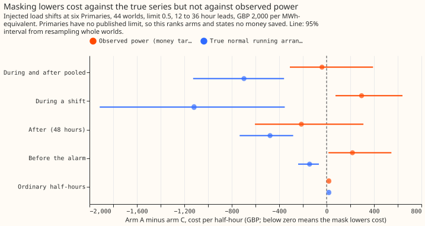
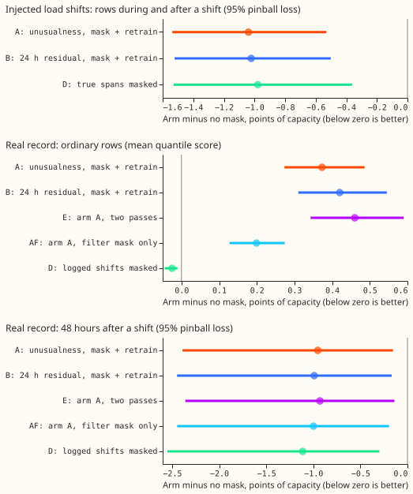

# Is a better load shift detector worth building?

**The evidence does not show that a better detector would change the decision, because the case for
a detector in the forecast is not yet made on curtailment cost.** The current label-free detector
(it uses no NGED switching log) finds 25 of the 35 real load shifts lasting over 1 day. Masking the
readings it flags (treating them as missing in the Kalman filter) lowers the forecast error during
and after injected shifts from 1.79 to 1.04, in points of effective capacity on the 95% pinball
loss, where lower is better. Against the power the electricity network actually carries, the mask
shows no clear change in curtailment cost.

A load shift is a switching operation that moves part of one substation's demand onto neighbouring
substations for hours or days. The normal running arrangement (NRA) is the network as normally
configured. Injected load shifts are shifts we add to real power series, so their size and timing
are known; the real record has 35 logged shifts over 1 day. Gains during a shift come mostly from
injected shifts, and one Primary substation (anonymised as D11) carries part of the main result.
Each question below has one answer, one figure, and the experiments behind them.

## 1. Does perfect knowledge of load shifts help?

**For the NRA forecast, perfect knowledge lowers the error during and after a shift, but by far less
than predicted and by almost nothing over a year.** The error falls by 1.50 points (95% interval
1.08 to 1.96) in the 48 hours after a transfer ends and by 1.46 points (0.69 to 2.29) during it,
against a predicted 3 points or more. Averaged over a year it falls by about 0.005 points, because
shifts are rare ([experiment
208](../../00208-switching-value-of-a-detector-by-phase-and-quality/result.md), verdict not
supported).

**For curtailment cost, the answer depends on the series the forecast is judged against.** Against
the true NRA series, masking the shifts a label-free detector finds lowers cost by 32.8% (95%
interval 17% to 53%). Against observed power, which a curtailment instruction responds to, the
change is -3.0% (-24% to +30%) and ordinary half-hours cost 1.3% more ([experiment
332](../../00332-lsc-curtailment-cost-of-label-free-mask/result.md)). Perfect knowledge beats the
best forecast with no detector on observed power only when the true moved megawatts are also added
back, by 6.5% (3.9 to 9.2; [experiment
297](../../00297-lsc-need-a-detector-no-detector-arms-against-the-mask/result.md)). The real record
at the D13 bulk supply point is too small to resolve a cost difference ([experiment
332](../../00332-lsc-curtailment-cost-of-label-free-mask/result.md)).

## 2. Do we need an explicit detector?

**This is not settled.** The label-free pipeline has not been run against the best forecast with no
detector, and the existing evidence points both ways.

**A forecast that recalibrates its bands with no detector matches or beats masks on the upper-tail
score near a shift.** Within 7 days of a shift, a quantile head (a small model that predicts
forecast quantiles from the Kalman filter's recent correction) beats the RO-NC mask on the
upper-tail score. RO-NC is the earlier switching detector built on neighbouring-substation counts.
The head also beats the perfect mask, but that margin disappears when one Primary (D16) is left out
([experiment 297](../../00297-lsc-need-a-detector-no-detector-arms-against-the-mask/result.md)).

**A label-free detector plus a mask beats a Kalman filter with no mask.** During and after injected
shifts the 95% pinball loss falls from 1.79 to 1.04, against 0.81 when the true spans are masked.
Without D11 the loss falls by 0.30 points instead of 0.75. The change on ordinary real days is
-0.016 points (98.75% interval -0.060 to +0.010), so the harm-side end is within the ±0.05 bar
([experiment 327](../../00327-lsc-label-free-detect-mask-train-pipeline/result.md), verdict partly
supported, scored on past weather and not on ensemble weather).

**The disagreement between the two forecasts cannot choose which forecast to use.** One forecast
uses recent power and the other does not. A rule on their disagreement recovered none of the gain
from choosing with the true answer, and the disagreement adds no information beyond the residual of
measured power ([experiment
309](../../00309-lsc-two-forecast-gap-choosing-without-truth/result.md)). As a detector, the 24-hour
mean residual is the better signal: it matches 20 of the 35 real shifts, against 11 for the
disagreement ([experiment 308](../../00308-lsc-two-forecast-gap-as-a-detector/result.md)).

## 3. How good must a detector be, and is ours good enough?

**On curtailment cost against the no-detector head, a mask needs to find about half the shifts.**
With the true megawatts added back, the mask still beats the head when it finds half the shifts or
when it raises false alarms at 1 in 2. It also wins with a 3-day delay (gain 1.4%, 0.3 to 2.5), and
with the megawatts wrong by 50%. It loses at 25% found. On the upper-tail score, a 2-day delay or a
50% megawatt error removes the margin ([experiment
312](../../00312-lsc-how-good-must-a-detector-be-against-the-band-head/result.md)).

**The label-free detector finds more than half of the real shifts, but the bar was measured on
injected worlds with the true megawatts.** The label-free detector finds 25 of the 35 real shifts at
8.8 alarms per found shift ([experiment
327](../../00327-lsc-label-free-detect-mask-train-pipeline/result.md)), and 15 of the 19
long-and-deep ones. The label-free mask adds no megawatts, and adding them did not help in
experiment 332. On the injected worlds RO-NC found 33% of the shifts, and a signal based on how far
power sits in the forecast's bands found 37%, with about 90% of its alarms false ([experiment
312](../../00312-lsc-how-good-must-a-detector-be-against-the-band-head/result.md)).

**Checking neighbouring substations removes a third of the false alarms.** The check removes 30% to
37% of the 24-hour residual detector's false alarms and loses none of the real shifts it found
([experiment 315](../../00315-lsc-neighbour-residual-filter/result.md)).

**Detectors based on the daily mean residual do no better on long, deep shifts.** They match 8 to 12
of the 19 long-and-deep real shifts and are clearly worse on the other 16 ([experiment
298](../../00298-lsc-long-deep-detector-and-refit-cleaning/result.md), verdict not supported). A
forecast refitted monthly absorbs long shifts: for a 30-day transfer of 25% of demand it absorbs 19%
of the shift. It absorbs 10% to 13% if the flagged days are left out of the refit, and 2.8% if the
true shift days are left out.

## What is still open

- **The pipeline against the no-detector head.** This comparison decides question 2, and no
  experiment has run it.
- **A curtailment-cost saving against observed power.** None is shown for the label-free mask.
  Whether NGED's cost is judged against the NRA or against observed power decides whether masking
  pays.
- **Injected shifts carry most of the evidence.** Injected shifts may be easier to detect than real
  ones, and the real record cannot score the gain during a shift.
- **Message for NGED.** A forecast refitted monthly partly learns shifts of 14 days or more as
  normal.
