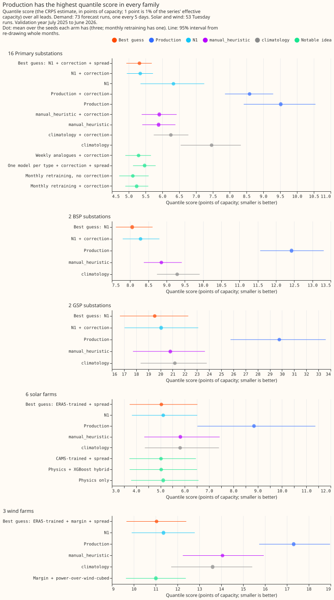
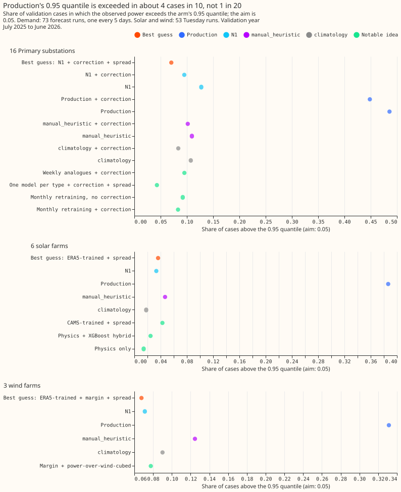

# Production reference and best guess

**The stored production-style forecast (`xgboost_baseline`) is much less accurate than recipes we
can already build.** The best recipe tested in this theme, BG2, scores 5.26 points of capacity at 16
Primary substations. BG2 is the recipe assembled in experiment 87 from the best earlier ideas. The
stored production-style forecast scores 10.54, and NGED's `manual_heuristic` (a forecast that copies
the power at the same time of day in earlier weeks and years) scores 6.18. The score is the quantile
score: twice the mean pinball loss (the standard error measure for a quantile forecast) over 11
quantile levels (9 in set A, below), in points of capacity, where 1 point is 1% of a series'
capacity and smaller is better. A Primary substation steps 33 kV or 66 kV down to 11 kV. A bulk or
grid supply point (supply point below) is a substation where the transmission network feeds the
distribution network.

**Terms used below.** N1 is an XGBoost quantile model per series, trained on the control member (the
unperturbed run) of the European Centre for Medium-Range Weather Forecasts (ECMWF) ensemble forecast
(ENS), with the power measured at the forecast origin as inputs. The correction adds the mean error
of the previous 14 days to every quantile. The half-life of 0.5 years makes a training row's weight
halve for every 0.5 years of age. The spread factor of 1.15 widens the forecast quantiles about the
median by 15%. The stack is N1 with the correction, the half-life, and the spread factor. A frozen
model is trained once and not refitted. The best guess of experiment 33 is the stack for Primary
demand, N1 alone for supply points, and a mixture of models trained on ERA5 (an estimate of past
weather) for solar and wind farms.

**Most of the gain comes from the 14-day correction, and weekly refitting adds a little more.** In
[experiment 87](../../00087-bg2-best-guess-assembled-with-drop-one-ablations/result.md), the 14-day
correction on a frozen XGBoost model lowers the Primary score by 1.38 of the total 1.67 points, and
weekly refitting by a further 0.12. The frozen model there already has the spread factor, and
whether its half-life differs from the stack's is unconfirmed. Against the production-style
forecast, [experiment 33](../../00033-best-guess-architecture-vs-production/result.md) attributes
only 1.38 of 4.89 points to the correction, and does not say what causes the rest. Only one
validation year (July 2025 to June 2026) has been scored, and several settings were chosen on that
year, so the gains are probably optimistic. Nothing from this theme is adopted in production, and no
experiment confirmed that the stored production-style forecast is the forecast that was deployed.

**Two sets of absolute scores appear below, and they are not comparable.** Experiments 13, 19, 22,
and 33 (set A) use 9 quantile levels. Their Primary and supply-point scores use 73 forecast runs
made every 5 days, and experiment 33's solar and wind farms use 53 Tuesday runs, so its farm
contrasts and its Primary contrasts are on different row sets. Experiment 87 (set B) uses 11 levels
and 292 daily runs. The [Experiments](experiments.md) page lists every experiment in the theme with
its verdict.

## Does it work?

**The recipes tested beat the production-style forecast for every target class, and at Primary
substations most of the gain comes from the 14-day correction.** The findings follow.

**The production-style forecast loses to a simple rule.** In [experiment
13](../../00013-primary-demand-against-stored-baselines/result.md), on the error of the median, the
production recipe was 1.69 points worse than `manual_heuristic` (99% interval +0.98 to +2.59; 16
Primary substations). N1 did not beat `manual_heuristic` with an interval that excludes zero (+0.22,
-0.54 to +0.97), so that verdict was inconclusive. Every arm forecast the validation year 1.3 to 3.1
points too low.

**A correction from the previous 14 days of errors supplies nearly all of the early gain.** In
[experiment 19](../../00019-primary-demand-stack-vs-manual-heuristic/result.md) the correction
lowered N1's quantile score by 0.99 points (set A), and the stack beat `manual_heuristic` by 0.56
(99.44% interval -0.93 to -0.26). The half-life added nothing to a frozen model, and the spread
factor lowered the score by 0.03 to 0.05 points.

**The best guess of experiment 33 beats the production-style forecast by a wide margin.** It lowered
the quantile score below production's by 4.89 points for Primary demand (98.33% interval -5.66 to
-4.06), 3.81 for solar (-5.07 to -2.64), and 6.27 for wind (-7.65 to -5.28), each wholly below its
threshold. The contrasts use the cases of the two arms compared, whereas the absolute scores (best
guess 5.32, production 9.52) use the cases every arm holds, so a contrast and the difference of two
scores are not equal. The solar and wind contrasts use the 53 Tuesday runs. The best guess's gain
over N1 alone is mostly the correction: 1.45 points for Primary demand (set A). Monthly retraining
without the correction scored 5.12 on one seed against 5.32 for the best guess, which is a lead and
not a ranking.

**The production-style forecast's bands are far too narrow, and the best guess fixes most of that.**
Production's 0.95 quantile was exceeded in 49% of Primary cases, 39% of solar cases, and 33% of wind
cases, where the aim is 5%. The best guess exceeded it in 7%, 4%, and 7% (experiment 33).

**BG2 is the second best guess: weekly refitting lowers the Primary and supply-point error, and a
five-model blend lowers the Primary error again.** In experiment 87, BG2 beat the previous best
forecast by 0.283 points at the 16 Primary substations (98.75% interval -0.425 to -0.146) and by
0.634 at the 4 bulk and grid supply points (-1.111 to -0.279; set B). Refitting (retraining the
XGBoost model on newer data) weekly instead of monthly lowered the Primary score by 0.123 (95%
interval 0.051 to 0.202). Adding the blend (a level-by-level average of five models' quantiles, used
only at Primaries) to the weekly refit lowered the score by a further 0.086 (0.038 to 0.135), and
removing the blend from the final BG2 raised the score by 0.091 (0.048 to 0.138). The solar offset
(the forecast output of the unmetered solar panels behind a substation) lowered the score by only
0.010 over the whole year, against 0.10 to 0.15 predicted.

**The solar and wind farm models cannot yet be ranked.** Training on the ensemble's own history
scored 0.050 points worse at 6 solar farms (98.75% interval -0.125 to +0.168) and 0.228 worse at 3
wind farms (-0.178 to +0.653) than experiment 33's ERA5-trained mixture. Neither interval rules out
a loss above the margin we would accept (0.10 for solar, 0.30 for wind), so the verdict of
experiment 87 is partly supported.

**Better weather would add little for Primary demand, but a model retrained on ERA5 might gain
more.** In [experiment 22](../../00022-era5-weather-ceiling-primary-demand/result.md), ERA5 weather
in place of ENS weather lowered the score by 0.10 points (99.38% interval -0.16 to -0.04), nearly
all from shortwave radiation, and did not help within 2 days. That demand model was trained on ENS
weather. In experiment 33, a demand model retrained on ERA5 and fed ERA5 lowered the score by 0.27
against an ENS-trained N1 refitted with the correction (99.38% interval -0.44 to -0.11). ERA5
arrives about 5 days late, so both results are ceilings for a weather product as accurate as ERA5,
and neither is a usable product. Experiment 33 found a larger ceiling for wind (5.46 points).

**Metering unit (MVA or MW) and skill: the pre-registered test was inconclusive, and 8 MVA series
against 8 MW series cannot separate the cause.** An MVA-only meter records the magnitude of the flow
and not its direction. In [experiment
56](../../00056-mva-only-primaries-skill-against-mw-primaries/result.md), skill is the percentage by
which the best guess's quantile score is lower than `manual_heuristic`'s. At sunny middays (April to
September, 10:00 to 13:30 UTC), skill was 5.6 percentage points lower at the 8 MVA series than at
the 8 MW series (95% interval -5.0 to 14.6, resampling months). The experiment found no evidence of
a need for special handling of MVA-only Primaries and cannot rule out a loss of up to about 15
percentage points. Across all hours the gap was 10.5 (2.1 to 17.5, resampling months), and one MW
series with 31% skill accounts for most of it. When series are resampled instead of months, both
intervals include zero (sunny middays -2.8 to 14.0; all hours -2.0 to 20.2).

## Best design so far

**BG2 is the best of the recipes tested in this theme for Primary substations and supply points, and
no recipe is yet ranked for solar and wind farms.**

- **Primary substations:** a quantile blend of five XGBoost models, with an explicit solar offset at
  the 5 substations that have a clean solar capacity. The members are a weekly-refitted model, a
  monthly-refitted model, an analogue model (which forecasts from past days with similar weather), a
  model pooled over all substations of the same type, and the frozen stack (the stack, trained once
  and not refitted). The analogue model forecasts each day from past days with similar weather.
  Score 5.260 against 5.543 for the frozen stack (experiment 87, set B).
- **Bulk and grid supply points:** the weekly-refitted XGBoost model with no correction. Score
  12.925 against 13.559 for the frozen stack (experiment 87).
- **Solar and wind farms:** no winner. The ERA5-trained mixture of experiment 33 and the
  ensemble-trained model of experiment 87 are within each other's intervals.

## Candidates for production

**Experiments 19, 33, and 87 are marked `candidate`; none is adopted.** The evidence supports these
changes for consideration.

- **Primary demand:** a candidate is to add the 14-day correction and the spread factor of 1.15 to
  the single-stage ENS-trained quantile model (experiments 19 and 33). Tail skill needs checking
  when porting the correction, because it raised production's threshold-weighted continuous ranked
  probability score (CRPS, a score for the upper tail) above the 99th percentile of each series'
  power from 0.067 to 0.107 (experiment 33).
- **Primary and supply-point demand:** a candidate is to refit weekly instead of monthly, and to
  serve the five-model blend at Primaries (experiment 87).
- **Supply points:** a candidate is to serve the model without the correction (experiment 87).
- **Solar and wind farms:** either the ERA5-trained mixture (experiment 33) or the ensemble-trained
  model (experiment 87) beats the production-style forecast, and which to serve is unresolved. A
  candidate for wind is to add the power-curve margin (a starting prediction taken from the turbine
  power curve) to the ensemble-trained model, which lowered the wind score by 0.057 (0.024 to 0.098;
  experiment 87). The solar bands need recalibration before use, because BG2's 0.05 and 0.95
  quantiles cover 0.028 and 0.973 of the actuals (experiment 87).

Experiments 13, 22, and 56 are `not-for-production`.

## Gotchas and implementation details

- **Score every arm on the same cases.** In [experiment
  33](../../00033-best-guess-architecture-vs-production/result.md), the stored production forecast
  lacked 124 of 282,916 solar and wind cases and `manual_heuristic` lacked 195 of them, so each
  family was scored on the cases every arm holds. Scoring each arm on its own cases would compare
  different rows. Recheck the case counts when a new arm has a different set of runs or ensemble
  members.
- **Compare against `manual_heuristic` as well as production.** Production scored 9.52 and
  `manual_heuristic` 5.89 in [experiment
  13](../../00013-primary-demand-against-stored-baselines/result.md) and [experiment
  33](../../00033-best-guess-architecture-vs-production/result.md) (set A), so a gain over
  production alone overstates how good a new XGBoost model is. Recheck the production score if the
  production recipe changes.
- **Do not add the 14-day correction to supply points without a new test.** Adding it raised BG2's
  supply-point score by 0.305 (95% interval 0.060 to 0.594) in [experiment
  87](../../00087-bg2-best-guess-assembled-with-drop-one-ablations/result.md), and [experiment
  33](../../00033-best-guess-architecture-vs-production/result.md) found no gain there (+0.38, -0.12
  to +0.92). Experiment 87 lists no farm correction ablation, so the correction at farms is
  untested. Test it again on a second validation year, or with more than 4 supply points.
- **Build the correction history from daily forecasts.** In [experiment
  19](../../00019-primary-demand-stack-vs-manual-heuristic/result.md), runs were 5 days apart, so
  past errors had leads of 0 to 5 days and were probably larger than a daily service would see.
  [Experiment 87](../../00087-bg2-best-guess-assembled-with-drop-one-ablations/result.md) uses 292
  daily runs, and its assembly script builds each run's correction from the runs before it. The
  correction on a frozen model still lowered the Primary score by 1.38. Test the correction again if
  the forecast service runs less often than daily.
- **Treat settings tuned on the scored year as optimistic.** The spread factor of 1.15, the blend
  scheme, the choice of which 5 Primaries get the solar offset (the offset gate), and the half-life
  were chosen or scored on the validation year in [experiment
  87](../../00087-bg2-best-guess-assembled-with-drop-one-ablations/result.md), so its gains are
  probably too large. Score the recipe again on a later validation year.
- **Read a staircase and a drop-one ablation separately.** A staircase adds one idea at a time to
  the frozen model; a drop-one ablation removes one idea from BG2. Adding the blend lowers the
  staircase score by 0.086, and removing it from the final BG2 raises the score by 0.091, because
  each starts from a different forecast ([experiment
  87](../../00087-bg2-best-guess-assembled-with-drop-one-ablations/result.md)). Reading the two as
  one gain misattributes it. Compare the two again whenever a new member joins the blend.
- **Report the tail coverage and the pinball loss at the 0.01, 0.05, 0.95, and 0.99 quantiles, as
  well as the quantile score.** Tail coverage is the share of actual values below or above a
  quantile. The quantile score alone hid that BG2's solar bands are too wide ([experiment
  87](../../00087-bg2-best-guess-assembled-with-drop-one-ablations/result.md)) and that the
  production band covers only 10% to 20% of cases ([experiment
  33](../../00033-best-guess-architecture-vs-production/result.md)). Report the tails again for any
  new weather source or target class.
- **Do not rely on the production-style row until its origin is confirmed.** [Experiment
  87](../../00087-bg2-best-guess-assembled-with-drop-one-ablations/result.md) read it from a stored
  forecast table of unconfirmed origin, so its score of 10.54 may not match the deployed forecast.
  Compare it again with the stored forecasts of the current production model.

## What we have not settled

- Whether the correction and the weekly refit hold their gains on a second validation year.
- Which training source to use for solar and wind farms, which needs more than 6 solar and 3 wind
  farms.
- Whether the solar offset helps on daylight rows from April to September.
- Whether MVA-only metering hurts the forecast, which needs more than 8 MVA series.

The [Research plan](plan.md) lists what is planned next.
