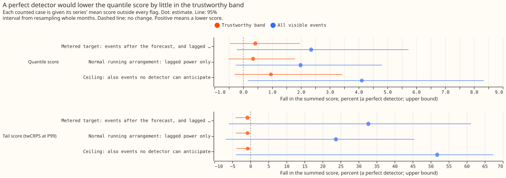
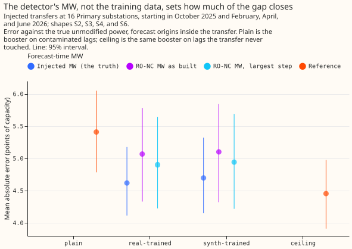

# Switching labels in the forecast

**Giving the Primary demand forecast switching labels has not yet improved it on real data. On
injected transfers it recovers the lost accuracy only when the megawatts (MW) moved are known: it
closes 83% of the extra error with the true MW, against 16% (interval -17% to +67%, so not
distinguishable from zero) with the MW from the RO-NC detector.**

A [load transfer](../../glossary.md#injected-and-real-load-transfers) moves part of one [Primary
substation's](../../glossary.md#primary-substation) demand onto its neighbours for hours or days.
The question is whether telling the XGBoost forecast about transfers lets it forecast the demand the
[normal running
arrangement](../../glossary.md#abnormal-running-arrangement-ara-and-normal-running-arrangement-nra)
would have carried. The labels come from NGED's logs or from the [RO-NC](../../glossary.md#ro-nc)
detector, whose own results are on the [switching detectors](../switching-detectors/index.md) page.
All results are from the lab: 16 Primary series, one validation year (292 daily forecast runs, July
2025 to June 2026), and labels that use hindsight.

**The share of the extra error recovered depends on where the MW comes from: 50% to 83% with the
true MW, 16% to 36% with RO-NC's MW as built (intervals include zero), and 43% with the largest
overlapping step (chosen after seeing the results).** The extra error (the "gap") is the error of
the plain forecast minus the error of the same forecast on unmodified lags (the "ceiling"). Source:
[experiment
88](../../00088-sw2-21-nra-forecast-recovers-normal-arrangement-during-and-after-injected-switches/result.md).

## Does it work?

**On real data, no label-based change lowered the score by an amount the data can show.** A label
source is "oracle" when it is NGED's logs and "detector" when it is RO-NC. The score is the
[quantile score](../../glossary.md#quantile-score-and-pinball-loss) in
[points of capacity](../../glossary.md#capacity-and-points-of-capacity); a positive change is a
worse forecast.

- **Dropping labelled switching from the training targets, or adding the moved MW, changed the score
  outside switching by under 0.06.** Masked minus plain was +0.004 (98.33% interval -0.026 to
  +0.025); only 22 of the 82 labelled events fall in the scored year ([experiment
  75](../../00075-sw2-11-nra-forecast-with-labelled-switching-masks/result.md)).
- **On the 37,394 half-hours whose lag (an earlier power reading used as an input) lies inside a
  logged event, no correction was shown to help.** Oracle labels changed the score by -0.29 (98.33%
  interval -2.06 to +0.68) and detector labels by +0.48 (-0.06 to +1.72). Outside switching, the
  detector labels raised the score by 0.056 (+0.016 to +0.126). The detector marks 8.1 times as many
  half-hours as the logs, and 15% of the logged ones ([experiment
  86](../../00086-sw2-12-detector-labels-for-nra-forecast/result.md)).
- **A perfect detector would lower the [best guess's](../../glossary.md#best-guess) quantile score
  by 0.42% (95% interval -0.47% to 1.96%)** on events moving 25% or more of the receiver's load for
  over a day, against a 3% threshold. Those events touch 3 of the 16 series, and if events on badly
  metered substations are dropped, 2 remain and every bound's point estimate lies between -0.3% and
  -0.1%. For all 22 visible events the bound is 2.35% (-0.22% to 5.73%), resting on a few short
  events ([experiment 44](../../00044-sw2-2-switching-share-of-best-guess-score/result.md)).

**A perfect detector would lower the quantile score by little in the band of events the labeller
finds most reliably.** Source: experiment 44.

**Two ways of marking suspect lags without a hand label did not help.** A probability that a lag
lies inside a transfer, built from the causal RO-NC detector, lowered the Brier score (the mean
squared error of a probability) by 3.3% against the yes-or-no flag (97.5% interval -7.6% to +1.6%)
where the plan needed 20%, and its area under the curve against NGED's logs was 0.53 ([experiment
91](../../00091-sw2-26-calibrated-probability-of-abnormal-arrangement/result.md); the 11.2% gain
reported there is a post hoc subset). Giving the forecast the unusualness of each lag against a
climatology raised the score by 0.355 (97.5% interval +0.209 to +0.513) and narrowed the band on
rows with a lag in a logged event ([experiment
90](../../00090-sw2-28-lag-unusualness-inputs-all-rows-and-switching/result.md); verdict refuted).

**On injected transfers, the true MW recovers most of the error and the detector's MW does not.**
The cases are forecast origins inside a transfer (2,452 cases from four onset months), scored
against the unmodified power. The XGBoost model trained on NGED's logged transfers and given the
true MW scored -0.790 points against plain (98.75% interval -1.397 to -0.412), closing 83% (70% to
91%) of the gap. With RO-NC's MW, the model trained on RO-NC's transfers scored -0.149 (-1.174 to
+0.148, negative in 2 of 4 months). Counting overlapping detector intervals once, chosen after
seeing the results, gave -0.406 (-1.223 to -0.083). After a transfer ended, the as-built MW raised
the error by 0.35 to 0.46 for up to 7 days (experiment 88).

**Adding about three times as many synthetic transfers to the training data did not help.** The
synthetic-trained model scored +0.079 (98.75% interval -0.031 to +0.153) against the real-trained
model with the true MW, and +0.032 (-0.019 to +0.067) with RO-NC's MW. The MW source set the share
of the gap closed (83% with the true MW, 32% to 53% with the detector's). Source: [experiment
96](../../00096-sw2-23-synthetic-switches-injected-into-training/result.md).

**Hiding lags that lie inside a transfer made the forecast worse.** Setting them to missing raised
the score by 0.409 (98.33% interval +0.281 to +0.517) on rows with such a lag, and training on all
history since March 2021 instead of 12 months changed it by +0.009 (-0.052 to +0.069) ([experiment
89](../../00089-sw2-22-longest-history-nra-forecast-with-ara-lags-masked/result.md)). Hiding lags
at random during training did not widen the 5% to 95% band on rows with a missing lag: its
[coverage](../../glossary.md#coverage) was 0.799 for the plain forecast and 0.802 with 10% of
training rows hidden, against 0.90 nominal ([experiment
100](../../00100-drop1-random-lag-dropout-widens-intervals/result.md); inconclusive).

## Best design so far

**The best of the recipes tested here, on injected transfers only, corrects each lag by the MW
moved, using the largest overlapping detector step as the MW.** In experiment 88 this
(post hoc) closed 43% (17% to 71%) of the gap with the RO-NC-trained model, and correcting the lags
alone closed 48% (18% to 71%). The recipe:

1. Subtract the signed MW at each lag from the lag, and give the three MW values as columns
   (experiments [75](../../00075-sw2-11-nra-forecast-with-labelled-switching-masks/result.md),
   [88](../../00088-sw2-21-nra-forecast-recovers-normal-arrangement-during-and-after-injected-switches/result.md)).
2. Take one MW per half-hour from the largest overlapping step, not the sum (experiment 88).
3. Do not also drop the transfer's half-hours from the training targets: it added +0.070 (-0.015 to
   +0.171) over lag correction alone (experiment 88).

No recipe has beaten the plain forecast on real logged events.

## Candidates for production

**Nothing is ready for the serving path.** All 9 experiments of this theme are
`not-for-production`: each uses hindsight labels, and the detector's residual uses
[ERA5](../../glossary.md#ens-era5-and-cams) weather, which arrives about 5 days late. The evidence
does not support a detector or a label table in the forecast.

## Gotchas and implementation details

- **Do not set lags inside a labelled switching event to missing.** The forecast got worse on rows
  with such a lag and on rows outside switching ([experiment
  89](../../00089-sw2-22-longest-history-nra-forecast-with-ara-lags-masked/result.md), +0.054
  outside switching; the `mask` arm of [experiment
  100](../../00100-drop1-random-lag-dropout-widens-intervals/result.md) lost 1.36 points on injected
  transfers). Random dropout in 30% of training rows removed that loss. Re-check with a model
  trained to read missing lags.
- **Count the half-hours a label source marks before using it to mask or correct.** The union of
  RO-NC and the logs marks 9% to 16% of half-hours per year from 2022, RO-NC alone marks 8.1 times
  the logged half-hours, and masking on the union raised the error ([experiment
  89](../../00089-sw2-22-longest-history-nra-forecast-with-ara-lags-masked/result.md), [experiment
  86](../../00086-sw2-12-detector-labels-for-nra-forecast/result.md)). Re-check with a detector that
  marks about as many half-hours as the logs.
- **Take one MW per half-hour from the largest overlapping detector step, not the sum.** The
  as-built MW, which adds overlapping intervals, did not beat the plain forecast (-0.149, -1.174 to
  +0.148), and the largest step did (-0.406, -1.223 to -0.083), though that choice was post hoc. A
  lingering return step kept the correction on after a transfer ended ([experiment
  88](../../00088-sw2-21-nra-forecast-recovers-normal-arrangement-during-and-after-injected-switches/result.md);
  the loss comes from the 21% of marked cases with overlapping intervals, not from a scale error in
  the MW). The 16% result rests on February 2026, and the oracle contrast C2
  keeps its size when any of the four months is left out.
- **A detected transfer is known late.** At the newest usable lag the detector had marked 32% of the
  moved MW in the first 24 hours after onset, against 73% in days 1 to 3 (experiment 88), and its
  probability separated poorly in that first day (area under the curve 0.61 for the calibrated
  probability and 0.60 for the flag; [experiment
  91](../../00091-sw2-26-calibrated-probability-of-abnormal-arrangement/result.md)). A gain scored
  with hindsight ends is therefore an upper bound ([experiment
  75](../../00075-sw2-11-nra-forecast-with-labelled-switching-masks/result.md)). Re-check on live
  data or with an end rule that needs no hindsight.
- **Score a forecast of the normal running arrangement against real data only outside events.** Real
  rows inside an event have no valid normal-arrangement truth, so experiments 75, 86, and 100 score
  real rows outside events and use injected transfers for the rest ([experiment
  100](../../00100-drop1-random-lag-dropout-widens-intervals/result.md)). Re-check if a source of
  the true normal-arrangement power appears.
- **Count events, not half-hours, and expect wide intervals.** The 37,394 rows with a lag in a
  logged event come from an estimated 15 to 20 events, 81% of them from 3 substations ([experiment
  100](../../00100-drop1-random-lag-dropout-widens-intervals/result.md)). Six trustworthy events
  fall in the scored year, and without those where a donor or receiver has over half its readings
  missing, 2 remain and every bound lies between -0.3% and -0.1% ([experiment
  44](../../00044-sw2-2-switching-share-of-best-guess-score/result.md)). Injected scores rest on 4
  onset months (experiments 88 and 96), so read the sign in each month. Re-check on a longer period.
- **Run a same-code repeat of the control arm before reading a change under about 0.05.** Only 9% of
  per-case scores from a graphics-card refit matched experiment 48's to 0.001, the largest gap was
  4.39 points, and the +0.004 of masked minus plain is at the level of that noise ([experiment
  75](../../00075-sw2-11-nra-forecast-with-labelled-switching-masks/result.md)). Re-check if the fit
  is made deterministic.
- **Give any "drop the event rows" arm a control that keeps them.** The `mask` arm, which also
  dropped 9% of training rows, narrowed the band on unmasked rows by 4% and lowered its coverage
  from 0.906 to 0.894 ([experiment
  100](../../00100-drop1-random-lag-dropout-widens-intervals/result.md)). Without the control, the
  effect of dropping rows is credited to masking lags. Re-check with the control run.
- **Report the pre-registered rows first, and name a post hoc subset.** Experiment 91's 11.2% gain
  is on rows chosen after seeing the results; the planned rows gave 3.3% with an interval including
  zero ([experiment
  91](../../00091-sw2-26-calibrated-probability-of-abnormal-arrangement/result.md)). Re-check
  against the plan's decision rule.

## What we have not settled

- Whether the detector's MW, with each transfer counted once and ended promptly, recovers more than
  the 43% of the gap that the post hoc rule did in experiment 88.
- Whether any label improves the forecast on real transfers: the logged events in a year are too
  few ([experiment 86](../../00086-sw2-12-detector-labels-for-nra-forecast/result.md)).
- Whether a missing-lag indicator column, or a separate XGBoost model of the quantile spread,
  widens the band where a lag is missing ([experiment
  100](../../00100-drop1-random-lag-dropout-widens-intervals/result.md)).
- Whether synthetic transfers trained with the detector's errors, not the exact MW, help
  ([experiment 96](../../00096-sw2-23-synthetic-switches-injected-into-training/result.md)).

The [Research plan](plan.md) lists what is planned next, and the [Experiments](experiments.md) page
lists every experiment.
